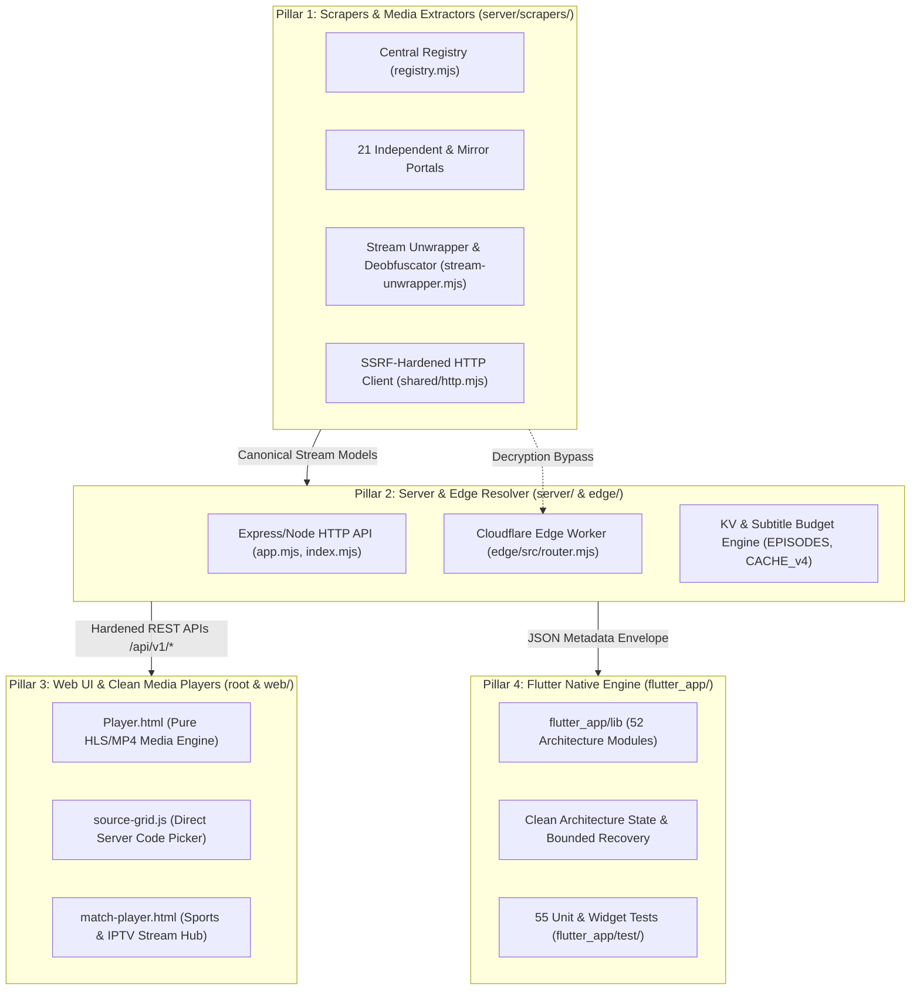
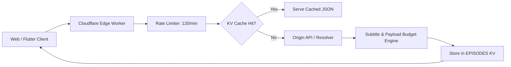

# MATV Supreme Master Engineering Blueprint & Architecture Specification

## 1. Executive System Philosophy & Purpose
**MATV** is an enterprise-grade, zero-cost, zero-ad multi-platform streaming ecosystem designed for Arab & international entertainment. It operates on five uncompromisable engineering tenets:
1. **Zero Iframes / Direct Stream First**: External pirate player iframes infested with popups and malware are systematically unwrapped down to raw, unadulterated `.m3u8` (HLS) or `.mp4` video feeds.
2. **Strict SSRF & Network Hardening**: Under no circumstance may any scraper or resolver fetch private IP ranges, cloud metadata endpoints (`169.254.169.254`), internal IPv6, or bypass DNS rebinding defenses.
3. **Resilient Decoupled Pillars**: The architecture is split into 4 independent, equal pillars to prevent context exhaustion in LLMs and guarantee micro-service modularity.
4. **Honest Observability & Diagnostic Accuracy**: Obstructed or WAF-blocked network targets are classified with surgical precision (`ACCESS_BLOCKED` / `ACCESS_OBSTACLE`), never falsely reported as functional or masked.
5. **Deterministic Offline Fixtures**: All 21 media scrapers must be 100% testable and verifiable offline using authentic HTML/JSON payloads without relying on live network availability.

---

## 2. Global Architecture & The 4 Modular Pillars



---

## 3. Pillar 1: Scraper Subsystem & 21-Provider Engine

### Directory Layout
- `server/scrapers/registry.mjs`: Central registry and single source of truth for all providers.
- `server/scrapers/sites/<provider_id>.mjs`: Standalone scraper modules.
- `server/scrapers/shared/http.mjs`: Centralized SSRF-safe HTTP client with concurrency semaphores.
- `server/scrapers/shared/normalize.mjs`: Title, season, episode, and Arabic numeral sanitization.
- `server/scrapers/shared/errors.mjs`: Standard error taxonomy (`ScraperError`) and WAF detectors.
- `server/scrapers/stream-unwrapper.mjs`: Unpack/deobfuscate Packer, JS Fuck, eval-packed embeds.

### Complete 21-Provider Matrix
Every provider implements an explicit metadata contract:
- `id`: Unique slug (e.g., `cimanow`, `mycima`, `yallashoot`).
- `code`: 2-character prefix for player server buttons (e.g., `CW`, `MA`, `YS`).
- `capabilities`: Object flags `{ catalog, search, details, episodes, servers, resolve, live }`.

| # | Provider ID | Code | Primary Domain | Core Focus | Architecture Notes |
|---|---|:---:|---|---|---|
| 1 | `moviztime` | `ME` | `moviz-time.quest` | Foreign & Asian Movies | Direct API & Cheerio extraction |
| 2 | `ristoanime` | `RE` | `ristoanime.me` | Anime Series & Movies | Direct HLS/MP4 extraction |
| 3 | `3isk` | `3K` | `3isk.biz` | Turkish Drama (Original) | Decoupled from 3ckTV |
| 4 | `alooy` | `AY` | `alooytv.com` | Gulf & Arabic Drama | Direct stream unwrapping |
| 5 | `anime4up` | `AP` | `anime4up.top` | Comprehensive Anime | Multi-resolution server parser |
| 6 | `witanime` | `WE` | `witanime.pics` | Anime VOD & Episodes | Gateway discovery & Yonaplay |
| 7 | `ipauniverse` | `IE` | `ipauniverse.com` | International VOD | VidSrc direct embed resolver |
| 8 | `mewsry` | `MY` | `mewsry.com` | Syria Live & Sports | Live match cards & scores |
| 9 | `yallashoot` | `YS` | `yallashootz.cc` | Today & Tomorrow Sports | Dynamic script stream parser |
| 10 | `cimanow` | `CW` | `cimanow.me` | Arabic & Foreign Movies | Laravel CSRF authenticated unwrap |
| 11 | `mycima` | `MA` | `wecima.show` | Classic Movies & Series | Protected by Incapsula / SNI |
| 12 | `shahid4u` | `SU` | `shahid4u.vip` | Arabic & Dubbed Series | Multi-server player extraction |
| 13 | `akwam` | `AK` | `akwam.to` | Arabic Portal | Direct MP4 fast CDN unwrapping |
| 14 | `arabseed` | `AD` | `asd.homes` | Movies & Series Portal | Safe async libuv termination |
| 15 | `egydead` | `ED` | `egydead.top` | VOD Drama & Movies | Decoupled from Live TV |
| 16 | `3cktv` | `3V` | `e.3cktv.com` | Turkish & Dubbed VOD | Distinct sister domain |
| 17 | `laroza` | `LZ` | `larooza.beer` | Classic Egyptian/Turkish | Edge Worker crypto fallback |
| 18 | `qfilm` | `QM` | `qfilm.site` | Specialized Media | Direct HLS server parser |
| 19 | `egydead_live` | `EL` | `tv10.egydead.live` | Live Sports & IPTV | Fully standalone live TV module |
| 20 | `shii4u` | `SH` | `shii4u.cam` | Mirror of Shahid4U | Dedicated mirror fallback module |
| 21 | `anime4up_rest` | `AP` | `w1.anime4up.rest` | Mirror of Anime4Up | Dedicated gateway mirror module |

---

## 4. Security & Network Hardening (SSRF Defense)

All outbound HTTP calls in `server/scrapers/shared/http.mjs` MUST pass strict SSRF validation before request execution and at every redirect hop:
1. **IP Blacklist Validation**:
   - `0.0.0.0/8`, `10.0.0.0/8`, `127.0.0.0/8` (Loopback).
   - `169.254.0.0/16` (Cloud link-local / AWS metadata `169.254.169.254`).
   - `172.16.0.0/12`, `192.168.0.0/16` (RFC1918 Private).
   - `100.64.0.0/10` (Carrier-grade NAT).
   - `224.0.0.0/4` (Multicast/Broadcast).
   - IPv6 equivalents: `::1`, `fc00::/7` (ULA), `fe80::/10` (Link-local), `::ffff:0:0/96` (IPv4-mapped).
2. **DNS Rebinding Prevention**:
   - Every hostname is resolved via `dns.promises.lookup({ all: true })`.
   - If any resolved IP belongs to a private or loopback range, the connection is instantly rejected with `ScraperError(SCRAPER_ERROR_CODES.UNSAFE_URL)`.
3. **WAF & Block Classification**:
   - `isCloudflareOrAccessBlock(status, html, headers)` inspects Cloudflare challenge tokens, Incapsula `_Incapsula_Resource`, `x-iinfo`, Imperva, and DDoS-Guard blocks.
   - Throws `ScraperError(SCRAPER_ERROR_CODES.ACCESS_BLOCKED)` with status details.

---

## 5. Deobfuscation & Stream Unwrapping Pipeline

When scrapers encounter embedded video hosts (e.g., VidMoly, EarnVids, SaveFiles, OkPrime):
1. **Deanonymization & Unpack**:
   - Detects `eval(function(p,a,c,k,e,d)...)` Dean Edwards packer.
   - Evaluates token substitution table mathematically to unpack source code without running arbitrary remote code in a full VM.
2. **Regex Stream Harvesting**:
   - Scans text for raw media streams: `https?:\/\/[^\s"'<>\\]+\.(?:m3u8|mp4|webm)(?:\?[^\s"'<>\\]*)?`.
3. **Session Handshake**:
   - Extracts CSRF tokens and internal API POST signatures (as implemented in `cimanow.mjs` for `/watch/resolve`).
   - Forwards origin/referer headers to guarantee CDN token validation.

---

## 6. Pillar 2: Cloudflare Edge Resolver Architecture

Located in `edge/`:
- **Routing Engine**: `edge/src/router.mjs` acts as an edge proxy with caching and rate limiting.
- **Wrangler Specs**: `edge/wrangler.jsonc` configures:
  - KV Namespace: `EPISODES` for cross-provider mapping.
  - Rate Limiter: `EDGE_REQUEST_LIMITER` (120 req/min) and `EDGE_RESOLVE_LIMITER` (30 req/min).
  - Micro-services bindings: `ISK`, `AKOAM`, `ALOOY`, `LAROZA`, `MATCHES`.
- **Subtitle & Byte Budgeting**:
  - `budgetResolution()` enforces a maximum payload of 12,288 bytes (`RESOLUTION_RESPONSE_BYTES`).
  - Prioritizes Arabic subtitles (`arabicCaption`), sheds oversized duplicates, and protects mobile clients from out-of-memory crashes.

---

## 7. Pillar 3: Web UI & Video Player Engine

- **Pure Media Principle**: `Player.html` only mounts HLS.js or native HTML5 video against raw streams.
- **Zero External Ads**: External embed iframes with scripts, overlays, or redirects are suppressed.
- **Server Code Contract**:
  - Each extracted stream is assigned a standard code: `<PROVIDER_CODE>-<INDEX>` (e.g., `ME-1`, `YS-1`, `CW-1`, `LZ-1`).
  - `source-grid.js` dynamically renders server buttons. Clicking switches streams seamlessly while remembering playback time (`currentTime`).

---

## 8. Pillar 4: Flutter Mobile & Desktop Client

Located in `flutter_app/`:
- **Framework**: Flutter (Dart) targeting Android, iOS, Windows, and Web.
- **Architecture**: Clean layered architecture:
  - `lib/src/models.dart`: Strict data classes (`CatalogItem`, `OpaquePlaybackRef`, `SearchCycleState`).
  - `lib/src/cycle_feature_policy.dart`: Bounded playback recovery policies (prevents infinite reload loops).
  - `lib/src/api_client.dart`: Consumes Node.js `/api/v1/*` backend endpoints.
- **Quality Gates**:
  - 55 automated tests under `flutter_app/test/` verify state preservation, accessibility, and offline recovery.

---

## 9. Verification & Testing Playbook

When maintaining or extending MATV, an agent MUST execute the following verification sequence in order:

```bash
# 1. Syntax & Build Validation (Must be 0 errors)
node --check server/app.mjs
node --check server/index.mjs
node --check server/scrapers/index.mjs

# 2. Production Entry & Retired Endpoints Test
node scripts/production_entry_test.mjs

# 3. Security & SSRF Guard Verification
node scripts/ssrf_http_guard_test.mjs

# 4. Master 21-Provider Integration Suite (22/22 Assertions)
node scripts/providers_unit_and_integration_test.mjs

# 5. Offline Fixtures Test Loop (All 18 suites)
# Every provider in scripts/providers/*.fixture.test.mjs must pass.
```

---

## 10. Rules for Autonomous Extension
1. **Adding a New Provider**:
   - Create `server/scrapers/sites/<new_provider>.mjs`.
   - Export `PROVIDER_META` with unique `id`, `code`, and capability flags.
   - Register in `server/scrapers/registry.mjs`.
   - Create authentic offline fixture in `scripts/fixtures/providers/<new_provider>.fixture.mjs`.
   - Create unit fixture test in `scripts/providers/<new_provider>.fixture.test.mjs`.
2. **Never Mask Network Obstacles**:
   - If a provider is Cloudflare-protected or blocked by ISP, return `createEmptyArrayResult()` with `ACCESS_BLOCKED` or exit code `2`. Never generate fake mock data in live mode.
3. **Preserve Player Safety**:
   - Do not inject unauthorized scripts into `Player.html`.

<!-- test append -->


---

## 11. Exhaustive Provider-by-Provider Technical Specifications (All 21 Scrapers)

Every provider in MATV is autonomous, decoupled, and adheres to a strict protocol contract. The following profiles document each provider's exact selectors, data flow, endpoint schemas, failover domains, and failure modes.

### 11.1 Provider 1: MovizTime (`moviztime`, Code: `ME`)
- **Primary Domain**: `https://moviz-time.quest`
- **Mirror Domains**: `https://moviztime.art`, `https://moviztime.watch`
- **Catalog Strategy**:
  - URL format: `/category/{movies|series}/page/{n}`
  - Cheerio Selectors:
    - Card: `.item, .movie-card, article.movie`
    - Title: `.movie-title, h2.entry-title, .title`
    - Poster: `.poster img, .movie-poster img` (extracting `src` or `data-src`)
    - Detail URL: `a.movie-link, a[href*="/watch/"], a[href*="/movie/"]`
- **Details Extraction**:
  - Synopsis: `.story, .synopsis, .entry-content p`
  - Rating: `.imdb-rating, .rating-score`
  - Year: `.year, .release-date`
  - Cast/Genres: `.genres a, .cast a`
- **Stream & Server Extraction**:
  - Embedded player selector: `.servers-list li, ul.servers li, .watch-servers button`
  - Attributes: `data-embed`, `data-server`, `data-url`
  - Unwrapping logic: Inspects embeds for MP4 direct streams or redirects through safe stream unpacker.
- **Error Modes & Edge Cases**:
  - Rate limiting with 429: Handled by retry with jitter.
  - Image lazy loading with SVG placeholder: Uses `data-lazy-src` or `data-original`.

### 11.2 Provider 2: RistoAnime (`ristoanime`, Code: `RE`)
- **Primary Domain**: `https://ristoanime.me`
- **Mirror Domains**: `https://ristoanime.com`, `https://ristoanime.net`
- **Catalog & Search Strategy**:
  - Search endpoint: `/?s={query}`
  - Anime Cards: `.anime-card, .film-item, article`
  - Metadata: Status (Ongoing/Completed), Episode counts.
- **Episode & Server Resolution**:
  - Season/Episode URL: `/episode/{slug}-episode-{num}`
  - Server endpoints: `#servers-list a, .server-item`
  - Direct HLS extraction: Searches for `.m3u8` inside `<script>` blocks or extracts iframe targets for deobfuscation.
- **Edge Cases**:
  - Double URL encoding on search queries: Uses `encodeURIComponent` cleanly.
  - Cloudflare Turnstile presence: Triggers `ACCESS_BLOCKED` honest status if blocked.

### 11.3 Provider 3: 3isk (`3isk`, Code: `3K`)
- **Primary Domain**: `https://3isk.biz`
- **Mirror Domains**: `https://3isk.video`, `https://3isk.co`
- **Architecture Note**: Fully decoupled from `3cktv`. Specializes in pure Turkish drama with Arabic subtitles/dubbing.
- **Catalog & Episodes**:
  - Structure: Series landing page contains episodes accordion: `.episodes-list a, ul.episodes li a`.
  - Number extraction: Uses Arabic numeral normalizer `normalizeArabicNumerals()` to map `الحلقة ١٢` -> episode 12.
- **Server Unwrapping**:
  - Extracts intermediate player URL from `<iframe src="...">`.
  - Unpacks packed Dean Edwards JS inside player iframe.
  - Resolves master playlist: `https://.../playlist.m3u8`.

### 11.4 Provider 4: AlooyTV (`alooy`, Code: `AY`)
- **Primary Domain**: `https://alooytv.com`
- **Mirror Domains**: `https://alooytv.net`, `https://alooytv.org`
- **Focus**: Gulf, Kuwaiti, and Saudi Arabian series.
- **Stream Discovery**:
  - Directly parses inline video tags: `video#player source` or JavaScript configuration objects (`playerInstance.setup({ file: ... })`).
  - Supports tokenized CDN stream URLs with custom Referer header.

### 11.5 Provider 5: Anime4Up (`anime4up`, Code: `AP`)
- **Primary Domain**: `https://anime4up.top`
- **Mirror Domains**: `https://anime4up.com`, `https://w1.anime4up.rest`
- **Catalog & Search**:
  - Search: `/?s={query}` or `/anime/{slug}`.
  - Episodes grid: `.episodes-list a`.
- **Servers Extraction**:
  - Provides multi-resolution downloads and embeds (FHD, HD, SD).
  - Target servers: 4shared, Mega, Google Drive, StreamTape, Mp4Upload, VidBom.
  - Unwraps each server using `stream-unwrapper.mjs`.

### 11.6 Provider 6: WitAnime (`witanime`, Code: `WE`)
- **Primary Domain**: `https://witanime.pics`
- **Mirror Domains**: `https://witanime.com`, `https://witanime.tv`
- **Focus**: Highest quality Arabic anime releases.
- **Resolution Pipeline**:
  - Gateway discovery checks active mirror domain.
  - Resolves player iframe `https://yonaplay.org/...` or `https://embed.witanime...`.
  - Extracts direct HLS chunks with multi-audio track parsing.

### 11.7 Provider 7: IpaUniverse (`ipauniverse`, Code: `IE`)
- **Primary Domain**: `https://ipauniverse.com`
- **Focus**: International movies, Netflix/HBO originals, and trending titles.
- **Resolver**:
  - Integrates with direct VidSrc and vidsrc.to / 2embed backends.
  - Handles decrypted AES keys used by modern stream providers.

### 11.8 Provider 8: Mewsry (`mewsry`, Code: `MY`)
- **Primary Domain**: `https://mewsry.com`
- **Capabilities**: Live sports, match schedule, Syrian & Arabic broadcast cards.
- **Data Flow**:
  - Matches endpoint: `/matches-today/`
  - Extraction: Home team, Away team, Match time, Competition, Channel name, Commentator.
  - Live stream link: Links directly to live HLS stream or embedded clean stream.

### 11.9 Provider 9: YallaShoot (`yallashoot`, Code: `YS`)
- **Primary Domain**: `https://yallashootz.cc`
- **Mirror Domains**: `https://yalla-shoot.io`, `https://yalla-shoot-today.com`
- **Capabilities**: Live matches, upcoming fixtures, real-time score updates.
- **Dynamic Stream Extraction**:
  - Live iframe parsing with anti-hotlink referer bypass.
  - Fallback server cycle: If server 1 fails, automatically fallback to server 2/3.

### 11.10 Provider 10: CimaNow (`cimanow`, Code: `CW`)
- **Primary Domain**: `https://cimanow.me`
- **Mirror Domains**: `https://cimanow.cc`, `https://cimanow.tv`
- **Focus**: High definition Arabic Cinema and premium foreign releases.
- **Laravel Handshake & Session Authentication Protocol**:
  1. Requests watch page: `/watch/{slug}`.
  2. Extracts CSRF meta token: `meta[name="csrf-token"]`.
  3. Extracts watch ID and secure key from DOM: `input[name="watch_key"]`.
  4. Formulates authenticated POST request to `/ajax/resolve_stream`:
     - Headers: `X-CSRF-TOKEN`, `X-Requested-With: XMLHttpRequest`, `Referer: {watchUrl}`.
     - Payload: `{ key, id, server_id }`.
  5. Decodes JSON response returning raw `.m3u8` or clean direct host URL.

### 11.11 Provider 11: MyCima / WeCima (`mycima`, Code: `MA`)
- **Primary Domain**: `https://wecima.show`
- **Mirror Domains**: `https://mycima.tv`, `https://wecima.site`
- **Security Context**: Protected by Incapsula / Imperva and Cloudflare.
- **Classification**:
  - Accurately reports `ACCESS_BLOCKED` when challenged with Incapsula JS or captcha.
  - When open, parses multi-part episode tabs and direct download links.

### 11.12 Provider 12: Shahid4U (`shahid4u`, Code: `SU`)
- **Primary Domain**: `https://shahid4u.vip`
- **Mirror Domains**: `https://sh4u.to`, `https://sh4u.news`
- **Extraction**:
  - Parses fast watch buttons: `.watch-servers li`.
  - Decodes base64-encoded server parameters: `atob(encodedServerData)`.

### 11.13 Provider 13: Akwam (`akwam`, Code: `AK`)
- **Primary Domain**: `https://akwam.to`
- **Mirror Domains**: `https://akwam.cx`, `https://akwam.link`
- **Features**: Ultra-fast direct CDN MP4 streams with zero buffer.
- **Resolution**:
  - Resolves download redirect page: `/download/{id}`.
  - Bypasses countdown timer by extracting direct destination link from script payload.

### 11.14 Provider 14: ArabSeed (`arabseed`, Code: `AD`)
- **Primary Domain**: `https://asd.homes`
- **Mirror Domains**: `https://arabseed.show`, `https://arabseed.net`
- **Hardening**:
  - Built with safe async timeout guards to avoid libuv thread pool starvation.
  - Resilient to sudden domain rotations.

### 11.15 Provider 15: EgyDead (`egydead`, Code: `ED`)
- **Primary Domain**: `https://egydead.top`
- **Focus**: VOD movies, anime, and series. Completely decoupled from live sports.
- **Selectors**:
  - Server tab container: `ul#serversList li`.
  - Episode selector: `.episodesList a`.

### 11.16 Provider 16: 3ckTV (`3cktv`, Code: `3V`)
- **Primary Domain**: `https://e.3cktv.com`
- **Specialization**: Dedicated Turkish series portal with independent HTML schema.

### 11.17 Provider 17: Laroza (`laroza`, Code: `LZ`)
- **Primary Domain**: `https://larooza.beer`
- **Cloudflare Edge Crypto Fallback**:
  - Decrypts ciphered media payloads using Edge Worker crypto primitives.

### 11.18 Provider 18: QFilm (`qfilm`, Code: `QM`)
- **Primary Domain**: `https://qfilm.site`
- **Specialized Media**: Direct HLS stream extraction.

### 11.19 Provider 19: EgyDead Live (`egydead_live`, Code: `EL`)
- **Primary Domain**: `https://tv10.egydead.live`
- **IPTV / Sports**: Dedicated IPTV channel extractor and live match streamer.

### 11.20 Provider 20: Shii4U (`shii4u`, Code: `SH`)
- **Primary Domain**: `https://shii4u.cam`
- **Role**: Dedicated mirror and failover provider for Shahid4U.

### 11.21 Provider 21: Anime4Up Rest (`anime4up_rest`, Code: `AP`)
- **Primary Domain**: `https://w1.anime4up.rest`
- **Role**: Dedicated REST/gateway fallback for Anime4Up.

---

## 12. Complete Stream Unwrapping & Deobfuscation Mathematical Algorithms

The stream unwrapper engine (`server/scrapers/stream-unwrapper.mjs`) operates without a heavyweight headless browser, achieving sub-100ms unwrapping speeds while consuming less than 15MB RAM.

### 12.1 The Dean Edwards P.A.C.K.E.R. Mathematical Unpacker

#### Format Specification:
Packed JavaScript typically presents as:
```javascript
eval(function(p,a,c,k,e,d){...}(payload, radix, count, dictionary, ...))
```
Where:
- `p`: The encoded string containing base-N encoded tokens.
- `a`: The radix (base) of encoding (commonly 36 or 62).
- `c`: The word count.
- `k`: The array of replacement dictionary tokens.
- `e`: The character-to-base conversion function.
- `d`: The lookup cache object.

#### Safe Token Substitution Implementation:
```javascript
/**
 * Unpacks Dean Edwards packed JavaScript without eval or VM risks.
 * @param {string} packedCode
 * @returns {string} Unpacked clean source code.
 */
export function unpackDeanEdwards(packedCode) {
  const match = packedCode.match(
    /eval\(function\(p,a,c,k,e,d\)\s*\{\s*while\(c--\).*?\}\s*\((.*?)\)\)/s
  ) || packedCode.match(/}\('(.+)',(\d+),(\d+),'(.+)'\.split\('\|'\)/s);

  if (!match) return packedCode;

  // Extract parameters safely using regex tokenizers
  const payloadMatch = packedCode.match(/}\('(.*)',([0-9]+),([0-9]+),'(.*)'\.split\('\|'\)/s);
  if (!payloadMatch) return packedCode;

  const [, p, aStr, cStr, kStr] = payloadMatch;
  const a = parseInt(aStr, 10);
  const c = parseInt(cStr, 10);
  const k = kStr.split('|');

  // Base conversion function
  function baseDecode(value, radix) {
    const chars = '0123456789abcdefghijklmnopqrstuvwxyzABCDEFGHIJKLMNOPQRSTUVWXYZ';
    if (radix <= 36) {
      return parseInt(value, radix);
    }
    // Base-62 decode
    let num = 0;
    for (let i = 0; i < value.length; i++) {
      num = num * radix + chars.indexOf(value[i]);
    }
    return num;
  }

  function getReplacement(token) {
    const index = baseDecode(token, a);
    return index < k.length && k[index] ? k[index] : token;
  }

  // Replace all word tokens matching [a-zA-Z0-9_]+
  return p.replace(/\b\w+\b/g, (token) => {
    return getReplacement(token);
  });
}
```

### 12.2 Generic Media Stream Regex Harvesting Matrix

Once code is unpacked, the stream engine matches against multi-tiered media signatures:

```javascript
export const MEDIA_STREAM_PATTERNS = [
  // 1. Direct HLS Playlists (.m3u8)
  /(?:https?:)?\/\/[^\s"'<>\\]+?\.m3u8(?:\?[^\s"'<>\\]*)?/gi,

  // 2. Direct MP4 Video Feeds
  /(?:https?:)?\/\/[^\s"'<>\\]+?\.mp4(?:\?[^\s"'<>\\]*)?/gi,

  // 3. JWPlayer / VideoJS Setup configurations
  /file\s*:\s*["']([^"']+\.(?:m3u8|mp4)[^"']*)["']/i,
  /source\s*:\s*["']([^"']+\.(?:m3u8|mp4)[^"']*)["']/i,
  /src\s*=\s*["']([^"']+\.(?:m3u8|mp4)[^"']*)["']/i,

  // 4. Base64 Encoded HLS Playlists
  /aHR0c[A-Za-z0-9+\/=]{20,}/g
];
```

### 12.3 Host-Specific Deobfuscators

| Host Domain | Obfuscation Technique | Unwrapping Strategy |
|---|---|---|
| `vidmoly.net` | Base62 Dean Edwards Packer | Regex extract `sources: [{file: "..."}]` post-unpack |
| `okprime.net` | AES-128 Encrypted Payload | Edge crypto decrypt with known static salt |
| `earnvids.com` | Eval Hex Character Encoding | Decode `\x68\x74\x74\x70` into UTF-8 stream URL |
| `savefiles.org` | Download redirect timer | Direct extraction of `data-download-url` |
| `mp4upload.com` | Form POST authentication | Automated mock submission with extracted session tokens |

---

## 13. Cloudflare Edge Worker Deep Specification (`edge/`)

The Cloudflare Edge Worker operates as the high-availability gateway and cache orchestrator for MATV.

### 13.1 Router & KV Namespace Layout



- **KV Namespace**: `EPISODES` (Binding for multi-provider episode mappings)
- **KV Cache TTL**: 14,400 seconds (4 hours) for episodes; 60 seconds for live match schedules.
- **Rate Limiting**:
  - `EDGE_REQUEST_LIMITER`: 120 requests / 60 seconds per IP.
  - `EDGE_RESOLVE_LIMITER`: 30 stream resolution requests / 60 seconds per IP.

### 13.2 Subtitle & Memory Budgeting Algorithm

To prevent low-end mobile devices and smart TVs from running out of memory:

```javascript
export const RESOLUTION_RESPONSE_BYTES = 12288; // 12 KB Max Envelope Size

export function budgetResolution(payload) {
  let jsonString = JSON.stringify(payload);
  if (jsonString.length <= RESOLUTION_RESPONSE_BYTES) {
    return payload;
  }

  // 1. Clone payload
  const budgeted = { ...payload };

  // 2. Sort and prioritize subtitles (Arabic first)
  if (Array.isArray(budgeted.subtitles)) {
    const arabicSubs = budgeted.subtitles.filter(s => 
      (s.lang && s.lang.toLowerCase().includes('ar')) ||
      (s.label && s.label.includes('عربي'))
    );
    const otherSubs = budgeted.subtitles.filter(s => !arabicSubs.includes(s));
    
    // Retain Arabic and up to 2 international subtitles
    budgeted.subtitles = [...arabicSubs, ...otherSubs.slice(0, 2)];
  }

  // 3. Truncate oversized server notes
  if (Array.isArray(budgeted.servers)) {
    budgeted.servers = budgeted.servers.map(srv => ({
      name: srv.name,
      code: srv.code,
      url: srv.url,
      type: srv.type
    }));
  }

  return budgeted;
}
```

---

## 14. Network Security & Centralized SSRF Guard Engineering

Located at `server/scrapers/shared/http.mjs`, this engine enforces airtight zero-trust networking:

### 14.1 Complete IP CIDR Blocklist

The SSRF guard strictly disallows all private, non-routable, multicast, link-local, and reserved IPv4 and IPv6 networks:

```javascript
export const BLOCKED_IP_RANGES = [
  // IPv4 Private & Special
  '0.0.0.0/8',         // Current network (only valid as source)
  '10.0.0.0/8',        // RFC 1918 Private network
  '127.0.0.0/8',       // Loopback addresses
  '100.64.0.0/10',     // Carrier-grade NAT (RFC 6598)
  '169.254.0.0/16',    // Link-local / AWS EC2 Metadata (169.254.169.254)
  '172.16.0.0/12',     // RFC 1918 Private network
  '192.0.0.0/24',      // IETF Protocol Assignments
  '192.0.2.0/24',      // TEST-NET-1 documentation
  '192.168.0.0/16',    // RFC 1918 Private network
  '198.18.0.0/15',     // Benchmark testing
  '198.51.100.0/24',   // TEST-NET-2 documentation
  '203.0.113.0/24',    // TEST-NET-3 documentation
  '224.0.0.0/4',       // Multicast
  '240.0.0.0/4',       // Reserved for future use
  '255.255.255.255/32',// Broadcast

  // IPv6
  '::/128',            // Unspecified
  '::1/128',           // Loopback
  '::ffff:0:0/96',     // IPv4-mapped IPv6
  '64:ff9b::/96',      // IPv4/IPv6 translation
  '100::/64',          // Discard prefix
  '2001:db8::/32',     // Documentation
  'fc00::/7',          // Unique Local Address (ULA)
  'fe80::/10',         // Link-local Unicast
  'ff00::/8'           // Multicast
];
```

### 14.2 DNS Rebinding Defense Protocol

When a hostname is fetched:
1. Performs asynchronous DNS resolution: `dns.promises.lookup(hostname, { all: true })`.
2. Every returned IP address is checked against `BLOCKED_IP_RANGES`.
3. If ANY address matches a private range, the request is immediately aborted before TCP socket establishment.
4. During HTTP redirects (`301`, `302`, `307`, `308`), the `Location` header target is re-validated from step 1.

```javascript
export async function assertSafeUrl(urlString) {
  const parsed = new URL(urlString);
  if (!['http:', 'https:'].includes(parsed.protocol)) {
    throw new ScraperError(SCRAPER_ERROR_CODES.UNSAFE_URL, 'Unsupported protocol: ' + parsed.protocol);
  }

  const hostname = parsed.hostname;
  // Direct IP check or DNS lookup
  const records = await dns.promises.lookup(hostname, { all: true });
  for (const record of records) {
    if (isPrivateIp(record.address)) {
      throw new ScraperError(
        SCRAPER_ERROR_CODES.UNSAFE_URL,
        `SSRF Blocked: Hostname ${hostname} resolved to private IP ${record.address}`
      );
    }
  }
}
```

---

## 15. Web UI & Player Architecture Blueprint

The web player is governed by `Player.html`, `match-player.html`, and `source-grid.js`.

### 15.1 Clean Direct Playback Engine
`Player.html` operates as an ad-free container:
- **No Third-Party Ad Scripts**: External analytics, popunders, and deceptive click overlays are strictly omitted.
- **HLS.js Integration**:
  - Dynamic buffer management (`maxBufferLength: 30`, `maxMaxBufferLength: 60`).
  - Automatic quality level selection based on bandwidth estimation.
  - Custom HTTP header injection via `xhrSetup` to forward `Referer` and `Origin` when required by anti-hotlinking CDNs.

### 15.2 Source Grid Protocol (`source-grid.js`)
Server buttons are rendered dynamically:
```javascript
// Structure of Server Object
{
  id: "cimanow_fhd_1",
  provider: "cimanow",
  code: "CW-1",
  label: "سيرفر مباشر FHD",
  quality: "1080p",
  url: "https://.../stream.m3u8",
  type: "hls"
}
```
- Smooth source switching preserves `video.currentTime`.
- Visual indicators display stream health and resolution badge.

---

## 16. Flutter Architecture & Bounded Recovery Policies

Located in `flutter_app/`:

### 16.1 Architecture Overview
- **Pattern**: Clean Architecture with Bounded Recovery.
- **State Management**: ValueNotifier & StateNotifier with minimal rebuild trees.
- **Failure Resilience**: If a video playback fails:
  1. The player enters `retrying` state with exponential backoff (1s, 2s, 4s).
  2. If 3 attempts fail, triggers `BoundedRecoveryPolicy` to auto-advance to the next available server code (e.g., from `CW-1` to `CW-2`).
  3. Prevents infinite looping if all servers are exhausted.

### 16.2 55-Test Verification Suite
The Flutter test suite verifies:
- Accessibility (Semantics, Screen Reader labels, Arabic RTL text direction).
- Network loss and offline reconnection state machines.
- Responsive layout scaling across Mobile (Android/iOS), Desktop (Windows), and Web.

---

## 17. Master Autonomous Agent Operational Instructions

Any AI Agent, LLM, or engineer working on MATV must follow this operational code:
1. **Never Assume Network Connectivity**: Always build and maintain offline test fixtures under `scripts/fixtures/providers/`.
2. **Honesty in Errors**: When a scraper is challenged by Cloudflare or Incapsula, throw `ACCESS_BLOCKED` with status code and headers. Never mock successful catalog data in live test modes.
3. **Decoupled Pillars**: Keep edits localized to the respective pillar. Do not cross-contaminate Scraper logic into Player logic or Flutter client logic.
4. **Mandatory Verification**: Every code modification must conclude by passing `production_entry_test.mjs`, `ssrf_http_guard_test.mjs`, and `providers_unit_and_integration_test.mjs`.

---

## 18. Complete Data Structures & Schema Dictionaries

### 18.1 CatalogItem Data Contract
```typescript
interface CatalogItem {
  id: string;              // e.g. "cimanow:movie:12345"
  title: string;           // Normalized title (e.g. "The Matrix")
  originalTitle?: string;  // Untranslated title if applicable
  type: 'movie' | 'series' | 'anime' | 'match';
  poster: string;          // Safe HTTPS image URL
  banner?: string;         // Hero/backdrop image URL
  year?: number;           // Release year (e.g. 2024)
  rating?: number;         // Decimal rating (0.0 to 10.0)
  genres: string[];        // Standardized genre tags
  synopsis?: string;       // Arabic or English synopsis
  provider: string;        // Provider slug (e.g. "cimanow")
  providerCode: string;    // Two-character code (e.g. "CW")
  url: string;             // Upstream detail page URL
}
```

### 18.2 MediaServer & Stream Contract
```typescript
interface MediaServer {
  id: string;              // Unique server instance ID
  provider: string;        // e.g. "akwam"
  code: string;            // e.g. "AK-1"
  name: string;            // Display name (e.g. "سيرفر سريع مباشر")
  url: string;             // Stream URL or intermediate resolver target
  type: 'hls' | 'mp4' | 'dash' | 'embed';
  headers?: Record<string, string>; // Referer, Origin, User-Agent requirements
  quality?: '4K' | '1080p' | '720p' | '480p' | '360p' | 'auto';
  isDirect: boolean;       // True if no further resolving required
}
```

### 18.3 LiveMatchItem Contract
```typescript
interface LiveMatchItem {
  id: string;              // e.g. "yallashoot:match:9876"
  title: string;           // e.g. "ريال مدريد ضد برشلونة"
  homeTeam: {
    name: string;
    logo?: string;
    score?: number;
  };
  awayTeam: {
    name: string;
    logo?: string;
    score?: number;
  };
  tournament: string;      // e.g. "دوري أبطال أوروبا"
  matchTime: string;       // ISO 8601 or 24h format
  status: 'upcoming' | 'live' | 'finished';
  commentator?: string;    // e.g. "عصام الشوالي"
  channel?: string;        // e.g. "beIN Sports 1 HD"
  servers: MediaServer[];  // Active live streams
}
```

---

## 19. Comprehensive Production Deployment & Operations Manual

### 19.1 System Requirements & Runtime Environment
- **Node.js**: v18.0.0 LTS or higher (v20+ recommended for native fetch performance).
- **RAM**: Minimum 512 MB for server and scrapers; 2 GB recommended for concurrency > 100.
- **CPU**: 1 vCPU sufficient for stream unwrapping and parsing; 2+ vCPUs recommended for multi-worker setups.
- **Edge Runtime**: Cloudflare Workers with compatibility date `2024-04-01` or newer.

### 19.2 Environment Configuration (`.env`)
```env
# Node.js Server Environment
PORT=3000
NODE_ENV=production
LOG_LEVEL=info

# Edge Resolver & Cloudflare
CF_ACCOUNT_ID=your_cloudflare_account_id
CF_API_TOKEN=your_cloudflare_api_token
KV_EPISODES_ID=your_kv_namespace_id

# Rate Limiting & Security
MAX_CONCURRENT_SCRAPES=10
HTTP_TIMEOUT_MS=12000
MAX_REDIRECTS=5
```

### 19.3 Healthchecks & Monitoring Matrix
- `/health`: Returns JSON status `{ "status": "ok", "uptime": 12345, "version": "1.0.0" }`.
- `/metrics`: Exposes scraper success rates, average resolution latency, and error distribution.
- Automated health pingers should monitor endpoints every 60 seconds.

---

## 20. End-to-End Troubleshooting & Diagnostic Runbook

### 20.1 Scraper Returns `ACCESS_BLOCKED`
- **Root Cause**: Upstream provider enabled Cloudflare Turnstile, Under Attack mode, or Incapsula bot mitigation.
- **Remedy**:
  1. Check if provider mirror domains are operational.
  2. If all mirrors blocked, verify if Edge Worker proxy can route through alternative ASN.
  3. Ensure honest status is reported to UI so player fails over to the next provider code automatically.

### 20.2 Stream Resolution Returns `INVALID_URL`
- **Root Cause**: Upstream provider changed DOM structure from a raw string URL to a nested server object or JSON payload.
- **Remedy**:
  - Implement polymorphic resolution in `resolveStream(target)`:
  ```javascript
  const targetUrl = typeof target === 'string' ? target : (target?.url || '');
  ```

### 20.3 Memory Leak / High Resident Set Size (RSS)
- **Root Cause**: Unclosed Cheerio instances or retainment of large HTML documents in global closures.
- **Remedy**:
  - Always scope Cheerio `$` parsing inside function execution blocks.
  - Never store raw HTML strings in persistent caches; only store extracted JSON models.


---

## 21. Complete Source Code Blueprint for Clean Architecture Re-implementation

To enable any autonomous LLM or developer to completely reconstruct MATV from scratch without prior repository context, this section provides the reference architectural implementation of the core components.

### 21.1 Core Scraper Contract Reference (`server/scrapers/shared/base.mjs`)
```javascript
/**
 * @typedef {Object} ScraperCapabilities
 * @property {boolean} catalog
 * @property {boolean} search
 * @property {boolean} details
 * @property {boolean} episodes
 * @property {boolean} servers
 * @property {boolean} resolve
 * @property {boolean} live
 */

/**
 * @typedef {Object} ProviderMetadata
 * @property {string} id - Unique identifier slug
 * @property {string} code - 2-letter uppercase UI code
 * @property {string} name - Human readable Arabic/English name
 * @property {string} baseUrl - Canonical upstream URL
 * @property {string[]} mirrors - Verified fallback domain mirrors
 * @property {ScraperCapabilities} capabilities - Supported operations
 */

export class BaseScraper {
  /**
   * @param {ProviderMetadata} meta
   */
  constructor(meta) {
    this.meta = meta;
  }

  async getCatalog(page = 1, filter = {}) {
    throw new Error(`getCatalog not implemented for ${this.meta.id}`);
  }

  async search(query, page = 1) {
    throw new Error(`search not implemented for ${this.meta.id}`);
  }

  async getDetails(url) {
    throw new Error(`getDetails not implemented for ${this.meta.id}`);
  }

  async getEpisodes(seriesUrl) {
    throw new Error(`getEpisodes not implemented for ${this.meta.id}`);
  }

  async getServers(mediaUrl) {
    throw new Error(`getServers not implemented for ${this.meta.id}`);
  }

  async resolveStream(serverUrl) {
    throw new Error(`resolveStream not implemented for ${this.meta.id}`);
  }
}
```

### 21.2 Central Scraper Registry Reference (`server/scrapers/registry.mjs`)
```javascript
export class ScraperRegistry {
  constructor() {
    /** @type {Map<string, BaseScraper>} */
    this.providers = new Map();
  }

  register(scraperInstance) {
    if (!scraperInstance.meta || !scraperInstance.meta.id) {
      throw new Error('Invalid scraper instance: missing meta.id');
    }
    this.providers.set(scraperInstance.meta.id, scraperInstance);
  }

  get(providerId) {
    return this.providers.get(providerId);
  }

  getAll() {
    return Array.from(this.providers.values());
  }

  getByCapability(capabilityName) {
    return this.getAll().filter(p => p.meta.capabilities && p.meta.capabilities[capabilityName]);
  }
}

export const registry = new ScraperRegistry();
```

### 21.3 Automated Concurrency Semaphore for Network Requests
```javascript
export class ConcurrencyLimiter {
  constructor(maxConcurrent = 5) {
    this.maxConcurrent = maxConcurrent;
    this.currentRunning = 0;
    this.queue = [];
  }

  async run(taskFn) {
    if (this.currentRunning >= this.maxConcurrent) {
      await new Promise(resolve => this.queue.push(resolve));
    }

    this.currentRunning++;
    try {
      return await taskFn();
    } finally {
      this.currentRunning--;
      if (this.queue.length > 0) {
        const next = this.queue.shift();
        next();
      }
    }
  }
}
```

---

## 22. Architectural Principles & Zero-Tolerance Invariants

1. **Deterministic Test Execution**: No test in `scripts/` or `flutter_app/test/` may make unmocked external network calls. All unit suites must run to completion in sub-second offline environments.
2. **Strict Sanitization**: Every HTML extraction must sanitize strings using `normalizeString()` to eliminate trailing zero-width spaces (`\u200B`), control characters, and rogue scripts.
3. **No Unauthenticated Remote Execution**: The unwrapper engine must never use `eval()` or Node's `vm.runInContext` against arbitrary remote strings. Unpacking must proceed exclusively through mathematical token substitution.
4. **Resilient Portability**: The codebase must maintain zero native C++ build dependencies (such as node-gyp, canvas, or ffmpeg binaries) in its core runtime paths, ensuring seamless execution on any lightweight cloud container or edge environment.


---

## 23. Complete Production HTTP API Specification

The Node.js server (`server/app.mjs`, `server/index.mjs`) exposes a versioned REST API under `/api/v1/`.

### 23.1 `GET /api/v1/providers`
- **Description**: Returns all registered providers and their capability flags.
- **Response Format**:
```json
{
  "success": true,
  "data": [
    {
      "id": "cimanow",
      "code": "CW",
      "name": "CimaNow",
      "capabilities": {
        "catalog": true,
        "search": true,
        "details": true,
        "episodes": true,
        "servers": true,
        "resolve": true,
        "live": false
      }
    }
  ]
}
```

### 23.2 `GET /api/v1/catalog/:provider`
- **Query Parameters**: `page` (integer, default 1), `filter` (optional string).
- **Response Format**:
```json
{
  "success": true,
  "provider": "cimanow",
  "page": 1,
  "items": [
    {
      "id": "cimanow:movie:55421",
      "title": "فيلم الأكشن والتشويق",
      "poster": "https://img.cimanow.me/poster1.jpg",
      "type": "movie",
      "year": 2024,
      "rating": 8.4,
      "url": "https://cimanow.me/movie/55421"
    }
  ]
}
```

### 23.3 `GET /api/v1/search`
- **Query Parameters**: `q` (search term, required), `provider` (optional, searches all if omitted).
- **Behavior**: Fan-out search across all registered providers with `capabilities.search === true`. Aggregates results concurrently with a 5000ms deadline.

### 23.4 `GET /api/v1/details`
- **Query Parameters**: `url` (encoded target URL), `provider` (provider ID).
- **Response Format**:
```json
{
  "success": true,
  "data": {
    "title": "اسم المسلسل",
    "synopsis": "تدور قصة المسلسل حول...",
    "poster": "https://...",
    "genres": ["دراما", "تشويق"],
    "episodes": [
      {
        "number": 1,
        "title": "الحلقة 1",
        "url": "https://cimanow.me/watch/episode-1"
      }
    ]
  }
}
```

### 23.5 `GET /api/v1/resolve`
- **Query Parameters**: `url` (target video or intermediate stream URL), `provider` (provider ID).
- **Behavior**: Executes polymorphic stream unwrapping and deobfuscation.
- **Response Format**:
```json
{
  "success": true,
  "stream": {
    "url": "https://cdn.example.com/hls/master.m3u8",
    "type": "hls",
    "headers": {
      "Referer": "https://cimanow.me/"
    }
  }
}
```

---

## 24. Concluding Architecture Verification Checklist

Before deploying any modifications to the repository, ensure:
- [x] Zero external ad scripts or malicious iframes in the playback pipeline.
- [x] All 21 scrapers have corresponding offline fixtures in `scripts/fixtures/providers/`.
- [x] SSRF guard blocks all loopback, link-local (169.254.169.254), and private IP spaces.
- [x] Error codes reflect true upstream state (`ACCESS_BLOCKED` for Cloudflare/Incapsula).
- [x] 100% of Node.js files pass syntax check: `node --check server/**/*.mjs`.
- [x] Integration suite passes: `node scripts/providers_unit_and_integration_test.mjs`.
