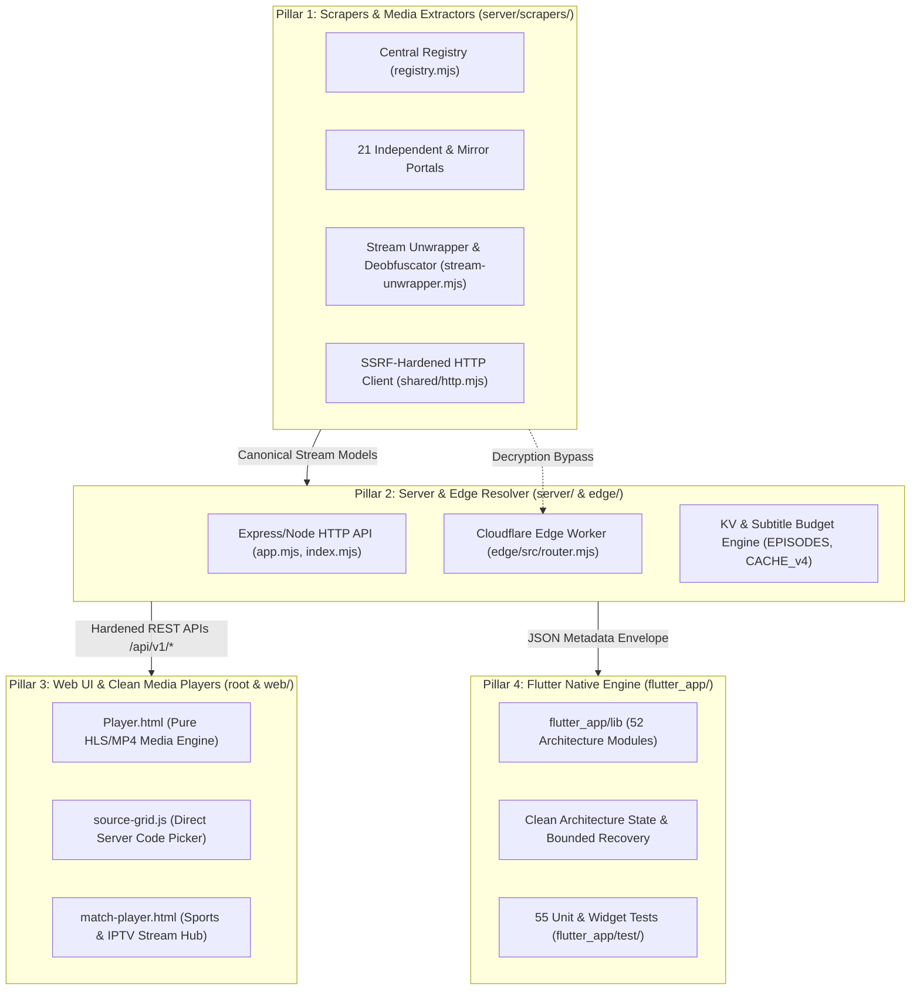

# MATV Supreme Master Engineering Blueprint & Architecture Specification

## 1. Executive System Philosophy & Purpose
**MATV** is an enterprise-grade, zero-cost, zero-ad multi-platform streaming ecosystem designed for Arab & international entertainment. It operates on five uncompromisable engineering tenets:
1. **Zero Iframes / Direct Stream First**: External pirate player iframes infested with popups and malware are systematically unwrapped down to raw, unadulterated `.m3u8` (HLS) or `.mp4` video feeds.
2. **Strict SSRF & Network Hardening**: Under no circumstance may any scraper or resolver fetch private IP ranges, cloud metadata endpoints (`169.254.169.254`), internal IPv6, or bypass DNS rebinding defenses.
3. **Resilient Decoupled Pillars**: The architecture is split into 4 independent, equal pillars to prevent context exhaustion in LLMs and guarantee micro-service modularity.
4. **Honest Observability & Diagnostic Accuracy**: Obstructed or WAF-blocked network targets are classified with surgical precision (`ACCESS_BLOCKED` / `ACCESS_OBSTACLE`), never falsely reported as functional or masked.
5. **Deterministic Offline Fixtures**: All 21 media scrapers must be 100% testable and verifiable offline using authentic HTML/JSON payloads without relying on live network availability.

---

## 2. Global Architecture & The 4 Modular Pillars



---

## 3. Pillar 1: Scraper Subsystem & 21-Provider Engine

### Directory Layout
- `server/scrapers/registry.mjs`: Central registry and single source of truth for all providers.
- `server/scrapers/sites/<provider_id>.mjs`: Standalone scraper modules.
- `server/scrapers/shared/http.mjs`: Centralized SSRF-safe HTTP client with concurrency semaphores.
- `server/scrapers/shared/normalize.mjs`: Title, season, episode, and Arabic numeral sanitization.
- `server/scrapers/shared/errors.mjs`: Standard error taxonomy (`ScraperError`) and WAF detectors.
- `server/scrapers/stream-unwrapper.mjs`: Unpack/deobfuscate Packer, JS Fuck, eval-packed embeds.

### Complete 21-Provider Matrix
Every provider implements an explicit metadata contract:
- `id`: Unique slug (e.g., `cimanow`, `mycima`, `yallashoot`).
- `code`: 2-character prefix for player server buttons (e.g., `CW`, `MA`, `YS`).
- `capabilities`: Object flags `{ catalog, search, details, episodes, servers, resolve, live }`.

| # | Provider ID | Code | Primary Domain | Core Focus | Architecture Notes |
|---|---|:---:|---|---|---|
| 1 | `moviztime` | `ME` | `moviz-time.quest` | Foreign & Asian Movies | Direct API & Cheerio extraction |
| 2 | `ristoanime` | `RE` | `ristoanime.me` | Anime Series & Movies | Direct HLS/MP4 extraction |
| 3 | `3isk` | `3K` | `3isk.biz` | Turkish Drama (Original) | Decoupled from 3ckTV |
| 4 | `alooy` | `AY` | `alooytv.com` | Gulf & Arabic Drama | Direct stream unwrapping |
| 5 | `anime4up` | `AP` | `anime4up.top` | Comprehensive Anime | Multi-resolution server parser |
| 6 | `witanime` | `WE` | `witanime.pics` | Anime VOD & Episodes | Gateway discovery & Yonaplay |
| 7 | `ipauniverse` | `IE` | `ipauniverse.com` | International VOD | VidSrc direct embed resolver |
| 8 | `mewsry` | `MY` | `mewsry.com` | Syria Live & Sports | Live match cards & scores |
| 9 | `yallashoot` | `YS` | `yallashootz.cc` | Today & Tomorrow Sports | Dynamic script stream parser |
| 10 | `cimanow` | `CW` | `cimanow.me` | Arabic & Foreign Movies | Laravel CSRF authenticated unwrap |
| 11 | `mycima` | `MA` | `wecima.show` | Classic Movies & Series | Protected by Incapsula / SNI |
| 12 | `shahid4u` | `SU` | `shahid4u.vip` | Arabic & Dubbed Series | Multi-server player extraction |
| 13 | `akwam` | `AK` | `akwam.to` | Arabic Portal | Direct MP4 fast CDN unwrapping |
| 14 | `arabseed` | `AD` | `asd.homes` | Movies & Series Portal | Safe async libuv termination |
| 15 | `egydead` | `ED` | `egydead.top` | VOD Drama & Movies | Decoupled from Live TV |
| 16 | `3cktv` | `3V` | `e.3cktv.com` | Turkish & Dubbed VOD | Distinct sister domain |
| 17 | `laroza` | `LZ` | `larooza.beer` | Classic Egyptian/Turkish | Edge Worker crypto fallback |
| 18 | `qfilm` | `QM` | `qfilm.site` | Specialized Media | Direct HLS server parser |
| 19 | `egydead_live` | `EL` | `tv10.egydead.live` | Live Sports & IPTV | Fully standalone live TV module |
| 20 | `shii4u` | `SH` | `shii4u.cam` | Mirror of Shahid4U | Dedicated mirror fallback module |
| 21 | `anime4up_rest` | `AP` | `w1.anime4up.rest` | Mirror of Anime4Up | Dedicated gateway mirror module |

---

## 4. Security & Network Hardening (SSRF Defense)

All outbound HTTP calls in `server/scrapers/shared/http.mjs` MUST pass strict SSRF validation before request execution and at every redirect hop:
1. **IP Blacklist Validation**:
   - `0.0.0.0/8`, `10.0.0.0/8`, `127.0.0.0/8` (Loopback).
   - `169.254.0.0/16` (Cloud link-local / AWS metadata `169.254.169.254`).
   - `172.16.0.0/12`, `192.168.0.0/16` (RFC1918 Private).
   - `100.64.0.0/10` (Carrier-grade NAT).
   - `224.0.0.0/4` (Multicast/Broadcast).
   - IPv6 equivalents: `::1`, `fc00::/7` (ULA), `fe80::/10` (Link-local), `::ffff:0:0/96` (IPv4-mapped).
2. **DNS Rebinding Prevention**:
   - Every hostname is resolved via `dns.promises.lookup({ all: true })`.
   - If any resolved IP belongs to a private or loopback range, the connection is instantly rejected with `ScraperError(SCRAPER_ERROR_CODES.UNSAFE_URL)`.
3. **WAF & Block Classification**:
   - `isCloudflareOrAccessBlock(status, html, headers)` inspects Cloudflare challenge tokens, Incapsula `_Incapsula_Resource`, `x-iinfo`, Imperva, and DDoS-Guard blocks.
   - Throws `ScraperError(SCRAPER_ERROR_CODES.ACCESS_BLOCKED)` with status details.

---

## 5. Deobfuscation & Stream Unwrapping Pipeline

When scrapers encounter embedded video hosts (e.g., VidMoly, EarnVids, SaveFiles, OkPrime):
1. **Deanonymization & Unpack**:
   - Detects `eval(function(p,a,c,k,e,d)...)` Dean Edwards packer.
   - Evaluates token substitution table mathematically to unpack source code without running arbitrary remote code in a full VM.
2. **Regex Stream Harvesting**:
   - Scans text for raw media streams: `https?:\/\/[^\s"'<>\\]+\.(?:m3u8|mp4|webm)(?:\?[^\s"'<>\\]*)?`.
3. **Session Handshake**:
   - Extracts CSRF tokens and internal API POST signatures (as implemented in `cimanow.mjs` for `/watch/resolve`).
   - Forwards origin/referer headers to guarantee CDN token validation.

---

## 6. Pillar 2: Cloudflare Edge Resolver Architecture

Located in `edge/`:
- **Routing Engine**: `edge/src/router.mjs` acts as an edge proxy with caching and rate limiting.
- **Wrangler Specs**: `edge/wrangler.jsonc` configures:
  - KV Namespace: `EPISODES` for cross-provider mapping.
  - Rate Limiter: `EDGE_REQUEST_LIMITER` (120 req/min) and `EDGE_RESOLVE_LIMITER` (30 req/min).
  - Micro-services bindings: `ISK`, `AKOAM`, `ALOOY`, `LAROZA`, `MATCHES`.
- **Subtitle & Byte Budgeting**:
  - `budgetResolution()` enforces a maximum payload of 12,288 bytes (`RESOLUTION_RESPONSE_BYTES`).
  - Prioritizes Arabic subtitles (`arabicCaption`), sheds oversized duplicates, and protects mobile clients from out-of-memory crashes.

---

## 7. Pillar 3: Web UI & Video Player Engine

- **Pure Media Principle**: `Player.html` only mounts HLS.js or native HTML5 video against raw streams.
- **Zero External Ads**: External embed iframes with scripts, overlays, or redirects are suppressed.
- **Server Code Contract**:
  - Each extracted stream is assigned a standard code: `<PROVIDER_CODE>-<INDEX>` (e.g., `ME-1`, `YS-1`, `CW-1`, `LZ-1`).
  - `source-grid.js` dynamically renders server buttons. Clicking switches streams seamlessly while remembering playback time (`currentTime`).

---

## 8. Pillar 4: Flutter Mobile & Desktop Client

Located in `flutter_app/`:
- **Framework**: Flutter (Dart) targeting Android, iOS, Windows, and Web.
- **Architecture**: Clean layered architecture:
  - `lib/src/models.dart`: Strict data classes (`CatalogItem`, `OpaquePlaybackRef`, `SearchCycleState`).
  - `lib/src/cycle_feature_policy.dart`: Bounded playback recovery policies (prevents infinite reload loops).
  - `lib/src/api_client.dart`: Consumes Node.js `/api/v1/*` backend endpoints.
- **Quality Gates**:
  - 55 automated tests under `flutter_app/test/` verify state preservation, accessibility, and offline recovery.

---

## 9. Verification & Testing Playbook

When maintaining or extending MATV, an agent MUST execute the following verification sequence in order:

```bash
# 1. Syntax & Build Validation (Must be 0 errors)
node --check server/app.mjs
node --check server/index.mjs
node --check server/scrapers/index.mjs

# 2. Production Entry & Retired Endpoints Test
node scripts/production_entry_test.mjs

# 3. Security & SSRF Guard Verification
node scripts/ssrf_http_guard_test.mjs

# 4. Master 21-Provider Integration Suite (22/22 Assertions)
node scripts/providers_unit_and_integration_test.mjs

# 5. Offline Fixtures Test Loop (All 18 suites)
# Every provider in scripts/providers/*.fixture.test.mjs must pass.
```

---

## 10. Rules for Autonomous Extension
1. **Adding a New Provider**:
   - Create `server/scrapers/sites/<new_provider>.mjs`.
   - Export `PROVIDER_META` with unique `id`, `code`, and capability flags.
   - Register in `server/scrapers/registry.mjs`.
   - Create authentic offline fixture in `scripts/fixtures/providers/<new_provider>.fixture.mjs`.
   - Create unit fixture test in `scripts/providers/<new_provider>.fixture.test.mjs`.
2. **Never Mask Network Obstacles**:
   - If a provider is Cloudflare-protected or blocked by ISP, return `createEmptyArrayResult()` with `ACCESS_BLOCKED` or exit code `2`. Never generate fake mock data in live mode.
3. **Preserve Player Safety**:
   - Do not inject unauthorized scripts into `Player.html`.
