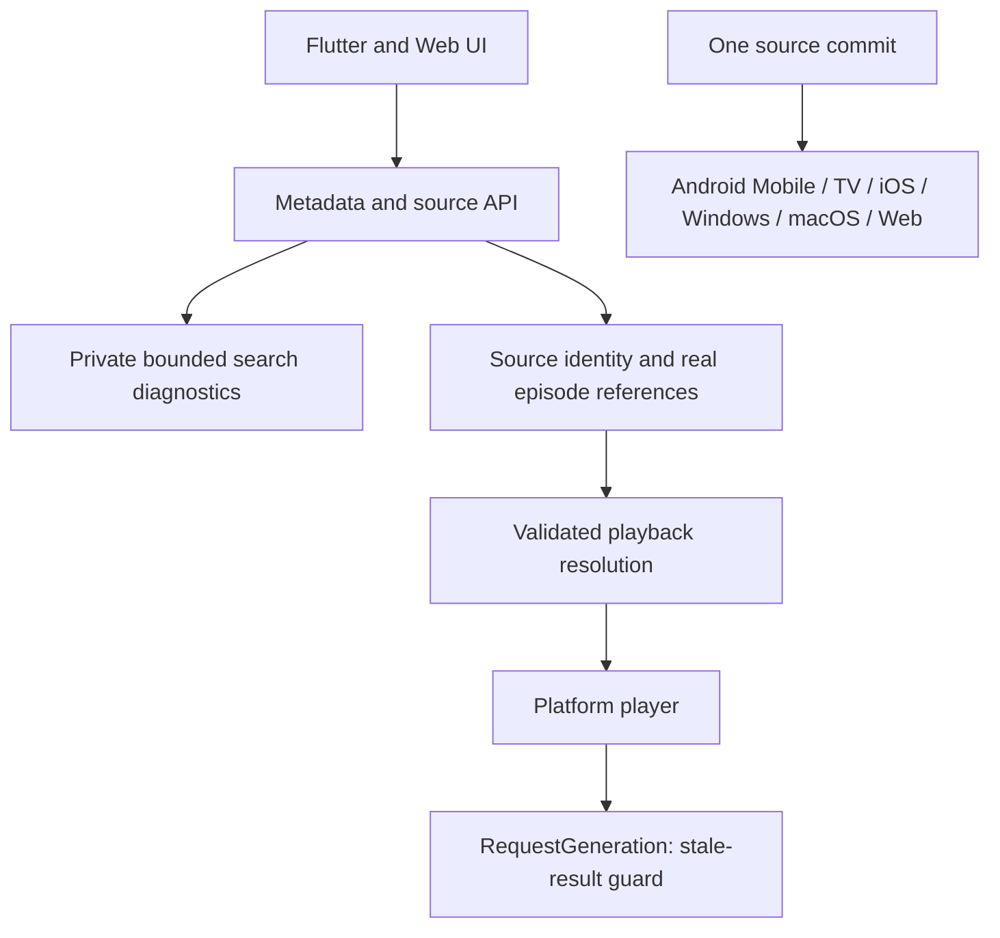

# Architecture attachment review

Reviewed the attached «MATV كود إلى مخطط» DOCX against the current source, 2026-10-27. Its diagrams describe Flutter imports and suggestions, not an authoritative runtime audit. There are currently52 Dart files under `flutter_app/lib/src`, plus `lib/main.dart`; main is1884 lines, player1541, API1073 before further refactoring.

Import arrows point from a caller/importer to the imported dependency. Zero import fan-in alone does not establish dead code: entry points, conditional platform imports, tests, JavaScript and native entry paths must be included.

The four referenced policy/cache/resolver/event modules are retained. RequestGeneration is now wired into the player's existing request lifecycle and disposal, replacing the equivalent integer generation guard without changing playback resolution or resume behavior. Existing policy tests cover invalidating stale generations. No new alternate provider playback path was enabled.

The suggested `shouldOfferResume` replacement is **not behavior-identical**: it rejects progress at or above95%, while the current player accepts any position below duration and permits handoff under5seconds. Changing that silently would alter resume behavior, so it is not folded into the security fix.

Miravd literal parsing is tested but should only be integrated into the validated source resolver contract with real URL/expiry checks, not called opportunistically from client UI. The event parser needs a verified sender and strict message origin/source validation before wiring. The M3U cache is disk-oriented and tested; enabling it globally requires platform storage/quota/expiry integration and equivalent parsing results. None is deleted or described as an automatically safe feature switch.

A future extraction of routing/theme/player overlays should preserve current six-target UI and policy contracts in small independently checked commits. Large architectural movement is kept separate from the security/episode regression fix so its behavioral impact remains reviewable.

