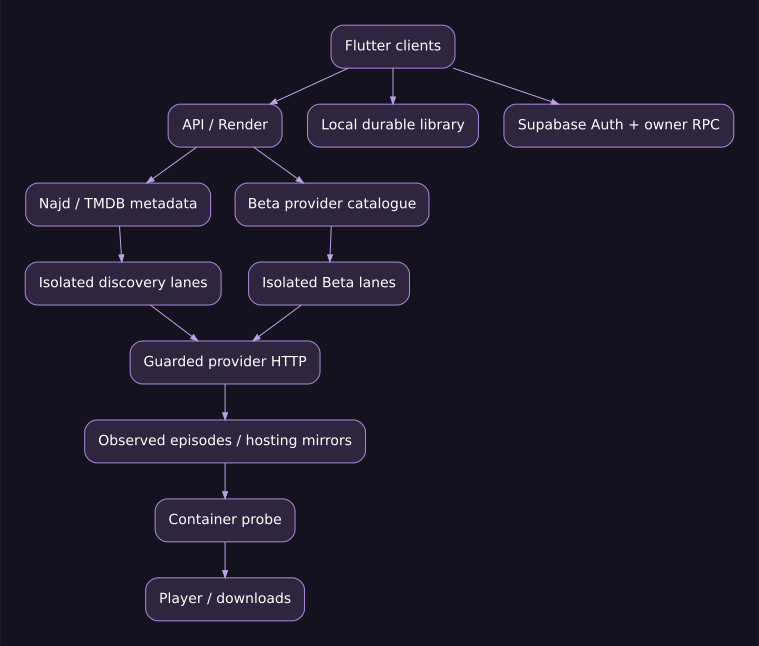
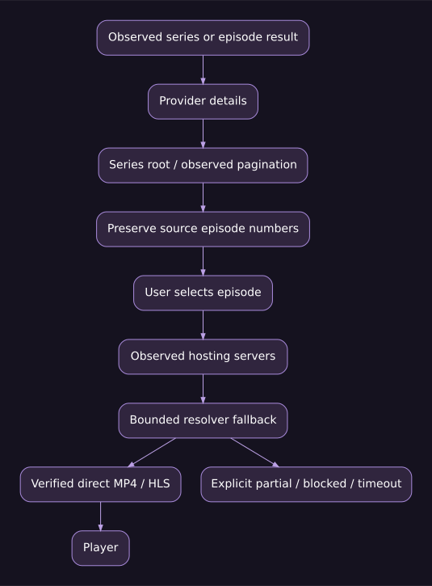

# نجد TV — مرجع البناء والكود 2.0.4

هذا مرجع النسخة 2.0.4+204 / Beta 5. مرجع إصلاح الاستئناف الأولي: `b3aae7a`، وتضم هذه الدفعة أيضًا إرسال التشغيل المضاف بعده. بصمة المصدر النهائية مثبتة في source-manifest.json المرفق بالحزمة. يُراجع معه ملف [منطق التشغيل](RUNTIME_AND_FLOW_MAP.md) و[ملاحظات الإصدار](RELEASE_2.0.4.md). وصف التنفيذ الحالي منفصل هنا عن التحسينات المقترحة؛ نجاح الاختبارات الآلية لا يعني اعتماد كل جهاز فعلي أو استمرار عمل موقع خارجي.

## 1. حدود المراجعة وكيف تقرأ المرجع

راجعت مسارات بدء التطبيق، المكتبة، الهوية، الربط، الاستئناف، الاستخراج، الترويسات والتحويلات، وعقود البناء والاختبارات ذات الصلة. أرفق جردًا نحويًا آليًا للدوال لتيسير الوصول إلى كل إعلان؛ الجرد لا يدّعي مراجعة بشرية مستقلة لكل سطر، ولا يثبت وحده صحة دالة. الأرقام والأسطر تخص لقطة الكود المذكورة، وتتغير عند تعديل الملفات.

[جرد Dart](assets/dart-functions.json) يسجل الصنف والدالة والمعاملات والاستدعاءات والفروع ومواضع الانتظار والاستثناء. [جرد JavaScript](assets/javascript-functions.json) يحصر الدوال والتوابع المجهولة في server وweb باستخدام Acorn، ويعرض أخطاء التحليل إن وجدت. ملف إعداد Supabase مستثنى عمدًا من جرد المحتوى. لا يتضمن الجرد أجسام الدوال أو مفاتيح التشغيل.

## 2. خريطة المكونات



| الطبقة | الملفات المركزية | المسؤولية والحدود |
|---|---|---|
| تهيئة Flutter والتنقل | `flutter_app/lib/main.dart` | تحميل المكتبة المحلية أولًا؛ إطلاق التهيئة السحابية والمظهر والخطوط دون جعل الشبكة شرط دخول؛ إنشاء Shell والتنقل بين المكتبة والبحث والإعدادات |
| هوية العمل والحلقة | `models.dart`, `watch_identity.dart` | حفظ المرجع الأصلي، عدم اختراع رقم حلقة، فصل المواسم حتى مع معرّف مصدر فارغ أو مكرر |
| المكتبة المحلية | `library_store.dart`, `library_sync_record.dart` | نقطة توقف دائمة محلية، قائمة انتظار تغييرات، دمج وتومبستون للحذف؛ ليست ملفات فيديو |
| Supabase | `cloud_library.dart`, `account_settings.dart` | جلسة مجهولة لكل تثبيت، RPC محدود بالمالك، ربط صريح قابل للإلغاء؛ لا مفاتيح خدمة داخل العميل |
| التفاصيل والمزودون | `details_page.dart`, `source_editions_panel.dart` | بيانات العرض من TMDB في نجد، مع اختيار نسخة المصدر وفهرسته؛ لا فرض ترقيم TMDB على مصدر مختلف |
| بيتا | `provider_browser_page.dart`, `api_client.dart` | جلسة متصفح مزود مستقلة؛ المصدر هو مالك الاسم والفهرس، وليست نسخة من مسار TMDB |
| المشغل | `player_page.dart`, `universal_player.dart`, `player_controls.dart` | اختيار المصدر، فتح الوسيط، انتظار صلاحية الزمن ثم seek، الحفظ، الحلقة التالية، الترجمة والتكبير والسرعة |
| جسور المنصة | `pip_bridge*.dart`, `stream_bridge*.dart`, `subtitle_delay*.dart` | استيراد مشروط للويب مقابل المنصات الأصلية؛ ليس كل زر مدعومًا من كل نظام |
| التنزيل | `download_service.dart`, `download_resume_catalog.dart`, `download_activity.dart` | مسار محلي وملفات جزئية وإلغاء وإعادة اتصال محدودة وفحص الحاوية؛ HLS دون اتصال غير مدعوم |
| منفذ الخادم | `server/index-runtime.mjs`, `index.mjs`, `app.mjs` | مسارات HTTP، CORS وحدود الأمان، تركيب TMDB والمحتوى والاكتشاف والإدارة |
| الاكتشاف | `server/discovery-coordinator.mjs` | عمل متزامن محدود لا يوقفه مزود بطيء؛ حالات جزئية بدل ادعاء اكتمال النتائج |
| القواشط | `server/scrapers/sites/*`, `shared/*` | محلل مستقل لكل مصدر؛ مشاركة الأدوات عديمة الحالة فقط؛ HTTP محروس في كل مرحلة |
| الحصاد | `server/harvest/{service,worker,store,pipeline}.mjs` | وظائف دائمة بمفاتيح ومهلات ومحاولات؛ فصل الفهرسة عن طلب تشغيل الحلقة |
| التشخيص | `server/diagnostics/*` | تقارير مراحل وأسباب آمنة؛ لا نشر روابط فيديو موقعة أو جلسات |
| البناء | `.github/workflows/mobile-trial.yml`, `public-web.yml`, `promote-reviewed-release.yml` | بناء وفحص مصدر وحزم متعددة، ثم ترقية مجموعة مراجعة موثوقة دون إعادة استعمال حزم إصدار قديم |

المسارات المختصرة لملفات Dart في هذا الجدول تقع تحت `flutter_app/lib/src/`.

## 3. تفسير التغيير في الاستئناف

`EpisodeItem.fromJson` يستعمل المرجع الفعلي بديلًا عن id المفقود. قبل التصحيح كان id الفارغ يسمح بتداخل حفظ حلقات العمل. `watchNumbers` يقرأ الرقم الإيجابي المرصود أو لاحقة `:sN:eM`؛ لا يحول حلقة غير معروفة إلى الحلقة 1. `stableWatchEpisodeId` ينتج `s1:e2` عندما توجد أرقام مؤكدة، وإلا هوية مشتقة من المرجع المميز عند الحاجة. تستعمل SHA-256 للهوية المبهمة، لا لتخمين الترتيب.

المفتاح المحفوظ يبقى `contentRef::episodeId` احترامًا للتوافق؛ يتغير مضمون episodeId إلى هوية مستقرة عند توفر الدليل. يحتوي WatchEntry حقول الموسم والحلقة ومعرّف المصدر والمرجع ونقطة الزمن والمدة وتاريخ التحديث. `matchesEpisode` يرفض التعارض الصريح قبل قبول التطابق. لا تكفي مساواة اسم العمل أو معرّف فارغ لإعادة زمن حلقة أخرى.

`LocalLibraryStore.resumeEntry` ينتقي أحدث سجل مطابق للسياق. `recordProgress` يسجل معرفًا قياسيًا مع الأصل للمهاجرة. `history` يوحّد عرض السجل القديم والجديد لنفس الحلقة دون حذف البيانات القديمة تلقائيًا. تومبستون قياسي أحدث يمنع رجوع سجل قديم إلى الواجهة. حد 80 يخص العرض الحديث، وليس حذف نقاط الحلقات القديمة من السحابة. هذا يمنع فقدان استئناف الحلقة الأولى عند تجاوز 80 مشاهدة، لكنه يقتضي مراقبة حجم الحالة المحلية مستقبلًا.

في `PlayerPage` تعطى الأولوية لنقطة المخزن الحالية المطابقة؛ watchEntry القادم من صفحة السجل لا يقبل إن كان لحلقة أخرى. تستدعى قراءة السحابة المحددة مرة عند التهيئة مع حارس generation/mounted. بعد فتح الوسيط وتوفر مدة قابلة للاستخدام يطبق الاستئناف على الحلقة المطلوبة فقط. اختيار البدء من جديد لا يعادل طلب max(position) عند الدمج؛ يعتمد التحديث الأحدث حتى يمكن الرجوع إلى الصفر عمدًا.

الانتقال اليدوي الصريح بين نسخ المزودين يحتفظ بالزمن حسب سياسة المشغل القائمة؛ ليس ذلك دليلًا أن TMDB الحلقة 1 تساوي حلقة المصدر 21. الانتقال إلى الحلقة التالية حالة مختلفة ويقرأ نقطة الحلقة التالية نفسها.

## 4. عقد المزامنة والملكية

`LibraryCloudTransport`: push وpull وownerId. `HistoryCheckpointTransport`: قراءة نقطة محددة. `SupabaseLibraryTransport` يفحص توافق المستخدم الحالي مع ownerId قبل الطلب، ويرفض أي صف عائد لا يطابق المالك المتوقع. push أقصاه 32 تغييرًا؛ pull أقصاه 250 صفًا. المهلة 20 ثانية للدفعات، و8 ثوان لطلب النقطة على مستوى النقل.

`AnonymousLibraryTransport.prepare` يستعيد جلسة محفوظة أو ينشئ جلسة Supabase مجهولة ويسجل الجهاز. Supabase auth UID هو هوية التفويض؛ UUID الجهاز المحلي ليس بديلًا عنها. إعادة التثبيت/حذف بيانات التطبيق قد تفقد الجلسة المجهولة؛ لا تعد الهوية المجهولة حساب استرداد دائمًا دون ربط أو وسيلة استرداد معتمدة.

`CloudLibrarySync` يدير قائمة التغييرات والدورة. أثناء التشغيل ترفع نقاط التقدم بإيقاع 5 ثوان عند تحقق شروط الإرسال؛ foreground polling كل 30 ثانية. الإيقاف والخروج يطلبان flush عاجلًا بأفضل جهد؛ إغلاق النظام للعملية أو انقطاع الشبكة قد يمنع وصول آخر لحظة، لذلك يبقى الحفظ المحلي أساسًا وتظل التغييرات غير المرسلة في الطابور. لا وعد بتسليم متزامن لحظي بلا شبكة.

`refreshForPlayback` ينتظر التهيئة بميزانية 1500ms ثم القراءة بميزانية 1500ms. `refreshCheckpoint` يستعلم حتى ثلاثة مفاتيح محددة: القياسي، القديم إن وجد، ومفتاح العمل القديم. يفحص سياق الحلقة قبل دمج الرد، ولا يتقدم بمؤشر bulk pull؛ وإلا قد تسقط تغييرات أقدم لغير هذه الحلقة. المهلة الخارجية لا تلغي بالضرورة الطلب الداخلي؛ النقل نفسه محدود. لا يعاد سحب المكتبة كاملة قبل كل تشغيل.

الترحيل `20261105154953_najd_exact_history_checkpoint.sql` ينشئ `najd_history_checkpoint(p_item_key)` بدالة stable security definer وsearch_path فارغ. يشتق المالك من auth.uid ومنحة الربط عبر helper خاص؛ لا يقبل owner من العميل. لا تنفيذ لدور anon؛ الدور authenticated مطلوب حتى للمستخدم ذي جلسة مجهولة. الحد 1536 بايت للمفتاح. الاستعلام مساواة على المالك والنوع والمفتاح، وlimit 1، ويعيد UID الطالب الموافق لعقد النقل.

`LibrarySyncRecord` بيانات وصفية فقط: favorite/history. ميزانية JSON لكل عنصر 16384 بايت، ومفتاح 1536، وفحص متداخل يمنع حقول الأسرار والترويسات وروابط الوسائط. الفيديوهات والكوكيز وروابطها المؤقتة ليست جزءًا من مزامنة سجل المستخدم.

TV يخفي إنشاء الربط وإرساله واعتماده، ويسمح بالاستقبال/المطالبة والفصل. توجد حماية إضافية قبل accountRpc تمنع create/approve عند هدف TV. هذا قيد في سياسة العميل، وليس توثيقًا عتاديًا يمنع تطبيقًا معدلًا من استدعاء واجهة عامة؛ التفويض الحقيقي للبيانات قائم على جلسة المالك والمنح في الخادم. الربط الأسبوعي والدائم يخضعان للعقد الموجود، وليس نقلاً عامًا لكل مكتبات المستخدمين.

أضيف إرسال التشغيل نفسه عبر `playback_handoff.dart`، مستقلًا عن رفع السجل. المرسل يختار جهازًا مرتبطًا من «المزيد»، ويرسل WatchEntry وصفيًا بالموسم والحلقة والمرجع والتوقيت بالمللي ثانية. يوافق المستقبل على «تشغيل هنا»، ثم يستخرج وسيطًا جديدًا من API ويمرر initialPosition صراحة. لا تنتقل روابط MP4/HLS الموقعة أو Cookie إلى السحابة. يعيد المستقبل إغلاق مسارات المشغل السابقة قبل فتح المشاهدة الجديدة لتفادي تراكب الصوت.

ترحيل `20261105170604_najd_playback_handoff.sql` يضيف جدولين داخل mitv_private مع RLS ودون منح عميل مباشرة، وفهارس للصندوق والمرسل والصلاحية. دوال RPC محددة: register لتعريف نوع الجهاز، targets لإظهار أجهزة نفس مالك المكتبة فقط، send للتحقق من المنحة والحمولة وإيداع طلب، inbox لقراءة أحدث طلب غير منتهٍ للجهاز نفسه، وack لقبوله أو رفضه مرة واحدة. يمنع الخادم send من جهاز مسجل TV، إضافة إلى منع الواجهة والعميل. يظل نوع الجهاز تصريحًا من التطبيق، وليس توثيقًا عتاديًا.

الطلب صالح لدقيقتين، وله حد إرسال3 ثوان؛ طلب جديد لنفس المستقبل يلغي الطلب المعلق السابق. القبول لا يعني أن الفيديو فك ترميزه بنجاح؛ يعني موافقة المستقبل على فتحه. يسحب TV/desktop/web الصندوق كل8 ثوان في المقدمة فقط، مع backoff30 ثانية عند الخطأ. heartbeat لا يكتب إلا بعد45 ثانية. الجوال الأصلي يسجل نفسه ولا يفحص صندوق استقبال غير مستخدم. يمنع seen محلي إعادة نافذة الطلب نفسه، وتمنع الحالة في DB إعادة تشغيل المقبول. إلغاء المنحة يمنع القراءة والإرسال حتى لو بقي طلب قديم في الجدول. لا تفتح طلبًا قديمًا بعد مدة صلاحيته.

المرسل لا يدعي أن القبول حدث بمجرد الإيداع، ولا يفرض إيقاف الفيديو على هاتفه دون تأكيد؛ واجهته تقول إن طلب التشغيل أرسل وإن الموافقة على الجهاز الآخر مطلوبة. هذه أوامر فتح مشاهدة مرتبطة، وليست بث الشاشة أو ريموتًا للتحكم المستمر بالصوت والسرعة على المستقبل.

## 5. الاكتشاف والفهرسة والاستخراج



المسار العادي: بيانات TMDB للعرض ثم بحث مستقل لدى المزودين ثم مطابقة مؤكدة للنسخة ثم فهرس المصدر ثم طلب وسيط الحلقة. مسار بيتا: اختيار مزود، أقسامه وبحثه وتفاصيله ثم فهرسه نفسه. يظلان منفصلين في config/cache/queue/session حتى مع مشاركة محللات منخفضة المستوى.

البحث عبر نحو20 مصدرًا بالتزامن ممكن، لكن لا يعني20 نتيجة ناجحة فورًا. ميزانيات المضيف، سعة Render، DNS وWAF وزمن الموقع تتحكم بالوصول. يجب إظهار النتائج المنتهية دون انتظار أبطأ مصدر، مع حالة مستقلة للآخرين. الفهرسة ليست استخراج فيديو كل حلقة؛ طلب الحلقة هو الذي يبدأ استخراج وسيطها. هذا الفصل مهم لأداء قاعدة البيانات.

المرجع الملاحظ لصفحة حلقة قد يقود إلى جذر المسلسل أو صفحات التالي والسابق وقوائم AJAX معلنة. لا يجوز توليد روابط صفحات أو حلقات مفترضة، أو ترقيم القائمة بالترتيب لمجرد غياب الرقم. تكرار الحلقة 14 برابطين يعني بديلين، لا حلقتين15و16. تختلف النسخ المدبلجة والمترجمة والمواسم حسب فهرسة المصدر.

`resolveProviderMedia` يفحص الهدف الأصلي ثم المرايا الملاحظة. الحد الافتراضي32 هدفًا، سقف64، ومحاولتان متزامنتان افتراضيًا بسقف4 قابل للضبط. ميزانية مرحلة التفريغ40 ثانية بسقف60. هذه ليست مهلة شاملة لكل الشبكة: scrapeServers وفحوص قبول الحاوية لهما حدود مستقلة. عند نفاد الميزانية قبل استكمال الأهداف يرجع `MEDIA_SERVER_SCAN_PARTIAL` بدل ادعاء عدم وجود فيديو. الاختبار يصل إلى الخادم التاسع، فلا يتوقف المسار المشترك عند أول4.

CimaNow: يحمل رابط resolve العام مفتاح الخادم ورمز CSRF، وتستخرج صفحة المصدر cookie جلسة عامة. التصحيح يعيد تمرير السياق لنفس origin عند POST؛ سابقًا كان cookie مستخرجًا ثم غير مستخدم. لا يوجد تسجيل دخول خفي ولا توليد توكنات ولا تجاوز تحدي. يحتفظ resolver بـReferer/Origin والترويسات المسموحة، ولا يرسل Cookie/Authorization/CSRF إلى أصل استضافة مختلف.

HTTP المشترك يعيد التحقق من HTTPS وDNS والعناوين الخاصة والتحويلات وحجم الرد والمهلة في كل طلب. يحول301/302POST و303 إلى GET عند انطباق السياسة، ويبقي307/308POST لنفس الأصل. يمنع تحويل جسم حساس إلى أصل مختلف، وينزع بيانات الاعتماد بعد التحويل العابر للأصل. لا eval لكود الموقع. صفحة iframe ليست ملف فيديو؛ يجب حلها ثم التحقق من الحاوية.

## 6. قاعدة البيانات وضبط الضغط

المكتبة الخاصة مختلفة عن فهارس الأعمال المشتركة ووظائف القشط. لا تعالج زيادة CPU بإعادة إنشاء حسابات المستخدمين أو مسح سجلهم. كان هناك عامل قديم وآخر جديد يتنافسان على عمل وطابور كبير، واستدعاءات claim تاريخية مكلفة. المعالجة القائمة تفصل المسارات وتستعمل مطالبات keyed، وتأخيرًا تصاعديًا، ومسحًا محدودًا، ولا تطلق حل فيديو لكل حلقة بمجرد فهرسة العمل.

الحالة التشغيلية التي جرى التحقق منها قبل هذه الدفعة: العامل الحالي مفعّل، مسح backlog العام والتحديث الساعي معطلان، والعامل القديم معطل. `najd_jobs_work_updated_idx(content_ref, updated_at desc)` يغطي استعلام حالة العمل. لا تعاود تشغيل العامل القديم مع الجديد. لا تفعل full backlog قبل قياس عمق الطابور وخطط الاستعلام وCPU ومعدل الخطأ.

في آخر القياسات الموثقة السابقة هبط CPU من95–96% إلى نطاق منخفض؛ القياس لقطة زمنية لا ضمان عدم التكرار. خطة التشغيل: راقب نسبة الطلبات الناجحة، p95زمن RPC، الوظائف الجاهزة/المؤجلة/leased، الاستعلامات الطويلة، CPU وI/O والاتصالات. عند تعطل DB، backoff بدل حلقة مطالبة سريعة، واستعمل المحلي للعميل. لا VACUUM FULL أو حذف جماعي أو تغيير خطة مدفوعة تلقائيًا كبديل للتشخيص.

تراجع الجداول والمنح والـRLS قبل أي ترحيل. فهارس بيتا/config لا تمنح anon/authenticated وصولًا عامًا؛ يديرها الخادم بصلاحية الخدمة خارج التطبيق. تمرير service-role إلى التطبيق خطأ أمني حتى لو سهّل أول تجربة. لا تضع الجلسات أو كلمات الإدارة داخل Git أو سجل الاختبارات.

## 7. إعادة البناء من المستودع

المتطلبات: Node متوافق مع engines في package.json، Python3، Flutter3.47.8/Dart المصاحب، Java17 وAndroidSDK للأندرويد، Xcode وmacOSلآبل، VisualStudioوWindowsSDKللويندوز. استعمل lockfiles؛ تحديث dependencies مشروع منفصل عن إصلاح الاستئناف.

```bash
npm ci
node scripts/runtime_version_contract_test.mjs
node --test tests/*.test.mjs
npm run test:continuation
cd flutter_app
flutter pub get --enforce-lockfile
flutter analyze
flutter test
flutter test --dart-define=MITV_TARGET=tv
```

للبناء الأصلي، راجع workflow لإنشاء scaffolding ثم apply_native_branding وتخصيص TV قبل compile. لا تغير application IDs التاريخية عند تغيير الاسم الظاهر؛ ذلك يفصل تثبيت المستخدم وسجله وتوقيعه. حزمة ثمانية الخاصة تأتي كمدخل بناء خارجي مصرح به ولا ترفع إلى المستودع. عند غياب المدخل يمكن استعادة ملفات OTF الأصلية والترخيص من حزمة نجد 2.0.3 المعتمدة، مع التحقق من SHA-256 للحزمة ولكل ملف. تظل الملفات المستخرجة داخل مسارات بناء متجاهلة، ولا تنتقل إلى الويب العام. الويب العام يستعمل Noto Sans Arabic المرخصة وميزة إضافة خط محلي، ولا ينشر الملفات الخاصة.

الأهداف الحالية: AndroidMobileARM64، AndroidTVARMv7، iOSIPAغيرموقعة، Windowsx64مثبتومحمول، macOSDMG، FlutterWeb. مراجعة artifact ليست مجرد نجاح compile: sourceSHA/version/API/architecture/checksum ومحتوى الحزمة جزء من الفحص. لا Linuxnative في هذه الحزمة. IPA تحتاج توقيعًا خارجيًا؛ macOSad-hocغيرموثق notarization؛ Windows دون Authenticode.

```bash
# مثال ويب عام بعد إعداد الخط المرخص وفق workflow
flutter build web --release --base-href=/NajdTV/   --dart-define=MITV_API_BASE=https://najdtv.onrender.com
```

ابن الحزم في mobile-trial مع publish_release=false. بعد نجاح كل الأهداف وverify-release يمكن ترقية review_run_id عبر promote-reviewed-release. فرع build/mitv-* يولد حزم مراجعة فقط، ثم يشغّل اكتماله الناجح ترقية موثوقة تلقائية بعد تحقق المصدر والنسخة والحزم؛ لا ينشر مجرد دفع الفرع قبل النجاح. يتحقق مسار الترقية من مصدر التشغيل وكونه ancestor ومن عدم تغير Flutter/shared/brand/verifier. تعديلات العميل بعد المراجعة تستلزم بناءً جديدًا. الموقع ينشر عبر public-web تلقائيًا لتغييرات العميل المدمجة في main أو بالتشغيل اليدوي بصورة مستقلة وبـbase-hrefالصحيح؛ لا تضف .nojekyll للجذر فتعرّض ملفات خاصة.

## 8. الاختبارات والدليل وحدوده

على هذه اللقطة: تحليل Flutter دون مشاكل؛370 اختبار Flutter ناجح مع7تجاوزات معلنة؛194اختبار Node ناجح. اختبار إضافي مستقل للتوافق بين سجل قديم أحدث وسجل قياسي أقدم ناجح. اختبار حي بجلستين مجهولتين مؤقتتين تحقق من العزل قبل الربط، الربط الصريح،3نقاط مختلفة بين الموسم1حلقة1/2 والموسم2حلقة1، تحديث المستقبل وقراءته لدى المرسل، ثم إلغاء المنحة واستعادة العزل. حذفت حسابات الاختبار المحددة فقط.

الاختبار الآلي لسياسة TV وفصل الحلقات ليس تجربة ريموت على تلفزيون فعلي. فحصMP4/HLSليس اعتمادًا لكلcodec. نجاح cookiefixtureفيCimaNowليس إثباتًا أن كلدومين حي يعمل. تراجع نتائج المصادر في الملف الثاني؛ لا تعلن جميع المصادر سليمة بسبب نجاح4منها.

## 9. نقاط هندسية تحتاج متابعة

الاستئناف الموزع يعتمد وصول الشبكة وأولوية آخر تحديث. عند مشاهدة جهازين الحلقة نفسها في اللحظة نفسها، سياسة أحدث كتابة قد تختار جهازًا واحدًا؛ لا يوجد دمج متعددالمشاهدين تلقائيًا. مزامنة metadata لا تنقل ملف التنزيل بين جهازين. الاحتفاظ بكل نقاط الحلقات يزيد حجم JSONالمحلي؛ قياسه ثم ترحيله إلى تخزين مفهرس مستقل تحسين محتمل، وليس جزءًا منفذًا هنا. اختبارات كل مصدر فيلمًا ومسلسلًا وعلى كل دولة/شبكة لم تكتمل؛ الحجب والمتطلبات المتغيرة تحتاج بيانات حية منفصلة.

## 10. مثال بيانات للاختبار، وليس سجل مستخدم حقيقي

```json
{
  "kind": "history",
  "item_key": "tmdb:tv:42::s2:e1",
  "metadata": {
    "content_ref": "tmdb:tv:42",
    "episode_id": "s2:e1",
    "season_number": 2,
    "episode_number": 1,
    "position_ms": 360000,
    "duration_ms": 2400000
  },
  "deleted": false
}
```

هذا مثال مصغر لتوضيح العقد؛ الصف الفعلي يتضمن طابع التحديث وحقولًا وصفية أخرى. لا يضع العميل user_id في أمر الكتابة للتفويض، ولا يتضمن المثال رابط فيديو أو Cookie أو سرًا. معرف42 عينة اختبار وليس ربطًا مؤكدًا بعمل في الإنتاج.

مراجعة Supabase الأمنية أظهرت تحذيرات عامة لدوال SECURITY DEFINER المتاحة للمستخدم المصادق. هذه الدوال نقطة API مقصودة لدعم مكتبة المالك المرتبط، وليست سببًا لمنح كل الجداول قراءة عامة. تحققنا تحديدًا من منع anon لدالة النقطة، والسماح authenticated، واشتقاق المالك داخليًا، ومن عدم قراءة المستقبل غير المرتبط بيانات المرسل. جداول بيتا لا تتيح SELECT للدورين. جداول cron لديها منح جدول تاريخية لكن لا USAGE للمخطط للدورين؛ لا تكفي المنحة وحدها للوصول. لا ندعي أن لوحة Advisor بلا تحذيرات.

## 11. دليل الدوال المستخرج من الكود

الجداول التالية مراجع قابلة للتتبع وليست وصفًا دلاليًا مصطنعًا للتوابع المجهولة. تفاصيل مسارات التنفيذ الجوهرية موضحة أعلاه وفي الملف الثاني؛ سجلات JSONتحتفظ بتفاصيل أكثر للاستدعاءات والفروع.

### Dart — إعلانات مسماة

عدد العناصر المستخرجة: 844. يمكن طي الجرد لكل ملف.

<details>
<summary>flutter_app/lib/main.dart — 88 إعلانًا</summary>

| الدالة/العضو | موضع التنفيذ | مؤشرات بنيوية |
|---|---|---|
| `main` | [45–45](../../flutter_app/lib/main.dart#L45) | 0 معاملات؛ 0 فروع؛ 0 await؛ 0 try |
| `MitvApp.new` | [48–48](../../flutter_app/lib/main.dart#L48) | 1 معاملات؛ 0 فروع؛ 0 await؛ 0 try |
| `MitvApp.createState` | [49–50](../../flutter_app/lib/main.dart#L49) | 0 معاملات؛ 0 فروع؛ 0 await؛ 0 try |
| `_MitvAppState.initState` | [57–75](../../flutter_app/lib/main.dart#L57) | 0 معاملات؛ 1 فروع؛ 1 await؛ 0 try |
| `_MitvAppState.dispose` | [77–82](../../flutter_app/lib/main.dart#L77) | 0 معاملات؛ 0 فروع؛ 0 await؛ 0 try |
| `_MitvAppState.build` | [84–151](../../flutter_app/lib/main.dart#L84) | 1 معاملات؛ 4 فروع؛ 0 await؛ 0 try |
| `openDetails` | [154–173](../../flutter_app/lib/main.dart#L154) | 4 معاملات؛ 2 فروع؛ 0 await؛ 0 try |
| `openHistoryEntry` | [175–203](../../flutter_app/lib/main.dart#L175) | 4 معاملات؛ 2 فروع؛ 0 await؛ 0 try |
| `_NajdMark.new` | [206–206](../../flutter_app/lib/main.dart#L206) | 1 معاملات؛ 0 فروع؛ 0 await؛ 0 try |
| `_NajdMark.build` | [208–214](../../flutter_app/lib/main.dart#L208) | 1 معاملات؛ 0 فروع؛ 0 await؛ 0 try |
| `_BrandTitle.new` | [218–218](../../flutter_app/lib/main.dart#L218) | 0 معاملات؛ 0 فروع؛ 0 await؛ 0 try |
| `_BrandTitle.build` | [219–238](../../flutter_app/lib/main.dart#L219) | 1 معاملات؛ 0 فروع؛ 0 await؛ 0 try |
| `ConfiguredTvChannel.new` | [242–246](../../flutter_app/lib/main.dart#L242) | 3 معاملات؛ 0 فروع؛ 0 await؛ 0 try |
| `Shell.new` | [253–261](../../flutter_app/lib/main.dart#L253) | 7 معاملات؛ 0 فروع؛ 0 await؛ 0 try |
| `Shell.createState` | [268–269](../../flutter_app/lib/main.dart#L268) | 0 معاملات؛ 0 فروع؛ 0 await؛ 0 try |
| `_ShellState.initState` | [289–322](../../flutter_app/lib/main.dart#L289) | 0 معاملات؛ 5 فروع؛ 0 await؛ 0 try |
| `_ShellState.dispose` | [324–332](../../flutter_app/lib/main.dart#L324) | 0 معاملات؛ 1 فروع؛ 0 await؛ 0 try |
| `_ShellState._clearBrowsingCache` | [334–349](../../flutter_app/lib/main.dart#L334) | 0 معاملات؛ 3 فروع؛ 1 await؛ 0 try |
| `_ShellState._clearDownloads` | [351–357](../../flutter_app/lib/main.dart#L351) | 0 معاملات؛ 1 فروع؛ 2 await؛ 0 try |
| `_ShellState._createPage` | [359–407](../../flutter_app/lib/main.dart#L359) | 1 معاملات؛ 1 فروع؛ 0 await؛ 0 try |
| `_ShellState._selectPage` | [408–415](../../flutter_app/lib/main.dart#L408) | 1 معاملات؛ 1 فروع؛ 0 await؛ 0 try |
| `_ShellState._closeNavigation` | [417–422](../../flutter_app/lib/main.dart#L417) | 0 معاملات؛ 1 فروع؛ 0 await؛ 0 try |
| `_ShellState._navigation` | [424–567](../../flutter_app/lib/main.dart#L424) | 1 معاملات؛ 13 فروع؛ 0 await؛ 0 try |
| `_ShellState._header` | [569–616](../../flutter_app/lib/main.dart#L569) | 0 معاملات؛ 0 فروع؛ 0 await؛ 0 try |
| `_ShellState.build` | [618–756](../../flutter_app/lib/main.dart#L618) | 1 معاملات؛ 15 فروع؛ 0 await؛ 0 try |
| `HomePage.new` | [760–765](../../flutter_app/lib/main.dart#L760) | 4 معاملات؛ 0 فروع؛ 0 await؛ 0 try |
| `HomePage.createState` | [769–770](../../flutter_app/lib/main.dart#L769) | 0 معاملات؛ 0 فروع؛ 0 await؛ 0 try |
| `_HomePageState._retry` | [783–784](../../flutter_app/lib/main.dart#L783) | 0 معاملات؛ 0 فروع؛ 0 await؛ 0 try |
| `_HomePageState._history` | [785–796](../../flutter_app/lib/main.dart#L785) | 0 معاملات؛ 0 فروع؛ 0 await؛ 0 try |
| `_HomePageState._shelf` | [797–834](../../flutter_app/lib/main.dart#L797) | 3 معاملات؛ 3 فروع؛ 0 await؛ 0 try |
| `_HomePageState.build` | [835–968](../../flutter_app/lib/main.dart#L835) | 1 معاملات؛ 4 فروع؛ 0 await؛ 0 try |
| `LivePage.new` | [972–977](../../flutter_app/lib/main.dart#L972) | 4 معاملات؛ 0 فروع؛ 0 await؛ 0 try |
| `LivePage.build` | [981–1041](../../flutter_app/lib/main.dart#L981) | 1 معاملات؛ 0 فروع؛ 0 await؛ 0 try |
| `SettingsPage.new` | [1045–1052](../../flutter_app/lib/main.dart#L1045) | 6 معاملات؛ 0 فروع؛ 0 await؛ 0 try |
| `SettingsPage.createState` | [1058–1059](../../flutter_app/lib/main.dart#L1058) | 0 معاملات؛ 0 فروع؛ 0 await؛ 0 try |
| `_SettingsPageState._clear` | [1065–1102](../../flutter_app/lib/main.dart#L1065) | 2 معاملات؛ 5 فروع؛ 2 await؛ 1 try |
| `_SettingsPageState.build` | [1104–1215](../../flutter_app/lib/main.dart#L1104) | 1 معاملات؛ 1 فروع؛ 0 await؛ 0 try |
| `_PlaybackPreferencesPanel.new` | [1219–1219](../../flutter_app/lib/main.dart#L1219) | 0 معاملات؛ 0 فروع؛ 0 await؛ 0 try |
| `_PlaybackPreferencesPanel.build` | [1220–1284](../../flutter_app/lib/main.dart#L1220) | 1 معاملات؛ 0 فروع؛ 0 await؛ 0 try |
| `_ProviderBetaPreferencesPanel.new` | [1288–1288](../../flutter_app/lib/main.dart#L1288) | 0 معاملات؛ 0 فروع؛ 0 await؛ 0 try |
| `_ProviderBetaPreferencesPanel.build` | [1289–1313](../../flutter_app/lib/main.dart#L1289) | 1 معاملات؛ 0 فروع؛ 0 await؛ 0 try |
| `_NajdAppearanceOptions.new` | [1317–1317](../../flutter_app/lib/main.dart#L1317) | 0 معاملات؛ 0 فروع؛ 0 await؛ 0 try |
| `_NajdAppearanceOptions.build` | [1318–1393](../../flutter_app/lib/main.dart#L1318) | 1 معاملات؛ 7 فروع؛ 0 await؛ 0 try |
| `_matchStatusLabel` | [1396–1407](../../flutter_app/lib/main.dart#L1396) | 1 معاملات؛ 1 فروع؛ 0 await؛ 0 try |
| `_localizedMatchTime` | [1409–1411](../../flutter_app/lib/main.dart#L1409) | 1 معاملات؛ 0 فروع؛ 0 await؛ 0 try |
| `_TeamBadge.new` | [1414–1414](../../flutter_app/lib/main.dart#L1414) | 2 معاملات؛ 0 فروع؛ 0 await؛ 0 try |
| `_TeamBadge.build` | [1417–1454](../../flutter_app/lib/main.dart#L1417) | 1 معاملات؛ 2 فروع؛ 0 await؛ 0 try |
| `MatchesPage.new` | [1459–1459](../../flutter_app/lib/main.dart#L1459) | 3 معاملات؛ 0 فروع؛ 0 await؛ 0 try |
| `MatchesPage.createState` | [1462–1463](../../flutter_app/lib/main.dart#L1462) | 0 معاملات؛ 0 فروع؛ 0 await؛ 0 try |
| `_MatchesPageState.dispose` | [1469–1473](../../flutter_app/lib/main.dart#L1469) | 0 معاملات؛ 0 فروع؛ 0 await؛ 0 try |
| `_MatchesPageState._scrollMatches` | [1475–1483](../../flutter_app/lib/main.dart#L1475) | 1 معاملات؛ 1 فروع؛ 0 await؛ 0 try |
| `_MatchesPageState.initState` | [1485–1489](../../flutter_app/lib/main.dart#L1485) | 0 معاملات؛ 0 فروع؛ 0 await؛ 0 try |
| `_MatchesPageState.didUpdateWidget` | [1491–1495](../../flutter_app/lib/main.dart#L1491) | 1 معاملات؛ 1 فروع؛ 0 await؛ 0 try |
| `_MatchesPageState._reload` | [1497–1502](../../flutter_app/lib/main.dart#L1497) | 0 معاملات؛ 0 فروع؛ 0 await؛ 0 try |
| `_MatchesPageState._open` | [1504–1523](../../flutter_app/lib/main.dart#L1504) | 2 معاملات؛ 2 فروع؛ 0 await؛ 0 try |
| `_MatchesPageState.build` | [1525–1682](../../flutter_app/lib/main.dart#L1525) | 1 معاملات؛ 14 فروع؛ 0 await؛ 0 try |
| `CatalogPage.new` | [1686–1694](../../flutter_app/lib/main.dart#L1686) | 7 معاملات؛ 0 فروع؛ 0 await؛ 0 try |
| `CatalogPage.createState` | [1701–1702](../../flutter_app/lib/main.dart#L1701) | 0 معاملات؛ 0 فروع؛ 0 await؛ 0 try |
| `_CatalogPageState._legacyCategories` | [1720–1753](../../flutter_app/lib/main.dart#L1720) | 0 معاملات؛ 3 فروع؛ 0 await؛ 0 try |
| `_CatalogPageState._categories` | [1755–1785](../../flutter_app/lib/main.dart#L1755) | 0 معاملات؛ 1 فروع؛ 0 await؛ 0 try |
| `_CatalogPageState._matchesKind` | [1787–1791](../../flutter_app/lib/main.dart#L1787) | 1 معاملات؛ 0 فروع؛ 0 await؛ 0 try |
| `_CatalogPageState.initState` | [1800–1805](../../flutter_app/lib/main.dart#L1800) | 0 معاملات؛ 0 فروع؛ 0 await؛ 0 try |
| `_CatalogPageState.dispose` | [1807–1812](../../flutter_app/lib/main.dart#L1807) | 0 معاملات؛ 0 فروع؛ 0 await؛ 0 try |
| `_CatalogPageState._onScroll` | [1814–1819](../../flutter_app/lib/main.dart#L1814) | 0 معاملات؛ 2 فروع؛ 0 await؛ 0 try |
| `_CatalogPageState._prefetchVisible` | [1822–1848](../../flutter_app/lib/main.dart#L1822) | 0 معاملات؛ 5 فروع؛ 0 await؛ 0 try |
| `_CatalogPageState._loadMore` | [1850–1893](../../flutter_app/lib/main.dart#L1850) | 0 معاملات؛ 7 فروع؛ 1 await؛ 1 try |
| `_CatalogPageState._refresh` | [1895–1906](../../flutter_app/lib/main.dart#L1895) | 0 معاملات؛ 0 فروع؛ 1 await؛ 0 try |
| `_CatalogPageState.build` | [1908–1981](../../flutter_app/lib/main.dart#L1908) | 1 معاملات؛ 11 فروع؛ 0 await؛ 0 try |
| `_CatalogCard.new` | [1985–1989](../../flutter_app/lib/main.dart#L1985) | 3 معاملات؛ 0 فروع؛ 0 await؛ 0 try |
| `_CatalogCard.build` | [1993–1996](../../flutter_app/lib/main.dart#L1993) | 1 معاملات؛ 0 فروع؛ 0 await؛ 0 try |
| `SearchPage.new` | [2000–2000](../../flutter_app/lib/main.dart#L2000) | 3 معاملات؛ 0 فروع؛ 0 await؛ 0 try |
| `SearchPage.createState` | [2003–2004](../../flutter_app/lib/main.dart#L2003) | 0 معاملات؛ 0 فروع؛ 0 await؛ 0 try |
| `_SearchPageState.initState` | [2015–2024](../../flutter_app/lib/main.dart#L2015) | 0 معاملات؛ 1 فروع؛ 0 await؛ 0 try |
| `_SearchPageState.loadMore` | [2026–2050](../../flutter_app/lib/main.dart#L2026) | 0 معاملات؛ 4 فروع؛ 1 await؛ 1 try |
| `_SearchPageState._setAdvanced` | [2061–2095](../../flutter_app/lib/main.dart#L2061) | 1 معاملات؛ 4 فروع؛ 1 await؛ 1 try |
| `_SearchPageState._resultGroups` | [2101–2124](../../flutter_app/lib/main.dart#L2101) | 0 معاملات؛ 4 فروع؛ 0 await؛ 0 try |
| `_SearchPageState._sourceLabel` | [2126–2126](../../flutter_app/lib/main.dart#L2126) | 1 معاملات؛ 0 فروع؛ 0 await؛ 0 try |
| `_SearchPageState.dispose` | [2131–2138](../../flutter_app/lib/main.dart#L2131) | 0 معاملات؛ 0 فروع؛ 0 await؛ 0 try |
| `_SearchPageState.onQueryChanged` | [2140–2156](../../flutter_app/lib/main.dart#L2140) | 1 معاملات؛ 2 فروع؛ 0 await؛ 0 try |
| `_SearchPageState.run` | [2158–2219](../../flutter_app/lib/main.dart#L2158) | 1 معاملات؛ 10 فروع؛ 4 await؛ 1 try |
| `_SearchPageState.build` | [2221–2434](../../flutter_app/lib/main.dart#L2221) | 1 معاملات؛ 24 فروع؛ 2 await؛ 1 try |
| `LibraryPage.new` | [2440–2445](../../flutter_app/lib/main.dart#L2440) | 4 معاملات؛ 0 فروع؛ 0 await؛ 0 try |
| `LibraryPage.createState` | [2449–2450](../../flutter_app/lib/main.dart#L2449) | 0 معاملات؛ 0 فروع؛ 0 await؛ 0 try |
| `_LibraryPageState._clearHistory` | [2459–2468](../../flutter_app/lib/main.dart#L2459) | 0 معاملات؛ 1 فروع؛ 2 await؛ 0 try |
| `_LibraryPageState._removeSelected` | [2470–2483](../../flutter_app/lib/main.dart#L2470) | 0 معاملات؛ 1 فروع؛ 1 await؛ 0 try |
| `_LibraryPageState.build` | [2485–2788](../../flutter_app/lib/main.dart#L2485) | 1 معاملات؛ 18 فروع؛ 0 await؛ 0 try |
| `_ErrorState.new` | [2792–2792](../../flutter_app/lib/main.dart#L2792) | 1 معاملات؛ 0 فروع؛ 0 await؛ 0 try |
| `_ErrorState.build` | [2794–2800](../../flutter_app/lib/main.dart#L2794) | 1 معاملات؛ 0 فروع؛ 0 await؛ 0 try |

</details>

<details>
<summary>flutter_app/lib/src/account_settings.dart — 20 إعلانًا</summary>

| الدالة/العضو | موضع التنفيذ | مؤشرات بنيوية |
|---|---|---|
| `NajdAccountPage.new` | [16–16](../../flutter_app/lib/src/account_settings.dart#L16) | 1 معاملات؛ 0 فروع؛ 0 await؛ 0 try |
| `NajdAccountPage.createState` | [17–18](../../flutter_app/lib/src/account_settings.dart#L17) | 0 معاملات؛ 0 فروع؛ 0 await؛ 0 try |
| `_NajdAccountPageState.initState` | [25–29](../../flutter_app/lib/src/account_settings.dart#L25) | 0 معاملات؛ 0 فروع؛ 0 await؛ 0 try |
| `_NajdAccountPageState.dispose` | [31–35](../../flutter_app/lib/src/account_settings.dart#L31) | 0 معاملات؛ 0 فروع؛ 0 await؛ 0 try |
| `_NajdAccountPageState.load` | [37–50](../../flutter_app/lib/src/account_settings.dart#L37) | 0 معاملات؛ 3 فروع؛ 2 await؛ 1 try |
| `_NajdAccountPageState.save` | [52–69](../../flutter_app/lib/src/account_settings.dart#L52) | 1 معاملات؛ 5 فروع؛ 1 await؛ 1 try |
| `_NajdAccountPageState.chooseAvatar` | [71–119](../../flutter_app/lib/src/account_settings.dart#L71) | 0 معاملات؛ 6 فروع؛ 4 await؛ 1 try |
| `_NajdAccountPageState.build` | [121–167](../../flutter_app/lib/src/account_settings.dart#L121) | 1 معاملات؛ 2 فروع؛ 0 await؛ 0 try |
| `NajdLinkPanel.new` | [171–171](../../flutter_app/lib/src/account_settings.dart#L171) | 2 معاملات؛ 0 فروع؛ 0 await؛ 0 try |
| `NajdLinkPanel.createState` | [173–174](../../flutter_app/lib/src/account_settings.dart#L173) | 0 معاملات؛ 0 فروع؛ 0 await؛ 0 try |
| `_NajdLinkPanelState._receiverOnly` | [178–178](../../flutter_app/lib/src/account_settings.dart#L178) | 0 معاملات؛ 0 فروع؛ 0 await؛ 0 try |
| `_NajdLinkPanelState.loadMembers` | [186–200](../../flutter_app/lib/src/account_settings.dart#L186) | 0 معاملات؛ 1 فروع؛ 1 await؛ 1 try |
| `_NajdLinkPanelState.link` | [202–217](../../flutter_app/lib/src/account_settings.dart#L202) | 0 معاملات؛ 0 فروع؛ 0 await؛ 0 try |
| `_NajdLinkPanelState.initState` | [219–231](../../flutter_app/lib/src/account_settings.dart#L219) | 0 معاملات؛ 1 فروع؛ 0 await؛ 1 try |
| `_NajdLinkPanelState.dispose` | [233–238](../../flutter_app/lib/src/account_settings.dart#L233) | 0 معاملات؛ 0 فروع؛ 0 await؛ 0 try |
| `_NajdLinkPanelState.action` | [240–265](../../flutter_app/lib/src/account_settings.dart#L240) | 1 معاملات؛ 7 فروع؛ 1 await؛ 1 try |
| `_NajdLinkPanelState.create` | [267–284](../../flutter_app/lib/src/account_settings.dart#L267) | 0 معاملات؛ 2 فروع؛ 1 await؛ 0 try |
| `_NajdLinkPanelState.check` | [285–310](../../flutter_app/lib/src/account_settings.dart#L285) | 0 معاملات؛ 5 فروع؛ 3 await؛ 1 try |
| `_NajdLinkPanelState.claim` | [312–349](../../flutter_app/lib/src/account_settings.dart#L312) | 0 معاملات؛ 5 فروع؛ 1 await؛ 0 try |
| `_NajdLinkPanelState.build` | [350–504](../../flutter_app/lib/src/account_settings.dart#L350) | 1 معاملات؛ 15 فروع؛ 8 await؛ 0 try |

</details>

<details>
<summary>flutter_app/lib/src/adaptive_viewport.dart — 5 إعلانًا</summary>

| الدالة/العضو | موضع التنفيذ | مؤشرات بنيوية |
|---|---|---|
| `ViewportMetrics.new` | [4–5](../../flutter_app/lib/src/adaptive_viewport.dart#L4) | 3 معاملات؛ 0 فروع؛ 0 await؛ 0 try |
| `ViewportMetrics.usesSideNavigation` | [9–9](../../flutter_app/lib/src/adaptive_viewport.dart#L9) | 0 معاملات؛ 0 فروع؛ 0 await؛ 0 try |
| `ViewportMetrics.columns` | [10–17](../../flutter_app/lib/src/adaptive_viewport.dart#L10) | 3 معاملات؛ 0 فروع؛ 0 await؛ 0 try |
| `AdaptiveViewport.new` | [22–22](../../flutter_app/lib/src/adaptive_viewport.dart#L22) | 2 معاملات؛ 0 فروع؛ 0 await؛ 0 try |
| `AdaptiveViewport.build` | [24–38](../../flutter_app/lib/src/adaptive_viewport.dart#L24) | 1 معاملات؛ 2 فروع؛ 0 await؛ 0 try |

</details>

<details>
<summary>flutter_app/lib/src/alooy_policy.dart — 5 إعلانًا</summary>

| الدالة/العضو | موضع التنفيذ | مؤشرات بنيوية |
|---|---|---|
| `StreamBridge.open` | [2–2](../../flutter_app/lib/src/alooy_policy.dart#L2) | 2 معاملات؛ 0 فروع؛ 0 await؛ 0 try |
| `StreamBridge.close` | [3–3](../../flutter_app/lib/src/alooy_policy.dart#L3) | 0 معاملات؛ 0 فروع؛ 0 await؛ 0 try |
| `validateAlooyStream` | [6–28](../../flutter_app/lib/src/alooy_policy.dart#L6) | 2 معاملات؛ 1 فروع؛ 0 await؛ 0 try |
| `isPublicMediaUri` | [32–43](../../flutter_app/lib/src/alooy_policy.dart#L32) | 1 معاملات؛ 0 فروع؛ 0 await؛ 0 try |
| `validateEdgeStream` | [45–62](../../flutter_app/lib/src/alooy_policy.dart#L45) | 2 معاملات؛ 1 فروع؛ 0 await؛ 0 try |

</details>

<details>
<summary>flutter_app/lib/src/api_client.dart — 69 إعلانًا</summary>

| الدالة/العضو | موضع التنفيذ | مؤشرات بنيوية |
|---|---|---|
| `MitvApi.explorationSourceLabel` | [24–24](../../flutter_app/lib/src/api_client.dart#L24) | 1 معاملات؛ 0 فروع؛ 0 await؛ 0 try |
| `MitvApi.new` | [25–54](../../flutter_app/lib/src/api_client.dart#L25) | 10 معاملات؛ 0 فروع؛ 0 await؛ 0 try |
| `MitvApi.browserSession` | [59–70](../../flutter_app/lib/src/api_client.dart#L59) | 1 معاملات؛ 2 فروع؛ 0 await؛ 0 try |
| `MitvApi.usesEdge` | [78–78](../../flutter_app/lib/src/api_client.dart#L78) | 0 معاملات؛ 0 فروع؛ 0 await؛ 0 try |
| `MitvApi.searchHasMore` | [87–88](../../flutter_app/lib/src/api_client.dart#L87) | 2 معاملات؛ 0 فروع؛ 0 await؛ 0 try |
| `MitvApi.clearBrowsingCache` | [92–106](../../flutter_app/lib/src/api_client.dart#L92) | 0 معاملات؛ 0 فروع؛ 0 await؛ 0 try |
| `MitvApi._ensureGeneration` | [108–113](../../flutter_app/lib/src/api_client.dart#L108) | 1 معاملات؛ 2 فروع؛ 0 await؛ 0 try |
| `MitvApi.categoryHasMore` | [115–116](../../flutter_app/lib/src/api_client.dart#L115) | 2 معاملات؛ 0 فروع؛ 0 await؛ 0 try |
| `MitvApi.rememberIdentity` | [118–126](../../flutter_app/lib/src/api_client.dart#L118) | 1 معاملات؛ 0 فروع؛ 0 await؛ 0 try |
| `MitvApi._providerId` | [137–138](../../flutter_app/lib/src/api_client.dart#L137) | 1 معاملات؛ 0 فروع؛ 0 await؛ 0 try |
| `MitvApi._providerReference` | [139–155](../../flutter_app/lib/src/api_client.dart#L139) | 1 معاملات؛ 0 فروع؛ 0 await؛ 0 try |
| `MitvApi._serverCatalogReference` | [156–158](../../flutter_app/lib/src/api_client.dart#L156) | 1 معاملات؛ 0 فروع؛ 0 await؛ 0 try |
| `MitvApi.canRequestHarvest` | [160–163](../../flutter_app/lib/src/api_client.dart#L160) | 1 معاملات؛ 0 فروع؛ 0 await؛ 0 try |
| `MitvApi.requestHarvest` | [165–199](../../flutter_app/lib/src/api_client.dart#L165) | 2 معاملات؛ 3 فروع؛ 0 await؛ 0 try |
| `MitvApi._providerSourceMetadata` | [201–233](../../flutter_app/lib/src/api_client.dart#L201) | 1 معاملات؛ 5 فروع؛ 3 await؛ 0 try |
| `MitvApi.remaining` | [205–205](../../flutter_app/lib/src/api_client.dart#L205) | 0 معاملات؛ 0 فروع؛ 0 await؛ 0 try |
| `MitvApi.reportPlaybackFailure` | [237–330](../../flutter_app/lib/src/api_client.dart#L237) | 6 معاملات؛ 11 فروع؛ 2 await؛ 1 try |
| `MitvApi.refreshSourceIndex` | [332–364](../../flutter_app/lib/src/api_client.dart#L332) | 2 معاملات؛ 4 فروع؛ 3 await؛ 0 try |
| `MitvApi.harvestStatus` | [366–370](../../flutter_app/lib/src/api_client.dart#L366) | 1 معاملات؛ 0 فروع؛ 1 await؛ 0 try |
| `MitvApi._harvestData` | [372–377](../../flutter_app/lib/src/api_client.dart#L372) | 1 معاملات؛ 1 فروع؛ 0 await؛ 0 try |
| `MitvApi.sourceWorkMetadata` | [379–419](../../flutter_app/lib/src/api_client.dart#L379) | 3 معاملات؛ 4 فروع؛ 1 await؛ 0 try |
| `MitvApi.moreSourceEpisodes` | [421–427](../../flutter_app/lib/src/api_client.dart#L421) | 3 معاملات؛ 0 فروع؛ 1 await؛ 0 try |
| `MitvApi._resolveSourceWorkPlayback` | [429–508](../../flutter_app/lib/src/api_client.dart#L429) | 2 معاملات؛ 8 فروع؛ 2 await؛ 0 try |
| `MitvApi._validSourceMedia` | [510–515](../../flutter_app/lib/src/api_client.dart#L510) | 1 معاملات؛ 0 فروع؛ 0 await؛ 0 try |
| `MitvApi._metadataJson` | [517–591](../../flutter_app/lib/src/api_client.dart#L517) | 3 معاملات؛ 11 فروع؛ 4 await؛ 1 try |
| `MitvApi._warmLarozaMetadata` | [593–617](../../flutter_app/lib/src/api_client.dart#L593) | 1 معاملات؛ 1 فروع؛ 1 await؛ 1 try |
| `MitvApi.cachedPlayback` | [619–622](../../flutter_app/lib/src/api_client.dart#L619) | 1 معاملات؛ 1 فروع؛ 0 await؛ 0 try |
| `MitvApi.downloadableSource` | [624–639](../../flutter_app/lib/src/api_client.dart#L624) | 1 معاملات؛ 2 فروع؛ 0 await؛ 0 try |
| `MitvApi.cachedMetadata` | [643–647](../../flutter_app/lib/src/api_client.dart#L643) | 1 معاملات؛ 1 فروع؛ 0 await؛ 0 try |
| `MitvApi.prefetchMetadata` | [649–670](../../flutter_app/lib/src/api_client.dart#L649) | 1 معاملات؛ 2 فروع؛ 1 await؛ 1 try |
| `MitvApi._matchItem` | [672–697](../../flutter_app/lib/src/api_client.dart#L672) | 1 معاملات؛ 3 فروع؛ 0 await؛ 0 try |
| `MitvApi.proxyLogo` | [674–683](../../flutter_app/lib/src/api_client.dart#L674) | 1 معاملات؛ 3 فروع؛ 0 await؛ 0 try |
| `MitvApi.matches` | [699–704](../../flutter_app/lib/src/api_client.dart#L699) | 0 معاملات؛ 1 فروع؛ 2 await؛ 0 try |
| `MitvApi.matchServers` | [706–715](../../flutter_app/lib/src/api_client.dart#L706) | 1 معاملات؛ 2 فروع؛ 2 await؛ 0 try |
| `MitvApi.resolveMatchPlayback` | [717–738](../../flutter_app/lib/src/api_client.dart#L717) | 1 معاملات؛ 4 فروع؛ 2 await؛ 0 try |
| `MitvApi._catalogItem` | [740–749](../../flutter_app/lib/src/api_client.dart#L740) | 1 معاملات؛ 2 فروع؛ 0 await؛ 0 try |
| `MitvApi.news` | [751–757](../../flutter_app/lib/src/api_client.dart#L751) | 0 معاملات؛ 0 فروع؛ 1 await؛ 0 try |
| `MitvApi.newsArticle` | [759–765](../../flutter_app/lib/src/api_client.dart#L759) | 1 معاملات؛ 2 فروع؛ 1 await؛ 0 try |
| `MitvApi.category` | [767–793](../../flutter_app/lib/src/api_client.dart#L767) | 2 معاملات؛ 4 فروع؛ 3 await؛ 0 try |
| `MitvApi.search` | [795–801](../../flutter_app/lib/src/api_client.dart#L795) | 1 معاملات؛ 0 فروع؛ 1 await؛ 0 try |
| `MitvApi.browserSources` | [803–807](../../flutter_app/lib/src/api_client.dart#L803) | 0 معاملات؛ 0 فروع؛ 1 await؛ 0 try |
| `MitvApi.browserCatalog` | [809–827](../../flutter_app/lib/src/api_client.dart#L809) | 3 معاملات؛ 0 فروع؛ 1 await؛ 0 try |
| `MitvApi.explorationSources` | [829–845](../../flutter_app/lib/src/api_client.dart#L829) | 0 معاملات؛ 1 فروع؛ 1 await؛ 0 try |
| `MitvApi.startServiceCheck` | [847–855](../../flutter_app/lib/src/api_client.dart#L847) | 1 معاملات؛ 0 فروع؛ 1 await؛ 0 try |
| `MitvApi.serviceCheckStatus` | [856–861](../../flutter_app/lib/src/api_client.dart#L856) | 1 معاملات؛ 0 فروع؛ 1 await؛ 0 try |
| `MitvApi.explore` | [863–895](../../flutter_app/lib/src/api_client.dart#L863) | 2 معاملات؛ 2 فروع؛ 1 await؛ 0 try |
| `MitvApi.exploreParallel` | [897–939](../../flutter_app/lib/src/api_client.dart#L897) | 5 معاملات؛ 6 فروع؛ 3 await؛ 1 try |
| `MitvApi.worker` | [912–928](../../flutter_app/lib/src/api_client.dart#L912) | 0 معاملات؛ 2 فروع؛ 1 await؛ 1 try |
| `MitvApi.tmdbAvailable` | [941–944](../../flutter_app/lib/src/api_client.dart#L941) | 0 معاملات؛ 0 فروع؛ 1 await؛ 0 try |
| `MitvApi.searchTmdb` | [946–946](../../flutter_app/lib/src/api_client.dart#L946) | 1 معاملات؛ 0 فروع؛ 0 await؛ 0 try |
| `MitvApi.searchTmdbPage` | [948–980](../../flutter_app/lib/src/api_client.dart#L948) | 2 معاملات؛ 5 فروع؛ 1 await؛ 0 try |
| `MitvApi.localizedMetadata` | [982–997](../../flutter_app/lib/src/api_client.dart#L982) | 2 معاملات؛ 3 فروع؛ 1 await؛ 0 try |
| `MitvApi.personWorks` | [999–1002](../../flutter_app/lib/src/api_client.dart#L999) | 1 معاملات؛ 0 فروع؛ 1 await؛ 0 try |
| `MitvApi._dedupeCatalog` | [1004–1010](../../flutter_app/lib/src/api_client.dart#L1004) | 1 معاملات؛ 0 فروع؛ 0 await؛ 0 try |
| `MitvApi.details` | [1012–1044](../../flutter_app/lib/src/api_client.dart#L1012) | 1 معاملات؛ 4 فروع؛ 3 await؛ 0 try |
| `MitvApi._details` | [1046–1092](../../flutter_app/lib/src/api_client.dart#L1046) | 2 معاملات؛ 7 فروع؛ 1 await؛ 0 try |
| `MitvApi._registerDirectMetadata` | [1094–1128](../../flutter_app/lib/src/api_client.dart#L1094) | 1 معاملات؛ 2 فروع؛ 0 await؛ 0 try |
| `MitvApi.resolvePlayback` | [1130–1268](../../flutter_app/lib/src/api_client.dart#L1130) | 2 معاملات؛ 21 فروع؛ 7 await؛ 1 try |
| `MitvApi._resolveEdge` | [1270–1325](../../flutter_app/lib/src/api_client.dart#L1270) | 2 معاملات؛ 2 فروع؛ 3 await؛ 2 try |
| `MitvApi._parentMatches` | [1327–1343](../../flutter_app/lib/src/api_client.dart#L1327) | 3 معاملات؛ 0 فروع؛ 0 await؛ 0 try |
| `MitvApi._rememberEpisodeGroups` | [1347–1418](../../flutter_app/lib/src/api_client.dart#L1347) | 3 معاملات؛ 7 فروع؛ 2 await؛ 1 try |
| `MitvApi._resolveSingleEdge` | [1420–1515](../../flutter_app/lib/src/api_client.dart#L1420) | 2 معاملات؛ 10 فروع؛ 1 await؛ 0 try |
| `MitvApi.mediaUri` | [1517–1576](../../flutter_app/lib/src/api_client.dart#L1517) | 4 معاملات؛ 9 فروع؛ 0 await؛ 0 try |
| `MitvApi._edgeJson` | [1578–1604](../../flutter_app/lib/src/api_client.dart#L1578) | 2 معاملات؛ 3 فروع؛ 1 await؛ 0 try |
| `MitvApi._getJson` | [1606–1686](../../flutter_app/lib/src/api_client.dart#L1606) | 4 معاملات؛ 17 فروع؛ 1 await؛ 2 try |
| `MitvApi._list` | [1688–1693](../../flutter_app/lib/src/api_client.dart#L1688) | 1 معاملات؛ 1 فروع؛ 0 await؛ 0 try |
| `MitvApi.close` | [1695–1700](../../flutter_app/lib/src/api_client.dart#L1695) | 0 معاملات؛ 2 فروع؛ 0 await؛ 0 try |
| `ApiException.new` | [1704–1704](../../flutter_app/lib/src/api_client.dart#L1704) | 1 معاملات؛ 0 فروع؛ 0 await؛ 0 try |
| `ApiException.toString` | [1706–1707](../../flutter_app/lib/src/api_client.dart#L1706) | 0 معاملات؛ 0 فروع؛ 0 await؛ 0 try |

</details>

<details>
<summary>flutter_app/lib/src/app_preferences.dart — 5 إعلانًا</summary>

| الدالة/العضو | موضع التنفيذ | مؤشرات بنيوية |
|---|---|---|
| `NajdPreferences.load` | [13–24](../../flutter_app/lib/src/app_preferences.dart#L13) | 0 معاملات؛ 2 فروع؛ 1 await؛ 0 try |
| `NajdPreferences.setHold` | [26–33](../../flutter_app/lib/src/app_preferences.dart#L26) | 1 معاملات؛ 0 فروع؛ 2 await؛ 0 try |
| `NajdPreferences.setHoldSpeed` | [35–43](../../flutter_app/lib/src/app_preferences.dart#L35) | 1 معاملات؛ 1 فروع؛ 2 await؛ 0 try |
| `NajdPreferences.setProviderBeta` | [45–52](../../flutter_app/lib/src/app_preferences.dart#L45) | 1 معاملات؛ 0 فروع؛ 2 await؛ 0 try |
| `NajdPreferences.setMetadataLanguage` | [54–62](../../flutter_app/lib/src/app_preferences.dart#L54) | 1 معاملات؛ 1 فروع؛ 2 await؛ 0 try |

</details>

<details>
<summary>flutter_app/lib/src/app_target.dart — 3 إعلانًا</summary>

| الدالة/العضو | موضع التنفيذ | مؤشرات بنيوية |
|---|---|---|
| `parseAppTarget` | [5–17](../../flutter_app/lib/src/app_target.dart#L5) | 1 معاملات؛ 1 فروع؛ 0 await؛ 0 try |
| `isTvTarget` | [26–26](../../flutter_app/lib/src/app_target.dart#L26) | 0 معاملات؛ 0 فروع؛ 0 await؛ 0 try |
| `isDesktopTarget` | [28–31](../../flutter_app/lib/src/app_target.dart#L28) | 0 معاملات؛ 0 فروع؛ 0 await؛ 0 try |

</details>

<details>
<summary>flutter_app/lib/src/background_download_contract.dart — 19 إعلانًا</summary>

| الدالة/العضو | موضع التنفيذ | مؤشرات بنيوية |
|---|---|---|
| `BackgroundDownloadBridge.enqueue` | [11–11](../../flutter_app/lib/src/background_download_contract.dart#L11) | 1 معاملات؛ 0 فروع؛ 0 await؛ 0 try |
| `BackgroundDownloadBridge.cancel` | [12–12](../../flutter_app/lib/src/background_download_contract.dart#L12) | 1 معاملات؛ 0 فروع؛ 0 await؛ 0 try |
| `BackgroundDownloadBridge.events` | [13–13](../../flutter_app/lib/src/background_download_contract.dart#L13) | 0 معاملات؛ 0 فروع؛ 0 await؛ 0 try |
| `BackgroundDownloadRequest.new` | [17–23](../../flutter_app/lib/src/background_download_contract.dart#L17) | 5 معاملات؛ 0 فروع؛ 0 await؛ 0 try |
| `BackgroundDownloadEvent.new` | [43–49](../../flutter_app/lib/src/background_download_contract.dart#L43) | 5 معاملات؛ 0 فروع؛ 0 await؛ 0 try |
| `BackgroundDownloadEvent.copyWith` | [57–70](../../flutter_app/lib/src/background_download_contract.dart#L57) | 4 معاملات؛ 0 فروع؛ 0 await؛ 0 try |
| `BackgroundDownloadCoordinator.new` | [77–84](../../flutter_app/lib/src/background_download_contract.dart#L77) | 2 معاملات؛ 0 فروع؛ 0 await؛ 0 try |
| `BackgroundDownloadCoordinator.events` | [94–94](../../flutter_app/lib/src/background_download_contract.dart#L94) | 0 معاملات؛ 0 فروع؛ 0 await؛ 0 try |
| `BackgroundDownloadCoordinator.stateFor` | [96–96](../../flutter_app/lib/src/background_download_contract.dart#L96) | 1 معاملات؛ 0 فروع؛ 0 await؛ 0 try |
| `BackgroundDownloadCoordinator.enqueue` | [98–121](../../flutter_app/lib/src/background_download_contract.dart#L98) | 1 معاملات؛ 3 فروع؛ 1 await؛ 0 try |
| `BackgroundDownloadCoordinator.cancel` | [123–128](../../flutter_app/lib/src/background_download_contract.dart#L123) | 1 معاملات؛ 1 فروع؛ 1 await؛ 0 try |
| `BackgroundDownloadCoordinator._onEvent` | [130–161](../../flutter_app/lib/src/background_download_contract.dart#L130) | 1 معاملات؛ 4 فروع؛ 1 await؛ 1 try |
| `BackgroundDownloadCoordinator._validateProgress` | [163–168](../../flutter_app/lib/src/background_download_contract.dart#L163) | 1 معاملات؛ 1 فروع؛ 0 await؛ 0 try |
| `BackgroundDownloadCoordinator._publish` | [170–173](../../flutter_app/lib/src/background_download_contract.dart#L170) | 1 معاملات؛ 0 فروع؛ 0 await؛ 0 try |
| `BackgroundDownloadCoordinator._rejectUnverifiedCompletion` | [175–177](../../flutter_app/lib/src/background_download_contract.dart#L175) | 1 معاملات؛ 0 فروع؛ 0 await؛ 0 try |
| `BackgroundDownloadCoordinator._isTerminal` | [179–182](../../flutter_app/lib/src/background_download_contract.dart#L179) | 1 معاملات؛ 0 فروع؛ 0 await؛ 0 try |
| `BackgroundDownloadCoordinator.dispose` | [184–187](../../flutter_app/lib/src/background_download_contract.dart#L184) | 0 معاملات؛ 0 فروع؛ 2 await؛ 0 try |
| `BackgroundDownloadException.new` | [191–191](../../flutter_app/lib/src/background_download_contract.dart#L191) | 1 معاملات؛ 0 فروع؛ 0 await؛ 0 try |
| `BackgroundDownloadException.toString` | [193–194](../../flutter_app/lib/src/background_download_contract.dart#L193) | 0 معاملات؛ 0 فروع؛ 0 await؛ 0 try |

</details>

<details>
<summary>flutter_app/lib/src/cloud_library.dart — 39 إعلانًا</summary>

| الدالة/العضو | موضع التنفيذ | مؤشرات بنيوية |
|---|---|---|
| `LibraryCloudTransport.ownerId` | [18–18](../../flutter_app/lib/src/cloud_library.dart#L18) | 0 معاملات؛ 0 فروع؛ 0 await؛ 0 try |
| `LibraryCloudTransport.push` | [19–19](../../flutter_app/lib/src/cloud_library.dart#L19) | 1 معاملات؛ 0 فروع؛ 0 await؛ 0 try |
| `LibraryCloudTransport.pull` | [20–23](../../flutter_app/lib/src/cloud_library.dart#L20) | 2 معاملات؛ 0 فروع؛ 0 await؛ 0 try |
| `HistoryCheckpointTransport.checkpoint` | [27–27](../../flutter_app/lib/src/cloud_library.dart#L27) | 1 معاملات؛ 0 فروع؛ 0 await؛ 0 try |
| `SupabaseLibraryTransport.new` | [32–32](../../flutter_app/lib/src/cloud_library.dart#L32) | 2 معاملات؛ 0 فروع؛ 0 await؛ 0 try |
| `SupabaseLibraryTransport._checkOwner` | [37–41](../../flutter_app/lib/src/cloud_library.dart#L37) | 0 معاملات؛ 1 فروع؛ 0 await؛ 0 try |
| `SupabaseLibraryTransport.push` | [43–56](../../flutter_app/lib/src/cloud_library.dart#L43) | 1 معاملات؛ 1 فروع؛ 1 await؛ 0 try |
| `SupabaseLibraryTransport.pull` | [58–71](../../flutter_app/lib/src/cloud_library.dart#L58) | 2 معاملات؛ 0 فروع؛ 1 await؛ 0 try |
| `SupabaseLibraryTransport.checkpoint` | [73–83](../../flutter_app/lib/src/cloud_library.dart#L73) | 1 معاملات؛ 1 فروع؛ 1 await؛ 0 try |
| `SupabaseLibraryTransport._rows` | [85–100](../../flutter_app/lib/src/cloud_library.dart#L85) | 1 معاملات؛ 2 فروع؛ 0 await؛ 0 try |
| `AnonymousLibraryTransport.new` | [106–107](../../flutter_app/lib/src/cloud_library.dart#L106) | 2 معاملات؛ 0 فروع؛ 0 await؛ 0 try |
| `AnonymousLibraryTransport.scopeKey` | [115–115](../../flutter_app/lib/src/cloud_library.dart#L115) | 0 معاملات؛ 1 فروع؛ 0 await؛ 0 try |
| `AnonymousLibraryTransport.ownerId` | [117–122](../../flutter_app/lib/src/cloud_library.dart#L117) | 0 معاملات؛ 0 فروع؛ 0 await؛ 0 try |
| `AnonymousLibraryTransport.prepare` | [124–135](../../flutter_app/lib/src/cloud_library.dart#L124) | 0 معاملات؛ 2 فروع؛ 0 await؛ 0 try |
| `AnonymousLibraryTransport._prepare` | [137–185](../../flutter_app/lib/src/cloud_library.dart#L137) | 0 معاملات؛ 9 فروع؛ 8 await؛ 0 try |
| `CloudLibrarySync._` | [191–199](../../flutter_app/lib/src/cloud_library.dart#L191) | 7 معاملات؛ 0 فروع؛ 0 await؛ 0 try |
| `CloudLibrarySync.closeDefault` | [216–222](../../flutter_app/lib/src/cloud_library.dart#L216) | 0 معاملات؛ 0 فروع؛ 2 await؛ 0 try |
| `CloudLibrarySync.refreshForPlayback` | [224–250](../../flutter_app/lib/src/cloud_library.dart#L224) | 6 معاملات؛ 2 فروع؛ 2 await؛ 1 try |
| `CloudLibrarySync.flushCheckpoint` | [252–261](../../flutter_app/lib/src/cloud_library.dart#L252) | 1 معاملات؛ 2 فروع؛ 2 await؛ 1 try |
| `CloudLibrarySync.installationOwnerId` | [263–269](../../flutter_app/lib/src/cloud_library.dart#L263) | 0 معاملات؛ 1 فروع؛ 2 await؛ 0 try |
| `CloudLibrarySync.refreshAccountContext` | [272–277](../../flutter_app/lib/src/cloud_library.dart#L272) | 0 معاملات؛ 1 فروع؛ 2 await؛ 0 try |
| `CloudLibrarySync.accountRpc` | [279–308](../../flutter_app/lib/src/cloud_library.dart#L279) | 2 معاملات؛ 3 فروع؛ 3 await؛ 0 try |
| `CloudLibrarySync.playbackRpc` | [310–339](../../flutter_app/lib/src/cloud_library.dart#L310) | 2 معاملات؛ 4 فروع؛ 3 await؛ 0 try |
| `CloudLibrarySync.profile` | [341–361](../../flutter_app/lib/src/cloud_library.dart#L341) | 2 معاملات؛ 1 فروع؛ 4 await؛ 0 try |
| `CloudLibrarySync.refreshFavorite` | [363–383](../../flutter_app/lib/src/cloud_library.dart#L363) | 1 معاملات؛ 3 فروع؛ 4 await؛ 0 try |
| `CloudLibrarySync._scopeId` | [385–387](../../flutter_app/lib/src/cloud_library.dart#L385) | 0 معاملات؛ 1 فروع؛ 0 await؛ 0 try |
| `CloudLibrarySync._cursorKey` | [388–388](../../flutter_app/lib/src/cloud_library.dart#L388) | 0 معاملات؛ 0 فروع؛ 0 await؛ 0 try |
| `CloudLibrarySync._historyKey` | [389–389](../../flutter_app/lib/src/cloud_library.dart#L389) | 0 معاملات؛ 0 فروع؛ 0 await؛ 0 try |
| `CloudLibrarySync.startDefault` | [401–423](../../flutter_app/lib/src/cloud_library.dart#L401) | 1 معاملات؛ 4 فروع؛ 0 await؛ 0 try |
| `CloudLibrarySync._startDefault` | [425–452](../../flutter_app/lib/src/cloud_library.dart#L425) | 1 معاملات؛ 0 فروع؛ 3 await؛ 1 try |
| `CloudLibrarySync.deviceIdFor` | [454–476](../../flutter_app/lib/src/cloud_library.dart#L454) | 1 معاملات؛ 2 فروع؛ 1 await؛ 0 try |
| `CloudLibrarySync.start` | [478–506](../../flutter_app/lib/src/cloud_library.dart#L478) | 8 معاملات؛ 3 فروع؛ 1 await؛ 0 try |
| `CloudLibrarySync._loadOwnerState` | [508–516](../../flutter_app/lib/src/cloud_library.dart#L508) | 0 معاملات؛ 2 فروع؛ 0 await؛ 0 try |
| `CloudLibrarySync._onChange` | [518–542](../../flutter_app/lib/src/cloud_library.dart#L518) | 0 معاملات؛ 5 فروع؛ 0 await؛ 0 try |
| `CloudLibrarySync.refreshCheckpoint` | [544–594](../../flutter_app/lib/src/cloud_library.dart#L544) | 5 معاملات؛ 9 فروع؛ 4 await؛ 0 try |
| `CloudLibrarySync.syncNow` | [597–618](../../flutter_app/lib/src/cloud_library.dart#L597) | 1 معاملات؛ 4 فروع؛ 0 await؛ 0 try |
| `CloudLibrarySync._sync` | [620–677](../../flutter_app/lib/src/cloud_library.dart#L620) | 0 معاملات؛ 6 فروع؛ 8 await؛ 1 try |
| `CloudLibrarySync.didChangeAppLifecycleState` | [679–687](../../flutter_app/lib/src/cloud_library.dart#L679) | 1 معاملات؛ 3 فروع؛ 0 await؛ 0 try |
| `CloudLibrarySync.close` | [689–697](../../flutter_app/lib/src/cloud_library.dart#L689) | 0 معاملات؛ 2 فروع؛ 1 await؛ 0 try |

</details>

<details>
<summary>flutter_app/lib/src/cloud_runtime_io.dart — 1 إعلانًا</summary>

| الدالة/العضو | موضع التنفيذ | مؤشرات بنيوية |
|---|---|---|
| `cloudRuntimeIsTest` | [3–3](../../flutter_app/lib/src/cloud_runtime_io.dart#L3) | 0 معاملات؛ 0 فروع؛ 0 await؛ 0 try |

</details>

<details>
<summary>flutter_app/lib/src/cloud_runtime_stub.dart — 1 إعلانًا</summary>

| الدالة/العضو | موضع التنفيذ | مؤشرات بنيوية |
|---|---|---|
| `cloudRuntimeIsTest` | [1–1](../../flutter_app/lib/src/cloud_runtime_stub.dart#L1) | 0 معاملات؛ 0 فروع؛ 0 await؛ 0 try |

</details>

<details>
<summary>flutter_app/lib/src/cycle_feature_policy.dart — 9 إعلانًا</summary>

| الدالة/العضو | موضع التنفيذ | مؤشرات بنيوية |
|---|---|---|
| `SearchCycleState.new` | [7–13](../../flutter_app/lib/src/cycle_feature_policy.dart#L7) | 5 معاملات؛ 0 فروع؛ 0 await؛ 0 try |
| `SearchCycleState.copyWith` | [21–32](../../flutter_app/lib/src/cycle_feature_policy.dart#L21) | 6 معاملات؛ 4 فروع؛ 0 await؛ 0 try |
| `SearchCycleState.canOfferFallback` | [34–34](../../flutter_app/lib/src/cycle_feature_policy.dart#L34) | 0 معاملات؛ 0 فروع؛ 0 await؛ 0 try |
| `filterSearchResults` | [37–50](../../flutter_app/lib/src/cycle_feature_policy.dart#L37) | 2 معاملات؛ 4 فروع؛ 0 await؛ 0 try |
| `playerConnectionArabic` | [54–59](../../flutter_app/lib/src/cycle_feature_policy.dart#L54) | 1 معاملات؛ 0 فروع؛ 0 await؛ 0 try |
| `shouldOfferResume` | [61–66](../../flutter_app/lib/src/cycle_feature_policy.dart#L61) | 2 معاملات؛ 3 فروع؛ 0 await؛ 0 try |
| `RequestGeneration.next` | [70–70](../../flutter_app/lib/src/cycle_feature_policy.dart#L70) | 0 معاملات؛ 0 فروع؛ 0 await؛ 0 try |
| `RequestGeneration.cancelOutstanding` | [71–71](../../flutter_app/lib/src/cycle_feature_policy.dart#L71) | 0 معاملات؛ 0 فروع؛ 0 await؛ 0 try |
| `RequestGeneration.isCurrent` | [72–72](../../flutter_app/lib/src/cycle_feature_policy.dart#L72) | 1 معاملات؛ 0 فروع؛ 0 await؛ 0 try |

</details>

<details>
<summary>flutter_app/lib/src/details_page.dart — 31 إعلانًا</summary>

| الدالة/العضو | موضع التنفيذ | مؤشرات بنيوية |
|---|---|---|
| `buildDownloadResumeKey` | [21–27](../../flutter_app/lib/src/details_page.dart#L21) | 2 معاملات؛ 1 فروع؛ 0 await؛ 0 try |
| `DetailsPage.new` | [30–39](../../flutter_app/lib/src/details_page.dart#L30) | 8 معاملات؛ 0 فروع؛ 0 await؛ 0 try |
| `DetailsPage.createState` | [50–51](../../flutter_app/lib/src/details_page.dart#L50) | 0 معاملات؛ 0 فروع؛ 0 await؛ 0 try |
| `_DetailsPageState.initState` | [75–84](../../flutter_app/lib/src/details_page.dart#L75) | 0 معاملات؛ 1 فروع؛ 0 await؛ 0 try |
| `_DetailsPageState.dispose` | [86–100](../../flutter_app/lib/src/details_page.dart#L86) | 0 معاملات؛ 1 فروع؛ 0 await؛ 0 try |
| `_DetailsPageState._queueCard` | [102–114](../../flutter_app/lib/src/details_page.dart#L102) | 1 معاملات؛ 3 فروع؛ 1 await؛ 1 try |
| `_DetailsPageState._loadDetails` | [116–149](../../flutter_app/lib/src/details_page.dart#L116) | 1 معاملات؛ 4 فروع؛ 2 await؛ 1 try |
| `_DetailsPageState.retry` | [151–151](../../flutter_app/lib/src/details_page.dart#L151) | 0 معاملات؛ 0 فروع؛ 0 await؛ 0 try |
| `_DetailsPageState._toggleFavorite` | [153–164](../../flutter_app/lib/src/details_page.dart#L153) | 0 معاملات؛ 3 فروع؛ 2 await؛ 1 try |
| `_DetailsPageState._openSourceEdition` | [166–191](../../flutter_app/lib/src/details_page.dart#L166) | 1 معاملات؛ 1 فروع؛ 1 await؛ 0 try |
| `_DetailsPageState._showProviders` | [193–246](../../flutter_app/lib/src/details_page.dart#L193) | 0 معاملات؛ 1 فروع؛ 0 await؛ 0 try |
| `_DetailsPageState._watch` | [248–299](../../flutter_app/lib/src/details_page.dart#L248) | 1 معاملات؛ 6 فروع؛ 4 await؛ 0 try |
| `_DetailsPageState._downloadPrimary` | [301–365](../../flutter_app/lib/src/details_page.dart#L301) | 1 معاملات؛ 10 فروع؛ 6 await؛ 0 try |
| `_DetailsPageState._providersRef` | [367–369](../../flutter_app/lib/src/details_page.dart#L367) | 0 معاملات؛ 1 فروع؛ 0 await؛ 0 try |
| `_DetailsPageState._refreshSourceIndex` | [373–402](../../flutter_app/lib/src/details_page.dart#L373) | 1 معاملات؛ 5 فروع؛ 1 await؛ 1 try |
| `_DetailsPageState._moreEpisodes` | [405–441](../../flutter_app/lib/src/details_page.dart#L405) | 0 معاملات؛ 6 فروع؛ 2 await؛ 1 try |
| `_DetailsPageState._episodeFocus` | [443–449](../../flutter_app/lib/src/details_page.dart#L443) | 1 معاملات؛ 0 فروع؛ 0 await؛ 0 try |
| `_DetailsPageState._episodeDownloadFocus` | [451–457](../../flutter_app/lib/src/details_page.dart#L451) | 1 معاملات؛ 0 فروع؛ 0 await؛ 0 try |
| `_DetailsPageState._playItem` | [459–478](../../flutter_app/lib/src/details_page.dart#L459) | 1 معاملات؛ 3 فروع؛ 0 await؛ 0 try |
| `_DetailsPageState._directContext` | [480–497](../../flutter_app/lib/src/details_page.dart#L480) | 0 معاملات؛ 3 فروع؛ 0 await؛ 0 try |
| `_DetailsPageState._openDirect` | [499–525](../../flutter_app/lib/src/details_page.dart#L499) | 1 معاملات؛ 1 فروع؛ 2 await؛ 0 try |
| `_DetailsPageState._openEpisode` | [527–564](../../flutter_app/lib/src/details_page.dart#L527) | 3 معاملات؛ 6 فروع؛ 4 await؛ 0 try |
| `_DetailsPageState._downloadLabel` | [566–575](../../flutter_app/lib/src/details_page.dart#L566) | 1 معاملات؛ 2 فروع؛ 0 await؛ 0 try |
| `_DetailsPageState._onDownloadProgress` | [577–588](../../flutter_app/lib/src/details_page.dart#L577) | 2 معاملات؛ 2 فروع؛ 0 await؛ 0 try |
| `_DetailsPageState._cancelDownload` | [590–608](../../flutter_app/lib/src/details_page.dart#L590) | 1 معاملات؛ 3 فروع؛ 1 await؛ 0 try |
| `_DetailsPageState._downloadSeason` | [611–649](../../flutter_app/lib/src/details_page.dart#L611) | 1 معاملات؛ 4 فروع؛ 2 await؛ 0 try |
| `_DetailsPageState._personWorks` | [651–712](../../flutter_app/lib/src/details_page.dart#L651) | 1 معاملات؛ 4 فروع؛ 1 await؛ 0 try |
| `_DetailsPageState._download` | [714–797](../../flutter_app/lib/src/details_page.dart#L714) | 3 معاملات؛ 10 فروع؛ 2 await؛ 1 try |
| `_DetailsPageState.build` | [799–1183](../../flutter_app/lib/src/details_page.dart#L799) | 1 معاملات؛ 22 فروع؛ 1 await؛ 0 try |
| `_EpisodeTile.new` | [1187–1197](../../flutter_app/lib/src/details_page.dart#L1187) | 9 معاملات؛ 0 فروع؛ 0 await؛ 0 try |
| `_EpisodeTile.build` | [1209–1315](../../flutter_app/lib/src/details_page.dart#L1209) | 1 معاملات؛ 20 فروع؛ 0 await؛ 0 try |

</details>

<details>
<summary>flutter_app/lib/src/download_activity.dart — 5 إعلانًا</summary>

| الدالة/العضو | موضع التنفيذ | مؤشرات بنيوية |
|---|---|---|
| `NajdDownloadJob.new` | [4–12](../../flutter_app/lib/src/download_activity.dart#L4) | 7 معاملات؛ 0 فروع؛ 0 await؛ 0 try |
| `NajdDownloadJob.fraction` | [19–20](../../flutter_app/lib/src/download_activity.dart#L19) | 0 معاملات؛ 1 فروع؛ 0 await؛ 0 try |
| `NajdDownloadActivity._` | [24–24](../../flutter_app/lib/src/download_activity.dart#L24) | 0 معاملات؛ 0 فروع؛ 0 await؛ 0 try |
| `NajdDownloadActivity.put` | [26–27](../../flutter_app/lib/src/download_activity.dart#L26) | 1 معاملات؛ 0 فروع؛ 0 await؛ 0 try |
| `NajdDownloadActivity.remove` | [28–28](../../flutter_app/lib/src/download_activity.dart#L28) | 1 معاملات؛ 0 فروع؛ 0 await؛ 0 try |

</details>

<details>
<summary>flutter_app/lib/src/download_cleanup_coordinator.dart — 11 إعلانًا</summary>

| الدالة/العضو | موضع التنفيذ | مؤشرات بنيوية |
|---|---|---|
| `DownloadCleanupResult.new` | [4–8](../../flutter_app/lib/src/download_cleanup_coordinator.dart#L4) | 3 معاملات؛ 0 فروع؛ 0 await؛ 0 try |
| `DownloadCleanupInProgress.new` | [16–16](../../flutter_app/lib/src/download_cleanup_coordinator.dart#L16) | 0 معاملات؛ 0 فروع؛ 0 await؛ 0 try |
| `DownloadCleanupInProgress.toString` | [18–19](../../flutter_app/lib/src/download_cleanup_coordinator.dart#L18) | 0 معاملات؛ 0 فروع؛ 0 await؛ 0 try |
| `DownloadCleanupCoordinator._` | [26–26](../../flutter_app/lib/src/download_cleanup_coordinator.dart#L26) | 0 معاملات؛ 0 فروع؛ 0 await؛ 0 try |
| `DownloadCleanupCoordinator.isClearing` | [33–33](../../flutter_app/lib/src/download_cleanup_coordinator.dart#L33) | 0 معاملات؛ 0 فروع؛ 0 await؛ 0 try |
| `DownloadCleanupCoordinator.activeJobs` | [34–34](../../flutter_app/lib/src/download_cleanup_coordinator.dart#L34) | 0 معاملات؛ 0 فروع؛ 0 await؛ 0 try |
| `DownloadCleanupCoordinator.register` | [36–41](../../flutter_app/lib/src/download_cleanup_coordinator.dart#L36) | 1 معاملات؛ 1 فروع؛ 0 await؛ 0 try |
| `DownloadCleanupCoordinator.cancelAndClean` | [43–68](../../flutter_app/lib/src/download_cleanup_coordinator.dart#L43) | 1 معاملات؛ 1 فروع؛ 2 await؛ 1 try |
| `DownloadCleanupCoordinator.run` | [51–64](../../flutter_app/lib/src/download_cleanup_coordinator.dart#L51) | 0 معاملات؛ 0 فروع؛ 2 await؛ 1 try |
| `DownloadJobRegistration._` | [72–72](../../flutter_app/lib/src/download_cleanup_coordinator.dart#L72) | 2 معاملات؛ 0 فروع؛ 0 await؛ 0 try |
| `DownloadJobRegistration.complete` | [78–84](../../flutter_app/lib/src/download_cleanup_coordinator.dart#L78) | 0 معاملات؛ 1 فروع؛ 0 await؛ 0 try |

</details>

<details>
<summary>flutter_app/lib/src/download_directory_migration.dart — 1 إعلانًا</summary>

| الدالة/العضو | موضع التنفيذ | مؤشرات بنيوية |
|---|---|---|
| `migrateDownloadDirectory` | [3–60](../../flutter_app/lib/src/download_directory_migration.dart#L3) | 1 معاملات؛ 8 فروع؛ 11 await؛ 0 try |

</details>

<details>
<summary>flutter_app/lib/src/download_library_section.dart — 11 إعلانًا</summary>

| الدالة/العضو | موضع التنفيذ | مؤشرات بنيوية |
|---|---|---|
| `DownloadLibrarySection.new` | [19–24](../../flutter_app/lib/src/download_library_section.dart#L19) | 4 معاملات؛ 0 فروع؛ 0 await؛ 0 try |
| `DownloadLibrarySection.createState` | [30–31](../../flutter_app/lib/src/download_library_section.dart#L30) | 0 معاملات؛ 0 فروع؛ 0 await؛ 0 try |
| `_DownloadLibrarySectionState.initState` | [42–48](../../flutter_app/lib/src/download_library_section.dart#L42) | 0 معاملات؛ 0 فروع؛ 0 await؛ 0 try |
| `_DownloadLibrarySectionState.dispose` | [50–54](../../flutter_app/lib/src/download_library_section.dart#L50) | 0 معاملات؛ 1 فروع؛ 0 await؛ 0 try |
| `_DownloadLibrarySectionState._reload` | [56–77](../../flutter_app/lib/src/download_library_section.dart#L56) | 0 معاملات؛ 3 فروع؛ 1 await؛ 1 try |
| `_DownloadLibrarySectionState._verifiedFile` | [79–92](../../flutter_app/lib/src/download_library_section.dart#L79) | 1 معاملات؛ 2 فروع؛ 2 await؛ 0 try |
| `_DownloadLibrarySectionState._open` | [94–107](../../flutter_app/lib/src/download_library_section.dart#L94) | 1 معاملات؛ 2 فروع؛ 3 await؛ 0 try |
| `_DownloadLibrarySectionState._share` | [109–122](../../flutter_app/lib/src/download_library_section.dart#L109) | 1 معاملات؛ 2 فروع؛ 3 await؛ 0 try |
| `_DownloadLibrarySectionState._delete` | [124–146](../../flutter_app/lib/src/download_library_section.dart#L124) | 1 معاملات؛ 3 فروع؛ 3 await؛ 1 try |
| `_DownloadLibrarySectionState.build` | [148–366](../../flutter_app/lib/src/download_library_section.dart#L148) | 1 معاملات؛ 8 فروع؛ 4 await؛ 0 try |
| `_DownloadLibrarySectionState._formatBytes` | [368–377](../../flutter_app/lib/src/download_library_section.dart#L368) | 1 معاملات؛ 3 فروع؛ 0 await؛ 0 try |

</details>

<details>
<summary>flutter_app/lib/src/download_resume_catalog.dart — 7 إعلانًا</summary>

| الدالة/العضو | موضع التنفيذ | مؤشرات بنيوية |
|---|---|---|
| `ResumeCandidate.new` | [4–8](../../flutter_app/lib/src/download_resume_catalog.dart#L4) | 4 معاملات؛ 0 فروع؛ 0 await؛ 0 try |
| `DownloadResumeCatalog.new` | [17–17](../../flutter_app/lib/src/download_resume_catalog.dart#L17) | 1 معاملات؛ 0 فروع؛ 0 await؛ 0 try |
| `DownloadResumeCatalog.list` | [21–42](../../flutter_app/lib/src/download_resume_catalog.dart#L21) | 0 معاملات؛ 4 فروع؛ 3 await؛ 0 try |
| `DownloadResumeCatalog.discard` | [44–59](../../flutter_app/lib/src/download_resume_catalog.dart#L44) | 1 معاملات؛ 3 فروع؛ 3 await؛ 0 try |
| `DownloadResumeCatalog._baseName` | [61–64](../../flutter_app/lib/src/download_resume_catalog.dart#L61) | 1 معاملات؛ 0 فروع؛ 0 await؛ 0 try |
| `ResumeCatalogException.new` | [68–68](../../flutter_app/lib/src/download_resume_catalog.dart#L68) | 1 معاملات؛ 0 فروع؛ 0 await؛ 0 try |
| `ResumeCatalogException.toString` | [70–71](../../flutter_app/lib/src/download_resume_catalog.dart#L70) | 0 معاملات؛ 0 فروع؛ 0 await؛ 0 try |

</details>

<details>
<summary>flutter_app/lib/src/download_service.dart — 48 إعلانًا</summary>

| الدالة/العضو | موضع التنفيذ | مؤشرات بنيوية |
|---|---|---|
| `DownloadResult.new` | [15–15](../../flutter_app/lib/src/download_service.dart#L15) | 2 معاملات؛ 0 فروع؛ 0 await؛ 0 try |
| `DownloadProgress.new` | [22–22](../../flutter_app/lib/src/download_service.dart#L22) | 2 معاملات؛ 0 فروع؛ 0 await؛ 0 try |
| `DownloadProgress.fraction` | [27–29](../../flutter_app/lib/src/download_service.dart#L27) | 0 معاملات؛ 1 فروع؛ 0 await؛ 0 try |
| `DownloadedFileInfo.new` | [33–38](../../flutter_app/lib/src/download_service.dart#L33) | 4 معاملات؛ 0 فروع؛ 0 await؛ 0 try |
| `DownloadCancellationToken.isCancelled` | [49–49](../../flutter_app/lib/src/download_service.dart#L49) | 0 معاملات؛ 0 فروع؛ 0 await؛ 0 try |
| `DownloadCancellationToken.whenCancelled` | [50–50](../../flutter_app/lib/src/download_service.dart#L50) | 0 معاملات؛ 0 فروع؛ 0 await؛ 0 try |
| `DownloadCancellationToken.cancel` | [52–54](../../flutter_app/lib/src/download_service.dart#L52) | 0 معاملات؛ 1 فروع؛ 0 await؛ 0 try |
| `DownloadService.new` | [65–71](../../flutter_app/lib/src/download_service.dart#L65) | 3 معاملات؛ 0 فروع؛ 0 await؛ 0 try |
| `DownloadService._defaultDirectory` | [80–88](../../flutter_app/lib/src/download_service.dart#L80) | 0 معاملات؛ 0 فروع؛ 3 await؛ 0 try |
| `DownloadService.download` | [90–171](../../flutter_app/lib/src/download_service.dart#L90) | 6 معاملات؛ 2 فروع؛ 2 await؛ 3 try |
| `DownloadService.publish` | [112–142](../../flutter_app/lib/src/download_service.dart#L112) | 1 معاملات؛ 1 فروع؛ 1 await؛ 1 try |
| `DownloadService._download` | [173–391](../../flutter_app/lib/src/download_service.dart#L173) | 6 معاملات؛ 26 فروع؛ 30 await؛ 8 try |
| `DownloadService.cleanupPartial` | [206–208](../../flutter_app/lib/src/download_service.dart#L206) | 0 معاملات؛ 1 فروع؛ 2 await؛ 0 try |
| `DownloadService._send` | [393–426](../../flutter_app/lib/src/download_service.dart#L393) | 4 معاملات؛ 4 فروع؛ 2 await؛ 0 try |
| `DownloadService._sendOrCancel` | [428–460](../../flutter_app/lib/src/download_service.dart#L428) | 2 معاملات؛ 2 فروع؛ 2 await؛ 2 try |
| `DownloadService._isMp4File` | [462–474](../../flutter_app/lib/src/download_service.dart#L462) | 1 معاملات؛ 0 فروع؛ 3 await؛ 1 try |
| `DownloadService._canReconnect` | [476–500](../../flutter_app/lib/src/download_service.dart#L476) | 3 معاملات؛ 5 فروع؛ 0 await؛ 0 try |
| `DownloadService._preservePartial` | [502–519](../../flutter_app/lib/src/download_service.dart#L502) | 2 معاملات؛ 4 فروع؛ 0 await؛ 0 try |
| `DownloadService._reconnectDelay` | [521–530](../../flutter_app/lib/src/download_service.dart#L521) | 2 معاملات؛ 1 فروع؛ 0 await؛ 0 try |
| `DownloadService._mergeTotal` | [532–539](../../flutter_app/lib/src/download_service.dart#L532) | 2 معاملات؛ 3 فروع؛ 0 await؛ 0 try |
| `DownloadService._contentRangeStart` | [541–548](../../flutter_app/lib/src/download_service.dart#L541) | 1 معاملات؛ 2 فروع؛ 0 await؛ 0 try |
| `DownloadService._throwIfCancelled` | [550–554](../../flutter_app/lib/src/download_service.dart#L550) | 1 معاملات؛ 1 فروع؛ 0 await؛ 0 try |
| `DownloadService._awaitOrCancel` | [556–570](../../flutter_app/lib/src/download_service.dart#L556) | 2 معاملات؛ 2 فروع؛ 1 await؛ 0 try |
| `DownloadService._moveNextOrCancel` | [572–587](../../flutter_app/lib/src/download_service.dart#L572) | 2 معاملات؛ 2 فروع؛ 2 await؛ 0 try |
| `DownloadService._responseLength` | [589–599](../../flutter_app/lib/src/download_service.dart#L589) | 1 معاملات؛ 4 فروع؛ 0 await؛ 0 try |
| `DownloadService.listDownloads` | [601–621](../../flutter_app/lib/src/download_service.dart#L601) | 0 معاملات؛ 4 فروع؛ 4 await؛ 0 try |
| `DownloadService.verifiedDownload` | [623–631](../../flutter_app/lib/src/download_service.dart#L623) | 1 معاملات؛ 2 فروع؛ 2 await؛ 0 try |
| `DownloadService.resolveStoredReference` | [633–640](../../flutter_app/lib/src/download_service.dart#L633) | 1 معاملات؛ 1 فروع؛ 0 await؛ 0 try |
| `DownloadService._verifyStoredFile` | [642–658](../../flutter_app/lib/src/download_service.dart#L642) | 1 معاملات؛ 4 فروع؛ 6 await؛ 1 try |
| `DownloadService.deleteDownload` | [660–670](../../flutter_app/lib/src/download_service.dart#L660) | 1 معاملات؛ 3 فروع؛ 4 await؛ 0 try |
| `DownloadService._downloadDirectory` | [672–678](../../flutter_app/lib/src/download_service.dart#L672) | 1 معاملات؛ 1 فروع؛ 4 await؛ 0 try |
| `DownloadService._assertDownloadDirectory` | [680–689](../../flutter_app/lib/src/download_service.dart#L680) | 1 معاملات؛ 1 فروع؛ 1 await؛ 0 try |
| `DownloadService._assertDownloadFile` | [691–697](../../flutter_app/lib/src/download_service.dart#L691) | 2 معاملات؛ 1 فروع؛ 1 await؛ 0 try |
| `DownloadService._normalizedContentType` | [699–703](../../flutter_app/lib/src/download_service.dart#L699) | 1 معاملات؛ 2 فروع؛ 0 await؛ 0 try |
| `DownloadService._assertMediaResponseType` | [705–722](../../flutter_app/lib/src/download_service.dart#L705) | 1 معاملات؛ 4 فروع؛ 0 await؛ 0 try |
| `DownloadService._isValidMediaFile` | [724–746](../../flutter_app/lib/src/download_service.dart#L724) | 2 معاملات؛ 5 فروع؛ 4 await؛ 1 try |
| `DownloadService._looksLikeTextError` | [748–768](../../flutter_app/lib/src/download_service.dart#L748) | 1 معاملات؛ 1 فروع؛ 0 await؛ 0 try |
| `DownloadService._hasKnownMediaSignature` | [770–814](../../flutter_app/lib/src/download_service.dart#L770) | 1 معاملات؛ 6 فروع؛ 0 await؛ 0 try |
| `DownloadService._isSafeStoredName` | [816–820](../../flutter_app/lib/src/download_service.dart#L816) | 1 معاملات؛ 2 فروع؛ 0 await؛ 0 try |
| `DownloadService._resumeFileName` | [822–826](../../flutter_app/lib/src/download_service.dart#L822) | 1 معاملات؛ 1 فروع؛ 0 await؛ 0 try |
| `DownloadService._baseName` | [828–831](../../flutter_app/lib/src/download_service.dart#L828) | 1 معاملات؛ 0 فروع؛ 0 await؛ 0 try |
| `DownloadService._trustedFileName` | [833–853](../../flutter_app/lib/src/download_service.dart#L833) | 1 معاملات؛ 5 فروع؛ 0 await؛ 0 try |
| `DownloadService._sanitizeFileName` | [855–862](../../flutter_app/lib/src/download_service.dart#L855) | 1 معاملات؛ 1 فروع؛ 0 await؛ 0 try |
| `DownloadService.close` | [864–864](../../flutter_app/lib/src/download_service.dart#L864) | 0 معاملات؛ 0 فروع؛ 0 await؛ 0 try |
| `_DownloadValue.new` | [868–868](../../flutter_app/lib/src/download_service.dart#L868) | 1 معاملات؛ 0 فروع؛ 0 await؛ 0 try |
| `_DownloadCancelled.new` | [873–873](../../flutter_app/lib/src/download_service.dart#L873) | 0 معاملات؛ 0 فروع؛ 0 await؛ 0 try |
| `DownloadException.new` | [877–877](../../flutter_app/lib/src/download_service.dart#L877) | 1 معاملات؛ 0 فروع؛ 0 await؛ 0 try |
| `DownloadException.toString` | [880–881](../../flutter_app/lib/src/download_service.dart#L880) | 0 معاملات؛ 0 فروع؛ 0 await؛ 0 try |

</details>

<details>
<summary>flutter_app/lib/src/favorite_refresh.dart — 5 إعلانًا</summary>

| الدالة/العضو | موضع التنفيذ | مؤشرات بنيوية |
|---|---|---|
| `FavoriteRefresh.new` | [8–8](../../flutter_app/lib/src/favorite_refresh.dart#L8) | 3 معاملات؛ 0 فروع؛ 0 await؛ 0 try |
| `FavoriteRefresh.createState` | [11–12](../../flutter_app/lib/src/favorite_refresh.dart#L11) | 0 معاملات؛ 0 فروع؛ 0 await؛ 0 try |
| `_FavoriteRefreshState.dispose` | [19–23](../../flutter_app/lib/src/favorite_refresh.dart#L19) | 0 معاملات؛ 0 فروع؛ 0 await؛ 0 try |
| `_FavoriteRefreshState.run` | [25–65](../../flutter_app/lib/src/favorite_refresh.dart#L25) | 0 معاملات؛ 7 فروع؛ 1 await؛ 1 try |
| `_FavoriteRefreshState.build` | [67–80](../../flutter_app/lib/src/favorite_refresh.dart#L67) | 1 معاملات؛ 4 فروع؛ 0 await؛ 0 try |

</details>

<details>
<summary>flutter_app/lib/src/file_export.dart — 8 إعلانًا</summary>

| الدالة/العضو | موضع التنفيذ | مؤشرات بنيوية |
|---|---|---|
| `FileExportBridge.export` | [4–4](../../flutter_app/lib/src/file_export.dart#L4) | 2 معاملات؛ 0 فروع؛ 0 await؛ 0 try |
| `ExportedFile.new` | [8–8](../../flutter_app/lib/src/file_export.dart#L8) | 2 معاملات؛ 0 فروع؛ 0 await؛ 0 try |
| `DownloadFileExporter.new` | [14–14](../../flutter_app/lib/src/file_export.dart#L14) | 1 معاملات؛ 0 فروع؛ 0 await؛ 0 try |
| `DownloadFileExporter.exportPath` | [17–27](../../flutter_app/lib/src/file_export.dart#L17) | 2 معاملات؛ 3 فروع؛ 2 await؛ 0 try |
| `DownloadFileExporter._baseName` | [29–32](../../flutter_app/lib/src/file_export.dart#L29) | 1 معاملات؛ 0 فروع؛ 0 await؛ 0 try |
| `DownloadFileExporter._sanitize` | [34–36](../../flutter_app/lib/src/file_export.dart#L34) | 1 معاملات؛ 0 فروع؛ 0 await؛ 0 try |
| `FileExportException.new` | [40–40](../../flutter_app/lib/src/file_export.dart#L40) | 1 معاملات؛ 0 فروع؛ 0 await؛ 0 try |
| `FileExportException.toString` | [42–43](../../flutter_app/lib/src/file_export.dart#L42) | 0 معاملات؛ 0 فروع؛ 0 await؛ 0 try |

</details>

<details>
<summary>flutter_app/lib/src/focus_highlight.dart — 3 إعلانًا</summary>

| الدالة/العضو | موضع التنفيذ | مؤشرات بنيوية |
|---|---|---|
| `FocusHighlight.new` | [5–5](../../flutter_app/lib/src/focus_highlight.dart#L5) | 2 معاملات؛ 0 فروع؛ 0 await؛ 0 try |
| `FocusHighlight.createState` | [7–8](../../flutter_app/lib/src/focus_highlight.dart#L7) | 0 معاملات؛ 0 فروع؛ 0 await؛ 0 try |
| `_FocusHighlightState.build` | [13–40](../../flutter_app/lib/src/focus_highlight.dart#L13) | 1 معاملات؛ 2 فروع؛ 0 await؛ 0 try |

</details>

<details>
<summary>flutter_app/lib/src/font_addons.dart — 8 إعلانًا</summary>

| الدالة/العضو | موضع التنفيذ | مؤشرات بنيوية |
|---|---|---|
| `readFontZip` | [11–77](../../flutter_app/lib/src/font_addons.dart#L11) | 1 معاملات؛ 10 فروع؛ 0 await؛ 0 try |
| `rank` | [47–54](../../flutter_app/lib/src/font_addons.dart#L47) | 1 معاملات؛ 3 فروع؛ 0 await؛ 0 try |
| `NajdFontAddon.load` | [81–89](../../flutter_app/lib/src/font_addons.dart#L81) | 1 معاملات؛ 0 فروع؛ 1 await؛ 0 try |
| `NajdFontAddon.restore` | [91–103](../../flutter_app/lib/src/font_addons.dart#L91) | 0 معاملات؛ 1 فروع؛ 2 await؛ 1 try |
| `NajdFontAddonControl.new` | [107–107](../../flutter_app/lib/src/font_addons.dart#L107) | 1 معاملات؛ 0 فروع؛ 0 await؛ 0 try |
| `NajdFontAddonControl.createState` | [108–109](../../flutter_app/lib/src/font_addons.dart#L108) | 0 معاملات؛ 0 فروع؛ 0 await؛ 0 try |
| `_NajdFontAddonControlState.import` | [114–160](../../flutter_app/lib/src/font_addons.dart#L114) | 0 معاملات؛ 7 فروع؛ 6 await؛ 1 try |
| `_NajdFontAddonControlState.build` | [162–183](../../flutter_app/lib/src/font_addons.dart#L162) | 1 معاملات؛ 0 فروع؛ 2 await؛ 0 try |

</details>

<details>
<summary>flutter_app/lib/src/fullscreen_video_surface.dart — 2 إعلانًا</summary>

| الدالة/العضو | موضع التنفيذ | مؤشرات بنيوية |
|---|---|---|
| `FullscreenVideoSurface.new` | [5–9](../../flutter_app/lib/src/fullscreen_video_surface.dart#L5) | 4 معاملات؛ 0 فروع؛ 0 await؛ 0 try |
| `FullscreenVideoSurface.build` | [13–31](../../flutter_app/lib/src/fullscreen_video_surface.dart#L13) | 1 معاملات؛ 1 فروع؛ 0 await؛ 0 try |

</details>

<details>
<summary>flutter_app/lib/src/library_store.dart — 42 إعلانًا</summary>

| الدالة/العضو | موضع التنفيذ | مؤشرات بنيوية |
|---|---|---|
| `_stableReference` | [10–21](../../flutter_app/lib/src/library_store.dart#L10) | 1 معاملات؛ 1 فروع؛ 0 await؛ 0 try |
| `WatchEntry.new` | [24–44](../../flutter_app/lib/src/library_store.dart#L24) | 19 معاملات؛ 0 فروع؛ 0 await؛ 0 try |
| `WatchEntry.observedNumbers` | [64–68](../../flutter_app/lib/src/library_store.dart#L64) | 0 معاملات؛ 1 فروع؛ 0 await؛ 0 try |
| `WatchEntry.matchesEpisode` | [69–109](../../flutter_app/lib/src/library_store.dart#L69) | 4 معاملات؛ 6 فروع؛ 0 await؛ 0 try |
| `WatchEntry.key` | [111–111](../../flutter_app/lib/src/library_store.dart#L111) | 0 معاملات؛ 1 فروع؛ 0 await؛ 0 try |
| `WatchEntry.progress` | [112–113](../../flutter_app/lib/src/library_store.dart#L112) | 0 معاملات؛ 1 فروع؛ 0 await؛ 0 try |
| `WatchEntry.catalogItem` | [114–122](../../flutter_app/lib/src/library_store.dart#L114) | 0 معاملات؛ 0 فروع؛ 0 await؛ 0 try |
| `WatchEntry.toJson` | [123–143](../../flutter_app/lib/src/library_store.dart#L123) | 0 معاملات؛ 0 فروع؛ 0 await؛ 0 try |
| `WatchEntry.fromJson` | [144–174](../../flutter_app/lib/src/library_store.dart#L144) | 1 معاملات؛ 1 فروع؛ 0 await؛ 0 try |
| `LocalLibraryStore._` | [178–178](../../flutter_app/lib/src/library_store.dart#L178) | 2 معاملات؛ 0 فروع؛ 0 await؛ 0 try |
| `LocalLibraryStore.create` | [202–209](../../flutter_app/lib/src/library_store.dart#L202) | 1 معاملات؛ 0 فروع؛ 1 await؛ 0 try |
| `LocalLibraryStore.favorites` | [211–211](../../flutter_app/lib/src/library_store.dart#L211) | 0 معاملات؛ 0 فروع؛ 0 await؛ 0 try |
| `LocalLibraryStore.searchHistory` | [212–212](../../flutter_app/lib/src/library_store.dart#L212) | 0 معاملات؛ 0 فروع؛ 0 await؛ 0 try |
| `LocalLibraryStore.searchSource` | [213–213](../../flutter_app/lib/src/library_store.dart#L213) | 0 معاملات؛ 0 فروع؛ 0 await؛ 0 try |
| `LocalLibraryStore.librarySort` | [214–214](../../flutter_app/lib/src/library_store.dart#L214) | 0 معاملات؛ 0 فروع؛ 0 await؛ 0 try |
| `LocalLibraryStore.history` | [215–236](../../flutter_app/lib/src/library_store.dart#L215) | 0 معاملات؛ 3 فروع؛ 0 await؛ 0 try |
| `LocalLibraryStore.continueWatching` | [238–245](../../flutter_app/lib/src/library_store.dart#L238) | 0 معاملات؛ 0 فروع؛ 0 await؛ 0 try |
| `LocalLibraryStore.isFavorite` | [246–246](../../flutter_app/lib/src/library_store.dart#L246) | 1 معاملات؛ 0 فروع؛ 0 await؛ 0 try |
| `LocalLibraryStore.resumeEntry` | [247–264](../../flutter_app/lib/src/library_store.dart#L247) | 5 معاملات؛ 0 فروع؛ 0 await؛ 0 try |
| `LocalLibraryStore.resumePosition` | [265–281](../../flutter_app/lib/src/library_store.dart#L265) | 5 معاملات؛ 0 فروع؛ 0 await؛ 0 try |
| `LocalLibraryStore.pendingCloudRows` | [282–290](../../flutter_app/lib/src/library_store.dart#L282) | 0 معاملات؛ 0 فروع؛ 0 await؛ 0 try |
| `LocalLibraryStore.sortedFavorites` | [292–306](../../flutter_app/lib/src/library_store.dart#L292) | 0 معاملات؛ 3 فروع؛ 0 await؛ 0 try |
| `LocalLibraryStore.sortedContinueWatching` | [308–319](../../flutter_app/lib/src/library_store.dart#L308) | 0 معاملات؛ 2 فروع؛ 0 await؛ 0 try |
| `LocalLibraryStore._notify` | [321–323](../../flutter_app/lib/src/library_store.dart#L321) | 0 معاملات؛ 1 فروع؛ 0 await؛ 0 try |
| `LocalLibraryStore.setSearchSource` | [325–331](../../flutter_app/lib/src/library_store.dart#L325) | 1 معاملات؛ 2 فروع؛ 1 await؛ 0 try |
| `LocalLibraryStore.rememberSearch` | [333–345](../../flutter_app/lib/src/library_store.dart#L333) | 1 معاملات؛ 2 فروع؛ 1 await؛ 0 try |
| `LocalLibraryStore.clearSearchHistory` | [347–351](../../flutter_app/lib/src/library_store.dart#L347) | 0 معاملات؛ 0 فروع؛ 1 await؛ 0 try |
| `LocalLibraryStore.setLibrarySort` | [353–362](../../flutter_app/lib/src/library_store.dart#L353) | 1 معاملات؛ 2 فروع؛ 1 await؛ 0 try |
| `LocalLibraryStore._nextTimestamp` | [364–368](../../flutter_app/lib/src/library_store.dart#L364) | 0 معاملات؛ 1 فروع؛ 0 await؛ 0 try |
| `LocalLibraryStore._change` | [370–395](../../flutter_app/lib/src/library_store.dart#L370) | 4 معاملات؛ 2 فروع؛ 0 await؛ 0 try |
| `LocalLibraryStore.toggleFavorite` | [397–409](../../flutter_app/lib/src/library_store.dart#L397) | 1 معاملات؛ 2 فروع؛ 1 await؛ 0 try |
| `LocalLibraryStore.recordProgress` | [411–457](../../flutter_app/lib/src/library_store.dart#L411) | 11 معاملات؛ 1 فروع؛ 1 await؛ 0 try |
| `LocalLibraryStore.removeHistoryEntry` | [459–464](../../flutter_app/lib/src/library_store.dart#L459) | 1 معاملات؛ 1 فروع؛ 1 await؛ 0 try |
| `LocalLibraryStore.clearHistory` | [466–473](../../flutter_app/lib/src/library_store.dart#L466) | 0 معاملات؛ 0 فروع؛ 1 await؛ 0 try |
| `LocalLibraryStore.markCloudAttempted` | [475–478](../../flutter_app/lib/src/library_store.dart#L475) | 1 معاملات؛ 0 فروع؛ 1 await؛ 0 try |
| `LocalLibraryStore.mergeCloudRows` | [480–503](../../flutter_app/lib/src/library_store.dart#L480) | 1 معاملات؛ 4 فروع؛ 1 await؛ 0 try |
| `LocalLibraryStore.acknowledgeCloudRows` | [505–534](../../flutter_app/lib/src/library_store.dart#L505) | 2 معاملات؛ 5 فروع؛ 1 await؛ 0 try |
| `LocalLibraryStore._applyCloudRow` | [536–564](../../flutter_app/lib/src/library_store.dart#L536) | 1 معاملات؛ 7 فروع؛ 0 await؛ 0 try |
| `LocalLibraryStore._load` | [566–676](../../flutter_app/lib/src/library_store.dart#L566) | 0 معاملات؛ 17 فروع؛ 0 await؛ 4 try |
| `LocalLibraryStore.rows` | [580–582](../../flutter_app/lib/src/library_store.dart#L580) | 2 معاملات؛ 1 فروع؛ 0 await؛ 0 try |
| `LocalLibraryStore._persistLibrary` | [678–731](../../flutter_app/lib/src/library_store.dart#L678) | 0 معاملات؛ 1 فروع؛ 4 await؛ 0 try |
| `LocalLibraryStore.dispose` | [733–737](../../flutter_app/lib/src/library_store.dart#L733) | 0 معاملات؛ 0 فروع؛ 0 await؛ 0 try |

</details>

<details>
<summary>flutter_app/lib/src/library_sync_record.dart — 6 إعلانًا</summary>

| الدالة/العضو | موضع التنفيذ | مؤشرات بنيوية |
|---|---|---|
| `LibrarySyncRecord.new` | [6–14](../../flutter_app/lib/src/library_sync_record.dart#L6) | 7 معاملات؛ 0 فروع؛ 0 await؛ 0 try |
| `LibrarySyncRecord.key` | [22–22](../../flutter_app/lib/src/library_sync_record.dart#L22) | 0 معاملات؛ 0 فروع؛ 0 await؛ 0 try |
| `LibrarySyncRecord.fitsCloudBudget` | [23–26](../../flutter_app/lib/src/library_sync_record.dart#L23) | 0 معاملات؛ 0 فروع؛ 0 await؛ 0 try |
| `LibrarySyncRecord.toJson` | [27–34](../../flutter_app/lib/src/library_sync_record.dart#L27) | 1 معاملات؛ 0 فروع؛ 0 await؛ 0 try |
| `LibrarySyncRecord.fromJson` | [35–55](../../flutter_app/lib/src/library_sync_record.dart#L35) | 1 معاملات؛ 1 فروع؛ 0 await؛ 0 try |
| `_safeMetadata` | [60–106](../../flutter_app/lib/src/library_sync_record.dart#L60) | 2 معاملات؛ 4 فروع؛ 0 await؛ 0 try |

</details>

<details>
<summary>flutter_app/lib/src/local_download_player_page.dart — 5 إعلانًا</summary>

| الدالة/العضو | موضع التنفيذ | مؤشرات بنيوية |
|---|---|---|
| `LocalDownloadPlayerPage.new` | [10–11](../../flutter_app/lib/src/local_download_player_page.dart#L10) | 3 معاملات؛ 0 فروع؛ 0 await؛ 0 try |
| `LocalDownloadPlayerPage.createState` | [14–16](../../flutter_app/lib/src/local_download_player_page.dart#L14) | 0 معاملات؛ 0 فروع؛ 0 await؛ 0 try |
| `_LocalDownloadPlayerPageState._prepare` | [22–27](../../flutter_app/lib/src/local_download_player_page.dart#L22) | 0 معاملات؛ 1 فروع؛ 2 await؛ 0 try |
| `_LocalDownloadPlayerPageState.dispose` | [29–33](../../flutter_app/lib/src/local_download_player_page.dart#L29) | 0 معاملات؛ 0 فروع؛ 0 await؛ 0 try |
| `_LocalDownloadPlayerPageState.build` | [35–60](../../flutter_app/lib/src/local_download_player_page.dart#L35) | 1 معاملات؛ 2 فروع؛ 0 await؛ 0 try |

</details>

<details>
<summary>flutter_app/lib/src/m3u_cache_engine.dart — 12 إعلانًا</summary>

| الدالة/العضو | موضع التنفيذ | مؤشرات بنيوية |
|---|---|---|
| `M3uCacheEntry.new` | [5–5](../../flutter_app/lib/src/m3u_cache_engine.dart#L5) | 4 معاملات؛ 0 فروع؛ 0 await؛ 0 try |
| `M3uCacheEntry.isExpired` | [12–12](../../flutter_app/lib/src/m3u_cache_engine.dart#L12) | 0 معاملات؛ 0 فروع؛ 0 await؛ 0 try |
| `M3uCacheEngine.new` | [16–16](../../flutter_app/lib/src/m3u_cache_engine.dart#L16) | 1 معاملات؛ 0 فروع؛ 0 await؛ 0 try |
| `M3uCacheEngine.put` | [20–37](../../flutter_app/lib/src/m3u_cache_engine.dart#L20) | 3 معاملات؛ 1 فروع؛ 6 await؛ 0 try |
| `M3uCacheEngine.get` | [39–59](../../flutter_app/lib/src/m3u_cache_engine.dart#L39) | 2 معاملات؛ 3 فروع؛ 3 await؛ 1 try |
| `M3uCacheEngine.resolveForOffline` | [61–61](../../flutter_app/lib/src/m3u_cache_engine.dart#L61) | 1 معاملات؛ 0 فروع؛ 1 await؛ 0 try |
| `M3uCacheEngine.purgeExpired` | [63–82](../../flutter_app/lib/src/m3u_cache_engine.dart#L63) | 0 معاملات؛ 3 فروع؛ 5 await؛ 1 try |
| `M3uCacheEngine._validateM3u` | [84–86](../../flutter_app/lib/src/m3u_cache_engine.dart#L84) | 1 معاملات؛ 1 فروع؛ 0 await؛ 0 try |
| `M3uCacheEngine._normalizeKey` | [88–92](../../flutter_app/lib/src/m3u_cache_engine.dart#L88) | 1 معاملات؛ 1 فروع؛ 0 await؛ 0 try |
| `M3uCacheEngine._fileName` | [94–101](../../flutter_app/lib/src/m3u_cache_engine.dart#L94) | 1 معاملات؛ 0 فروع؛ 0 await؛ 0 try |
| `M3uCacheException.new` | [105–105](../../flutter_app/lib/src/m3u_cache_engine.dart#L105) | 1 معاملات؛ 0 فروع؛ 0 await؛ 0 try |
| `M3uCacheException.toString` | [107–108](../../flutter_app/lib/src/m3u_cache_engine.dart#L107) | 0 معاملات؛ 0 فروع؛ 0 await؛ 0 try |

</details>

<details>
<summary>flutter_app/lib/src/match_player_page.dart — 2 إعلانًا</summary>

| الدالة/العضو | موضع التنفيذ | مؤشرات بنيوية |
|---|---|---|
| `MatchPlayerPage.new` | [10–15](../../flutter_app/lib/src/match_player_page.dart#L10) | 5 معاملات؛ 0 فروع؛ 0 await؛ 0 try |
| `MatchPlayerPage.build` | [21–34](../../flutter_app/lib/src/match_player_page.dart#L21) | 1 معاملات؛ 0 فروع؛ 0 await؛ 0 try |

</details>

<details>
<summary>flutter_app/lib/src/media_format_policy.dart — 4 إعلانًا</summary>

| الدالة/العضو | موضع التنفيذ | مؤشرات بنيوية |
|---|---|---|
| `classifyRuntimeMediaType` | [5–22](../../flutter_app/lib/src/media_format_policy.dart#L5) | 1 معاملات؛ 3 فروع؛ 0 await؛ 0 try |
| `videoFormatHintForRuntimeMedia` | [24–33](../../flutter_app/lib/src/media_format_policy.dart#L24) | 1 معاملات؛ 1 فروع؛ 0 await؛ 0 try |
| `runtimeMediaLabel` | [35–46](../../flutter_app/lib/src/media_format_policy.dart#L35) | 1 معاملات؛ 2 فروع؛ 0 await؛ 0 try |
| `usesExtendedMediaEngine` | [49–63](../../flutter_app/lib/src/media_format_policy.dart#L49) | 2 معاملات؛ 0 فروع؛ 0 await؛ 0 try |

</details>

<details>
<summary>flutter_app/lib/src/media_repository.dart — 8 إعلانًا</summary>

| الدالة/العضو | موضع التنفيذ | مؤشرات بنيوية |
|---|---|---|
| `MediaRepository.category` | [5–5](../../flutter_app/lib/src/media_repository.dart#L5) | 2 معاملات؛ 0 فروع؛ 0 await؛ 0 try |
| `MediaRepository.search` | [6–6](../../flutter_app/lib/src/media_repository.dart#L6) | 1 معاملات؛ 0 فروع؛ 0 await؛ 0 try |
| `MediaRepository.details` | [7–7](../../flutter_app/lib/src/media_repository.dart#L7) | 1 معاملات؛ 0 فروع؛ 0 await؛ 0 try |
| `MediaRepository.resolvePlayback` | [8–8](../../flutter_app/lib/src/media_repository.dart#L8) | 2 معاملات؛ 0 فروع؛ 0 await؛ 0 try |
| `MediaRepository.prefetchMetadata` | [9–9](../../flutter_app/lib/src/media_repository.dart#L9) | 1 معاملات؛ 0 فروع؛ 0 await؛ 0 try |
| `SourceRouter.rank` | [15–33](../../flutter_app/lib/src/media_repository.dart#L15) | 1 معاملات؛ 1 فروع؛ 0 await؛ 0 try |
| `SourceRouter.score` | [21–26](../../flutter_app/lib/src/media_repository.dart#L21) | 1 معاملات؛ 0 فروع؛ 0 await؛ 0 try |
| `SourceRouter.record` | [35–43](../../flutter_app/lib/src/media_repository.dart#L35) | 3 معاملات؛ 2 فروع؛ 0 await؛ 0 try |

</details>

<details>
<summary>flutter_app/lib/src/miravd_resolver.dart — 3 إعلانًا</summary>

| الدالة/العضو | موضع التنفيذ | مؤشرات بنيوية |
|---|---|---|
| `miravdMediaUrl` | [1–47](../../flutter_app/lib/src/miravd_resolver.dart#L1) | 1 معاملات؛ 5 فروع؛ 0 await؛ 0 try |
| `literal` | [17–18](../../flutter_app/lib/src/miravd_resolver.dart#L17) | 1 معاملات؛ 0 فروع؛ 0 await؛ 0 try |
| `encode` | [23–25](../../flutter_app/lib/src/miravd_resolver.dart#L23) | 1 معاملات؛ 1 فروع؛ 0 await؛ 0 try |

</details>

<details>
<summary>flutter_app/lib/src/models.dart — 42 إعلانًا</summary>

| الدالة/العضو | موضع التنفيذ | مؤشرات بنيوية |
|---|---|---|
| `_safePlaybackHeaders` | [1–16](../../flutter_app/lib/src/models.dart#L1) | 1 معاملات؛ 1 فروع؛ 0 await؛ 0 try |
| `_safeRating` | [18–21](../../flutter_app/lib/src/models.dart#L18) | 1 معاملات؛ 2 فروع؛ 0 await؛ 0 try |
| `MediaItem.new` | [26–45](../../flutter_app/lib/src/models.dart#L26) | 18 معاملات؛ 0 فروع؛ 0 await؛ 0 try |
| `MediaItem.copyWith` | [65–103](../../flutter_app/lib/src/models.dart#L65) | 18 معاملات؛ 0 فروع؛ 0 await؛ 0 try |
| `MediaItem.toJson` | [105–126](../../flutter_app/lib/src/models.dart#L105) | 0 معاملات؛ 0 فروع؛ 0 await؛ 0 try |
| `MediaItem.fromJson` | [128–147](../../flutter_app/lib/src/models.dart#L128) | 1 معاملات؛ 1 فروع؛ 0 await؛ 0 try |
| `EpisodeItem.new` | [151–159](../../flutter_app/lib/src/models.dart#L151) | 7 معاملات؛ 0 فروع؛ 0 await؛ 0 try |
| `EpisodeItem.fromJson` | [169–184](../../flutter_app/lib/src/models.dart#L169) | 1 معاملات؛ 2 فروع؛ 0 await؛ 0 try |
| `isPublicSubtitleUri` | [189–199](../../flutter_app/lib/src/models.dart#L189) | 1 معاملات؛ 0 فروع؛ 0 await؛ 0 try |
| `SubtitleDescriptor.new` | [202–212](../../flutter_app/lib/src/models.dart#L202) | 9 معاملات؛ 0 فروع؛ 0 await؛ 0 try |
| `SubtitleDescriptor.fromJson` | [216–254](../../flutter_app/lib/src/models.dart#L216) | 1 معاملات؛ 2 فروع؛ 0 await؛ 0 try |
| `subtitleDescriptorsFromJson` | [257–268](../../flutter_app/lib/src/models.dart#L257) | 1 معاملات؛ 1 فروع؛ 0 await؛ 1 try |
| `StreamSource.new` | [271–288](../../flutter_app/lib/src/models.dart#L271) | 16 معاملات؛ 0 فروع؛ 0 await؛ 0 try |
| `StreamSource.displayLabel` | [305–305](../../flutter_app/lib/src/models.dart#L305) | 0 معاملات؛ 1 فروع؛ 0 await؛ 0 try |
| `StreamSource.fromJson` | [306–330](../../flutter_app/lib/src/models.dart#L306) | 1 معاملات؛ 3 فروع؛ 0 await؛ 0 try |
| `TitleDetails.new` | [334–372](../../flutter_app/lib/src/models.dart#L334) | 37 معاملات؛ 0 فروع؛ 0 await؛ 0 try |
| `TitleDetails.copyWith` | [412–496](../../flutter_app/lib/src/models.dart#L412) | 38 معاملات؛ 1 فروع؛ 0 await؛ 0 try |
| `TitleDetails.hasEpisodes` | [498–498](../../flutter_app/lib/src/models.dart#L498) | 0 معاملات؛ 0 فروع؛ 0 await؛ 0 try |
| `TitleDetails.hasDirectMedia` | [499–499](../../flutter_app/lib/src/models.dart#L499) | 0 معاملات؛ 0 فروع؛ 0 await؛ 0 try |
| `TitleDetails.needsClientResolution` | [500–501](../../flutter_app/lib/src/models.dart#L500) | 0 معاملات؛ 0 فروع؛ 0 await؛ 0 try |
| `TitleDetails.canPlay` | [502–502](../../flutter_app/lib/src/models.dart#L502) | 0 معاملات؛ 0 فروع؛ 0 await؛ 0 try |
| `TitleDetails.fromJson` | [504–609](../../flutter_app/lib/src/models.dart#L504) | 1 معاملات؛ 9 فروع؛ 0 await؛ 0 try |
| `_positiveIdentityNumber` | [612–615](../../flutter_app/lib/src/models.dart#L612) | 1 معاملات؛ 1 فروع؛ 0 await؛ 0 try |
| `_descriptiveGenres` | [617–619](../../flutter_app/lib/src/models.dart#L617) | 1 معاملات؛ 0 فروع؛ 0 await؛ 0 try |
| `_genreList` | [621–634](../../flutter_app/lib/src/models.dart#L621) | 1 معاملات؛ 3 فروع؛ 0 await؛ 0 try |
| `_sourceReferenceMap` | [636–646](../../flutter_app/lib/src/models.dart#L636) | 1 معاملات؛ 1 فروع؛ 0 await؛ 0 try |
| `_nullableScore` | [648–653](../../flutter_app/lib/src/models.dart#L648) | 1 معاملات؛ 2 فروع؛ 0 await؛ 0 try |
| `_firstScore` | [655–661](../../flutter_app/lib/src/models.dart#L655) | 1 معاملات؛ 2 فروع؛ 0 await؛ 0 try |
| `MatchItem.new` | [664–675](../../flutter_app/lib/src/models.dart#L664) | 10 معاملات؛ 0 فروع؛ 0 await؛ 0 try |
| `MatchItem.hasScore` | [687–687](../../flutter_app/lib/src/models.dart#L687) | 0 معاملات؛ 0 فروع؛ 0 await؛ 0 try |
| `MatchItem.fromJson` | [689–740](../../flutter_app/lib/src/models.dart#L689) | 1 معاملات؛ 1 فروع؛ 0 await؛ 0 try |
| `MatchServer.new` | [744–748](../../flutter_app/lib/src/models.dart#L744) | 3 معاملات؛ 0 فروع؛ 0 await؛ 0 try |
| `MatchServer.fromJson` | [753–757](../../flutter_app/lib/src/models.dart#L753) | 1 معاملات؛ 0 فروع؛ 0 await؛ 0 try |
| `MatchPlayback.new` | [761–768](../../flutter_app/lib/src/models.dart#L761) | 6 معاملات؛ 0 فروع؛ 0 await؛ 0 try |
| `MatchPlayback.fromJson` | [776–783](../../flutter_app/lib/src/models.dart#L776) | 1 معاملات؛ 0 فروع؛ 0 await؛ 0 try |
| `NewsItem.new` | [787–793](../../flutter_app/lib/src/models.dart#L787) | 5 معاملات؛ 0 فروع؛ 0 await؛ 0 try |
| `NewsItem.fromJson` | [800–806](../../flutter_app/lib/src/models.dart#L800) | 1 معاملات؛ 0 فروع؛ 0 await؛ 0 try |
| `NewsArticle.new` | [810–815](../../flutter_app/lib/src/models.dart#L810) | 4 معاملات؛ 0 فروع؛ 0 await؛ 0 try |
| `NewsArticle.fromJson` | [821–834](../../flutter_app/lib/src/models.dart#L821) | 1 معاملات؛ 1 فروع؛ 0 await؛ 0 try |
| `RuntimeEnvelope.new` | [838–842](../../flutter_app/lib/src/models.dart#L838) | 3 معاملات؛ 0 فروع؛ 0 await؛ 0 try |
| `ResolutionOption.new` | [849–849](../../flutter_app/lib/src/models.dart#L849) | 2 معاملات؛ 0 فروع؛ 0 await؛ 0 try |
| `ResolutionOption.fromLabel` | [852–859](../../flutter_app/lib/src/models.dart#L852) | 1 معاملات؛ 1 فروع؛ 0 await؛ 0 try |

</details>

<details>
<summary>flutter_app/lib/src/najd_panels.dart — 8 إعلانًا</summary>

| الدالة/العضو | موضع التنفيذ | مؤشرات بنيوية |
|---|---|---|
| `NajdOption.new` | [7–15](../../flutter_app/lib/src/najd_panels.dart#L7) | 7 معاملات؛ 0 فروع؛ 0 await؛ 0 try |
| `showNajdPanel` | [24–121](../../flutter_app/lib/src/najd_panels.dart#L24) | 5 معاملات؛ 1 فروع؛ 0 await؛ 0 try |
| `panel` | [32–95](../../flutter_app/lib/src/najd_panels.dart#L32) | 1 معاملات؛ 0 فروع؛ 0 await؛ 0 try |
| `showNajdOptions` | [123–147](../../flutter_app/lib/src/najd_panels.dart#L123) | 6 معاملات؛ 0 فروع؛ 0 await؛ 0 try |
| `_OptionTile.new` | [150–150](../../flutter_app/lib/src/najd_panels.dart#L150) | 2 معاملات؛ 0 فروع؛ 0 await؛ 0 try |
| `_OptionTile.build` | [153–206](../../flutter_app/lib/src/najd_panels.dart#L153) | 1 معاملات؛ 7 فروع؛ 0 await؛ 0 try |
| `NajdChoiceButton.new` | [210–221](../../flutter_app/lib/src/najd_panels.dart#L210) | 10 معاملات؛ 0 فروع؛ 0 await؛ 0 try |
| `NajdChoiceButton.build` | [230–261](../../flutter_app/lib/src/najd_panels.dart#L230) | 1 معاملات؛ 4 فروع؛ 2 await؛ 1 try |

</details>

<details>
<summary>flutter_app/lib/src/najd_theme.dart — 18 إعلانًا</summary>

| الدالة/العضو | موضع التنفيذ | مؤشرات بنيوية |
|---|---|---|
| `NajdAppearance.setFontFamily` | [15–18](../../flutter_app/lib/src/najd_theme.dart#L15) | 1 معاملات؛ 0 فروع؛ 0 await؛ 0 try |
| `NajdAppearance.load` | [20–29](../../flutter_app/lib/src/najd_theme.dart#L20) | 0 معاملات؛ 0 فروع؛ 1 await؛ 0 try |
| `NajdAppearance.setMode` | [31–38](../../flutter_app/lib/src/najd_theme.dart#L31) | 1 معاملات؛ 0 فروع؛ 2 await؛ 0 try |
| `loadPrivateNajdFonts` | [41–61](../../flutter_app/lib/src/najd_theme.dart#L41) | 0 معاملات؛ 1 فروع؛ 2 await؛ 1 try |
| `NajdThemes.forBrightness` | [65–200](../../flutter_app/lib/src/najd_theme.dart#L65) | 1 معاملات؛ 13 فروع؛ 0 await؛ 0 try |
| `NajdThemes.dark` | [202–202](../../flutter_app/lib/src/najd_theme.dart#L202) | 0 معاملات؛ 0 فروع؛ 0 await؛ 0 try |
| `NajdThemes.light` | [203–203](../../flutter_app/lib/src/najd_theme.dart#L203) | 0 معاملات؛ 0 فروع؛ 0 await؛ 0 try |
| `NajdThemeControl.new` | [207–207](../../flutter_app/lib/src/najd_theme.dart#L207) | 1 معاملات؛ 0 فروع؛ 0 await؛ 0 try |
| `NajdThemeControl.build` | [208–228](../../flutter_app/lib/src/najd_theme.dart#L208) | 1 معاملات؛ 2 فروع؛ 0 await؛ 0 try |
| `NajdIntro.new` | [232–236](../../flutter_app/lib/src/najd_theme.dart#L232) | 3 معاملات؛ 0 فروع؛ 0 await؛ 0 try |
| `NajdIntro.createState` | [239–240](../../flutter_app/lib/src/najd_theme.dart#L239) | 0 معاملات؛ 0 فروع؛ 0 await؛ 0 try |
| `_NajdIntroState.initState` | [248–260](../../flutter_app/lib/src/najd_theme.dart#L248) | 0 معاملات؛ 2 فروع؛ 0 await؛ 0 try |
| `_NajdIntroState._dismiss` | [262–266](../../flutter_app/lib/src/najd_theme.dart#L262) | 0 معاملات؛ 1 فروع؛ 0 await؛ 0 try |
| `_NajdIntroState.dispose` | [268–273](../../flutter_app/lib/src/najd_theme.dart#L268) | 0 معاملات؛ 0 فروع؛ 0 await؛ 0 try |
| `_NajdIntroState.build` | [275–346](../../flutter_app/lib/src/najd_theme.dart#L275) | 1 معاملات؛ 4 فروع؛ 0 await؛ 0 try |
| `NajdTvViewport.new` | [350–350](../../flutter_app/lib/src/najd_theme.dart#L350) | 2 معاملات؛ 0 فروع؛ 0 await؛ 0 try |
| `NajdTvViewport.createState` | [352–353](../../flutter_app/lib/src/najd_theme.dart#L352) | 0 معاملات؛ 0 فروع؛ 0 await؛ 0 try |
| `_NajdTvViewportState.build` | [359–383](../../flutter_app/lib/src/najd_theme.dart#L359) | 1 معاملات؛ 3 فروع؛ 0 await؛ 0 try |

</details>

<details>
<summary>flutter_app/lib/src/pip_bridge_native.dart — 7 إعلانًا</summary>

| الدالة/العضو | موضع التنفيذ | مؤشرات بنيوية |
|---|---|---|
| `NajdPipBridge.needsNativeHandoff` | [14–14](../../flutter_app/lib/src/pip_bridge_native.dart#L14) | 0 معاملات؛ 0 فروع؛ 0 await؛ 0 try |
| `NajdPipBridge.events` | [15–29](../../flutter_app/lib/src/pip_bridge_native.dart#L15) | 0 معاملات؛ 2 فروع؛ 0 await؛ 0 try |
| `NajdPipBridge._install` | [30–38](../../flutter_app/lib/src/pip_bridge_native.dart#L30) | 0 معاملات؛ 2 فروع؛ 0 await؛ 0 try |
| `NajdPipBridge.supported` | [40–57](../../flutter_app/lib/src/pip_bridge_native.dart#L40) | 1 معاملات؛ 2 فروع؛ 1 await؛ 1 try |
| `NajdPipBridge.update` | [59–72](../../flutter_app/lib/src/pip_bridge_native.dart#L59) | 3 معاملات؛ 0 فروع؛ 1 await؛ 1 try |
| `NajdPipBridge.enter` | [74–99](../../flutter_app/lib/src/pip_bridge_native.dart#L74) | 7 معاملات؛ 0 فروع؛ 1 await؛ 1 try |
| `NajdPipBridge.close` | [101–105](../../flutter_app/lib/src/pip_bridge_native.dart#L101) | 0 معاملات؛ 0 فروع؛ 1 await؛ 1 try |

</details>

<details>
<summary>flutter_app/lib/src/pip_bridge_web.dart — 8 إعلانًا</summary>

| الدالة/العضو | موضع التنفيذ | مؤشرات بنيوية |
|---|---|---|
| `_document` | [7–8](../../flutter_app/lib/src/pip_bridge_web.dart#L7) | 0 معاملات؛ 0 فروع؛ 0 await؛ 0 try |
| `NajdPipBridge.needsNativeHandoff` | [12–12](../../flutter_app/lib/src/pip_bridge_web.dart#L12) | 0 معاملات؛ 0 فروع؛ 0 await؛ 0 try |
| `NajdPipBridge.events` | [13–13](../../flutter_app/lib/src/pip_bridge_web.dart#L13) | 0 معاملات؛ 0 فروع؛ 0 await؛ 0 try |
| `NajdPipBridge._find` | [16–18](../../flutter_app/lib/src/pip_bridge_web.dart#L16) | 0 معاملات؛ 0 فروع؛ 0 await؛ 0 try |
| `NajdPipBridge.supported` | [19–27](../../flutter_app/lib/src/pip_bridge_web.dart#L19) | 1 معاملات؛ 0 فروع؛ 0 await؛ 0 try |
| `NajdPipBridge.update` | [29–33](../../flutter_app/lib/src/pip_bridge_web.dart#L29) | 3 معاملات؛ 0 فروع؛ 0 await؛ 0 try |
| `NajdPipBridge.enter` | [34–89](../../flutter_app/lib/src/pip_bridge_web.dart#L34) | 7 معاملات؛ 4 فروع؛ 1 await؛ 1 try |
| `NajdPipBridge.close` | [91–119](../../flutter_app/lib/src/pip_bridge_web.dart#L91) | 0 معاملات؛ 4 فروع؛ 1 await؛ 1 try |

</details>

<details>
<summary>flutter_app/lib/src/pip_event.dart — 1 إعلانًا</summary>

| الدالة/العضو | موضع التنفيذ | مؤشرات بنيوية |
|---|---|---|
| `NajdPipEvent.new` | [2–8](../../flutter_app/lib/src/pip_event.dart#L2) | 5 معاملات؛ 0 فروع؛ 0 await؛ 0 try |

</details>

<details>
<summary>flutter_app/lib/src/playback_handoff.dart — 17 إعلانًا</summary>

| الدالة/العضو | موضع التنفيذ | مؤشرات بنيوية |
|---|---|---|
| `playbackDeviceTarget` | [12–20](../../flutter_app/lib/src/playback_handoff.dart#L12) | 0 معاملات؛ 4 فروع؛ 0 await؛ 0 try |
| `playbackDeviceLabel` | [21–27](../../flutter_app/lib/src/playback_handoff.dart#L21) | 0 معاملات؛ 0 فروع؛ 0 await؛ 0 try |
| `PlaybackHandoff.new` | [35–37](../../flutter_app/lib/src/playback_handoff.dart#L35) | 1 معاملات؛ 0 فروع؛ 0 await؛ 0 try |
| `PlaybackHandoff.register` | [39–44](../../flutter_app/lib/src/playback_handoff.dart#L39) | 0 معاملات؛ 0 فروع؛ 1 await؛ 0 try |
| `PlaybackHandoff.targets` | [46–56](../../flutter_app/lib/src/playback_handoff.dart#L46) | 0 معاملات؛ 2 فروع؛ 2 await؛ 0 try |
| `PlaybackHandoff.send` | [58–74](../../flutter_app/lib/src/playback_handoff.dart#L58) | 2 معاملات؛ 2 فروع؛ 1 await؛ 0 try |
| `PlaybackHandoff.inbox` | [76–80](../../flutter_app/lib/src/playback_handoff.dart#L76) | 0 معاملات؛ 1 فروع؛ 1 await؛ 0 try |
| `PlaybackHandoff.acknowledge` | [82–84](../../flutter_app/lib/src/playback_handoff.dart#L82) | 2 معاملات؛ 0 فروع؛ 1 await؛ 0 try |
| `showPlaybackTargets` | [87–159](../../flutter_app/lib/src/playback_handoff.dart#L87) | 3 معاملات؛ 8 فروع؛ 3 await؛ 1 try |
| `PlaybackInbox.new` | [162–168](../../flutter_app/lib/src/playback_handoff.dart#L162) | 5 معاملات؛ 0 فروع؛ 0 await؛ 0 try |
| `PlaybackInbox.createState` | [173–174](../../flutter_app/lib/src/playback_handoff.dart#L173) | 0 معاملات؛ 0 فروع؛ 0 await؛ 0 try |
| `_PlaybackInboxState.receiver` | [184–187](../../flutter_app/lib/src/playback_handoff.dart#L184) | 0 معاملات؛ 0 فروع؛ 0 await؛ 0 try |
| `_PlaybackInboxState.initState` | [188–202](../../flutter_app/lib/src/playback_handoff.dart#L188) | 0 معاملات؛ 1 فروع؛ 0 await؛ 0 try |
| `_PlaybackInboxState.didChangeAppLifecycleState` | [204–208](../../flutter_app/lib/src/playback_handoff.dart#L204) | 1 معاملات؛ 1 فروع؛ 0 await؛ 0 try |
| `_PlaybackInboxState.tick` | [210–260](../../flutter_app/lib/src/playback_handoff.dart#L210) | 0 معاملات؛ 10 فروع؛ 4 await؛ 1 try |
| `_PlaybackInboxState.dispose` | [262–267](../../flutter_app/lib/src/playback_handoff.dart#L262) | 0 معاملات؛ 0 فروع؛ 0 await؛ 0 try |
| `_PlaybackInboxState.build` | [269–270](../../flutter_app/lib/src/playback_handoff.dart#L269) | 1 معاملات؛ 0 فروع؛ 0 await؛ 0 try |

</details>

<details>
<summary>flutter_app/lib/src/playback_policy.dart — 2 إعلانًا</summary>

| الدالة/العضو | موضع التنفيذ | مؤشرات بنيوية |
|---|---|---|
| `isSupportedPlaybackSpeed` | [13–14](../../flutter_app/lib/src/playback_policy.dart#L13) | 1 معاملات؛ 0 فروع؛ 0 await؛ 0 try |
| `playbackSpeedLabel` | [16–19](../../flutter_app/lib/src/playback_policy.dart#L16) | 1 معاملات؛ 1 فروع؛ 0 await؛ 0 try |

</details>

<details>
<summary>flutter_app/lib/src/playback_resume.dart — 3 إعلانًا</summary>

| الدالة/العضو | موضع التنفيذ | مؤشرات بنيوية |
|---|---|---|
| `resumeClock` | [8–14](../../flutter_app/lib/src/playback_resume.dart#L8) | 1 معاملات؛ 1 فروع؛ 0 await؛ 0 try |
| `showResumeChoice` | [16–38](../../flutter_app/lib/src/playback_resume.dart#L16) | 3 معاملات؛ 3 فروع؛ 0 await؛ 0 try |
| `historyPlaybackReference` | [40–56](../../flutter_app/lib/src/playback_resume.dart#L40) | 1 معاملات؛ 3 فروع؛ 0 await؛ 0 try |

</details>

<details>
<summary>flutter_app/lib/src/player_controls.dart — 4 إعلانًا</summary>

| الدالة/العضو | موضع التنفيذ | مؤشرات بنيوية |
|---|---|---|
| `PlayerControls.new` | [7–17](../../flutter_app/lib/src/player_controls.dart#L7) | 9 معاملات؛ 0 فروع؛ 0 await؛ 0 try |
| `PlayerControls.createState` | [28–29](../../flutter_app/lib/src/player_controls.dart#L28) | 0 معاملات؛ 0 فروع؛ 0 await؛ 0 try |
| `_PlayerControlsState.dispose` | [38–45](../../flutter_app/lib/src/player_controls.dart#L38) | 0 معاملات؛ 0 فروع؛ 0 await؛ 0 try |
| `_PlayerControlsState.build` | [47–133](../../flutter_app/lib/src/player_controls.dart#L47) | 1 معاملات؛ 8 فروع؛ 0 await؛ 0 try |

</details>

<details>
<summary>flutter_app/lib/src/player_page.dart — 63 إعلانًا</summary>

| الدالة/العضو | موضع التنفيذ | مؤشرات بنيوية |
|---|---|---|
| `sourcesShareTimeline` | [43–60](../../flutter_app/lib/src/player_page.dart#L43) | 2 معاملات؛ 2 فروع؛ 0 await؛ 0 try |
| `sourceHandoffPosition` | [62–78](../../flutter_app/lib/src/player_page.dart#L62) | 3 معاملات؛ 4 فروع؛ 0 await؛ 0 try |
| `historyPositionForSource` | [80–119](../../flutter_app/lib/src/player_page.dart#L80) | 3 معاملات؛ 8 فروع؛ 0 await؛ 0 try |
| `nextObservedEpisode` | [121–142](../../flutter_app/lib/src/player_page.dart#L121) | 3 معاملات؛ 3 فروع؛ 0 await؛ 0 try |
| `PlayerPage.new` | [145–170](../../flutter_app/lib/src/player_page.dart#L145) | 24 معاملات؛ 0 فروع؛ 0 await؛ 0 try |
| `PlayerPage.createState` | [198–199](../../flutter_app/lib/src/player_page.dart#L198) | 0 معاملات؛ 0 فروع؛ 0 await؛ 0 try |
| `_PlayerPageState._savedEntry` | [229–249](../../flutter_app/lib/src/player_page.dart#L229) | 0 معاملات؛ 2 فروع؛ 0 await؛ 0 try |
| `_PlayerPageState.initState` | [294–309](../../flutter_app/lib/src/player_page.dart#L294) | 0 معاملات؛ 0 فروع؛ 0 await؛ 0 try |
| `_PlayerPageState.didChangeAppLifecycleState` | [311–317](../../flutter_app/lib/src/player_page.dart#L311) | 1 معاملات؛ 1 فروع؛ 0 await؛ 0 try |
| `_PlayerPageState._queue` | [320–320](../../flutter_app/lib/src/player_page.dart#L320) | 0 معاملات؛ 0 فروع؛ 0 await؛ 0 try |
| `_PlayerPageState._loadSourceQueue` | [321–355](../../flutter_app/lib/src/player_page.dart#L321) | 0 معاملات؛ 3 فروع؛ 2 await؛ 1 try |
| `_PlayerPageState._rememberSelection` | [357–375](../../flutter_app/lib/src/player_page.dart#L357) | 0 معاملات؛ 1 فروع؛ 1 await؛ 1 try |
| `_PlayerPageState._enterDisplay` | [377–386](../../flutter_app/lib/src/player_page.dart#L377) | 0 معاملات؛ 2 فروع؛ 2 await؛ 0 try |
| `_PlayerPageState._doubleTapSeek` | [388–395](../../flutter_app/lib/src/player_page.dart#L388) | 0 معاملات؛ 3 فروع؛ 0 await؛ 0 try |
| `_PlayerPageState._keepScreenOn` | [397–401](../../flutter_app/lib/src/player_page.dart#L397) | 1 معاملات؛ 0 فروع؛ 1 await؛ 1 try |
| `_PlayerPageState._readBrightness` | [403–414](../../flutter_app/lib/src/player_page.dart#L403) | 0 معاملات؛ 2 فروع؛ 1 await؛ 1 try |
| `_PlayerPageState._setBrightness` | [416–429](../../flutter_app/lib/src/player_page.dart#L416) | 0 معاملات؛ 2 فروع؛ 1 await؛ 1 try |
| `_PlayerPageState._revealControls` | [431–439](../../flutter_app/lib/src/player_page.dart#L431) | 0 معاملات؛ 2 فروع؛ 0 await؛ 0 try |
| `_PlayerPageState._toggleFullscreen` | [441–457](../../flutter_app/lib/src/player_page.dart#L441) | 0 معاملات؛ 3 فروع؛ 2 await؛ 0 try |
| `_PlayerPageState._restoreDisplay` | [459–469](../../flutter_app/lib/src/player_page.dart#L459) | 0 معاملات؛ 2 فروع؛ 3 await؛ 1 try |
| `_PlayerPageState._initialize` | [471–748](../../flutter_app/lib/src/player_page.dart#L471) | 3 معاملات؛ 42 فروع؛ 13 await؛ 1 try |
| `_PlayerPageState._confirmResumePosition` | [750–758](../../flutter_app/lib/src/player_page.dart#L750) | 0 معاملات؛ 2 فروع؛ 0 await؛ 0 try |
| `_PlayerPageState._startResumeRetry` | [760–801](../../flutter_app/lib/src/player_page.dart#L760) | 1 معاملات؛ 6 فروع؛ 2 await؛ 1 try |
| `_PlayerPageState._nativeValueChanged` | [803–839](../../flutter_app/lib/src/player_page.dart#L803) | 0 معاملات؛ 8 فروع؛ 0 await؛ 0 try |
| `_PlayerPageState._fallbackFromNative` | [841–959](../../flutter_app/lib/src/player_page.dart#L841) | 1 معاملات؛ 20 فروع؛ 9 await؛ 2 try |
| `_PlayerPageState._compatibleAlternative` | [961–977](../../flutter_app/lib/src/player_page.dart#L961) | 0 معاملات؛ 2 فروع؛ 0 await؛ 0 try |
| `_PlayerPageState._prepareHandoff` | [979–989](../../flutter_app/lib/src/player_page.dart#L979) | 1 معاملات؛ 1 فروع؛ 0 await؛ 0 try |
| `_PlayerPageState._selectSource` | [991–1025](../../flutter_app/lib/src/player_page.dart#L991) | 1 معاملات؛ 7 فروع؛ 3 await؛ 0 try |
| `_PlayerPageState._sourceMenu` | [1027–1033](../../flutter_app/lib/src/player_page.dart#L1027) | 0 معاملات؛ 0 فروع؛ 0 await؛ 0 try |
| `_PlayerPageState._episodeMenu` | [1035–1062](../../flutter_app/lib/src/player_page.dart#L1035) | 0 معاملات؛ 4 فروع؛ 2 await؛ 0 try |
| `_PlayerPageState._providerCatalogue` | [1064–1205](../../flutter_app/lib/src/player_page.dart#L1064) | 0 معاملات؛ 9 فروع؛ 6 await؛ 0 try |
| `_PlayerPageState._nextEpisode` | [1208–1212](../../flutter_app/lib/src/player_page.dart#L1208) | 0 معاملات؛ 0 فروع؛ 0 await؛ 0 try |
| `_PlayerPageState._prepareNext` | [1213–1219](../../flutter_app/lib/src/player_page.dart#L1213) | 2 معاملات؛ 0 فروع؛ 1 await؛ 1 try |
| `_PlayerPageState._advanceEpisode` | [1221–1249](../../flutter_app/lib/src/player_page.dart#L1221) | 1 معاملات؛ 3 فروع؛ 1 await؛ 0 try |
| `_PlayerPageState._configurePip` | [1251–1267](../../flutter_app/lib/src/player_page.dart#L1251) | 1 معاملات؛ 2 فروع؛ 3 await؛ 0 try |
| `_PlayerPageState._updatePipPlayback` | [1269–1280](../../flutter_app/lib/src/player_page.dart#L1269) | 0 معاملات؛ 2 فروع؛ 0 await؛ 0 try |
| `_PlayerPageState._enterPip` | [1282–1326](../../flutter_app/lib/src/player_page.dart#L1282) | 0 معاملات؛ 6 فروع؛ 5 await؛ 0 try |
| `_PlayerPageState._onPipEvent` | [1328–1370](../../flutter_app/lib/src/player_page.dart#L1328) | 1 معاملات؛ 11 فروع؛ 5 await؛ 0 try |
| `_PlayerPageState._saveProgress` | [1372–1420](../../flutter_app/lib/src/player_page.dart#L1372) | 3 معاملات؛ 9 فروع؛ 1 await؛ 0 try |
| `_PlayerPageState._seekBy` | [1422–1433](../../flutter_app/lib/src/player_page.dart#L1422) | 1 معاملات؛ 5 فروع؛ 2 await؛ 0 try |
| `_PlayerPageState._togglePlay` | [1435–1444](../../flutter_app/lib/src/player_page.dart#L1435) | 1 معاملات؛ 1 فروع؛ 3 await؛ 0 try |
| `_PlayerPageState._applyRate` | [1446–1465](../../flutter_app/lib/src/player_page.dart#L1446) | 1 معاملات؛ 1 فروع؛ 1 await؛ 1 try |
| `_PlayerPageState._startBoost` | [1467–1488](../../flutter_app/lib/src/player_page.dart#L1467) | 0 معاملات؛ 2 فروع؛ 1 await؛ 0 try |
| `_PlayerPageState._endBoost` | [1490–1496](../../flutter_app/lib/src/player_page.dart#L1490) | 0 معاملات؛ 3 فروع؛ 1 await؛ 0 try |
| `_PlayerPageState._setPlaybackSpeed` | [1498–1508](../../flutter_app/lib/src/player_page.dart#L1498) | 1 معاملات؛ 3 فروع؛ 1 await؛ 0 try |
| `_PlayerPageState._chooseFit` | [1510–1548](../../flutter_app/lib/src/player_page.dart#L1510) | 0 معاملات؛ 1 فروع؛ 1 await؛ 0 try |
| `_PlayerPageState._trackPlayer` | [1550–1560](../../flutter_app/lib/src/player_page.dart#L1550) | 1 معاملات؛ 2 فروع؛ 2 await؛ 0 try |
| `_PlayerPageState._audioMenu` | [1562–1604](../../flutter_app/lib/src/player_page.dart#L1562) | 1 معاملات؛ 5 فروع؛ 3 await؛ 0 try |
| `_PlayerPageState._moreMenu` | [1606–1765](../../flutter_app/lib/src/player_page.dart#L1606) | 1 معاملات؛ 14 فروع؛ 14 await؛ 0 try |
| `_PlayerPageState.dispose` | [1767–1797](../../flutter_app/lib/src/player_page.dart#L1767) | 0 معاملات؛ 2 فروع؛ 2 await؛ 0 try |
| `_PlayerPageState._modernControls` | [1799–1839](../../flutter_app/lib/src/player_page.dart#L1799) | 1 معاملات؛ 4 فروع؛ 0 await؛ 0 try |
| `_PlayerPageState._time` | [1841–1842](../../flutter_app/lib/src/player_page.dart#L1841) | 1 معاملات؛ 0 فروع؛ 0 await؛ 0 try |
| `_PlayerPageState._subtitleNotice` | [1843–1847](../../flutter_app/lib/src/player_page.dart#L1843) | 1 معاملات؛ 1 فروع؛ 0 await؛ 0 try |
| `_PlayerPageState._applyCaption` | [1849–1864](../../flutter_app/lib/src/player_page.dart#L1849) | 2 معاملات؛ 2 فروع؛ 2 await؛ 0 try |
| `_PlayerPageState._restoreCaption` | [1866–1907](../../flutter_app/lib/src/player_page.dart#L1866) | 1 معاملات؛ 5 فروع؛ 4 await؛ 1 try |
| `_PlayerPageState._chooseCaption` | [1909–1957](../../flutter_app/lib/src/player_page.dart#L1909) | 2 معاملات؛ 6 فروع؛ 6 await؛ 1 try |
| `_PlayerPageState._searchCaptions` | [1959–2087](../../flutter_app/lib/src/player_page.dart#L1959) | 1 معاملات؛ 11 فروع؛ 4 await؛ 1 try |
| `_PlayerPageState._setCaptionDelay` | [2089–2114](../../flutter_app/lib/src/player_page.dart#L2089) | 2 معاملات؛ 4 فروع؛ 2 await؛ 1 try |
| `_PlayerPageState._captionTiming` | [2116–2160](../../flutter_app/lib/src/player_page.dart#L2116) | 1 معاملات؛ 4 فروع؛ 3 await؛ 0 try |
| `_PlayerPageState._captionControls` | [2162–2225](../../flutter_app/lib/src/player_page.dart#L2162) | 2 معاملات؛ 8 فروع؛ 4 await؛ 0 try |
| `_PlayerPageState._downloadCurrent` | [2227–2282](../../flutter_app/lib/src/player_page.dart#L2227) | 0 معاملات؛ 8 فروع؛ 1 await؛ 1 try |
| `_PlayerPageState._trackControls` | [2284–2322](../../flutter_app/lib/src/player_page.dart#L2284) | 1 معاملات؛ 4 فروع؛ 0 await؛ 0 try |
| `_PlayerPageState.build` | [2324–2612](../../flutter_app/lib/src/player_page.dart#L2324) | 1 معاملات؛ 18 فروع؛ 0 await؛ 0 try |

</details>

<details>
<summary>flutter_app/lib/src/provider_browser_page.dart — 9 إعلانًا</summary>

| الدالة/العضو | موضع التنفيذ | مؤشرات بنيوية |
|---|---|---|
| `ProviderBrowserPage.new` | [18–22](../../flutter_app/lib/src/provider_browser_page.dart#L18) | 3 معاملات؛ 0 فروع؛ 0 await؛ 0 try |
| `ProviderBrowserPage.createState` | [25–26](../../flutter_app/lib/src/provider_browser_page.dart#L25) | 0 معاملات؛ 0 فروع؛ 0 await؛ 0 try |
| `_ProviderBrowserPageState.initState` | [39–44](../../flutter_app/lib/src/provider_browser_page.dart#L39) | 0 معاملات؛ 0 فروع؛ 0 await؛ 0 try |
| `_ProviderBrowserPageState.dispose` | [46–52](../../flutter_app/lib/src/provider_browser_page.dart#L46) | 0 معاملات؛ 0 فروع؛ 0 await؛ 0 try |
| `_ProviderBrowserPageState._loadSources` | [54–99](../../flutter_app/lib/src/provider_browser_page.dart#L54) | 0 معاملات؛ 9 فروع؛ 3 await؛ 2 try |
| `_ProviderBrowserPageState._categories` | [101–106](../../flutter_app/lib/src/provider_browser_page.dart#L101) | 0 معاملات؛ 0 فروع؛ 0 await؛ 0 try |
| `_ProviderBrowserPageState._rememberProvider` | [108–114](../../flutter_app/lib/src/provider_browser_page.dart#L108) | 0 معاملات؛ 0 فروع؛ 2 await؛ 1 try |
| `_ProviderBrowserPageState._load` | [116–151](../../flutter_app/lib/src/provider_browser_page.dart#L116) | 1 معاملات؛ 7 فروع؛ 2 await؛ 1 try |
| `_ProviderBrowserPageState.build` | [153–307](../../flutter_app/lib/src/provider_browser_page.dart#L153) | 1 معاملات؛ 5 فروع؛ 2 await؛ 0 try |

</details>

<details>
<summary>flutter_app/lib/src/route_focus_restorer.dart — 2 إعلانًا</summary>

| الدالة/العضو | موضع التنفيذ | مؤشرات بنيوية |
|---|---|---|
| `RouteFocusRestorer._` | [4–4](../../flutter_app/lib/src/route_focus_restorer.dart#L4) | 0 معاملات؛ 0 فروع؛ 0 await؛ 0 try |
| `RouteFocusRestorer.push` | [6–16](../../flutter_app/lib/src/route_focus_restorer.dart#L6) | 3 معاملات؛ 1 فروع؛ 1 await؛ 0 try |

</details>

<details>
<summary>flutter_app/lib/src/search_work_groups.dart — 4 إعلانًا</summary>

| الدالة/العضو | موضع التنفيذ | مؤشرات بنيوية |
|---|---|---|
| `SearchWorkGroup.new` | [7–7](../../flutter_app/lib/src/search_work_groups.dart#L7) | 3 معاملات؛ 0 فروع؛ 0 await؛ 0 try |
| `SearchWorkGroup.representative` | [11–11](../../flutter_app/lib/src/search_work_groups.dart#L11) | 0 معاملات؛ 0 فروع؛ 0 await؛ 0 try |
| `SearchWorkGroup.providerChoices` | [12–24](../../flutter_app/lib/src/search_work_groups.dart#L12) | 0 معاملات؛ 1 فروع؛ 0 await؛ 0 try |
| `groupSearchWorks` | [27–85](../../flutter_app/lib/src/search_work_groups.dart#L27) | 2 معاملات؛ 9 فروع؛ 0 await؛ 0 try |

</details>

<details>
<summary>flutter_app/lib/src/service_checks_page.dart — 6 إعلانًا</summary>

| الدالة/العضو | موضع التنفيذ | مؤشرات بنيوية |
|---|---|---|
| `ServiceChecksPage.new` | [11–11](../../flutter_app/lib/src/service_checks_page.dart#L11) | 3 معاملات؛ 0 فروع؛ 0 await؛ 0 try |
| `ServiceChecksPage.createState` | [14–15](../../flutter_app/lib/src/service_checks_page.dart#L14) | 0 معاملات؛ 0 فروع؛ 0 await؛ 0 try |
| `_ServiceChecksPageState.dispose` | [32–36](../../flutter_app/lib/src/service_checks_page.dart#L32) | 0 معاملات؛ 0 فروع؛ 0 await؛ 0 try |
| `_ServiceChecksPageState._cloudCheck` | [38–58](../../flutter_app/lib/src/service_checks_page.dart#L38) | 0 معاملات؛ 6 فروع؛ 2 await؛ 1 try |
| `_ServiceChecksPageState._run` | [60–88](../../flutter_app/lib/src/service_checks_page.dart#L60) | 0 معاملات؛ 4 فروع؛ 3 await؛ 1 try |
| `_ServiceChecksPageState.build` | [90–181](../../flutter_app/lib/src/service_checks_page.dart#L90) | 1 معاملات؛ 3 فروع؛ 0 await؛ 0 try |

</details>

<details>
<summary>flutter_app/lib/src/source_editions_panel.dart — 12 إعلانًا</summary>

| الدالة/العضو | موضع التنفيذ | مؤشرات بنيوية |
|---|---|---|
| `sourceHarvestMessage` | [9–28](../../flutter_app/lib/src/source_editions_panel.dart#L9) | 1 معاملات؛ 0 فروع؛ 0 await؛ 0 try |
| `SourceEditionsPanel.new` | [33–41](../../flutter_app/lib/src/source_editions_panel.dart#L33) | 7 معاملات؛ 0 فروع؛ 0 await؛ 0 try |
| `SourceEditionsPanel.createState` | [48–49](../../flutter_app/lib/src/source_editions_panel.dart#L48) | 0 معاملات؛ 0 فروع؛ 0 await؛ 0 try |
| `_SourceEditionsPanelState._now` | [53–53](../../flutter_app/lib/src/source_editions_panel.dart#L53) | 0 معاملات؛ 0 فروع؛ 0 await؛ 0 try |
| `_SourceEditionsPanelState.initState` | [63–67](../../flutter_app/lib/src/source_editions_panel.dart#L63) | 0 معاملات؛ 0 فروع؛ 0 await؛ 0 try |
| `_SourceEditionsPanelState.didUpdateWidget` | [69–80](../../flutter_app/lib/src/source_editions_panel.dart#L69) | 1 معاملات؛ 1 فروع؛ 0 await؛ 0 try |
| `_SourceEditionsPanelState.dispose` | [82–87](../../flutter_app/lib/src/source_editions_panel.dart#L82) | 0 معاملات؛ 0 فروع؛ 0 await؛ 0 try |
| `_SourceEditionsPanelState._start` | [89–113](../../flutter_app/lib/src/source_editions_panel.dart#L89) | 1 معاملات؛ 4 فروع؛ 2 await؛ 1 try |
| `_SourceEditionsPanelState._poll` | [115–170](../../flutter_app/lib/src/source_editions_panel.dart#L115) | 1 معاملات؛ 11 فروع؛ 1 await؛ 1 try |
| `_SourceEditionsPanelState._finishTimeout` | [172–178](../../flutter_app/lib/src/source_editions_panel.dart#L172) | 0 معاملات؛ 1 فروع؛ 0 await؛ 0 try |
| `_SourceEditionsPanelState.build` | [180–303](../../flutter_app/lib/src/source_editions_panel.dart#L180) | 1 معاملات؛ 1 فروع؛ 0 await؛ 0 try |
| `_SourceEditionsPanelState._edition` | [305–378](../../flutter_app/lib/src/source_editions_panel.dart#L305) | 2 معاملات؛ 5 فروع؛ 0 await؛ 0 try |

</details>

<details>
<summary>flutter_app/lib/src/source_picker.dart — 2 إعلانًا</summary>

| الدالة/العضو | موضع التنفيذ | مؤشرات بنيوية |
|---|---|---|
| `SourcePickerButton.new` | [8–15](../../flutter_app/lib/src/source_picker.dart#L8) | 6 معاملات؛ 0 فروع؛ 0 await؛ 0 try |
| `SourcePickerButton.build` | [20–56](../../flutter_app/lib/src/source_picker.dart#L20) | 1 معاملات؛ 3 فروع؛ 2 await؛ 1 try |

</details>

<details>
<summary>flutter_app/lib/src/source_selection_memory.dart — 7 إعلانًا</summary>

| الدالة/العضو | موضع التنفيذ | مؤشرات بنيوية |
|---|---|---|
| `SourceSelection.new` | [8–16](../../flutter_app/lib/src/source_selection_memory.dart#L8) | 7 معاملات؛ 0 فروع؛ 0 await؛ 0 try |
| `SourceSelection.toJson` | [19–27](../../flutter_app/lib/src/source_selection_memory.dart#L19) | 0 معاملات؛ 0 فروع؛ 0 await؛ 0 try |
| `SourceSelection.parse` | [28–47](../../flutter_app/lib/src/source_selection_memory.dart#L28) | 1 معاملات؛ 2 فروع؛ 0 await؛ 0 try |
| `SourceSelectionMemory.canonical` | [52–53](../../flutter_app/lib/src/source_selection_memory.dart#L52) | 1 معاملات؛ 0 فروع؛ 0 await؛ 0 try |
| `SourceSelectionMemory._map` | [54–61](../../flutter_app/lib/src/source_selection_memory.dart#L54) | 1 معاملات؛ 1 فروع؛ 0 await؛ 1 try |
| `SourceSelectionMemory.read` | [63–68](../../flutter_app/lib/src/source_selection_memory.dart#L63) | 1 معاملات؛ 1 فروع؛ 1 await؛ 0 try |
| `SourceSelectionMemory.remember` | [70–86](../../flutter_app/lib/src/source_selection_memory.dart#L70) | 2 معاملات؛ 1 فروع؛ 2 await؛ 0 try |

</details>

<details>
<summary>flutter_app/lib/src/stitch_design.dart — 18 إعلانًا</summary>

| الدالة/العضو | موضع التنفيذ | مؤشرات بنيوية |
|---|---|---|
| `NajdSectionHeading.new` | [17–17](../../flutter_app/lib/src/stitch_design.dart#L17) | 4 معاملات؛ 0 فروع؛ 0 await؛ 0 try |
| `NajdSectionHeading.build` | [21–46](../../flutter_app/lib/src/stitch_design.dart#L21) | 1 معاملات؛ 0 فروع؛ 0 await؛ 0 try |
| `NajdSurface.new` | [50–55](../../flutter_app/lib/src/stitch_design.dart#L50) | 4 معاملات؛ 0 فروع؛ 0 await؛ 0 try |
| `NajdSurface.build` | [58–71](../../flutter_app/lib/src/stitch_design.dart#L58) | 1 معاملات؛ 0 فروع؛ 0 await؛ 0 try |
| `NajdPoster.new` | [75–75](../../flutter_app/lib/src/stitch_design.dart#L75) | 3 معاملات؛ 0 فروع؛ 0 await؛ 0 try |
| `NajdPoster.build` | [78–97](../../flutter_app/lib/src/stitch_design.dart#L78) | 1 معاملات؛ 2 فروع؛ 0 await؛ 0 try |
| `NajdWorkCard.new` | [101–108](../../flutter_app/lib/src/stitch_design.dart#L101) | 6 معاملات؛ 0 فروع؛ 0 await؛ 0 try |
| `NajdWorkCard.build` | [114–225](../../flutter_app/lib/src/stitch_design.dart#L114) | 1 معاملات؛ 6 فروع؛ 0 await؛ 0 try |
| `NajdFeatureHero.new` | [229–235](../../flutter_app/lib/src/stitch_design.dart#L229) | 5 معاملات؛ 0 فروع؛ 0 await؛ 0 try |
| `NajdFeatureHero.build` | [239–336](../../flutter_app/lib/src/stitch_design.dart#L239) | 1 معاملات؛ 3 فروع؛ 0 await؛ 0 try |
| `_HeroTag.new` | [340–340](../../flutter_app/lib/src/stitch_design.dart#L340) | 1 معاملات؛ 0 فروع؛ 0 await؛ 0 try |
| `_HeroTag.build` | [342–353](../../flutter_app/lib/src/stitch_design.dart#L342) | 1 معاملات؛ 0 فروع؛ 0 await؛ 0 try |
| `NajdEmptyState.new` | [368–375](../../flutter_app/lib/src/stitch_design.dart#L368) | 6 معاملات؛ 0 فروع؛ 0 await؛ 0 try |
| `NajdEmptyState.build` | [379–495](../../flutter_app/lib/src/stitch_design.dart#L379) | 1 معاملات؛ 1 فروع؛ 0 await؛ 0 try |
| `NajdSkeleton.new` | [499–499](../../flutter_app/lib/src/stitch_design.dart#L499) | 2 معاملات؛ 0 فروع؛ 0 await؛ 0 try |
| `NajdSkeleton.build` | [501–538](../../flutter_app/lib/src/stitch_design.dart#L501) | 1 معاملات؛ 1 فروع؛ 0 await؛ 0 try |
| `NajdSkeleton.block` | [503–510](../../flutter_app/lib/src/stitch_design.dart#L503) | 2 معاملات؛ 0 فروع؛ 0 await؛ 0 try |
| `najdConfirm` | [541–565](../../flutter_app/lib/src/stitch_design.dart#L541) | 5 معاملات؛ 0 فروع؛ 1 await؛ 0 try |

</details>

<details>
<summary>flutter_app/lib/src/storage_cleanup_native.dart — 4 إعلانًا</summary>

| الدالة/العضو | موضع التنفيذ | مؤشرات بنيوية |
|---|---|---|
| `StorageCleanup._` | [10–10](../../flutter_app/lib/src/storage_cleanup_native.dart#L10) | 0 معاملات؛ 0 فروع؛ 0 await؛ 0 try |
| `StorageCleanup.clearDownloads` | [14–102](../../flutter_app/lib/src/storage_cleanup_native.dart#L14) | 1 معاملات؛ 11 فروع؛ 16 await؛ 0 try |
| `StorageCleanup.withinRoot` | [47–48](../../flutter_app/lib/src/storage_cleanup_native.dart#L47) | 1 معاملات؛ 0 فروع؛ 0 await؛ 0 try |
| `StorageCleanup.visit` | [50–94](../../flutter_app/lib/src/storage_cleanup_native.dart#L50) | 1 معاملات؛ 8 فروع؛ 10 await؛ 0 try |

</details>

<details>
<summary>flutter_app/lib/src/storage_cleanup_stub.dart — 2 إعلانًا</summary>

| الدالة/العضو | موضع التنفيذ | مؤشرات بنيوية |
|---|---|---|
| `StorageCleanup._` | [5–5](../../flutter_app/lib/src/storage_cleanup_stub.dart#L5) | 0 معاملات؛ 0 فروع؛ 0 await؛ 0 try |
| `StorageCleanup.clearDownloads` | [9–11](../../flutter_app/lib/src/storage_cleanup_stub.dart#L9) | 1 معاملات؛ 0 فروع؛ 0 await؛ 0 try |

</details>

<details>
<summary>flutter_app/lib/src/storage_quota_manager.dart — 7 إعلانًا</summary>

| الدالة/العضو | موضع التنفيذ | مؤشرات بنيوية |
|---|---|---|
| `StorageQuotaPolicy.new` | [4–7](../../flutter_app/lib/src/storage_quota_manager.dart#L4) | 2 معاملات؛ 0 فروع؛ 0 await؛ 0 try |
| `StorageQuotaPolicy.usableBytes` | [12–12](../../flutter_app/lib/src/storage_quota_manager.dart#L12) | 0 معاملات؛ 0 فروع؛ 0 await؛ 0 try |
| `StorageCleanupResult.new` | [16–16](../../flutter_app/lib/src/storage_quota_manager.dart#L16) | 3 معاملات؛ 0 فروع؛ 0 await؛ 0 try |
| `StorageQuotaManager.new` | [24–24](../../flutter_app/lib/src/storage_quota_manager.dart#L24) | 2 معاملات؛ 0 فروع؛ 0 await؛ 0 try |
| `StorageQuotaManager.usedBytes` | [29–39](../../flutter_app/lib/src/storage_quota_manager.dart#L29) | 0 معاملات؛ 3 فروع؛ 3 await؛ 0 try |
| `StorageQuotaManager.enforce` | [41–69](../../flutter_app/lib/src/storage_quota_manager.dart#L41) | 1 معاملات؛ 6 فروع؛ 6 await؛ 0 try |
| `FileStatEntry.new` | [73–73](../../flutter_app/lib/src/storage_quota_manager.dart#L73) | 3 معاملات؛ 0 فروع؛ 0 await؛ 0 try |

</details>

<details>
<summary>flutter_app/lib/src/stream_bridge_native.dart — 3 إعلانًا</summary>

| الدالة/العضو | موضع التنفيذ | مؤشرات بنيوية |
|---|---|---|
| `LocalStreamBridge.new` | [8–11](../../flutter_app/lib/src/stream_bridge_native.dart#L8) | 2 معاملات؛ 0 فروع؛ 0 await؛ 0 try |
| `LocalStreamBridge.open` | [17–131](../../flutter_app/lib/src/stream_bridge_native.dart#L17) | 2 معاملات؛ 12 فروع؛ 9 await؛ 3 try |
| `LocalStreamBridge.close` | [133–142](../../flutter_app/lib/src/stream_bridge_native.dart#L133) | 0 معاملات؛ 0 فروع؛ 1 await؛ 0 try |

</details>

<details>
<summary>flutter_app/lib/src/stream_bridge_stub.dart — 3 إعلانًا</summary>

| الدالة/العضو | موضع التنفيذ | مؤشرات بنيوية |
|---|---|---|
| `LocalStreamBridge.new` | [5–5](../../flutter_app/lib/src/stream_bridge_stub.dart#L5) | 1 معاملات؛ 0 فروع؛ 0 await؛ 0 try |
| `LocalStreamBridge.open` | [6–9](../../flutter_app/lib/src/stream_bridge_stub.dart#L6) | 2 معاملات؛ 0 فروع؛ 0 await؛ 0 try |
| `LocalStreamBridge.close` | [10–11](../../flutter_app/lib/src/stream_bridge_stub.dart#L10) | 0 معاملات؛ 0 فروع؛ 0 await؛ 0 try |

</details>

<details>
<summary>flutter_app/lib/src/subtitle_delay_native.dart — 1 إعلانًا</summary>

| الدالة/العضو | موضع التنفيذ | مؤشرات بنيوية |
|---|---|---|
| `applyNativeSubtitleDelay` | [3–9](../../flutter_app/lib/src/subtitle_delay_native.dart#L3) | 2 معاملات؛ 2 فروع؛ 1 await؛ 0 try |

</details>

<details>
<summary>flutter_app/lib/src/subtitle_delay_stub.dart — 1 إعلانًا</summary>

| الدالة/العضو | موضع التنفيذ | مؤشرات بنيوية |
|---|---|---|
| `applyNativeSubtitleDelay` | [4–5](../../flutter_app/lib/src/subtitle_delay_stub.dart#L4) | 2 معاملات؛ 0 فروع؛ 0 await؛ 0 try |

</details>

<details>
<summary>flutter_app/lib/src/subtitle_service.dart — 15 إعلانًا</summary>

| الدالة/العضو | موضع التنفيذ | مؤشرات بنيوية |
|---|---|---|
| `PreparedSubtitle.new` | [16–22](../../flutter_app/lib/src/subtitle_service.dart#L16) | 5 معاملات؛ 0 فروع؛ 0 await؛ 0 try |
| `SubtitleService.new` | [27–33](../../flutter_app/lib/src/subtitle_service.dart#L27) | 3 معاملات؛ 0 فروع؛ 0 await؛ 0 try |
| `SubtitleService.loadDescriptor` | [44–84](../../flutter_app/lib/src/subtitle_service.dart#L44) | 1 معاملات؛ 4 فروع؛ 3 await؛ 2 try |
| `SubtitleService.loadLocalBytes` | [86–97](../../flutter_app/lib/src/subtitle_service.dart#L86) | 4 معاملات؛ 1 فروع؛ 0 await؛ 0 try |
| `SubtitleService._prepare` | [99–132](../../flutter_app/lib/src/subtitle_service.dart#L99) | 4 معاملات؛ 5 فروع؛ 1 await؛ 1 try |
| `SubtitleService.searchStremio` | [134–185](../../flutter_app/lib/src/subtitle_service.dart#L134) | 5 معاملات؛ 7 فروع؛ 1 await؛ 0 try |
| `SubtitleService._fetch` | [187–272](../../flutter_app/lib/src/subtitle_service.dart#L187) | 3 معاملات؛ 15 فروع؛ 3 await؛ 1 try |
| `SubtitleService.remaining` | [202–206](../../flutter_app/lib/src/subtitle_service.dart#L202) | 0 معاملات؛ 1 فروع؛ 0 await؛ 0 try |
| `SubtitleService.dispose` | [274–283](../../flutter_app/lib/src/subtitle_service.dart#L274) | 0 معاملات؛ 2 فروع؛ 1 await؛ 0 try |
| `decodeSubtitleBytes` | [286–339](../../flutter_app/lib/src/subtitle_service.dart#L286) | 1 معاملات؛ 10 فروع؛ 0 await؛ 1 try |
| `normalizeSubtitleText` | [341–375](../../flutter_app/lib/src/subtitle_service.dart#L341) | 3 معاملات؛ 7 فروع؛ 0 await؛ 0 try |
| `_subtitleTime` | [377–386](../../flutter_app/lib/src/subtitle_service.dart#L377) | 1 معاملات؛ 3 فروع؛ 0 await؛ 0 try |
| `_vttTime` | [388–394](../../flutter_app/lib/src/subtitle_service.dart#L388) | 1 معاملات؛ 0 فروع؛ 0 await؛ 0 try |
| `shiftVtt` | [396–423](../../flutter_app/lib/src/subtitle_service.dart#L396) | 2 معاملات؛ 3 فروع؛ 0 await؛ 0 try |
| `_assToVtt` | [425–472](../../flutter_app/lib/src/subtitle_service.dart#L425) | 1 معاملات؛ 8 فروع؛ 0 await؛ 0 try |

</details>

<details>
<summary>flutter_app/lib/src/subtitle_temporary_store.dart — 2 إعلانًا</summary>

| الدالة/العضو | موضع التنفيذ | مؤشرات بنيوية |
|---|---|---|
| `SubtitleTemporaryStore.prepare` | [4–4](../../flutter_app/lib/src/subtitle_temporary_store.dart#L4) | 2 معاملات؛ 0 فروع؛ 0 await؛ 0 try |
| `SubtitleTemporaryStore.close` | [5–5](../../flutter_app/lib/src/subtitle_temporary_store.dart#L5) | 0 معاملات؛ 0 فروع؛ 0 await؛ 0 try |

</details>

<details>
<summary>flutter_app/lib/src/subtitle_temporary_store_native.dart — 5 إعلانًا</summary>

| الدالة/العضو | موضع التنفيذ | مؤشرات بنيوية |
|---|---|---|
| `createSubtitleTemporaryStore` | [6–8](../../flutter_app/lib/src/subtitle_temporary_store_native.dart#L6) | 1 معاملات؛ 0 فروع؛ 0 await؛ 0 try |
| `_NativeStore.new` | [11–11](../../flutter_app/lib/src/subtitle_temporary_store_native.dart#L11) | 1 معاملات؛ 0 فروع؛ 0 await؛ 0 try |
| `_NativeStore._create` | [17–18](../../flutter_app/lib/src/subtitle_temporary_store_native.dart#L17) | 0 معاملات؛ 0 فروع؛ 1 await؛ 0 try |
| `_NativeStore.prepare` | [19–34](../../flutter_app/lib/src/subtitle_temporary_store_native.dart#L19) | 2 معاملات؛ 3 فروع؛ 2 await؛ 0 try |
| `_NativeStore.close` | [36–56](../../flutter_app/lib/src/subtitle_temporary_store_native.dart#L36) | 0 معاملات؛ 3 فروع؛ 4 await؛ 1 try |

</details>

<details>
<summary>flutter_app/lib/src/subtitle_temporary_store_stub.dart — 3 إعلانًا</summary>

| الدالة/العضو | موضع التنفيذ | مؤشرات بنيوية |
|---|---|---|
| `createSubtitleTemporaryStore` | [5–5](../../flutter_app/lib/src/subtitle_temporary_store_stub.dart#L5) | 0 معاملات؛ 0 فروع؛ 0 await؛ 0 try |
| `_MemoryStore.prepare` | [8–10](../../flutter_app/lib/src/subtitle_temporary_store_stub.dart#L8) | 2 معاملات؛ 0 فروع؛ 0 await؛ 0 try |
| `_MemoryStore.close` | [11–12](../../flutter_app/lib/src/subtitle_temporary_store_stub.dart#L11) | 0 معاملات؛ 0 فروع؛ 0 await؛ 0 try |

</details>

<details>
<summary>flutter_app/lib/src/subtitle_temporary_store_web.dart — 6 إعلانًا</summary>

| الدالة/العضو | موضع التنفيذ | مؤشرات بنيوية |
|---|---|---|
| `new` | [7–7](../../flutter_app/lib/src/subtitle_temporary_store_web.dart#L7) | 2 معاملات؛ 0 فروع؛ 0 await؛ 0 try |
| `_createObjectURL` | [9–10](../../flutter_app/lib/src/subtitle_temporary_store_web.dart#L9) | 1 معاملات؛ 0 فروع؛ 0 await؛ 0 try |
| `_revokeObjectURL` | [11–12](../../flutter_app/lib/src/subtitle_temporary_store_web.dart#L11) | 1 معاملات؛ 0 فروع؛ 0 await؛ 0 try |
| `createSubtitleTemporaryStore` | [14–14](../../flutter_app/lib/src/subtitle_temporary_store_web.dart#L14) | 0 معاملات؛ 0 فروع؛ 0 await؛ 0 try |
| `_WebStore.prepare` | [19–30](../../flutter_app/lib/src/subtitle_temporary_store_web.dart#L19) | 2 معاملات؛ 2 فروع؛ 0 await؛ 0 try |
| `_WebStore.close` | [32–39](../../flutter_app/lib/src/subtitle_temporary_store_web.dart#L32) | 0 معاملات؛ 0 فروع؛ 0 await؛ 0 try |

</details>

<details>
<summary>flutter_app/lib/src/unified_media.dart — 20 إعلانًا</summary>

| الدالة/العضو | موضع التنفيذ | مؤشرات بنيوية |
|---|---|---|
| `MediaTaxonomy.classify` | [7–33](../../flutter_app/lib/src/unified_media.dart#L7) | 1 معاملات؛ 5 فروع؛ 0 await؛ 0 try |
| `MediaTaxonomy.normalizeTitle` | [35–47](../../flutter_app/lib/src/unified_media.dart#L35) | 1 معاملات؛ 1 فروع؛ 0 await؛ 0 try |
| `_fold` | [112–123](../../flutter_app/lib/src/unified_media.dart#L112) | 1 معاملات؛ 0 فروع؛ 0 await؛ 0 try |
| `_words` | [125–129](../../flutter_app/lib/src/unified_media.dart#L125) | 1 معاملات؛ 0 فروع؛ 0 await؛ 0 try |
| `UnifiedMedia.sameIdentity` | [134–137](../../flutter_app/lib/src/unified_media.dart#L134) | 2 معاملات؛ 0 فروع؛ 0 await؛ 0 try |
| `UnifiedMedia.mergeSources` | [139–171](../../flutter_app/lib/src/unified_media.dart#L139) | 1 معاملات؛ 6 فروع؛ 0 await؛ 0 try |
| `UnifiedMedia.providerId` | [173–179](../../flutter_app/lib/src/unified_media.dart#L173) | 1 معاملات؛ 2 فروع؛ 0 await؛ 0 try |
| `UnifiedMedia._references` | [181–189](../../flutter_app/lib/src/unified_media.dart#L181) | 1 معاملات؛ 0 فروع؛ 0 await؛ 0 try |
| `_MediaGroup.new` | [211–211](../../flutter_app/lib/src/unified_media.dart#L211) | 2 معاملات؛ 0 فروع؛ 0 await؛ 0 try |
| `_MediaGroup.canMerge` | [215–224](../../flutter_app/lib/src/unified_media.dart#L215) | 2 معاملات؛ 1 فروع؛ 0 await؛ 0 try |
| `_MediaGroup.add` | [226–249](../../flutter_app/lib/src/unified_media.dart#L226) | 2 معاملات؛ 7 فروع؛ 0 await؛ 0 try |
| `_MediaIdentity.new` | [253–267](../../flutter_app/lib/src/unified_media.dart#L253) | 1 معاملات؛ 0 فروع؛ 0 await؛ 0 try |
| `_MediaIdentity.complete` | [279–283](../../flutter_app/lib/src/unified_media.dart#L279) | 0 معاملات؛ 0 فروع؛ 0 await؛ 0 try |
| `_MediaIdentity.keys` | [284–291](../../flutter_app/lib/src/unified_media.dart#L284) | 0 معاملات؛ 3 فروع؛ 0 await؛ 0 try |
| `_MediaIdentity.matches` | [293–320](../../flutter_app/lib/src/unified_media.dart#L293) | 1 معاملات؛ 4 فروع؛ 0 await؛ 0 try |
| `_verifiedImdb` | [323–329](../../flutter_app/lib/src/unified_media.dart#L323) | 1 معاملات؛ 1 فروع؛ 0 await؛ 0 try |
| `_underlyingKind` | [331–341](../../flutter_app/lib/src/unified_media.dart#L331) | 1 معاملات؛ 5 فروع؛ 0 await؛ 0 try |
| `_scope` | [343–360](../../flutter_app/lib/src/unified_media.dart#L343) | 1 معاملات؛ 5 فروع؛ 0 await؛ 0 try |
| `_knownAudio` | [362–483](../../flutter_app/lib/src/unified_media.dart#L362) | 1 معاملات؛ 3 فروع؛ 0 await؛ 0 try |
| `_knownEdition` | [485–503](../../flutter_app/lib/src/unified_media.dart#L485) | 1 معاملات؛ 1 فروع؛ 0 await؛ 0 try |

</details>

<details>
<summary>flutter_app/lib/src/universal_player.dart — 17 إعلانًا</summary>

| الدالة/العضو | موضع التنفيذ | مؤشرات بنيوية |
|---|---|---|
| `UniversalPlayer.new` | [13–19](../../flutter_app/lib/src/universal_player.dart#L13) | 6 معاملات؛ 0 فروع؛ 0 await؛ 0 try |
| `UniversalPlayer.usesExtendedEngine` | [46–47](../../flutter_app/lib/src/universal_player.dart#L46) | 0 معاملات؛ 0 فروع؛ 0 await؛ 0 try |
| `UniversalPlayer.extendedPlayer` | [48–48](../../flutter_app/lib/src/universal_player.dart#L48) | 0 معاملات؛ 0 فروع؛ 0 await؛ 0 try |
| `UniversalPlayer.value` | [49–50](../../flutter_app/lib/src/universal_player.dart#L49) | 0 معاملات؛ 0 فروع؛ 0 await؛ 0 try |
| `UniversalPlayer.addListener` | [51–52](../../flutter_app/lib/src/universal_player.dart#L51) | 1 معاملات؛ 0 فروع؛ 0 await؛ 0 try |
| `UniversalPlayer.removeListener` | [53–54](../../flutter_app/lib/src/universal_player.dart#L53) | 1 معاملات؛ 0 فروع؛ 0 await؛ 0 try |
| `UniversalPlayer._update` | [56–58](../../flutter_app/lib/src/universal_player.dart#L56) | 1 معاملات؛ 1 فروع؛ 0 await؛ 0 try |
| `UniversalPlayer.initialize` | [60–60](../../flutter_app/lib/src/universal_player.dart#L60) | 0 معاملات؛ 0 فروع؛ 0 await؛ 0 try |
| `UniversalPlayer._initialize` | [62–119](../../flutter_app/lib/src/universal_player.dart#L62) | 0 معاملات؛ 12 فروع؛ 1 await؛ 0 try |
| `UniversalPlayer._activePlayer` | [121–126](../../flutter_app/lib/src/universal_player.dart#L121) | 0 معاملات؛ 2 فروع؛ 0 await؛ 0 try |
| `UniversalPlayer.play` | [128–128](../../flutter_app/lib/src/universal_player.dart#L128) | 0 معاملات؛ 0 فروع؛ 0 await؛ 0 try |
| `UniversalPlayer.pause` | [129–129](../../flutter_app/lib/src/universal_player.dart#L129) | 0 معاملات؛ 0 فروع؛ 0 await؛ 0 try |
| `UniversalPlayer.seekTo` | [130–130](../../flutter_app/lib/src/universal_player.dart#L130) | 1 معاملات؛ 0 فروع؛ 0 await؛ 0 try |
| `UniversalPlayer.setPlaybackSpeed` | [131–131](../../flutter_app/lib/src/universal_player.dart#L131) | 1 معاملات؛ 0 فروع؛ 0 await؛ 0 try |
| `UniversalPlayer.setVolume` | [132–133](../../flutter_app/lib/src/universal_player.dart#L132) | 1 معاملات؛ 0 فروع؛ 0 await؛ 0 try |
| `UniversalPlayer.video` | [135–140](../../flutter_app/lib/src/universal_player.dart#L135) | 0 معاملات؛ 0 فروع؛ 0 await؛ 0 try |
| `UniversalPlayer.dispose` | [142–154](../../flutter_app/lib/src/universal_player.dart#L142) | 0 معاملات؛ 1 فروع؛ 1 await؛ 0 try |

</details>

<details>
<summary>flutter_app/lib/src/viewport_profile.dart — 3 إعلانًا</summary>

| الدالة/العضو | موضع التنفيذ | مؤشرات بنيوية |
|---|---|---|
| `NajdViewportProfile.tvScale` | [11–11](../../flutter_app/lib/src/viewport_profile.dart#L11) | 1 معاملات؛ 0 فروع؛ 0 await؛ 0 try |
| `NajdViewportProfile.measure` | [12–34](../../flutter_app/lib/src/viewport_profile.dart#L12) | 1 معاملات؛ 5 فروع؛ 0 await؛ 0 try |
| `NajdViewportProfile.save` | [35–38](../../flutter_app/lib/src/viewport_profile.dart#L35) | 1 معاملات؛ 0 فروع؛ 2 await؛ 0 try |

</details>

<details>
<summary>flutter_app/lib/src/virtual_pointer.dart — 26 إعلانًا</summary>

| الدالة/العضو | موضع التنفيذ | مؤشرات بنيوية |
|---|---|---|
| `VirtualPointerController.new` | [16–16](../../flutter_app/lib/src/virtual_pointer.dart#L16) | 1 معاملات؛ 0 فروع؛ 0 await؛ 0 try |
| `VirtualPointerController.enabled` | [23–23](../../flutter_app/lib/src/virtual_pointer.dart#L23) | 0 معاملات؛ 0 فروع؛ 0 await؛ 0 try |
| `VirtualPointerController.position` | [24–24](../../flutter_app/lib/src/virtual_pointer.dart#L24) | 0 معاملات؛ 0 فروع؛ 0 await؛ 0 try |
| `VirtualPointerController.setEnabled` | [26–30](../../flutter_app/lib/src/virtual_pointer.dart#L26) | 1 معاملات؛ 1 فروع؛ 0 await؛ 0 try |
| `VirtualPointerController.toggle` | [32–32](../../flutter_app/lib/src/virtual_pointer.dart#L32) | 0 معاملات؛ 0 فروع؛ 0 await؛ 0 try |
| `VirtualPointerController.moveTo` | [34–43](../../flutter_app/lib/src/virtual_pointer.dart#L34) | 1 معاملات؛ 2 فروع؛ 0 await؛ 0 try |
| `VirtualPointerController._clamp` | [45–51](../../flutter_app/lib/src/virtual_pointer.dart#L45) | 1 معاملات؛ 1 فروع؛ 0 await؛ 0 try |
| `VirtualPointerController._setBounds` | [55–63](../../flutter_app/lib/src/virtual_pointer.dart#L55) | 1 معاملات؛ 1 فروع؛ 0 await؛ 0 try |
| `VirtualPointerScope.new` | [73–77](../../flutter_app/lib/src/virtual_pointer.dart#L73) | 3 معاملات؛ 0 فروع؛ 0 await؛ 0 try |
| `VirtualPointerScope.createState` | [82–83](../../flutter_app/lib/src/virtual_pointer.dart#L82) | 0 معاملات؛ 0 فروع؛ 0 await؛ 0 try |
| `_VirtualPointerScopeState.initState` | [107–118](../../flutter_app/lib/src/virtual_pointer.dart#L107) | 0 معاملات؛ 1 فروع؛ 0 await؛ 0 try |
| `_VirtualPointerScopeState.didUpdateWidget` | [120–130](../../flutter_app/lib/src/virtual_pointer.dart#L120) | 1 معاملات؛ 2 فروع؛ 0 await؛ 0 try |
| `_VirtualPointerScopeState.didChangeAppLifecycleState` | [132–142](../../flutter_app/lib/src/virtual_pointer.dart#L132) | 1 معاملات؛ 3 فروع؛ 0 await؛ 0 try |
| `_VirtualPointerScopeState._onControllerChanged` | [144–157](../../flutter_app/lib/src/virtual_pointer.dart#L144) | 0 معاملات؛ 4 فروع؛ 0 await؛ 0 try |
| `_VirtualPointerScopeState._deactivatePointer` | [159–170](../../flutter_app/lib/src/virtual_pointer.dart#L159) | 0 معاملات؛ 2 فروع؛ 0 await؛ 0 try |
| `_VirtualPointerScopeState._stopMotion` | [172–177](../../flutter_app/lib/src/virtual_pointer.dart#L172) | 0 معاملات؛ 0 فروع؛ 0 await؛ 0 try |
| `_VirtualPointerScopeState._isDirection` | [179–183](../../flutter_app/lib/src/virtual_pointer.dart#L179) | 1 معاملات؛ 0 فروع؛ 0 await؛ 0 try |
| `_VirtualPointerScopeState._onKeyEvent` | [185–222](../../flutter_app/lib/src/virtual_pointer.dart#L185) | 1 معاملات؛ 13 فروع؛ 0 await؛ 0 try |
| `_VirtualPointerScopeState._direction` | [224–232](../../flutter_app/lib/src/virtual_pointer.dart#L224) | 0 معاملات؛ 5 فروع؛ 0 await؛ 0 try |
| `_VirtualPointerScopeState._onTick` | [234–250](../../flutter_app/lib/src/virtual_pointer.dart#L234) | 1 معاملات؛ 1 فروع؛ 0 await؛ 0 try |
| `_VirtualPointerScopeState._eventPosition` | [252–262](../../flutter_app/lib/src/virtual_pointer.dart#L252) | 0 معاملات؛ 1 فروع؛ 0 await؛ 0 try |
| `_VirtualPointerScopeState._sendHover` | [264–288](../../flutter_app/lib/src/virtual_pointer.dart#L264) | 0 معاملات؛ 2 فروع؛ 0 await؛ 0 try |
| `_VirtualPointerScopeState._click` | [290–313](../../flutter_app/lib/src/virtual_pointer.dart#L290) | 0 معاملات؛ 1 فروع؛ 0 await؛ 0 try |
| `_VirtualPointerScopeState._removeMouse` | [315–337](../../flutter_app/lib/src/virtual_pointer.dart#L315) | 0 معاملات؛ 2 فروع؛ 0 await؛ 0 try |
| `_VirtualPointerScopeState.dispose` | [339–349](../../flutter_app/lib/src/virtual_pointer.dart#L339) | 0 معاملات؛ 0 فروع؛ 0 await؛ 0 try |
| `_VirtualPointerScopeState.build` | [351–399](../../flutter_app/lib/src/virtual_pointer.dart#L351) | 1 معاملات؛ 0 فروع؛ 0 await؛ 0 try |

</details>

<details>
<summary>flutter_app/lib/src/watch_identity.dart — 3 إعلانًا</summary>

| الدالة/العضو | موضع التنفيذ | مؤشرات بنيوية |
|---|---|---|
| `positiveWatchNumber` | [5–6](../../flutter_app/lib/src/watch_identity.dart#L5) | 1 معاملات؛ 1 فروع؛ 0 await؛ 0 try |
| `watchNumbers` | [8–23](../../flutter_app/lib/src/watch_identity.dart#L8) | 3 معاملات؛ 2 فروع؛ 0 await؛ 0 try |
| `stableWatchEpisodeId` | [25–55](../../flutter_app/lib/src/watch_identity.dart#L25) | 5 معاملات؛ 7 فروع؛ 0 await؛ 0 try |

</details>

<details>
<summary>flutter_app/lib/src/web_playback_event.dart — 4 إعلانًا</summary>

| الدالة/العضو | موضع التنفيذ | مؤشرات بنيوية |
|---|---|---|
| `WebPlaybackEvent.new` | [4–9](../../flutter_app/lib/src/web_playback_event.dart#L4) | 4 معاملات؛ 0 فروع؛ 0 await؛ 0 try |
| `WebPlaybackEvent.isPlaybackEvidence` | [16–16](../../flutter_app/lib/src/web_playback_event.dart#L16) | 0 معاملات؛ 0 فروع؛ 0 await؛ 0 try |
| `WebPlaybackEvent.tryParse` | [18–35](../../flutter_app/lib/src/web_playback_event.dart#L18) | 1 معاملات؛ 2 فروع؛ 0 await؛ 1 try |
| `WebPlaybackEvent._seconds` | [37–41](../../flutter_app/lib/src/web_playback_event.dart#L37) | 1 معاملات؛ 2 فروع؛ 0 await؛ 0 try |

</details>

### JavaScript — الدوال والتوابع المجهولة

عدد العناصر المستخرجة: 2082. يمكن طي الجرد لكل ملف.

<details>
<summary>server/3isk-runtime.mjs — 24 إعلانًا</summary>

| الدالة/العضو | موضع التنفيذ | مؤشرات بنيوية |
|---|---|---|
| `create3iskRuntime` | [5–81](../../server/3isk-runtime.mjs#L5) | 1 معاملات؛ غير async |
| `persisted` | [9–13](../../server/3isk-runtime.mjs#L9) | 2 معاملات؛ async |
| `valid` | [14–25](../../server/3isk-runtime.mjs#L14) | 3 معاملات؛ غير async |
| `execute` | [26–64](../../server/3isk-runtime.mjs#L26) | 4 معاملات؛ async |
| `(anonymous callback)` | [28–61](../../server/3isk-runtime.mjs#L28) | 0 معاملات؛ async |
| `(anonymous callback)` | [32–32](../../server/3isk-runtime.mjs#L32) | 0 معاملات؛ غير async |
| `(anonymous callback)` | [40–40](../../server/3isk-runtime.mjs#L40) | 0 معاملات؛ غير async |
| `(anonymous callback)` | [45–45](../../server/3isk-runtime.mjs#L45) | 0 معاملات؛ غير async |
| `(anonymous callback)` | [51–51](../../server/3isk-runtime.mjs#L51) | 0 معاملات؛ غير async |
| `(anonymous callback)` | [52–52](../../server/3isk-runtime.mjs#L52) | 0 معاملات؛ غير async |
| `(anonymous callback)` | [54–54](../../server/3isk-runtime.mjs#L54) | 0 معاملات؛ غير async |
| `(anonymous callback)` | [58–58](../../server/3isk-runtime.mjs#L58) | 0 معاملات؛ غير async |
| `(anonymous callback)` | [66–66](../../server/3isk-runtime.mjs#L66) | 0 معاملات؛ غير async |
| `category` | [66–66](../../server/3isk-runtime.mjs#L66) | 2 معاملات؛ غير async |
| `(anonymous callback)` | [67–67](../../server/3isk-runtime.mjs#L67) | 0 معاملات؛ غير async |
| `search` | [67–67](../../server/3isk-runtime.mjs#L67) | 1 معاملات؛ غير async |
| `(anonymous callback)` | [68–68](../../server/3isk-runtime.mjs#L68) | 0 معاملات؛ غير async |
| `metadata` | [68–68](../../server/3isk-runtime.mjs#L68) | 1 معاملات؛ غير async |
| `details` | [69–74](../../server/3isk-runtime.mjs#L69) | 2 معاملات؛ غير async |
| `(anonymous callback)` | [72–72](../../server/3isk-runtime.mjs#L72) | 0 معاملات؛ غير async |
| `(anonymous callback)` | [73–73](../../server/3isk-runtime.mjs#L73) | 0 معاملات؛ غير async |
| `resolve` | [75–78](../../server/3isk-runtime.mjs#L75) | 2 معاملات؛ غير async |
| `(anonymous callback)` | [77–77](../../server/3isk-runtime.mjs#L77) | 0 معاملات؛ غير async |
| `status` | [79–79](../../server/3isk-runtime.mjs#L79) | 0 معاملات؛ غير async |

</details>

<details>
<summary>server/alooy-stream-bridge.mjs — 3 إعلانًا</summary>

| الدالة/العضو | موضع التنفيذ | مؤشرات بنيوية |
|---|---|---|
| `createAlooyWebBridge` | [3–13](../../server/alooy-stream-bridge.mjs#L3) | 0 معاملات؛ غير async |
| `register` | [5–5](../../server/alooy-stream-bridge.mjs#L5) | 0 معاملات؛ غير async |
| `proxy` | [6–11](../../server/alooy-stream-bridge.mjs#L6) | 2 معاملات؛ async |

</details>

<details>
<summary>server/app.mjs — 89 إعلانًا</summary>

| الدالة/العضو | موضع التنفيذ | مؤشرات بنيوية |
|---|---|---|
| `requireTestMode` | [76–78](../../server/app.mjs#L76) | 0 معاملات؛ غير async |
| `applyCors` | [80–89](../../server/app.mjs#L80) | 2 معاملات؛ غير async |
| `appendVary` | [91–98](../../server/app.mjs#L91) | 2 معاملات؛ غير async |
| `(anonymous callback)` | [94–94](../../server/app.mjs#L94) | 1 معاملات؛ غير async |
| `(anonymous callback)` | [96–96](../../server/app.mjs#L96) | 1 معاملات؛ غير async |
| `sendJson` | [100–111](../../server/app.mjs#L100) | 4 معاملات؛ غير async |
| `log` | [113–115](../../server/app.mjs#L113) | 2 معاملات؛ غير async |
| `safeHeaderUrl` | [117–126](../../server/app.mjs#L117) | 1 معاملات؛ غير async |
| `(anonymous callback)` | [121–121](../../server/app.mjs#L121) | 1 معاملات؛ غير async |
| `fetchTextJson` | [128–140](../../server/app.mjs#L128) | 3 معاملات؛ async |
| `(anonymous callback)` | [130–130](../../server/app.mjs#L130) | 0 معاملات؛ غير async |
| `basriHeaders` | [142–150](../../server/app.mjs#L142) | 2 معاملات؛ غير async |
| `getMatchToken` | [152–156](../../server/app.mjs#L152) | 0 معاملات؛ async |
| `getMatches` | [158–163](../../server/app.mjs#L158) | 0 معاملات؛ async |
| `getMatchServers` | [165–172](../../server/app.mjs#L165) | 1 معاملات؛ async |
| `ensureCinemaSession` | [174–187](../../server/app.mjs#L174) | 1 معاملات؛ async |
| `(anonymous callback)` | [178–185](../../server/app.mjs#L178) | 0 معاملات؛ async |
| `cinemaWorkerRequest` | [189–202](../../server/app.mjs#L189) | 3 معاملات؛ async |
| `workerOrDirect` | [204–207](../../server/app.mjs#L204) | 3 معاملات؛ async |
| `normalizeCatalog` | [209–218](../../server/app.mjs#L209) | 1 معاملات؛ غير async |
| `(anonymous callback)` | [210–217](../../server/app.mjs#L210) | 1 معاملات؛ غير async |
| `(anonymous callback)` | [217–217](../../server/app.mjs#L217) | 1 معاملات؛ غير async |
| `wrapEpisodes` | [220–236](../../server/app.mjs#L220) | 1 معاملات؛ غير async |
| `(anonymous callback)` | [221–235](../../server/app.mjs#L221) | 2 معاملات؛ غير async |
| `normalizeWorkerDetails` | [238–260](../../server/app.mjs#L238) | 1 معاملات؛ async |
| `cinemaSearch` | [262–270](../../server/app.mjs#L262) | 1 معاملات؛ async |
| `(anonymous callback)` | [265–265](../../server/app.mjs#L265) | 0 معاملات؛ غير async |
| `(anonymous callback)` | [266–266](../../server/app.mjs#L266) | 0 معاملات؛ غير async |
| `cinemaCategory` | [272–282](../../server/app.mjs#L272) | 2 معاملات؛ async |
| `(anonymous callback)` | [277–277](../../server/app.mjs#L277) | 0 معاملات؛ غير async |
| `(anonymous callback)` | [278–278](../../server/app.mjs#L278) | 0 معاملات؛ غير async |
| `createIntegratedContentRuntime` | [284–320](../../server/app.mjs#L284) | 2 معاملات؛ غير async |
| `searchCatalog` | [287–301](../../server/app.mjs#L287) | 1 معاملات؛ async |
| `(anonymous callback)` | [295–295](../../server/app.mjs#L295) | 1 معاملات؛ غير async |
| `(anonymous callback)` | [297–299](../../server/app.mjs#L297) | 1 معاملات؛ غير async |
| `fetchCategory` | [302–318](../../server/app.mjs#L302) | 2 معاملات؛ async |
| `(anonymous callback)` | [303–303](../../server/app.mjs#L303) | 1 معاملات؛ غير async |
| `(anonymous callback)` | [305–305](../../server/app.mjs#L305) | 1 معاملات؛ غير async |
| `inspectMediaCandidate` | [322–327](../../server/app.mjs#L322) | 2 معاملات؛ async |
| `validateUrl` | [325–325](../../server/app.mjs#L325) | 1 معاملات؛ غير async |
| `browserPlayable` | [329–335](../../server/app.mjs#L329) | 2 معاملات؛ async |
| `validateUrl` | [332–332](../../server/app.mjs#L332) | 1 معاملات؛ غير async |
| `extractDownloadCandidates` | [337–356](../../server/app.mjs#L337) | 2 معاملات؛ غير async |
| `__extractDownloadCandidatesForTest` | [358–361](../../server/app.mjs#L358) | 2 معاملات؛ غير async |
| `resolveDirectWatch` | [363–381](../../server/app.mjs#L363) | 2 معاملات؛ async |
| `(anonymous callback)` | [365–365](../../server/app.mjs#L365) | 1 معاملات؛ async |
| `(anonymous callback)` | [370–370](../../server/app.mjs#L370) | 1 معاملات؛ غير async |
| `(anonymous callback)` | [376–376](../../server/app.mjs#L376) | 1 معاملات؛ غير async |
| `resolveDirectDownload` | [383–410](../../server/app.mjs#L383) | 2 معاملات؛ async |
| `akoamMetadata` | [413–420](../../server/app.mjs#L413) | 1 معاملات؛ async |
| `directDetailsResolved` | [422–451](../../server/app.mjs#L422) | 1 معاملات؛ async |
| `(anonymous callback)` | [450–450](../../server/app.mjs#L450) | 1 معاملات؛ غير async |
| `cinemaDetails` | [453–485](../../server/app.mjs#L453) | 1 معاملات؛ async |
| `retiredMedia` | [487–489](../../server/app.mjs#L487) | 2 معاملات؛ غير async |
| `publicDetails` | [491–498](../../server/app.mjs#L491) | 2 معاملات؛ غير async |
| `assertCatalogReference` | [500–513](../../server/app.mjs#L500) | 1 معاملات؛ غير async |
| `createServer` | [515–994](../../server/app.mjs#L515) | 1 معاملات؛ غير async |
| `logger` | [516–516](../../server/app.mjs#L516) | 1 معاملات؛ غير async |
| `(anonymous callback)` | [520–526](../../server/app.mjs#L520) | 2 معاملات؛ async |
| `loadDetails` | [527–542](../../server/app.mjs#L527) | 1 معاملات؛ async |
| `persist` | [546–549](../../server/app.mjs#L546) | 1 معاملات؛ async |
| `logger` | [551–551](../../server/app.mjs#L551) | 1 معاملات؛ غير async |
| `(anonymous callback)` | [555–555](../../server/app.mjs#L555) | 0 معاملات؛ غير async |
| `load` | [555–555](../../server/app.mjs#L555) | 1 معاملات؛ async |
| `persist` | [556–556](../../server/app.mjs#L556) | 1 معاملات؛ async |
| `discover` | [558–592](../../server/app.mjs#L558) | 2 معاملات؛ async |
| `(anonymous callback)` | [559–559](../../server/app.mjs#L559) | 0 معاملات؛ غير async |
| `(anonymous callback)` | [562–562](../../server/app.mjs#L562) | 0 معاملات؛ غير async |
| `(anonymous callback)` | [565–565](../../server/app.mjs#L565) | 0 معاملات؛ غير async |
| `(anonymous callback)` | [566–566](../../server/app.mjs#L566) | 1 معاملات؛ غير async |
| `(anonymous callback)` | [569–569](../../server/app.mjs#L569) | 0 معاملات؛ غير async |
| `(anonymous callback)` | [573–573](../../server/app.mjs#L573) | 1 معاملات؛ غير async |
| `acceptSources` | [578–589](../../server/app.mjs#L578) | 1 معاملات؛ async |
| `(anonymous callback)` | [598–598](../../server/app.mjs#L598) | 0 معاملات؛ غير async |
| `(anonymous callback)` | [601–988](../../server/app.mjs#L601) | 2 معاملات؛ async |
| `(anonymous callback)` | [622–625](../../server/app.mjs#L622) | 1 معاملات؛ غير async |
| `(anonymous callback)` | [634–637](../../server/app.mjs#L634) | 1 معاملات؛ غير async |
| `(anonymous callback)` | [635–635](../../server/app.mjs#L635) | 1 معاملات؛ غير async |
| `(anonymous callback)` | [682–682](../../server/app.mjs#L682) | 0 معاملات؛ غير async |
| `(anonymous callback)` | [754–754](../../server/app.mjs#L754) | 0 معاملات؛ غير async |
| `(anonymous callback)` | [754–754](../../server/app.mjs#L754) | 0 معاملات؛ غير async |
| `(anonymous callback)` | [756–756](../../server/app.mjs#L756) | 0 معاملات؛ غير async |
| `(anonymous callback)` | [758–758](../../server/app.mjs#L758) | 1 معاملات؛ غير async |
| `(anonymous callback)` | [820–820](../../server/app.mjs#L820) | 0 معاملات؛ غير async |
| `(anonymous callback)` | [841–841](../../server/app.mjs#L841) | 0 معاملات؛ غير async |
| `(anonymous callback)` | [842–842](../../server/app.mjs#L842) | 0 معاملات؛ غير async |
| `(anonymous callback)` | [844–844](../../server/app.mjs#L844) | 0 معاملات؛ غير async |
| `(anonymous callback)` | [991–991](../../server/app.mjs#L991) | 0 معاملات؛ غير async |
| `(anonymous callback)` | [992–992](../../server/app.mjs#L992) | 0 معاملات؛ غير async |

</details>

<details>
<summary>server/browser/configuration.mjs — 10 إعلانًا</summary>

| الدالة/العضو | موضع التنفيذ | مؤشرات بنيوية |
|---|---|---|
| `createBrowserConfiguration` | [9–69](../../server/browser/configuration.mjs#L9) | 1 معاملات؛ غير async |
| `refresh` | [16–34](../../server/browser/configuration.mjs#L16) | 0 معاملات؛ async |
| `(anonymous callback)` | [20–32](../../server/browser/configuration.mjs#L20) | 0 معاملات؛ async |
| `(anonymous callback)` | [36–36](../../server/browser/configuration.mjs#L36) | 0 معاملات؛ غير async |
| `status` | [40–40](../../server/browser/configuration.mjs#L40) | 0 معاملات؛ غير async |
| `set` | [41–66](../../server/browser/configuration.mjs#L41) | 3 معاملات؛ async |
| `(anonymous callback)` | [48–48](../../server/browser/configuration.mjs#L48) | 1 معاملات؛ غير async |
| `(anonymous callback)` | [55–55](../../server/browser/configuration.mjs#L55) | 1 معاملات؛ غير async |
| `(anonymous callback)` | [64–64](../../server/browser/configuration.mjs#L64) | 0 معاملات؛ غير async |
| `close` | [67–67](../../server/browser/configuration.mjs#L67) | 0 معاملات؛ غير async |

</details>

<details>
<summary>server/browser/service.mjs — 61 إعلانًا</summary>

| الدالة/العضو | موضع التنفيذ | مؤشرات بنيوية |
|---|---|---|
| `createBrowserWorkService` | [27–786](../../server/browser/service.mjs#L27) | 1 معاملات؛ غير async |
| `adapter` | [47–59](../../server/browser/service.mjs#L47) | 1 معاملات؛ غير async |
| `displayTitle` | [66–80](../../server/browser/service.mjs#L66) | 1 معاملات؛ غير async |
| `keyOf` | [81–82](../../server/browser/service.mjs#L81) | 1 معاملات؛ غير async |
| `get` | [83–88](../../server/browser/service.mjs#L83) | 1 معاملات؛ غير async |
| `persist` | [89–130](../../server/browser/service.mjs#L89) | 1 معاملات؛ غير async |
| `(anonymous callback)` | [94–127](../../server/browser/service.mjs#L94) | 0 معاملات؛ async |
| `(anonymous callback)` | [114–114](../../server/browser/service.mjs#L114) | 1 معاملات؛ غير async |
| `(anonymous callback)` | [115–115](../../server/browser/service.mjs#L115) | 1 معاملات؛ غير async |
| `(anonymous callback)` | [129–129](../../server/browser/service.mjs#L129) | 0 معاملات؛ غير async |
| `hydrate` | [131–195](../../server/browser/service.mjs#L131) | 1 معاملات؛ async |
| `(anonymous callback)` | [144–144](../../server/browser/service.mjs#L144) | 0 معاملات؛ غير async |
| `(anonymous callback)` | [156–156](../../server/browser/service.mjs#L156) | 1 معاملات؛ غير async |
| `schedule` | [196–413](../../server/browser/service.mjs#L196) | 1 معاملات؛ غير async |
| `(anonymous callback)` | [200–400](../../server/browser/service.mjs#L200) | 0 معاملات؛ غير async |
| `(anonymous callback)` | [201–399](../../server/browser/service.mjs#L201) | 0 معاملات؛ غير async |
| `(anonymous callback)` | [202–399](../../server/browser/service.mjs#L202) | 0 معاملات؛ async |
| `(anonymous callback)` | [210–210](../../server/browser/service.mjs#L210) | 1 معاملات؛ غير async |
| `cut` | [233–238](../../server/browser/service.mjs#L233) | 1 معاملات؛ غير async |
| `(anonymous callback)` | [338–338](../../server/browser/service.mjs#L338) | 1 معاملات؛ غير async |
| `(anonymous callback)` | [339–339](../../server/browser/service.mjs#L339) | 1 معاملات؛ غير async |
| `(anonymous callback)` | [404–406](../../server/browser/service.mjs#L404) | 1 معاملات؛ غير async |
| `(anonymous callback)` | [407–412](../../server/browser/service.mjs#L407) | 0 معاملات؛ غير async |
| `request` | [414–478](../../server/browser/service.mjs#L414) | 2 معاملات؛ غير async |
| `(anonymous callback)` | [425–425](../../server/browser/service.mjs#L425) | 1 معاملات؛ غير async |
| `(anonymous callback)` | [431–431](../../server/browser/service.mjs#L431) | 1 معاملات؛ غير async |
| `(anonymous callback)` | [455–455](../../server/browser/service.mjs#L455) | 1 معاملات؛ غير async |
| `status` | [479–509](../../server/browser/service.mjs#L479) | 1 معاملات؛ غير async |
| `(anonymous callback)` | [501–501](../../server/browser/service.mjs#L501) | 1 معاملات؛ غير async |
| `details` | [510–570](../../server/browser/service.mjs#L510) | 2 معاملات؛ غير async |
| `(anonymous callback)` | [524–524](../../server/browser/service.mjs#L524) | 2 معاملات؛ غير async |
| `(anonymous callback)` | [526–526](../../server/browser/service.mjs#L526) | 1 معاملات؛ غير async |
| `(anonymous callback)` | [527–527](../../server/browser/service.mjs#L527) | 2 معاملات؛ غير async |
| `(anonymous callback)` | [532–532](../../server/browser/service.mjs#L532) | 1 معاملات؛ غير async |
| `(anonymous callback)` | [548–553](../../server/browser/service.mjs#L548) | 1 معاملات؛ غير async |
| `(anonymous callback)` | [551–551](../../server/browser/service.mjs#L551) | 1 معاملات؛ غير async |
| `(anonymous callback)` | [551–551](../../server/browser/service.mjs#L551) | 1 معاملات؛ غير async |
| `(anonymous callback)` | [557–563](../../server/browser/service.mjs#L557) | 1 معاملات؛ غير async |
| `playback` | [571–729](../../server/browser/service.mjs#L571) | 2 معاملات؛ async |
| `(anonymous callback)` | [590–590](../../server/browser/service.mjs#L590) | 1 معاملات؛ غير async |
| `(anonymous callback)` | [602–602](../../server/browser/service.mjs#L602) | 1 معاملات؛ غير async |
| `(anonymous callback)` | [619–619](../../server/browser/service.mjs#L619) | 1 معاملات؛ غير async |
| `(anonymous callback)` | [626–709](../../server/browser/service.mjs#L626) | 0 معاملات؛ غير async |
| `(anonymous callback)` | [627–708](../../server/browser/service.mjs#L627) | 0 معاملات؛ غير async |
| `(anonymous callback)` | [628–708](../../server/browser/service.mjs#L628) | 0 معاملات؛ async |
| `accept` | [649–688](../../server/browser/service.mjs#L649) | 1 معاملات؛ async |
| `(anonymous callback)` | [695–695](../../server/browser/service.mjs#L695) | 1 معاملات؛ غير async |
| `(anonymous callback)` | [701–701](../../server/browser/service.mjs#L701) | 1 معاملات؛ غير async |
| `(anonymous callback)` | [711–715](../../server/browser/service.mjs#L711) | 1 معاملات؛ غير async |
| `(anonymous callback)` | [716–725](../../server/browser/service.mjs#L716) | 1 معاملات؛ غير async |
| `(anonymous callback)` | [726–726](../../server/browser/service.mjs#L726) | 0 معاملات؛ غير async |
| `request` | [731–735](../../server/browser/service.mjs#L731) | 1 معاملات؛ غير async |
| `(anonymous callback)` | [732–735](../../server/browser/service.mjs#L732) | 0 معاملات؛ async |
| `status` | [736–740](../../server/browser/service.mjs#L736) | 1 معاملات؛ غير async |
| `(anonymous callback)` | [737–740](../../server/browser/service.mjs#L737) | 0 معاملات؛ async |
| `details` | [741–745](../../server/browser/service.mjs#L741) | 1 معاملات؛ غير async |
| `(anonymous callback)` | [742–745](../../server/browser/service.mjs#L742) | 0 معاملات؛ async |
| `playback` | [746–769](../../server/browser/service.mjs#L746) | 1 معاملات؛ غير async |
| `(anonymous callback)` | [747–769](../../server/browser/service.mjs#L747) | 0 معاملات؛ async |
| `metrics` | [770–776](../../server/browser/service.mjs#L770) | 0 معاملات؛ غير async |
| `settle` | [777–784](../../server/browser/service.mjs#L777) | 0 معاملات؛ async |

</details>

<details>
<summary>server/browser/source-graph.mjs — 8 إعلانًا</summary>

| الدالة/العضو | موضع التنفيذ | مؤشرات بنيوية |
|---|---|---|
| `titleKey` | [13–16](../../server/browser/source-graph.mjs#L13) | 1 معاملات؛ غير async |
| `cut` | [17–22](../../server/browser/source-graph.mjs#L17) | 1 معاملات؛ غير async |
| `scanSourceGraph` | [24–125](../../server/browser/source-graph.mjs#L24) | 3 معاملات؛ غير async |
| `(anonymous callback)` | [38–38](../../server/browser/source-graph.mjs#L38) | 1 معاملات؛ غير async |
| `safe` | [43–44](../../server/browser/source-graph.mjs#L43) | 1 معاملات؛ غير async |
| `ref` | [45–46](../../server/browser/source-graph.mjs#L45) | 1 معاملات؛ غير async |
| `(anonymous callback)` | [56–115](../../server/browser/source-graph.mjs#L56) | 2 معاملات؛ غير async |
| `(anonymous callback)` | [119–119](../../server/browser/source-graph.mjs#L119) | 2 معاملات؛ غير async |

</details>

<details>
<summary>server/browser/store.mjs — 6 إعلانًا</summary>

| الدالة/العضو | موضع التنفيذ | مؤشرات بنيوية |
|---|---|---|
| `createBrowserStore` | [2–90](../../server/browser/store.mjs#L2) | 1 معاملات؛ غير async |
| `request` | [26–54](../../server/browser/store.mjs#L26) | 4 معاملات؛ async |
| `get` | [56–69](../../server/browser/store.mjs#L56) | 1 معاملات؛ async |
| `save` | [70–78](../../server/browser/store.mjs#L70) | 1 معاملات؛ غير async |
| `configs` | [79–82](../../server/browser/store.mjs#L79) | 0 معاملات؛ غير async |
| `setConfig` | [83–88](../../server/browser/store.mjs#L83) | 3 معاملات؛ غير async |

</details>

<details>
<summary>server/browser/traffic.mjs — 7 إعلانًا</summary>

| الدالة/العضو | موضع التنفيذ | مؤشرات بنيوية |
|---|---|---|
| `installBrowserConfigs` | [8–13](../../server/browser/traffic.mjs#L8) | 1 معاملات؛ غير async |
| `(anonymous callback)` | [9–12](../../server/browser/traffic.mjs#L9) | 1 معاملات؛ غير async |
| `browserConfigs` | [14–14](../../server/browser/traffic.mjs#L14) | 0 معاملات؛ غير async |
| `runInBrowserLane` | [15–16](../../server/browser/traffic.mjs#L15) | 1 معاملات؛ غير async |
| `(anonymous callback)` | [16–16](../../server/browser/traffic.mjs#L16) | 0 معاملات؛ غير async |
| `isBrowserTraffic` | [17–17](../../server/browser/traffic.mjs#L17) | 0 معاملات؛ غير async |
| `runInDiagnosticLane` | [19–19](../../server/browser/traffic.mjs#L19) | 1 معاملات؛ غير async |

</details>

<details>
<summary>server/catalog-browser.mjs — 4 إعلانًا</summary>

| الدالة/العضو | موضع التنفيذ | مؤشرات بنيوية |
|---|---|---|
| `browseRequest` | [7–15](../../server/catalog-browser.mjs#L7) | 2 معاملات؛ غير async |
| `(anonymous callback)` | [8–8](../../server/catalog-browser.mjs#L8) | 1 معاملات؛ غير async |
| `browseCatalog` | [16–28](../../server/catalog-browser.mjs#L16) | 3 معاملات؛ async |
| `(anonymous callback)` | [18–26](../../server/catalog-browser.mjs#L18) | 1 معاملات؛ غير async |

</details>

<details>
<summary>server/catalog-categories.mjs — 5 إعلانًا</summary>

| الدالة/العضو | موضع التنفيذ | مؤشرات بنيوية |
|---|---|---|
| `(anonymous callback)` | [25–25](../../server/catalog-categories.mjs#L25) | 1 معاملات؛ غير async |
| `(anonymous callback)` | [27–27](../../server/catalog-categories.mjs#L27) | 1 معاملات؛ غير async |
| `resolveCatalogCategory` | [29–40](../../server/catalog-categories.mjs#L29) | 1 معاملات؛ غير async |
| `(anonymous callback)` | [36–36](../../server/catalog-categories.mjs#L36) | 1 معاملات؛ غير async |
| `isCatalogCategoryId` | [42–44](../../server/catalog-categories.mjs#L42) | 1 معاملات؛ غير async |

</details>

<details>
<summary>server/catalog-metadata-cache.mjs — 23 إعلانًا</summary>

| الدالة/العضو | موضع التنفيذ | مؤشرات بنيوية |
|---|---|---|
| `text` | [7–7](../../server/catalog-metadata-cache.mjs#L7) | 2 معاملات؛ غير async |
| `image` | [8–12](../../server/catalog-metadata-cache.mjs#L8) | 1 معاملات؛ غير async |
| `(anonymous callback)` | [11–11](../../server/catalog-metadata-cache.mjs#L11) | 1 معاملات؛ غير async |
| `catalogMetadata` | [16–59](../../server/catalog-metadata-cache.mjs#L16) | 4 معاملات؛ غير async |
| `item` | [18–34](../../server/catalog-metadata-cache.mjs#L18) | 2 معاملات؛ غير async |
| `(anonymous callback)` | [25–25](../../server/catalog-metadata-cache.mjs#L25) | 1 معاملات؛ غير async |
| `trustedNewUntil` | [61–68](../../server/catalog-metadata-cache.mjs#L61) | 2 معاملات؛ غير async |
| `createCatalogMetadataCache` | [70–143](../../server/catalog-metadata-cache.mjs#L70) | 1 معاملات؛ غير async |
| `persisted` | [73–73](../../server/catalog-metadata-cache.mjs#L73) | 1 معاملات؛ async |
| `due` | [74–74](../../server/catalog-metadata-cache.mjs#L74) | 2 معاملات؛ غير async |
| `flush` | [75–92](../../server/catalog-metadata-cache.mjs#L75) | 2 معاملات؛ async |
| `(anonymous callback)` | [80–90](../../server/catalog-metadata-cache.mjs#L80) | 0 معاملات؛ async |
| `obtain` | [93–111](../../server/catalog-metadata-cache.mjs#L93) | 2 معاملات؛ async |
| `(anonymous callback)` | [94–94](../../server/catalog-metadata-cache.mjs#L94) | 0 معاملات؛ غير async |
| `(anonymous callback)` | [96–96](../../server/catalog-metadata-cache.mjs#L96) | 1 معاملات؛ غير async |
| `observeLatest` | [113–122](../../server/catalog-metadata-cache.mjs#L113) | 1 معاملات؛ غير async |
| `get` | [123–139](../../server/catalog-metadata-cache.mjs#L123) | 1 معاملات؛ async |
| `(anonymous callback)` | [131–131](../../server/catalog-metadata-cache.mjs#L131) | 0 معاملات؛ async |
| `(anonymous callback)` | [132–132](../../server/catalog-metadata-cache.mjs#L132) | 0 معاملات؛ غير async |
| `(anonymous callback)` | [132–132](../../server/catalog-metadata-cache.mjs#L132) | 0 معاملات؛ غير async |
| `(anonymous callback)` | [140–140](../../server/catalog-metadata-cache.mjs#L140) | 1 معاملات؛ غير async |
| `flush` | [140–140](../../server/catalog-metadata-cache.mjs#L140) | 0 معاملات؛ async |
| `status` | [141–141](../../server/catalog-metadata-cache.mjs#L141) | 0 معاملات؛ غير async |

</details>

<details>
<summary>server/content-runtime-service.mjs — 26 إعلانًا</summary>

| الدالة/العضو | موضع التنفيذ | مؤشرات بنيوية |
|---|---|---|
| `unwrapList` | [26–30](../../server/content-runtime-service.mjs#L26) | 1 معاملات؛ غير async |
| `providerName` | [32–35](../../server/content-runtime-service.mjs#L32) | 2 معاملات؛ غير async |
| `cacheKey` | [37–39](../../server/content-runtime-service.mjs#L37) | 2 معاملات؛ غير async |
| `mapBounded` | [41–53](../../server/content-runtime-service.mjs#L41) | 3 معاملات؛ async |
| `(anonymous callback)` | [45–51](../../server/content-runtime-service.mjs#L45) | 0 معاملات؛ async |
| `createContentRuntimeService` | [55–236](../../server/content-runtime-service.mjs#L55) | 1 معاملات؛ غير async |
| `(anonymous callback)` | [59–59](../../server/content-runtime-service.mjs#L59) | 0 معاملات؛ غير async |
| `execute` | [74–131](../../server/content-runtime-service.mjs#L74) | 1 معاملات؛ async |
| `matches` | [138–147](../../server/content-runtime-service.mjs#L138) | 0 معاملات؛ async |
| `normalize` | [145–145](../../server/content-runtime-service.mjs#L145) | 1 معاملات؛ غير async |
| `search` | [149–160](../../server/content-runtime-service.mjs#L149) | 1 معاملات؛ async |
| `fetcher` | [157–157](../../server/content-runtime-service.mjs#L157) | 0 معاملات؛ غير async |
| `(anonymous callback)` | [158–158](../../server/content-runtime-service.mjs#L158) | 1 معاملات؛ غير async |
| `normalize` | [158–158](../../server/content-runtime-service.mjs#L158) | 1 معاملات؛ غير async |
| `category` | [162–174](../../server/content-runtime-service.mjs#L162) | 2 معاملات؛ async |
| `fetcher` | [171–171](../../server/content-runtime-service.mjs#L171) | 0 معاملات؛ غير async |
| `(anonymous callback)` | [172–172](../../server/content-runtime-service.mjs#L172) | 1 معاملات؛ غير async |
| `normalize` | [172–172](../../server/content-runtime-service.mjs#L172) | 1 معاملات؛ غير async |
| `home` | [176–219](../../server/content-runtime-service.mjs#L176) | 0 معاملات؛ async |
| `(anonymous callback)` | [179–179](../../server/content-runtime-service.mjs#L179) | 1 معاملات؛ غير async |
| `(anonymous callback)` | [180–180](../../server/content-runtime-service.mjs#L180) | 0 معاملات؛ غير async |
| `(anonymous callback)` | [182–205](../../server/content-runtime-service.mjs#L182) | 1 معاملات؛ async |
| `(anonymous callback)` | [208–208](../../server/content-runtime-service.mjs#L208) | 1 معاملات؛ غير async |
| `(anonymous callback)` | [209–209](../../server/content-runtime-service.mjs#L209) | 1 معاملات؛ غير async |
| `(anonymous callback)` | [215–215](../../server/content-runtime-service.mjs#L215) | 1 معاملات؛ غير async |
| `status` | [221–232](../../server/content-runtime-service.mjs#L221) | 0 معاملات؛ غير async |

</details>

<details>
<summary>server/content-runtime.mjs — 30 إعلانًا</summary>

| الدالة/العضو | موضع التنفيذ | مؤشرات بنيوية |
|---|---|---|
| `constructor` | [5–5](../../server/content-runtime.mjs#L5) | 1 معاملات؛ غير async |
| `peek` | [6–6](../../server/content-runtime.mjs#L6) | 2 معاملات؛ غير async |
| `get` | [7–7](../../server/content-runtime.mjs#L7) | 2 معاملات؛ غير async |
| `set` | [8–8](../../server/content-runtime.mjs#L8) | 4 معاملات؛ غير async |
| `delete` | [9–9](../../server/content-runtime.mjs#L9) | 1 معاملات؛ غير async |
| `clear` | [10–10](../../server/content-runtime.mjs#L10) | 0 معاملات؛ غير async |
| `size` | [11–11](../../server/content-runtime.mjs#L11) | 0 معاملات؛ غير async |
| `constructor` | [16–16](../../server/content-runtime.mjs#L16) | 1 معاملات؛ غير async |
| `entry` | [17–17](../../server/content-runtime.mjs#L17) | 1 معاملات؛ غير async |
| `recordSuccess` | [18–18](../../server/content-runtime.mjs#L18) | 2 معاملات؛ غير async |
| `recordFailure` | [19–19](../../server/content-runtime.mjs#L19) | 2 معاملات؛ غير async |
| `isAvailable` | [20–20](../../server/content-runtime.mjs#L20) | 2 معاملات؛ غير async |
| `score` | [21–21](../../server/content-runtime.mjs#L21) | 2 معاملات؛ غير async |
| `(anonymous callback)` | [22–22](../../server/content-runtime.mjs#L22) | 1 معاملات؛ غير async |
| `(anonymous callback)` | [22–22](../../server/content-runtime.mjs#L22) | 2 معاملات؛ غير async |
| `rank` | [22–22](../../server/content-runtime.mjs#L22) | 2 معاملات؛ غير async |
| `snapshot` | [23–23](../../server/content-runtime.mjs#L23) | 2 معاملات؛ غير async |
| `(anonymous callback)` | [24–24](../../server/content-runtime.mjs#L24) | 1 معاملات؛ غير async |
| `(anonymous callback)` | [24–24](../../server/content-runtime.mjs#L24) | 2 معاملات؛ غير async |
| `summary` | [24–24](../../server/content-runtime.mjs#L24) | 1 معاملات؛ غير async |
| `asText` | [27–27](../../server/content-runtime.mjs#L27) | 1 معاملات؛ غير async |
| `asNumber` | [28–28](../../server/content-runtime.mjs#L28) | 2 معاملات؛ غير async |
| `firstScore` | [29–29](../../server/content-runtime.mjs#L29) | 1 معاملات؛ غير async |
| `normalizeCatalogItem` | [31–56](../../server/content-runtime.mjs#L31) | 1 معاملات؛ غير async |
| `(anonymous callback)` | [42–42](../../server/content-runtime.mjs#L42) | 1 معاملات؛ غير async |
| `(anonymous callback)` | [42–42](../../server/content-runtime.mjs#L42) | 1 معاملات؛ غير async |
| `(anonymous callback)` | [52–53](../../server/content-runtime.mjs#L52) | 1 معاملات؛ غير async |
| `normalizeEpisode` | [58–58](../../server/content-runtime.mjs#L58) | 2 معاملات؛ غير async |
| `normalizeMatch` | [60–84](../../server/content-runtime.mjs#L60) | 1 معاملات؛ غير async |
| `buildRuntimeEnvelope` | [86–86](../../server/content-runtime.mjs#L86) | 1 معاملات؛ غير async |

</details>

<details>
<summary>server/dash-manifest.mjs — 10 إعلانًا</summary>

| الدالة/العضو | موضع التنفيذ | مؤشرات بنيوية |
|---|---|---|
| `rewriteDashManifest` | [3–44](../../server/dash-manifest.mjs#L3) | 4 معاملات؛ غير async |
| `baseFor` | [7–14](../../server/dash-manifest.mjs#L7) | 1 معاملات؛ غير async |
| `(anonymous callback)` | [15–15](../../server/dash-manifest.mjs#L15) | 2 معاملات؛ غير async |
| `(anonymous callback)` | [17–25](../../server/dash-manifest.mjs#L17) | 2 معاملات؛ غير async |
| `(anonymous callback)` | [26–26](../../server/dash-manifest.mjs#L26) | 2 معاملات؛ غير async |
| `(anonymous callback)` | [28–33](../../server/dash-manifest.mjs#L28) | 2 معاملات؛ غير async |
| `(anonymous callback)` | [37–40](../../server/dash-manifest.mjs#L37) | 2 معاملات؛ غير async |
| `dashProxyParameters` | [46–54](../../server/dash-manifest.mjs#L46) | 1 معاملات؛ غير async |
| `expandDashTemplate` | [56–63](../../server/dash-manifest.mjs#L56) | 2 معاملات؛ غير async |
| `(anonymous callback)` | [57–62](../../server/dash-manifest.mjs#L57) | 2 معاملات؛ غير async |

</details>

<details>
<summary>server/diagnostics/client-feedback.mjs — 2 إعلانًا</summary>

| الدالة/العضو | موضع التنفيذ | مؤشرات بنيوية |
|---|---|---|
| `clientDiagnosticContext` | [5–8](../../server/diagnostics/client-feedback.mjs#L5) | 1 معاملات؛ غير async |
| `parsePlaybackFeedback` | [9–15](../../server/diagnostics/client-feedback.mjs#L9) | 1 معاملات؛ غير async |

</details>

<details>
<summary>server/diagnostics/database-metrics.mjs — 3 إعلانًا</summary>

| الدالة/العضو | موضع التنفيذ | مؤشرات بنيوية |
|---|---|---|
| `createDatabaseMetrics` | [3–32](../../server/diagnostics/database-metrics.mjs#L3) | 1 معاملات؛ غير async |
| `read` | [5–31](../../server/diagnostics/database-metrics.mjs#L5) | 0 معاملات؛ async |
| `(anonymous callback)` | [9–30](../../server/diagnostics/database-metrics.mjs#L9) | 0 معاملات؛ async |

</details>

<details>
<summary>server/diagnostics/search-forms.mjs — 4 إعلانًا</summary>

| الدالة/العضو | موضع التنفيذ | مؤشرات بنيوية |
|---|---|---|
| `searchTraceHtml` | [3–11](../../server/diagnostics/search-forms.mjs#L3) | 2 معاملات؛ غير async |
| `(anonymous callback)` | [6–10](../../server/diagnostics/search-forms.mjs#L6) | 2 معاملات؛ غير async |
| `(anonymous callback)` | [7–7](../../server/diagnostics/search-forms.mjs#L7) | 2 معاملات؛ غير async |
| `(anonymous callback)` | [8–8](../../server/diagnostics/search-forms.mjs#L8) | 1 معاملات؛ غير async |

</details>

<details>
<summary>server/diagnostics/search-trace.mjs — 15 إعلانًا</summary>

| الدالة/العضو | موضع التنفيذ | مؤشرات بنيوية |
|---|---|---|
| `safeSearchUrl` | [5–13](../../server/diagnostics/search-trace.mjs#L5) | 1 معاملات؛ غير async |
| `searchTraceEvent` | [14–26](../../server/diagnostics/search-trace.mjs#L14) | 2 معاملات؛ غير async |
| `(anonymous callback)` | [23–23](../../server/diagnostics/search-trace.mjs#L23) | 1 معاملات؛ غير async |
| `(anonymous callback)` | [24–24](../../server/diagnostics/search-trace.mjs#L24) | 1 معاملات؛ غير async |
| `hasSearchTrace` | [27–27](../../server/diagnostics/search-trace.mjs#L27) | 0 معاملات؛ غير async |
| `diagnosticsAuthorized` | [28–35](../../server/diagnostics/search-trace.mjs#L28) | 2 معاملات؛ غير async |
| `(anonymous callback)` | [36–36](../../server/diagnostics/search-trace.mjs#L36) | 0 معاملات؛ غير async |
| `createSearchTraces` | [36–71](../../server/diagnostics/search-trace.mjs#L36) | 1 معاملات؛ غير async |
| `prune` | [38–41](../../server/diagnostics/search-trace.mjs#L38) | 0 معاملات؛ غير async |
| `start` | [42–47](../../server/diagnostics/search-trace.mjs#L42) | 1 معاملات؛ غير async |
| `run` | [48–66](../../server/diagnostics/search-trace.mjs#L48) | 2 معاملات؛ async |
| `(anonymous callback)` | [49–65](../../server/diagnostics/search-trace.mjs#L49) | 0 معاملات؛ async |
| `list` | [67–69](../../server/diagnostics/search-trace.mjs#L67) | 1 معاملات؛ غير async |
| `(anonymous callback)` | [68–68](../../server/diagnostics/search-trace.mjs#L68) | 1 معاملات؛ غير async |
| `(anonymous callback)` | [68–68](../../server/diagnostics/search-trace.mjs#L68) | 1 معاملات؛ غير async |

</details>

<details>
<summary>server/diagnostics/service-checks.mjs — 26 إعلانًا</summary>

| الدالة/العضو | موضع التنفيذ | مؤشرات بنيوية |
|---|---|---|
| `createServiceChecks` | [15–202](../../server/diagnostics/service-checks.mjs#L15) | 1 معاملات؛ غير async |
| `reason` | [27–30](../../server/diagnostics/service-checks.mjs#L27) | 1 معاملات؛ غير async |
| `providerCheck` | [31–101](../../server/diagnostics/service-checks.mjs#L31) | 2 معاملات؛ async |
| `(anonymous callback)` | [33–99](../../server/diagnostics/service-checks.mjs#L33) | 0 معاملات؛ async |
| `step` | [44–53](../../server/diagnostics/service-checks.mjs#L44) | 2 معاملات؛ async |
| `(anonymous callback)` | [54–60](../../server/diagnostics/service-checks.mjs#L54) | 0 معاملات؛ async |
| `(anonymous callback)` | [65–77](../../server/diagnostics/service-checks.mjs#L65) | 0 معاملات؛ async |
| `(anonymous callback)` | [72–72](../../server/diagnostics/service-checks.mjs#L72) | 1 معاملات؛ غير async |
| `(anonymous callback)` | [78–82](../../server/diagnostics/service-checks.mjs#L78) | 0 معاملات؛ async |
| `(anonymous callback)` | [84–92](../../server/diagnostics/service-checks.mjs#L84) | 0 معاملات؛ async |
| `(anonymous callback)` | [85–85](../../server/diagnostics/service-checks.mjs#L85) | 1 معاملات؛ غير async |
| `accept` | [87–89](../../server/diagnostics/service-checks.mjs#L87) | 1 معاملات؛ async |
| `(anonymous callback)` | [94–94](../../server/diagnostics/service-checks.mjs#L94) | 1 معاملات؛ غير async |
| `start` | [102–184](../../server/diagnostics/service-checks.mjs#L102) | 1 معاملات؛ غير async |
| `(anonymous callback)` | [110–110](../../server/diagnostics/service-checks.mjs#L110) | 1 معاملات؛ غير async |
| `add` | [122–138](../../server/diagnostics/service-checks.mjs#L122) | 3 معاملات؛ غير async |
| `(anonymous callback)` | [126–136](../../server/diagnostics/service-checks.mjs#L126) | 0 معاملات؛ async |
| `(anonymous callback)` | [140–144](../../server/diagnostics/service-checks.mjs#L140) | 0 معاملات؛ async |
| `(anonymous callback)` | [146–150](../../server/diagnostics/service-checks.mjs#L146) | 0 معاملات؛ async |
| `(anonymous callback)` | [152–169](../../server/diagnostics/service-checks.mjs#L152) | 0 معاملات؛ async |
| `(anonymous callback)` | [173–173](../../server/diagnostics/service-checks.mjs#L173) | 1 معاملات؛ غير async |
| `(anonymous callback)` | [178–178](../../server/diagnostics/service-checks.mjs#L178) | 0 معاملات؛ غير async |
| `(anonymous callback)` | [180–182](../../server/diagnostics/service-checks.mjs#L180) | 0 معاملات؛ غير async |
| `snapshot` | [185–193](../../server/diagnostics/service-checks.mjs#L185) | 1 معاملات؛ غير async |
| `(anonymous callback)` | [190–190](../../server/diagnostics/service-checks.mjs#L190) | 1 معاملات؛ غير async |
| `status` | [196–200](../../server/diagnostics/service-checks.mjs#L196) | 1 معاملات؛ غير async |

</details>

<details>
<summary>server/diagnostics/support-report.mjs — 51 إعلانًا</summary>

| الدالة/العضو | موضع التنفيذ | مؤشرات بنيوية |
|---|---|---|
| `text` | [7–19](../../server/diagnostics/support-report.mjs#L7) | 2 معاملات؛ غير async |
| `(anonymous callback)` | [13–13](../../server/diagnostics/support-report.mjs#L13) | 3 معاملات؛ غير async |
| `code` | [20–20](../../server/diagnostics/support-report.mjs#L20) | 1 معاملات؛ غير async |
| `provider` | [21–21](../../server/diagnostics/support-report.mjs#L21) | 1 معاملات؛ غير async |
| `number` | [22–22](../../server/diagnostics/support-report.mjs#L22) | 1 معاملات؛ غير async |
| `bool` | [23–23](../../server/diagnostics/support-report.mjs#L23) | 1 معاملات؛ غير async |
| `date` | [24–24](../../server/diagnostics/support-report.mjs#L24) | 1 معاملات؛ غير async |
| `enumValue` | [25–25](../../server/diagnostics/support-report.mjs#L25) | 2 معاملات؛ غير async |
| `rows` | [26–26](../../server/diagnostics/support-report.mjs#L26) | 1 معاملات؛ غير async |
| `(anonymous callback)` | [27–27](../../server/diagnostics/support-report.mjs#L27) | 1 معاملات؛ غير async |
| `records` | [27–27](../../server/diagnostics/support-report.mjs#L27) | 1 معاملات؛ غير async |
| `reference` | [28–28](../../server/diagnostics/support-report.mjs#L28) | 2 معاملات؛ غير async |
| `workRef` | [29–29](../../server/diagnostics/support-report.mjs#L29) | 1 معاملات؛ غير async |
| `clientVersion` | [37–37](../../server/diagnostics/support-report.mjs#L37) | 1 معاملات؛ غير async |
| `clientBuild` | [38–38](../../server/diagnostics/support-report.mjs#L38) | 1 معاملات؛ غير async |
| `failureScope` | [39–39](../../server/diagnostics/support-report.mjs#L39) | 1 معاملات؛ غير async |
| `redactSupportValue` | [42–57](../../server/diagnostics/support-report.mjs#L42) | 2 معاملات؛ غير async |
| `(anonymous callback)` | [47–47](../../server/diagnostics/support-report.mjs#L47) | 1 معاملات؛ غير async |
| `progress` | [58–71](../../server/diagnostics/support-report.mjs#L58) | 1 معاملات؛ غير async |
| `(anonymous callback)` | [69–69](../../server/diagnostics/support-report.mjs#L69) | 1 معاملات؛ غير async |
| `catalogDecision` | [72–75](../../server/diagnostics/support-report.mjs#L72) | 1 معاملات؛ غير async |
| `(anonymous callback)` | [74–74](../../server/diagnostics/support-report.mjs#L74) | 1 معاملات؛ غير async |
| `(anonymous callback)` | [74–74](../../server/diagnostics/support-report.mjs#L74) | 1 معاملات؛ غير async |
| `totalsOf` | [76–86](../../server/diagnostics/support-report.mjs#L76) | 1 معاملات؛ غير async |
| `(anonymous callback)` | [81–81](../../server/diagnostics/support-report.mjs#L81) | 1 معاملات؛ غير async |
| `(anonymous callback)` | [82–82](../../server/diagnostics/support-report.mjs#L82) | 1 معاملات؛ غير async |
| `(anonymous callback)` | [85–85](../../server/diagnostics/support-report.mjs#L85) | 1 معاملات؛ غير async |
| `(anonymous callback)` | [85–85](../../server/diagnostics/support-report.mjs#L85) | 1 معاملات؛ غير async |
| `(anonymous callback)` | [85–85](../../server/diagnostics/support-report.mjs#L85) | 1 معاملات؛ غير async |
| `reasonGuidance` | [118–118](../../server/diagnostics/support-report.mjs#L118) | 1 معاملات؛ غير async |
| `aggregateProviders` | [119–126](../../server/diagnostics/support-report.mjs#L119) | 4 معاملات؛ غير async |
| `get` | [120–120](../../server/diagnostics/support-report.mjs#L120) | 1 معاملات؛ غير async |
| `(anonymous callback)` | [125–125](../../server/diagnostics/support-report.mjs#L125) | 1 معاملات؛ غير async |
| `buildSupportReport` | [129–154](../../server/diagnostics/support-report.mjs#L129) | 2 معاملات؛ غير async |
| `(anonymous callback)` | [131–131](../../server/diagnostics/support-report.mjs#L131) | 1 معاملات؛ غير async |
| `(anonymous callback)` | [132–132](../../server/diagnostics/support-report.mjs#L132) | 1 معاملات؛ غير async |
| `(anonymous callback)` | [133–133](../../server/diagnostics/support-report.mjs#L133) | 1 معاملات؛ غير async |
| `(anonymous callback)` | [134–134](../../server/diagnostics/support-report.mjs#L134) | 1 معاملات؛ غير async |
| `(anonymous callback)` | [135–135](../../server/diagnostics/support-report.mjs#L135) | 1 معاملات؛ غير async |
| `(anonymous callback)` | [136–140](../../server/diagnostics/support-report.mjs#L136) | 1 معاملات؛ غير async |
| `(anonymous callback)` | [137–137](../../server/diagnostics/support-report.mjs#L137) | 1 معاملات؛ غير async |
| `(anonymous callback)` | [138–138](../../server/diagnostics/support-report.mjs#L138) | 1 معاملات؛ غير async |
| `(anonymous callback)` | [141–141](../../server/diagnostics/support-report.mjs#L141) | 1 معاملات؛ غير async |
| `(anonymous callback)` | [141–141](../../server/diagnostics/support-report.mjs#L141) | 1 معاملات؛ غير async |
| `(anonymous callback)` | [149–149](../../server/diagnostics/support-report.mjs#L149) | 1 معاملات؛ غير async |
| `(anonymous callback)` | [151–151](../../server/diagnostics/support-report.mjs#L151) | 1 معاملات؛ غير async |
| `(anonymous callback)` | [151–151](../../server/diagnostics/support-report.mjs#L151) | 1 معاملات؛ غير async |
| `(anonymous callback)` | [151–151](../../server/diagnostics/support-report.mjs#L151) | 1 معاملات؛ غير async |
| `(anonymous callback)` | [151–151](../../server/diagnostics/support-report.mjs#L151) | 1 معاملات؛ غير async |
| `(anonymous callback)` | [151–151](../../server/diagnostics/support-report.mjs#L151) | 1 معاملات؛ غير async |
| `(anonymous callback)` | [153–153](../../server/diagnostics/support-report.mjs#L153) | 1 معاملات؛ غير async |

</details>

<details>
<summary>server/direct-media.mjs — 8 إعلانًا</summary>

| الدالة/العضو | موضع التنفيذ | مؤشرات بنيوية |
|---|---|---|
| `directFormat` | [9–12](../../server/direct-media.mjs#L9) | 1 معاملات؛ غير async |
| `(anonymous callback)` | [11–11](../../server/direct-media.mjs#L11) | 1 معاملات؛ غير async |
| `contentFormat` | [14–24](../../server/direct-media.mjs#L14) | 2 معاملات؛ غير async |
| `probeDirectMedia` | [26–60](../../server/direct-media.mjs#L26) | 3 معاملات؛ async |
| `streamExpiry` | [62–69](../../server/direct-media.mjs#L62) | 2 معاملات؛ غير async |
| `directSource` | [71–82](../../server/direct-media.mjs#L71) | 3 معاملات؛ غير async |
| `filterBrowserSources` | [84–94](../../server/direct-media.mjs#L84) | 1 معاملات؛ غير async |
| `(anonymous callback)` | [85–88](../../server/direct-media.mjs#L85) | 1 معاملات؛ غير async |

</details>

<details>
<summary>server/discovery-audit.mjs — 7 إعلانًا</summary>

| الدالة/العضو | موضع التنفيذ | مؤشرات بنيوية |
|---|---|---|
| `probeDiscoveryMedia` | [8–10](../../server/discovery-audit.mjs#L8) | 1 معاملات؛ async |
| `createDiscoveryAudit` | [12–45](../../server/discovery-audit.mjs#L12) | 1 معاملات؛ غير async |
| `review` | [15–43](../../server/discovery-audit.mjs#L15) | 2 معاملات؛ async |
| `(anonymous callback)` | [16–24](../../server/discovery-audit.mjs#L16) | 0 معاملات؛ async |
| `(anonymous callback)` | [16–24](../../server/discovery-audit.mjs#L16) | 1 معاملات؛ غير async |
| `(anonymous callback)` | [31–31](../../server/discovery-audit.mjs#L31) | 1 معاملات؛ غير async |
| `(anonymous callback)` | [34–35](../../server/discovery-audit.mjs#L34) | 1 معاملات؛ غير async |

</details>

<details>
<summary>server/discovery-coordinator.mjs — 39 إعلانًا</summary>

| الدالة/العضو | موضع التنفيذ | مؤشرات بنيوية |
|---|---|---|
| `(anonymous callback)` | [3–3](../../server/discovery-coordinator.mjs#L3) | 0 معاملات؛ async |
| `(anonymous callback)` | [3–3](../../server/discovery-coordinator.mjs#L3) | 0 معاملات؛ async |
| `createDiscoveryCoordinator` | [3–80](../../server/discovery-coordinator.mjs#L3) | 1 معاملات؛ غير async |
| `keyOf` | [12–19](../../server/discovery-coordinator.mjs#L12) | 1 معاملات؛ غير async |
| `(anonymous callback)` | [15–15](../../server/discovery-coordinator.mjs#L15) | 1 معاملات؛ غير async |
| `pump` | [20–43](../../server/discovery-coordinator.mjs#L20) | 0 معاملات؛ غير async |
| `(anonymous callback)` | [26–31](../../server/discovery-coordinator.mjs#L26) | 0 معاملات؛ async |
| `(anonymous callback)` | [27–27](../../server/discovery-coordinator.mjs#L27) | 0 معاملات؛ غير async |
| `(anonymous callback)` | [30–30](../../server/discovery-coordinator.mjs#L30) | 1 معاملات؛ غير async |
| `(anonymous callback)` | [31–38](../../server/discovery-coordinator.mjs#L31) | 1 معاملات؛ async |
| `(anonymous callback)` | [38–41](../../server/discovery-coordinator.mjs#L38) | 1 معاملات؛ غير async |
| `(anonymous callback)` | [41–41](../../server/discovery-coordinator.mjs#L41) | 0 معاملات؛ غير async |
| `enqueue` | [44–58](../../server/discovery-coordinator.mjs#L44) | 1 معاملات؛ غير async |
| `snapshot` | [59–63](../../server/discovery-coordinator.mjs#L59) | 1 معاملات؛ غير async |
| `status` | [64–68](../../server/discovery-coordinator.mjs#L64) | 1 معاملات؛ غير async |
| `evictExpired` | [69–78](../../server/discovery-coordinator.mjs#L69) | 0 معاملات؛ غير async |
| `(anonymous callback)` | [76–76](../../server/discovery-coordinator.mjs#L76) | 1 معاملات؛ غير async |
| `metrics` | [79–79](../../server/discovery-coordinator.mjs#L79) | 0 معاملات؛ غير async |
| `(anonymous callback)` | [84–84](../../server/discovery-coordinator.mjs#L84) | 0 معاملات؛ غير async |
| `createExplorationLibrary` | [84–177](../../server/discovery-coordinator.mjs#L84) | 1 معاملات؛ غير async |
| `ownerId` | [90–93](../../server/discovery-coordinator.mjs#L90) | 1 معاملات؛ غير async |
| `identity` | [94–100](../../server/discovery-coordinator.mjs#L94) | 1 معاملات؛ غير async |
| `counter` | [101–105](../../server/discovery-coordinator.mjs#L101) | 2 معاملات؛ غير async |
| `stale` | [106–108](../../server/discovery-coordinator.mjs#L106) | 1 معاملات؛ غير async |
| `publicEntry` | [109–111](../../server/discovery-coordinator.mjs#L109) | 1 معاملات؛ غير async |
| `rows` | [112–115](../../server/discovery-coordinator.mjs#L112) | 1 معاملات؛ async |
| `mutate` | [117–129](../../server/discovery-coordinator.mjs#L117) | 2 معاملات؛ async |
| `(anonymous callback)` | [120–120](../../server/discovery-coordinator.mjs#L120) | 0 معاملات؛ غير async |
| `(anonymous callback)` | [120–125](../../server/discovery-coordinator.mjs#L120) | 0 معاملات؛ async |
| `list` | [130–134](../../server/discovery-coordinator.mjs#L130) | 1 معاملات؛ async |
| `save` | [135–150](../../server/discovery-coordinator.mjs#L135) | 2 معاملات؛ async |
| `(anonymous callback)` | [137–145](../../server/discovery-coordinator.mjs#L137) | 1 معاملات؛ غير async |
| `(anonymous callback)` | [138–138](../../server/discovery-coordinator.mjs#L138) | 1 معاملات؛ غير async |
| `recordWatch` | [151–167](../../server/discovery-coordinator.mjs#L151) | 2 معاملات؛ async |
| `(anonymous callback)` | [158–166](../../server/discovery-coordinator.mjs#L158) | 1 معاملات؛ غير async |
| `(anonymous callback)` | [159–159](../../server/discovery-coordinator.mjs#L159) | 1 معاملات؛ غير async |
| `remove` | [168–175](../../server/discovery-coordinator.mjs#L168) | 2 معاملات؛ async |
| `(anonymous callback)` | [170–174](../../server/discovery-coordinator.mjs#L170) | 1 معاملات؛ غير async |
| `(anonymous callback)` | [171–171](../../server/discovery-coordinator.mjs#L171) | 1 معاملات؛ غير async |

</details>

<details>
<summary>server/download-filename.mjs — 3 إعلانًا</summary>

| الدالة/العضو | موضع التنفيذ | مؤشرات بنيوية |
|---|---|---|
| `sanitizeDownloadFilename` | [4–21](../../server/download-filename.mjs#L4) | 2 معاملات؛ غير async |
| `clean` | [6–16](../../server/download-filename.mjs#L6) | 1 معاملات؛ غير async |
| `buildDownloadContentDisposition` | [23–33](../../server/download-filename.mjs#L23) | 1 معاملات؛ غير async |

</details>

<details>
<summary>server/exploration-store.mjs — 12 إعلانًا</summary>

| الدالة/العضو | موضع التنفيذ | مؤشرات بنيوية |
|---|---|---|
| `normalizeEntry` | [8–24](../../server/exploration-store.mjs#L8) | 1 معاملات؛ غير async |
| `(anonymous callback)` | [12–12](../../server/exploration-store.mjs#L12) | 1 معاملات؛ غير async |
| `itemKey` | [25–27](../../server/exploration-store.mjs#L25) | 1 معاملات؛ غير async |
| `readJson` | [28–42](../../server/exploration-store.mjs#L28) | 2 معاملات؛ async |
| `(anonymous callback)` | [41–41](../../server/exploration-store.mjs#L41) | 0 معاملات؛ غير async |
| `createSupabaseExplorationStore` | [43–146](../../server/exploration-store.mjs#L43) | 1 معاملات؛ غير async |
| `authenticate` | [49–49](../../server/exploration-store.mjs#L49) | 0 معاملات؛ async |
| `request` | [56–76](../../server/exploration-store.mjs#L56) | 5 معاملات؛ async |
| `authenticate` | [77–144](../../server/exploration-store.mjs#L77) | 1 معاملات؛ async |
| `assertOwner` | [86–86](../../server/exploration-store.mjs#L86) | 1 معاملات؛ غير async |
| `loadUser` | [87–106](../../server/exploration-store.mjs#L87) | 1 معاملات؛ async |
| `saveUser` | [107–142](../../server/exploration-store.mjs#L107) | 2 معاملات؛ async |

</details>

<details>
<summary>server/fallback-probe.mjs — 6 إعلانًا</summary>

| الدالة/العضو | موضع التنفيذ | مؤشرات بنيوية |
|---|---|---|
| `normalizeContentType` | [9–11](../../server/fallback-probe.mjs#L9) | 1 معاملات؛ غير async |
| `classifyFallbackProbeResponse` | [13–65](../../server/fallback-probe.mjs#L13) | 1 معاملات؛ غير async |
| `(anonymous callback)` | [16–16](../../server/fallback-probe.mjs#L16) | 1 معاملات؛ غير async |
| `probeFallbackTarget` | [67–126](../../server/fallback-probe.mjs#L67) | 2 معاملات؛ async |
| `(anonymous callback)` | [70–70](../../server/fallback-probe.mjs#L70) | 0 معاملات؛ غير async |
| `(anonymous callback)` | [77–77](../../server/fallback-probe.mjs#L77) | 0 معاملات؛ غير async |

</details>

<details>
<summary>server/fallback-providers.mjs — 10 إعلانًا</summary>

| الدالة/العضو | موضع التنفيذ | مؤشرات بنيوية |
|---|---|---|
| `registerVerifiedFallbackProvider` | [5–9](../../server/fallback-providers.mjs#L5) | 1 معاملات؛ غير async |
| `fallbackProviderCount` | [10–10](../../server/fallback-providers.mjs#L10) | 0 معاملات؛ غير async |
| `(anonymous callback)` | [11–11](../../server/fallback-providers.mjs#L11) | 1 معاملات؛ غير async |
| `listFallbackProviders` | [11–11](../../server/fallback-providers.mjs#L11) | 0 معاملات؛ غير async |
| `buildFallbackProviderUrl` | [12–16](../../server/fallback-providers.mjs#L12) | 1 معاملات؛ غير async |
| `resolveFallbackStreams` | [17–24](../../server/fallback-providers.mjs#L17) | 2 معاملات؛ async |
| `(anonymous callback)` | [22–22](../../server/fallback-providers.mjs#L22) | 1 معاملات؛ غير async |
| `ranked` | [26–26](../../server/fallback-providers.mjs#L26) | 0 معاملات؛ غير async |
| `recordPlaybackSuccess` | [27–27](../../server/fallback-providers.mjs#L27) | 0 معاملات؛ غير async |
| `recordPlaybackFailure` | [28–28](../../server/fallback-providers.mjs#L28) | 0 معاملات؛ غير async |

</details>

<details>
<summary>server/fallback-runtime.mjs — 11 إعلانًا</summary>

| الدالة/العضو | موضع التنفيذ | مؤشرات بنيوية |
|---|---|---|
| `positiveInt` | [4–8](../../server/fallback-runtime.mjs#L4) | 2 معاملات؛ غير async |
| `normalizeIdentity` | [10–15](../../server/fallback-runtime.mjs#L10) | 1 معاملات؛ غير async |
| `status` | [18–20](../../server/fallback-runtime.mjs#L18) | 0 معاملات؛ غير async |
| `resolve` | [21–33](../../server/fallback-runtime.mjs#L21) | 1 معاملات؛ async |
| `inspect` | [34–34](../../server/fallback-runtime.mjs#L34) | 0 معاملات؛ غير async |
| `probe` | [35–35](../../server/fallback-runtime.mjs#L35) | 0 معاملات؛ async |
| `openDirectMedia` | [36–36](../../server/fallback-runtime.mjs#L36) | 0 معاملات؛ async |
| `recordFailure` | [37–37](../../server/fallback-runtime.mjs#L37) | 0 معاملات؛ غير async |
| `recordSuccess` | [38–38](../../server/fallback-runtime.mjs#L38) | 0 معاملات؛ غير async |
| `next` | [39–39](../../server/fallback-runtime.mjs#L39) | 0 معاملات؛ غير async |
| `createFallbackPlaybackRuntime` | [41–41](../../server/fallback-runtime.mjs#L41) | 0 معاملات؛ غير async |

</details>

<details>
<summary>server/hardening.mjs — 9 إعلانًا</summary>

| الدالة/العضو | موضع التنفيذ | مؤشرات بنيوية |
|---|---|---|
| `sweepExpiredMediaRefs` | [3–12](../../server/hardening.mjs#L3) | 2 معاملات؛ غير async |
| `startMediaRefSweeper` | [14–32](../../server/hardening.mjs#L14) | 3 معاملات؛ غير async |
| `(anonymous callback)` | [19–29](../../server/hardening.mjs#L19) | 0 معاملات؛ غير async |
| `createRateLimiter` | [34–65](../../server/hardening.mjs#L34) | 1 معاملات؛ غير async |
| `(anonymous callback)` | [41–46](../../server/hardening.mjs#L41) | 0 معاملات؛ غير async |
| `rateLimit` | [49–64](../../server/hardening.mjs#L49) | 2 معاملات؛ غير async |
| `getClientAddress` | [67–72](../../server/hardening.mjs#L67) | 1 معاملات؛ غير async |
| `(anonymous callback)` | [70–70](../../server/hardening.mjs#L70) | 1 معاملات؛ غير async |
| `maybeCompress` | [74–86](../../server/hardening.mjs#L74) | 3 معاملات؛ غير async |

</details>

<details>
<summary>server/harvest/cached-playback.mjs — 4 إعلانًا</summary>

| الدالة/العضو | موضع التنفيذ | مؤشرات بنيوية |
|---|---|---|
| `readCachedPlayback` | [3–19](../../server/harvest/cached-playback.mjs#L3) | 3 معاملات؛ async |
| `(anonymous callback)` | [9–9](../../server/harvest/cached-playback.mjs#L9) | 1 معاملات؛ غير async |
| `(anonymous callback)` | [12–17](../../server/harvest/cached-playback.mjs#L12) | 1 معاملات؛ غير async |
| `(anonymous callback)` | [17–17](../../server/harvest/cached-playback.mjs#L17) | 1 معاملات؛ غير async |

</details>

<details>
<summary>server/harvest/episode-index.mjs — 9 إعلانًا</summary>

| الدالة/العضو | موضع التنفيذ | مؤشرات بنيوية |
|---|---|---|
| `shortHash` | [6–6](../../server/harvest/episode-index.mjs#L6) | 1 معاملات؛ غير async |
| `referenceUrl` | [7–11](../../server/harvest/episode-index.mjs#L7) | 2 معاملات؛ غير async |
| `safePage` | [12–12](../../server/harvest/episode-index.mjs#L12) | 3 معاملات؛ غير async |
| `cleanTitle` | [13–13](../../server/harvest/episode-index.mjs#L13) | 1 معاملات؛ غير async |
| `scanEpisodeIndex` | [15–45](../../server/harvest/episode-index.mjs#L15) | 3 معاملات؛ غير async |
| `add` | [17–25](../../server/harvest/episode-index.mjs#L17) | 1 معاملات؛ غير async |
| `(anonymous callback)` | [27–29](../../server/harvest/episode-index.mjs#L27) | 2 معاملات؛ غير async |
| `(anonymous callback)` | [32–37](../../server/harvest/episode-index.mjs#L32) | 2 معاملات؛ غير async |
| `(anonymous callback)` | [39–42](../../server/harvest/episode-index.mjs#L39) | 2 معاملات؛ غير async |

</details>

<details>
<summary>server/harvest/episode-mapping.mjs — 13 إعلانًا</summary>

| الدالة/العضو | موضع التنفيذ | مؤشرات بنيوية |
|---|---|---|
| `mapSourceEpisodes` | [2–16](../../server/harvest/episode-mapping.mjs#L2) | 2 معاملات؛ غير async |
| `(anonymous callback)` | [3–3](../../server/harvest/episode-mapping.mjs#L3) | 1 معاملات؛ غير async |
| `(anonymous callback)` | [3–3](../../server/harvest/episode-mapping.mjs#L3) | 2 معاملات؛ غير async |
| `(anonymous callback)` | [4–4](../../server/harvest/episode-mapping.mjs#L4) | 1 معاملات؛ غير async |
| `unchanged` | [4–4](../../server/harvest/episode-mapping.mjs#L4) | 0 معاملات؛ غير async |
| `(anonymous callback)` | [5–5](../../server/harvest/episode-mapping.mjs#L5) | 2 معاملات؛ غير async |
| `(anonymous callback)` | [9–9](../../server/harvest/episode-mapping.mjs#L9) | 1 معاملات؛ غير async |
| `(anonymous callback)` | [9–9](../../server/harvest/episode-mapping.mjs#L9) | 2 معاملات؛ غير async |
| `(anonymous callback)` | [10–10](../../server/harvest/episode-mapping.mjs#L10) | 2 معاملات؛ غير async |
| `(anonymous callback)` | [11–11](../../server/harvest/episode-mapping.mjs#L11) | 1 معاملات؛ غير async |
| `(anonymous callback)` | [11–11](../../server/harvest/episode-mapping.mjs#L11) | 2 معاملات؛ غير async |
| `(anonymous callback)` | [12–15](../../server/harvest/episode-mapping.mjs#L12) | 1 معاملات؛ غير async |
| `episodeMatchesMapping` | [18–26](../../server/harvest/episode-mapping.mjs#L18) | 2 معاملات؛ غير async |

</details>

<details>
<summary>server/harvest/identity.mjs — 24 إعلانًا</summary>

| الدالة/العضو | موضع التنفيذ | مؤشرات بنيوية |
|---|---|---|
| `normalize` | [2–2](../../server/harvest/identity.mjs#L2) | 1 معاملات؛ غير async |
| `(anonymous callback)` | [3–3](../../server/harvest/identity.mjs#L3) | 1 معاملات؛ غير async |
| `tokens` | [3–3](../../server/harvest/identity.mjs#L3) | 1 معاملات؛ غير async |
| `(anonymous callback)` | [4–4](../../server/harvest/identity.mjs#L4) | 1 معاملات؛ غير async |
| `overlap` | [4–4](../../server/harvest/identity.mjs#L4) | 2 معاملات؛ غير async |
| `year` | [5–5](../../server/harvest/identity.mjs#L5) | 1 معاملات؛ غير async |
| `posterId` | [6–6](../../server/harvest/identity.mjs#L6) | 1 معاملات؛ غير async |
| `matchHarvestIdentity` | [8–28](../../server/harvest/identity.mjs#L8) | 2 معاملات؛ غير async |
| `(anonymous callback)` | [11–11](../../server/harvest/identity.mjs#L11) | 1 معاملات؛ غير async |
| `(anonymous callback)` | [11–11](../../server/harvest/identity.mjs#L11) | 1 معاملات؛ غير async |
| `(anonymous callback)` | [11–11](../../server/harvest/identity.mjs#L11) | 1 معاملات؛ غير async |
| `(anonymous callback)` | [12–12](../../server/harvest/identity.mjs#L12) | 1 معاملات؛ غير async |
| `(anonymous callback)` | [12–12](../../server/harvest/identity.mjs#L12) | 1 معاملات؛ غير async |
| `format` | [14–14](../../server/harvest/identity.mjs#L14) | 1 معاملات؛ غير async |
| `(anonymous callback)` | [19–19](../../server/harvest/identity.mjs#L19) | 1 معاملات؛ غير async |
| `(anonymous callback)` | [19–19](../../server/harvest/identity.mjs#L19) | 1 معاملات؛ غير async |
| `(anonymous callback)` | [20–20](../../server/harvest/identity.mjs#L20) | 1 معاملات؛ غير async |
| `harvestQueryVariants` | [29–32](../../server/harvest/identity.mjs#L29) | 1 معاملات؛ غير async |
| `(anonymous callback)` | [30–30](../../server/harvest/identity.mjs#L30) | 1 معاملات؛ غير async |
| `(anonymous callback)` | [30–30](../../server/harvest/identity.mjs#L30) | 1 معاملات؛ غير async |
| `mediaExpiry` | [34–43](../../server/harvest/identity.mjs#L34) | 2 معاملات؛ غير async |
| `epoch` | [36–36](../../server/harvest/identity.mjs#L36) | 1 معاملات؛ غير async |
| `containsWorkTitle` | [45–49](../../server/harvest/identity.mjs#L45) | 2 معاملات؛ غير async |
| `(anonymous callback)` | [48–48](../../server/harvest/identity.mjs#L48) | 1 معاملات؛ غير async |

</details>

<details>
<summary>server/harvest/media-probe.mjs — 1 إعلانًا</summary>

| الدالة/العضو | موضع التنفيذ | مؤشرات بنيوية |
|---|---|---|
| `probeHarvestMedia` | [4–16](../../server/harvest/media-probe.mjs#L4) | 2 معاملات؛ async |

</details>

<details>
<summary>server/harvest/pipeline.mjs — 23 إعلانًا</summary>

| الدالة/العضو | موضع التنفيذ | مؤشرات بنيوية |
|---|---|---|
| `createHarvestPipeline` | [16–140](../../server/harvest/pipeline.mjs#L16) | 1 معاملات؛ غير async |
| `(anonymous callback)` | [17–17](../../server/harvest/pipeline.mjs#L17) | 1 معاملات؛ غير async |
| `(anonymous callback)` | [17–17](../../server/harvest/pipeline.mjs#L17) | 1 معاملات؛ غير async |
| `(anonymous callback)` | [19–19](../../server/harvest/pipeline.mjs#L19) | 1 معاملات؛ غير async |
| `domains` | [19–19](../../server/harvest/pipeline.mjs#L19) | 1 معاملات؛ غير async |
| `job` | [20–20](../../server/harvest/pipeline.mjs#L20) | 8 معاملات؛ غير async |
| `(anonymous callback)` | [22–22](../../server/harvest/pipeline.mjs#L22) | 0 معاملات؛ غير async |
| `event` | [22–22](../../server/harvest/pipeline.mjs#L22) | 6 معاملات؛ async |
| `work` | [23–35](../../server/harvest/pipeline.mjs#L23) | 1 معاملات؛ async |
| `(anonymous callback)` | [30–30](../../server/harvest/pipeline.mjs#L30) | 1 معاملات؛ غير async |
| `(anonymous callback)` | [30–30](../../server/harvest/pipeline.mjs#L30) | 1 معاملات؛ غير async |
| `provider` | [36–95](../../server/harvest/pipeline.mjs#L36) | 1 معاملات؛ async |
| `(anonymous callback)` | [46–46](../../server/harvest/pipeline.mjs#L46) | 1 معاملات؛ غير async |
| `(anonymous callback)` | [73–73](../../server/harvest/pipeline.mjs#L73) | 1 معاملات؛ غير async |
| `(anonymous callback)` | [86–86](../../server/harvest/pipeline.mjs#L86) | 1 معاملات؛ غير async |
| `(anonymous callback)` | [89–89](../../server/harvest/pipeline.mjs#L89) | 1 معاملات؛ غير async |
| `(anonymous callback)` | [90–90](../../server/harvest/pipeline.mjs#L90) | 1 معاملات؛ غير async |
| `episode` | [96–132](../../server/harvest/pipeline.mjs#L96) | 1 معاملات؛ async |
| `(anonymous callback)` | [101–102](../../server/harvest/pipeline.mjs#L101) | 1 معاملات؛ غير async |
| `inspect` | [115–123](../../server/harvest/pipeline.mjs#L115) | 1 معاملات؛ async |
| `(anonymous callback)` | [126–126](../../server/harvest/pipeline.mjs#L126) | 1 معاملات؛ غير async |
| `(anonymous callback)` | [131–131](../../server/harvest/pipeline.mjs#L131) | 0 معاملات؛ غير async |
| `season` | [133–138](../../server/harvest/pipeline.mjs#L133) | 1 معاملات؛ async |

</details>

<details>
<summary>server/harvest/service.mjs — 25 إعلانًا</summary>

| الدالة/العضو | موضع التنفيذ | مؤشرات بنيوية |
|---|---|---|
| `canonical` | [10–10](../../server/harvest/service.mjs#L10) | 1 معاملات؛ غير async |
| `(anonymous callback)` | [11–11](../../server/harvest/service.mjs#L11) | 0 معاملات؛ غير async |
| `createHarvestService` | [11–74](../../server/harvest/service.mjs#L11) | 1 معاملات؛ غير async |
| `(anonymous callback)` | [12–12](../../server/harvest/service.mjs#L12) | 1 معاملات؛ غير async |
| `refreshConfig` | [15–15](../../server/harvest/service.mjs#L15) | 0 معاملات؛ async |
| `start` | [16–22](../../server/harvest/service.mjs#L16) | 0 معاملات؛ غير async |
| `(anonymous callback)` | [18–18](../../server/harvest/service.mjs#L18) | 0 معاملات؛ غير async |
| `(anonymous callback)` | [20–20](../../server/harvest/service.mjs#L20) | 0 معاملات؛ غير async |
| `(anonymous callback)` | [20–20](../../server/harvest/service.mjs#L20) | 0 معاملات؛ غير async |
| `(anonymous callback)` | [21–21](../../server/harvest/service.mjs#L21) | 0 معاملات؛ غير async |
| `(anonymous callback)` | [21–21](../../server/harvest/service.mjs#L21) | 0 معاملات؛ غير async |
| `(anonymous callback)` | [21–21](../../server/harvest/service.mjs#L21) | 0 معاملات؛ غير async |
| `stop` | [23–23](../../server/harvest/service.mjs#L23) | 0 معاملات؛ async |
| `cachedWork` | [24–27](../../server/harvest/service.mjs#L24) | 1 معاملات؛ async |
| `cachedSeason` | [28–31](../../server/harvest/service.mjs#L28) | 2 معاملات؛ async |
| `media` | [32–38](../../server/harvest/service.mjs#L32) | 2 معاملات؛ async |
| `(anonymous callback)` | [35–35](../../server/harvest/service.mjs#L35) | 1 معاملات؛ غير async |
| `(anonymous callback)` | [35–35](../../server/harvest/service.mjs#L35) | 1 معاملات؛ غير async |
| `summary` | [39–53](../../server/harvest/service.mjs#L39) | 0 معاملات؛ async |
| `(anonymous callback)` | [51–51](../../server/harvest/service.mjs#L51) | 2 معاملات؛ غير async |
| `setConfig` | [54–62](../../server/harvest/service.mjs#L54) | 2 معاملات؛ async |
| `(anonymous callback)` | [59–59](../../server/harvest/service.mjs#L59) | 1 معاملات؛ غير async |
| `applyVerified` | [63–69](../../server/harvest/service.mjs#L63) | 3 معاملات؛ async |
| `recordClientFeedback` | [71–71](../../server/harvest/service.mjs#L71) | 1 معاملات؛ async |
| `wake` | [72–72](../../server/harvest/service.mjs#L72) | 0 معاملات؛ غير async |

</details>

<details>
<summary>server/harvest/source-api.mjs — 30 إعلانًا</summary>

| الدالة/العضو | موضع التنفيذ | مؤشرات بنيوية |
|---|---|---|
| `createSourceApi` | [7–84](../../server/harvest/source-api.mjs#L7) | 1 معاملات؛ غير async |
| `(anonymous callback)` | [9–9](../../server/harvest/source-api.mjs#L9) | 1 معاملات؛ غير async |
| `stamp` | [10–10](../../server/harvest/source-api.mjs#L10) | 0 معاملات؛ غير async |
| `request` | [11–24](../../server/harvest/source-api.mjs#L11) | 2 معاملات؛ async |
| `status` | [25–46](../../server/harvest/source-api.mjs#L25) | 1 معاملات؛ async |
| `(anonymous callback)` | [30–30](../../server/harvest/source-api.mjs#L30) | 1 معاملات؛ غير async |
| `(anonymous callback)` | [32–32](../../server/harvest/source-api.mjs#L32) | 1 معاملات؛ غير async |
| `(anonymous callback)` | [32–32](../../server/harvest/source-api.mjs#L32) | 1 معاملات؛ غير async |
| `(anonymous callback)` | [36–36](../../server/harvest/source-api.mjs#L36) | 0 معاملات؛ غير async |
| `(anonymous callback)` | [37–37](../../server/harvest/source-api.mjs#L37) | 1 معاملات؛ غير async |
| `(anonymous callback)` | [42–42](../../server/harvest/source-api.mjs#L42) | 1 معاملات؛ غير async |
| `(anonymous callback)` | [42–42](../../server/harvest/source-api.mjs#L42) | 1 معاملات؛ غير async |
| `(anonymous callback)` | [42–42](../../server/harvest/source-api.mjs#L42) | 1 معاملات؛ غير async |
| `(anonymous callback)` | [43–43](../../server/harvest/source-api.mjs#L43) | 1 معاملات؛ غير async |
| `(anonymous callback)` | [44–44](../../server/harvest/source-api.mjs#L44) | 1 معاملات؛ غير async |
| `(anonymous callback)` | [44–44](../../server/harvest/source-api.mjs#L44) | 1 معاملات؛ غير async |
| `(anonymous callback)` | [44–44](../../server/harvest/source-api.mjs#L44) | 1 معاملات؛ غير async |
| `(anonymous callback)` | [44–44](../../server/harvest/source-api.mjs#L44) | 1 معاملات؛ غير async |
| `(anonymous callback)` | [45–45](../../server/harvest/source-api.mjs#L45) | 1 معاملات؛ غير async |
| `(anonymous callback)` | [45–45](../../server/harvest/source-api.mjs#L45) | 1 معاملات؛ غير async |
| `(anonymous callback)` | [45–45](../../server/harvest/source-api.mjs#L45) | 1 معاملات؛ غير async |
| `details` | [47–54](../../server/harvest/source-api.mjs#L47) | 2 معاملات؛ async |
| `(anonymous callback)` | [51–51](../../server/harvest/source-api.mjs#L51) | 1 معاملات؛ غير async |
| `(anonymous callback)` | [53–53](../../server/harvest/source-api.mjs#L53) | 1 معاملات؛ غير async |
| `(anonymous callback)` | [53–53](../../server/harvest/source-api.mjs#L53) | 1 معاملات؛ غير async |
| `playback` | [55–82](../../server/harvest/source-api.mjs#L55) | 2 معاملات؛ async |
| `(anonymous callback)` | [62–62](../../server/harvest/source-api.mjs#L62) | 1 معاملات؛ غير async |
| `(anonymous callback)` | [69–69](../../server/harvest/source-api.mjs#L69) | 1 معاملات؛ غير async |
| `(anonymous callback)` | [69–69](../../server/harvest/source-api.mjs#L69) | 1 معاملات؛ غير async |
| `(anonymous callback)` | [71–71](../../server/harvest/source-api.mjs#L71) | 1 معاملات؛ غير async |

</details>

<details>
<summary>server/harvest/source-edition-identity.mjs — 5 إعلانًا</summary>

| الدالة/العضو | موضع التنفيذ | مؤشرات بنيوية |
|---|---|---|
| `sourceIndexIdentity` | [4–7](../../server/harvest/source-edition-identity.mjs#L4) | 3 معاملات؛ غير async |
| `(anonymous callback)` | [5–5](../../server/harvest/source-edition-identity.mjs#L5) | 1 معاملات؛ غير async |
| `(anonymous callback)` | [5–5](../../server/harvest/source-edition-identity.mjs#L5) | 1 معاملات؛ غير async |
| `distinctSourceEditions` | [8–15](../../server/harvest/source-edition-identity.mjs#L8) | 1 معاملات؛ غير async |
| `editionDisplayTitle` | [16–20](../../server/harvest/source-edition-identity.mjs#L16) | 1 معاملات؛ غير async |

</details>

<details>
<summary>server/harvest/source-work.mjs — 6 إعلانًا</summary>

| الدالة/العضو | موضع التنفيذ | مؤشرات بنيوية |
|---|---|---|
| `createSourceWorkHandler` | [6–45](../../server/harvest/source-work.mjs#L6) | 1 معاملات؛ غير async |
| `(anonymous callback)` | [7–44](../../server/harvest/source-work.mjs#L7) | 1 معاملات؛ async |
| `(anonymous callback)` | [10–10](../../server/harvest/source-work.mjs#L10) | 1 معاملات؛ غير async |
| `(anonymous callback)` | [20–20](../../server/harvest/source-work.mjs#L20) | 1 معاملات؛ غير async |
| `(anonymous callback)` | [25–25](../../server/harvest/source-work.mjs#L25) | 1 معاملات؛ غير async |
| `(anonymous callback)` | [33–33](../../server/harvest/source-work.mjs#L33) | 1 معاملات؛ غير async |

</details>

<details>
<summary>server/harvest/store.mjs — 31 إعلانًا</summary>

| الدالة/العضو | موضع التنفيذ | مؤشرات بنيوية |
|---|---|---|
| `createHarvestStore` | [5–67](../../server/harvest/store.mjs#L5) | 1 معاملات؛ غير async |
| `notifyQueued` | [10–10](../../server/harvest/store.mjs#L10) | 1 معاملات؛ غير async |
| `request` | [12–19](../../server/harvest/store.mjs#L12) | 5 معاملات؛ async |
| `ensureProviderRegistry` | [21–27](../../server/harvest/store.mjs#L21) | 0 معاملات؛ غير async |
| `(anonymous callback)` | [23–23](../../server/harvest/store.mjs#L23) | 1 معاملات؛ غير async |
| `(anonymous callback)` | [24–24](../../server/harvest/store.mjs#L24) | 1 معاملات؛ غير async |
| `(anonymous callback)` | [24–24](../../server/harvest/store.mjs#L24) | 1 معاملات؛ غير async |
| `upsert` | [28–28](../../server/harvest/store.mjs#L28) | 3 معاملات؛ غير async |
| `(anonymous callback)` | [31–31](../../server/harvest/store.mjs#L31) | 0 معاملات؛ غير async |
| `onQueued` | [31–31](../../server/harvest/store.mjs#L31) | 1 معاملات؛ غير async |
| `claimKnown` | [32–32](../../server/harvest/store.mjs#L32) | 4 معاملات؛ غير async |
| `claim` | [33–33](../../server/harvest/store.mjs#L33) | 2 معاملات؛ غير async |
| `sourceIndexIdentities` | [34–34](../../server/harvest/store.mjs#L34) | 1 معاملات؛ غير async |
| `claimLane` | [35–35](../../server/harvest/store.mjs#L35) | 3 معاملات؛ غير async |
| `heartbeat` | [36–36](../../server/harvest/store.mjs#L36) | 2 معاملات؛ غير async |
| `complete` | [37–41](../../server/harvest/store.mjs#L37) | 3 معاملات؛ async |
| `fail` | [42–43](../../server/harvest/store.mjs#L42) | 3 معاملات؛ غير async |
| `enqueue` | [44–52](../../server/harvest/store.mjs#L44) | 2 معاملات؛ async |
| `enqueueMany` | [53–53](../../server/harvest/store.mjs#L53) | 1 معاملات؛ async |
| `putSeason` | [54–54](../../server/harvest/store.mjs#L54) | 1 معاملات؛ غير async |
| `getSeason` | [55–55](../../server/harvest/store.mjs#L55) | 2 معاملات؛ async |
| `getWork` | [56–56](../../server/harvest/store.mjs#L56) | 1 معاملات؛ async |
| `putWork` | [57–57](../../server/harvest/store.mjs#L57) | 1 معاملات؛ غير async |
| `putSource` | [58–58](../../server/harvest/store.mjs#L58) | 1 معاملات؛ غير async |
| `putEpisodes` | [59–59](../../server/harvest/store.mjs#L59) | 1 معاملات؛ async |
| `getEpisode` | [60–60](../../server/harvest/store.mjs#L60) | 3 معاملات؛ async |
| `episodes` | [61–61](../../server/harvest/store.mjs#L61) | 2 معاملات؛ غير async |
| `setEpisode` | [62–62](../../server/harvest/store.mjs#L62) | 4 معاملات؛ غير async |
| `event` | [63–63](../../server/harvest/store.mjs#L63) | 1 معاملات؛ غير async |
| `hourly` | [64–64](../../server/harvest/store.mjs#L64) | 0 معاملات؛ غير async |
| `config` | [65–65](../../server/harvest/store.mjs#L65) | 0 معاملات؛ غير async |

</details>

<details>
<summary>server/harvest/work-reference.mjs — 5 إعلانًا</summary>

| الدالة/العضو | موضع التنفيذ | مؤشرات بنيوية |
|---|---|---|
| `canonicalWorkRef` | [3–3](../../server/harvest/work-reference.mjs#L3) | 1 معاملات؛ غير async |
| `sourceWorkRef` | [4–4](../../server/harvest/work-reference.mjs#L4) | 1 معاملات؛ غير async |
| `providerForReference` | [6–6](../../server/harvest/work-reference.mjs#L6) | 1 معاملات؛ غير async |
| `workReference` | [7–13](../../server/harvest/work-reference.mjs#L7) | 1 معاملات؛ غير async |
| `scraperReference` | [14–17](../../server/harvest/work-reference.mjs#L14) | 1 معاملات؛ غير async |

</details>

<details>
<summary>server/harvest/worker.mjs — 16 إعلانًا</summary>

| الدالة/العضو | موضع التنفيذ | مؤشرات بنيوية |
|---|---|---|
| `(anonymous callback)` | [3–3](../../server/harvest/worker.mjs#L3) | 0 معاملات؛ غير async |
| `createHarvestWorker` | [3–60](../../server/harvest/worker.mjs#L3) | 1 معاملات؛ غير async |
| `remember` | [8–13](../../server/harvest/worker.mjs#L8) | 2 معاملات؛ غير async |
| `(anonymous callback)` | [14–14](../../server/harvest/worker.mjs#L14) | 1 معاملات؛ غير async |
| `reason` | [15–15](../../server/harvest/worker.mjs#L15) | 1 معاملات؛ غير async |
| `run` | [16–28](../../server/harvest/worker.mjs#L16) | 2 معاملات؛ async |
| `(anonymous callback)` | [18–27](../../server/harvest/worker.mjs#L18) | 0 معاملات؛ async |
| `(anonymous callback)` | [21–21](../../server/harvest/worker.mjs#L21) | 0 معاملات؛ غير async |
| `(anonymous callback)` | [21–21](../../server/harvest/worker.mjs#L21) | 0 معاملات؛ غير async |
| `(anonymous callback)` | [25–25](../../server/harvest/worker.mjs#L25) | 0 معاملات؛ غير async |
| `pulse` | [29–56](../../server/harvest/worker.mjs#L29) | 1 معاملات؛ async |
| `(anonymous callback)` | [33–48](../../server/harvest/worker.mjs#L33) | 1 معاملات؛ async |
| `start` | [57–57](../../server/harvest/worker.mjs#L57) | 0 معاملات؛ غير async |
| `stop` | [58–58](../../server/harvest/worker.mjs#L58) | 0 معاملات؛ async |
| `wake` | [59–59](../../server/harvest/worker.mjs#L59) | 1 معاملات؛ غير async |
| `metrics` | [59–59](../../server/harvest/worker.mjs#L59) | 0 معاملات؛ غير async |

</details>

<details>
<summary>server/index-runtime.mjs — 12 إعلانًا</summary>

| الدالة/العضو | موضع التنفيذ | مؤشرات بنيوية |
|---|---|---|
| `applyCors` | [33–42](../../server/index-runtime.mjs#L33) | 2 معاملات؛ غير async |
| `sendJson` | [44–52](../../server/index-runtime.mjs#L44) | 4 معاملات؛ غير async |
| `errorStatus` | [54–67](../../server/index-runtime.mjs#L54) | 1 معاملات؛ غير async |
| `fallbackIdentity` | [69–76](../../server/index-runtime.mjs#L69) | 1 معاملات؛ غير async |
| `createMitvRuntimeServer` | [78–177](../../server/index-runtime.mjs#L78) | 1 معاملات؛ غير async |
| `(anonymous callback)` | [86–175](../../server/index-runtime.mjs#L86) | 2 معاملات؛ async |
| `(anonymous callback)` | [126–126](../../server/index-runtime.mjs#L126) | 0 معاملات؛ async |
| `(anonymous callback)` | [136–136](../../server/index-runtime.mjs#L136) | 0 معاملات؛ غير async |
| `startMitvRuntimeServer` | [179–191](../../server/index-runtime.mjs#L179) | 1 معاملات؛ غير async |
| `(anonymous callback)` | [180–182](../../server/index-runtime.mjs#L180) | 1 معاملات؛ غير async |
| `(anonymous callback)` | [183–185](../../server/index-runtime.mjs#L183) | 1 معاملات؛ غير async |
| `(anonymous callback)` | [188–190](../../server/index-runtime.mjs#L188) | 0 معاملات؛ غير async |

</details>

<details>
<summary>server/index.mjs — 12 إعلانًا</summary>

| الدالة/العضو | موضع التنفيذ | مؤشرات بنيوية |
|---|---|---|
| `applyRuntimeCors` | [14–23](../../server/index.mjs#L14) | 3 معاملات؛ غير async |
| `applyLogoCors` | [25–27](../../server/index.mjs#L25) | 2 معاملات؛ غير async |
| `isAllowedMatchLogoUrl` | [29–36](../../server/index.mjs#L29) | 1 معاملات؛ غير async |
| `proxyMatchLogo` | [38–94](../../server/index.mjs#L38) | 3 معاملات؛ async |
| `(anonymous callback)` | [56–56](../../server/index.mjs#L56) | 0 معاملات؛ غير async |
| `sendRuntimeJson` | [96–100](../../server/index.mjs#L96) | 4 معاملات؛ غير async |
| `handleNewsRuntime` | [102–113](../../server/index.mjs#L102) | 4 معاملات؛ async |
| `handleMatchRuntime` | [115–144](../../server/index.mjs#L115) | 4 معاملات؛ async |
| `createProductionServer` | [146–175](../../server/index.mjs#L146) | 1 معاملات؛ غير async |
| `(anonymous callback)` | [155–173](../../server/index.mjs#L155) | 2 معاملات؛ async |
| `startProductionServer` | [177–182](../../server/index.mjs#L177) | 1 معاملات؛ غير async |
| `(anonymous callback)` | [179–181](../../server/index.mjs#L179) | 0 معاملات؛ غير async |

</details>

<details>
<summary>server/internal-web.mjs — 6 إعلانًا</summary>

| الدالة/العضو | موضع التنفيذ | مؤشرات بنيوية |
|---|---|---|
| `digest` | [7–7](../../server/internal-web.mjs#L7) | 1 معاملات؛ غير async |
| `(anonymous callback)` | [8–8](../../server/internal-web.mjs#L8) | 0 معاملات؛ غير async |
| `createInternalWeb` | [8–50](../../server/internal-web.mjs#L8) | 1 معاملات؛ غير async |
| `authorized` | [10–14](../../server/internal-web.mjs#L10) | 1 معاملات؛ غير async |
| `handle` | [16–48](../../server/internal-web.mjs#L16) | 3 معاملات؛ async |
| `(anonymous callback)` | [46–46](../../server/internal-web.mjs#L46) | 0 معاملات؛ غير async |

</details>

<details>
<summary>server/maintenance/github-identity.mjs — 4 إعلانًا</summary>

| الدالة/العضو | موضع التنفيذ | مؤشرات بنيوية |
|---|---|---|
| `createGithubIdentityVerifier` | [3–22](../../server/maintenance/github-identity.mjs#L3) | 1 معاملات؛ غير async |
| `validate` | [5–21](../../server/maintenance/github-identity.mjs#L5) | 1 معاملات؛ async |
| `(anonymous callback)` | [7–7](../../server/maintenance/github-identity.mjs#L7) | 1 معاملات؛ غير async |
| `(anonymous callback)` | [18–18](../../server/maintenance/github-identity.mjs#L18) | 1 معاملات؛ غير async |

</details>

<details>
<summary>server/maintenance/verify-config.mjs — 8 إعلانًا</summary>

| الدالة/العضو | موضع التنفيذ | مؤشرات بنيوية |
|---|---|---|
| `maintenanceExample` | [4–4](../../server/maintenance/verify-config.mjs#L4) | 1 معاملات؛ غير async |
| `verifyConfiguration` | [5–18](../../server/maintenance/verify-config.mjs#L5) | 2 معاملات؛ async |
| `(anonymous callback)` | [9–9](../../server/maintenance/verify-config.mjs#L9) | 1 معاملات؛ غير async |
| `(anonymous callback)` | [10–17](../../server/maintenance/verify-config.mjs#L10) | 0 معاملات؛ async |
| `(anonymous callback)` | [13–13](../../server/maintenance/verify-config.mjs#L13) | 1 معاملات؛ غير async |
| `verifyProviderConfiguration` | [20–22](../../server/maintenance/verify-config.mjs#L20) | 3 معاملات؛ async |
| `(anonymous callback)` | [21–21](../../server/maintenance/verify-config.mjs#L21) | 0 معاملات؛ غير async |
| `(anonymous callback)` | [21–21](../../server/maintenance/verify-config.mjs#L21) | 2 معاملات؛ غير async |

</details>

<details>
<summary>server/match-playback.mjs — 20 إعلانًا</summary>

| الدالة/العضو | موضع التنفيذ | مؤشرات بنيوية |
|---|---|---|
| `text` | [6–8](../../server/match-playback.mjs#L6) | 1 معاملات؛ غير async |
| `isPrivateIpv4` | [10–25](../../server/match-playback.mjs#L10) | 1 معاملات؛ غير async |
| `(anonymous callback)` | [14–14](../../server/match-playback.mjs#L14) | 1 معاملات؛ غير async |
| `isPrivateIpv6` | [27–35](../../server/match-playback.mjs#L27) | 1 معاملات؛ غير async |
| `assertPublicHttpsUrl` | [37–59](../../server/match-playback.mjs#L37) | 1 معاملات؛ غير async |
| `inferType` | [61–71](../../server/match-playback.mjs#L61) | 2 معاملات؛ غير async |
| `prune` | [73–77](../../server/match-playback.mjs#L73) | 1 معاملات؛ غير async |
| `store` | [79–84](../../server/match-playback.mjs#L79) | 2 معاملات؛ غير async |
| `resolveRef` | [86–94](../../server/match-playback.mjs#L86) | 3 معاملات؛ غير async |
| `decodeCandidateValue` | [96–102](../../server/match-playback.mjs#L96) | 1 معاملات؛ غير async |
| `candidateUrls` | [104–146](../../server/match-playback.mjs#L104) | 2 معاملات؛ غير async |
| `add` | [108–123](../../server/match-playback.mjs#L108) | 1 معاملات؛ غير async |
| `__candidateUrlsForTest` | [148–150](../../server/match-playback.mjs#L148) | 2 معاملات؛ غير async |
| `createMatchPlaybackRuntime` | [152–236](../../server/match-playback.mjs#L152) | 1 معاملات؛ غير async |
| `maskMatchesPayload` | [159–176](../../server/match-playback.mjs#L159) | 1 معاملات؛ غير async |
| `(anonymous callback)` | [165–174](../../server/match-playback.mjs#L165) | 1 معاملات؛ غير async |
| `listServers` | [178–192](../../server/match-playback.mjs#L178) | 1 معاملات؛ async |
| `(anonymous callback)` | [183–190](../../server/match-playback.mjs#L183) | 2 معاملات؛ غير async |
| `resolveServer` | [194–222](../../server/match-playback.mjs#L194) | 1 معاملات؛ async |
| `proxyMedia` | [224–233](../../server/match-playback.mjs#L224) | 2 معاملات؛ async |

</details>

<details>
<summary>server/match-production.mjs — 6 إعلانًا</summary>

| الدالة/العضو | موضع التنفيذ | مؤشرات بنيوية |
|---|---|---|
| `createProductionMatchRuntime` | [6–81](../../server/match-production.mjs#L6) | 1 معاملات؛ غير async |
| `request` | [21–32](../../server/match-production.mjs#L21) | 2 معاملات؛ async |
| `matches` | [34–46](../../server/match-production.mjs#L34) | 0 معاملات؛ async |
| `servers` | [47–50](../../server/match-production.mjs#L47) | 1 معاملات؛ async |
| `playback` | [51–69](../../server/match-production.mjs#L51) | 1 معاملات؛ async |
| `proxyMedia` | [70–79](../../server/match-production.mjs#L70) | 2 معاملات؛ async |

</details>

<details>
<summary>server/media-audit.mjs — 26 إعلانًا</summary>

| الدالة/العضو | موضع التنفيذ | مؤشرات بنيوية |
|---|---|---|
| `integer` | [6–6](../../server/media-audit.mjs#L6) | 1 معاملات؛ غير async |
| `safeText` | [7–11](../../server/media-audit.mjs#L7) | 2 معاملات؛ غير async |
| `identity` | [12–14](../../server/media-audit.mjs#L12) | 1 معاملات؛ غير async |
| `evidenceOf` | [15–24](../../server/media-audit.mjs#L15) | 1 معاملات؛ غير async |
| `localDecision` | [25–36](../../server/media-audit.mjs#L25) | 1 معاملات؛ غير async |
| `validateAnswer` | [37–50](../../server/media-audit.mjs#L37) | 2 معاملات؛ غير async |
| `(anonymous callback)` | [39–39](../../server/media-audit.mjs#L39) | 1 معاملات؛ غير async |
| `(anonymous callback)` | [43–43](../../server/media-audit.mjs#L43) | 1 معاملات؛ غير async |
| `(anonymous callback)` | [44–48](../../server/media-audit.mjs#L44) | 1 معاملات؛ غير async |
| `createMediaAuditor` | [56–159](../../server/media-audit.mjs#L56) | 1 معاملات؛ غير async |
| `(anonymous callback)` | [59–59](../../server/media-audit.mjs#L59) | 0 معاملات؛ async |
| `(anonymous callback)` | [61–61](../../server/media-audit.mjs#L61) | 1 معاملات؛ غير async |
| `limit` | [64–64](../../server/media-audit.mjs#L64) | 3 معاملات؛ غير async |
| `reserve` | [68–73](../../server/media-audit.mjs#L68) | 0 معاملات؛ غير async |
| `ask` | [74–114](../../server/media-audit.mjs#L74) | 1 معاملات؛ async |
| `(anonymous callback)` | [81–100](../../server/media-audit.mjs#L81) | 0 معاملات؛ async |
| `(anonymous callback)` | [101–101](../../server/media-audit.mjs#L101) | 0 معاملات؛ غير async |
| `(anonymous callback)` | [101–101](../../server/media-audit.mjs#L101) | 2 معاملات؛ غير async |
| `(anonymous callback)` | [108–108](../../server/media-audit.mjs#L108) | 1 معاملات؛ غير async |
| `(anonymous callback)` | [108–108](../../server/media-audit.mjs#L108) | 1 معاملات؛ غير async |
| `audit` | [115–156](../../server/media-audit.mjs#L115) | 1 معاملات؛ async |
| `redact` | [118–120](../../server/media-audit.mjs#L118) | 1 معاملات؛ غير async |
| `(anonymous callback)` | [119–119](../../server/media-audit.mjs#L119) | 2 معاملات؛ غير async |
| `(anonymous callback)` | [120–120](../../server/media-audit.mjs#L120) | 1 معاملات؛ غير async |
| `(anonymous callback)` | [129–153](../../server/media-audit.mjs#L129) | 0 معاملات؛ async |
| `status` | [157–158](../../server/media-audit.mjs#L157) | 0 معاملات؛ غير async |

</details>

<details>
<summary>server/news-runtime.mjs — 26 إعلانًا</summary>

| الدالة/العضو | موضع التنفيذ | مؤشرات بنيوية |
|---|---|---|
| `listFromPayload` | [7–14](../../server/news-runtime.mjs#L7) | 1 معاملات؛ غير async |
| `articleFromPayload` | [16–19](../../server/news-runtime.mjs#L16) | 1 معاملات؛ غير async |
| `safeText` | [21–23](../../server/news-runtime.mjs#L21) | 2 معاملات؛ غير async |
| `decodeHtml` | [25–32](../../server/news-runtime.mjs#L25) | 1 معاملات؛ غير async |
| `htmlText` | [34–36](../../server/news-runtime.mjs#L34) | 2 معاملات؛ غير async |
| `normalizeParagraphs` | [38–42](../../server/news-runtime.mjs#L38) | 1 معاملات؛ غير async |
| `(anonymous callback)` | [39–39](../../server/news-runtime.mjs#L39) | 1 معاملات؛ غير async |
| `sourceOriginFromHtml` | [44–54](../../server/news-runtime.mjs#L44) | 1 معاملات؛ غير async |
| `safeSourceArticleUrl` | [56–66](../../server/news-runtime.mjs#L56) | 2 معاملات؛ غير async |
| `parseNewsCards` | [68–84](../../server/news-runtime.mjs#L68) | 2 معاملات؛ غير async |
| `parseNewsJsonLd` | [86–113](../../server/news-runtime.mjs#L86) | 2 معاملات؛ غير async |
| `(anonymous callback)` | [95–95](../../server/news-runtime.mjs#L95) | 1 معاملات؛ غير async |
| `parseNewsSourceHtml` | [115–122](../../server/news-runtime.mjs#L115) | 1 معاملات؛ غير async |
| `(anonymous callback)` | [124–124](../../server/news-runtime.mjs#L124) | 0 معاملات؛ غير async |
| `createNewsRuntime` | [124–220](../../server/news-runtime.mjs#L124) | 1 معاملات؛ غير async |
| `prune` | [127–131](../../server/news-runtime.mjs#L127) | 0 معاملات؛ غير async |
| `remember` | [133–140](../../server/news-runtime.mjs#L133) | 1 معاملات؛ غير async |
| `resolve` | [142–147](../../server/news-runtime.mjs#L142) | 1 معاملات؛ غير async |
| `requestJson` | [149–161](../../server/news-runtime.mjs#L149) | 1 معاملات؛ async |
| `(anonymous callback)` | [151–151](../../server/news-runtime.mjs#L151) | 0 معاملات؛ غير async |
| `requestSourceHtml` | [163–179](../../server/news-runtime.mjs#L163) | 0 معاملات؛ async |
| `(anonymous callback)` | [165–165](../../server/news-runtime.mjs#L165) | 0 معاملات؛ غير async |
| `list` | [181–196](../../server/news-runtime.mjs#L181) | 0 معاملات؛ async |
| `(anonymous callback)` | [185–194](../../server/news-runtime.mjs#L185) | 2 معاملات؛ غير async |
| `(anonymous callback)` | [194–194](../../server/news-runtime.mjs#L194) | 1 معاملات؛ غير async |
| `article` | [198–217](../../server/news-runtime.mjs#L198) | 1 معاملات؛ async |

</details>

<details>
<summary>server/optional-cache.mjs — 6 إعلانًا</summary>

| الدالة/العضو | موضع التنفيذ | مؤشرات بنيوية |
|---|---|---|
| `createOptionalCacheReader` | [2–31](../../server/optional-cache.mjs#L2) | 1 معاملات؛ غير async |
| `read` | [9–30](../../server/optional-cache.mjs#L9) | 2 معاملات؛ async |
| `(anonymous callback)` | [16–18](../../server/optional-cache.mjs#L16) | 2 معاملات؛ غير async |
| `(anonymous callback)` | [17–17](../../server/optional-cache.mjs#L17) | 0 معاملات؛ غير async |
| `(anonymous callback)` | [20–23](../../server/optional-cache.mjs#L20) | 0 معاملات؛ غير async |
| `(anonymous callback)` | [24–27](../../server/optional-cache.mjs#L24) | 0 معاملات؛ غير async |

</details>

<details>
<summary>server/pinned-playback.mjs — 17 إعلانًا</summary>

| الدالة/العضو | موضع التنفيذ | مؤشرات بنيوية |
|---|---|---|
| `canonicalPinnedSource` | [8–13](../../server/pinned-playback.mjs#L8) | 1 معاملات؛ غير async |
| `sourceDomains` | [14–16](../../server/pinned-playback.mjs#L14) | 1 معاملات؛ غير async |
| `(anonymous callback)` | [15–15](../../server/pinned-playback.mjs#L15) | 1 معاملات؛ غير async |
| `sourceRef` | [17–49](../../server/pinned-playback.mjs#L17) | 3 معاملات؛ غير async |
| `unwrap` | [50–53](../../server/pinned-playback.mjs#L50) | 1 معاملات؛ غير async |
| `assertOwnership` | [54–61](../../server/pinned-playback.mjs#L54) | 2 معاملات؛ غير async |
| `episodeNumber` | [62–62](../../server/pinned-playback.mjs#L62) | 1 معاملات؛ غير async |
| `seasonNumber` | [63–63](../../server/pinned-playback.mjs#L63) | 2 معاملات؛ غير async |
| `candidateList` | [64–70](../../server/pinned-playback.mjs#L64) | 1 معاملات؛ غير async |
| `candidateOf` | [71–90](../../server/pinned-playback.mjs#L71) | 2 معاملات؛ غير async |
| `(anonymous callback)` | [72–72](../../server/pinned-playback.mjs#L72) | 1 معاملات؛ غير async |
| `probePinnedMedia` | [93–102](../../server/pinned-playback.mjs#L93) | 2 معاملات؛ async |
| `createPinnedPlayback` | [105–179](../../server/pinned-playback.mjs#L105) | 1 معاملات؛ غير async |
| `resolve` | [112–177](../../server/pinned-playback.mjs#L112) | 1 معاملات؛ async |
| `unavailable` | [124–124](../../server/pinned-playback.mjs#L124) | 1 معاملات؛ غير async |
| `(anonymous callback)` | [131–132](../../server/pinned-playback.mjs#L131) | 1 معاملات؛ غير async |
| `(anonymous callback)` | [162–162](../../server/pinned-playback.mjs#L162) | 1 معاملات؛ غير async |

</details>

<details>
<summary>server/provider-store.mjs — 15 إعلانًا</summary>

| الدالة/العضو | موضع التنفيذ | مؤشرات بنيوية |
|---|---|---|
| `createSupabaseProviderStore` | [2–40](../../server/provider-store.mjs#L2) | 1 معاملات؛ غير async |
| `request` | [10–18](../../server/provider-store.mjs#L10) | 3 معاملات؛ async |
| `remove` | [20–22](../../server/provider-store.mjs#L20) | 1 معاملات؛ async |
| `get` | [23–26](../../server/provider-store.mjs#L23) | 2 معاملات؛ async |
| `put` | [27–30](../../server/provider-store.mjs#L27) | 4 معاملات؛ async |
| `event` | [31–34](../../server/provider-store.mjs#L31) | 4 معاملات؛ async |
| `prune` | [35–38](../../server/provider-store.mjs#L35) | 1 معاملات؛ async |
| `createSupabaseCatalogStore` | [44–82](../../server/provider-store.mjs#L44) | 1 معاملات؛ غير async |
| `request` | [53–69](../../server/provider-store.mjs#L53) | 3 معاملات؛ async |
| `get` | [71–76](../../server/provider-store.mjs#L71) | 2 معاملات؛ async |
| `touch` | [77–80](../../server/provider-store.mjs#L77) | 3 معاملات؛ async |
| `createSupabaseDiscoveryStore` | [86–122](../../server/provider-store.mjs#L86) | 1 معاملات؛ غير async |
| `request` | [98–108](../../server/provider-store.mjs#L98) | 3 معاملات؛ async |
| `get` | [110–114](../../server/provider-store.mjs#L110) | 1 معاملات؛ async |
| `put` | [115–120](../../server/provider-store.mjs#L115) | 3 معاملات؛ async |

</details>

<details>
<summary>server/providers/3isk-playback/contract.mjs — 5 إعلانًا</summary>

| الدالة/العضو | موضع التنفيذ | مؤشرات بنيوية |
|---|---|---|
| `assert3iskStream` | [4–8](../../server/providers/3isk-playback/contract.mjs#L4) | 1 معاملات؛ غير async |
| `findPlayerStream` | [10–15](../../server/providers/3isk-playback/contract.mjs#L10) | 1 معاملات؛ غير async |
| `(anonymous callback)` | [11–13](../../server/providers/3isk-playback/contract.mjs#L11) | 1 معاملات؛ غير async |
| `(anonymous callback)` | [14–14](../../server/providers/3isk-playback/contract.mjs#L14) | 1 معاملات؛ غير async |
| `playbackResult` | [17–29](../../server/providers/3isk-playback/contract.mjs#L17) | 3 معاملات؛ غير async |

</details>

<details>
<summary>server/providers/3isk-playback/miravd.mjs — 5 إعلانًا</summary>

| الدالة/العضو | موضع التنفيذ | مؤشرات بنيوية |
|---|---|---|
| `unpack3iskPlayer` | [5–18](../../server/providers/3isk-playback/miravd.mjs#L5) | 1 معاملات؛ غير async |
| `literal` | [10–10](../../server/providers/3isk-playback/miravd.mjs#L10) | 1 معاملات؛ غير async |
| `encode` | [15–15](../../server/providers/3isk-playback/miravd.mjs#L15) | 1 معاملات؛ غير async |
| `(anonymous callback)` | [16–16](../../server/providers/3isk-playback/miravd.mjs#L16) | 0 معاملات؛ غير async |
| `resolveMiravd` | [20–23](../../server/providers/3isk-playback/miravd.mjs#L20) | 1 معاملات؛ async |

</details>

<details>
<summary>server/providers/3isk-playback/router.mjs — 2 إعلانًا</summary>

| الدالة/العضو | موضع التنفيذ | مؤشرات بنيوية |
|---|---|---|
| `selectPlayerIframe` | [6–28](../../server/providers/3isk-playback/router.mjs#L6) | 2 معاملات؛ غير async |
| `resolvePlayer` | [30–36](../../server/providers/3isk-playback/router.mjs#L30) | 2 معاملات؛ غير async |

</details>

<details>
<summary>server/providers/3isk-playback/ukrcdn.mjs — 1 إعلانًا</summary>

| الدالة/العضو | موضع التنفيذ | مؤشرات بنيوية |
|---|---|---|
| `resolveUkrcdn` | [3–16](../../server/providers/3isk-playback/ukrcdn.mjs#L3) | 1 معاملات؛ async |

</details>

<details>
<summary>server/providers/3isk.mjs — 19 إعلانًا</summary>

| الدالة/العضو | موضع التنفيذ | مؤشرات بنيوية |
|---|---|---|
| `assertSource` | [16–20](../../server/providers/3isk.mjs#L16) | 1 معاملات؛ غير async |
| `encode3iskRef` | [22–26](../../server/providers/3isk.mjs#L22) | 1 معاملات؛ غير async |
| `decode3iskRef` | [28–34](../../server/providers/3isk.mjs#L28) | 1 معاملات؛ غير async |
| `imageUrl` | [36–39](../../server/providers/3isk.mjs#L36) | 1 معاملات؛ غير async |
| `parse3iskCatalog` | [41–60](../../server/providers/3isk.mjs#L41) | 2 معاملات؛ غير async |
| `(anonymous callback)` | [44–58](../../server/providers/3isk.mjs#L44) | 2 معاملات؛ غير async |
| `parse3iskDetails` | [62–82](../../server/providers/3isk.mjs#L62) | 1 معاملات؛ غير async |
| `(anonymous callback)` | [65–77](../../server/providers/3isk.mjs#L65) | 2 معاملات؛ غير async |
| `(anonymous callback)` | [80–80](../../server/providers/3isk.mjs#L80) | 2 معاملات؛ غير async |
| `create3iskProvider` | [84–181](../../server/providers/3isk.mjs#L84) | 1 معاملات؛ غير async |
| `(anonymous callback)` | [85–85](../../server/providers/3isk.mjs#L85) | 1 معاملات؛ غير async |
| `(anonymous callback)` | [85–85](../../server/providers/3isk.mjs#L85) | 0 معاملات؛ غير async |
| `page` | [86–119](../../server/providers/3isk.mjs#L86) | 2 معاملات؛ async |
| `(anonymous callback)` | [93–93](../../server/providers/3isk.mjs#L93) | 1 معاملات؛ غير async |
| `category` | [122–129](../../server/providers/3isk.mjs#L122) | 2 معاملات؛ async |
| `search` | [130–135](../../server/providers/3isk.mjs#L130) | 1 معاملات؛ async |
| `metadata` | [136–138](../../server/providers/3isk.mjs#L136) | 1 معاملات؛ async |
| `details` | [139–143](../../server/providers/3isk.mjs#L139) | 1 معاملات؛ async |
| `resolve` | [144–179](../../server/providers/3isk.mjs#L144) | 2 معاملات؛ async |

</details>

<details>
<summary>server/providers/akoam.mjs — 41 إعلانًا</summary>

| الدالة/العضو | موضع التنفيذ | مؤشرات بنيوية |
|---|---|---|
| `decodeEntities` | [8–15](../../server/providers/akoam.mjs#L8) | 1 معاملات؛ غير async |
| `stripTags` | [17–19](../../server/providers/akoam.mjs#L17) | 1 معاملات؛ غير async |
| `absoluteUrl` | [21–23](../../server/providers/akoam.mjs#L21) | 2 معاملات؛ غير async |
| `safeHeaderUrl` | [25–27](../../server/providers/akoam.mjs#L25) | 1 معاملات؛ غير async |
| `assertSourceUrl` | [29–37](../../server/providers/akoam.mjs#L29) | 2 معاملات؛ غير async |
| `(anonymous callback)` | [34–34](../../server/providers/akoam.mjs#L34) | 1 معاملات؛ غير async |
| `sourcePathUrl` | [39–50](../../server/providers/akoam.mjs#L39) | 2 معاملات؛ غير async |
| `sourceAnchorMatches` | [52–62](../../server/providers/akoam.mjs#L52) | 2 معاملات؛ غير async |
| `fetchSourceHtml` | [64–98](../../server/providers/akoam.mjs#L64) | 2 معاملات؛ async |
| `(anonymous callback)` | [67–67](../../server/providers/akoam.mjs#L67) | 0 معاملات؛ غير async |
| `contentKind` | [100–107](../../server/providers/akoam.mjs#L100) | 1 معاملات؛ غير async |
| `catalogEntry` | [109–127](../../server/providers/akoam.mjs#L109) | 2 معاملات؛ غير async |
| `parseCatalog` | [129–147](../../server/providers/akoam.mjs#L129) | 1 معاملات؛ غير async |
| `parseJsonLd` | [149–158](../../server/providers/akoam.mjs#L149) | 1 معاملات؛ غير async |
| `pageTitle` | [160–167](../../server/providers/akoam.mjs#L160) | 1 معاملات؛ غير async |
| `(anonymous callback)` | [161–161](../../server/providers/akoam.mjs#L161) | 1 معاملات؛ غير async |
| `pagePoster` | [169–175](../../server/providers/akoam.mjs#L169) | 1 معاملات؛ غير async |
| `(anonymous callback)` | [170–170](../../server/providers/akoam.mjs#L170) | 1 معاملات؛ غير async |
| `episodeIdentity` | [177–192](../../server/providers/akoam.mjs#L177) | 3 معاملات؛ غير async |
| `normalizeEpisodes` | [194–223](../../server/providers/akoam.mjs#L194) | 1 معاملات؛ غير async |
| `(anonymous callback)` | [196–196](../../server/providers/akoam.mjs#L196) | 2 معاملات؛ غير async |
| `(anonymous callback)` | [216–216](../../server/providers/akoam.mjs#L216) | 1 معاملات؛ غير async |
| `(anonymous callback)` | [216–216](../../server/providers/akoam.mjs#L216) | 1 معاملات؛ غير async |
| `(anonymous callback)` | [217–217](../../server/providers/akoam.mjs#L217) | 2 معاملات؛ غير async |
| `(anonymous callback)` | [219–222](../../server/providers/akoam.mjs#L219) | 2 معاملات؛ غير async |
| `parseDetails` | [225–253](../../server/providers/akoam.mjs#L225) | 2 معاملات؛ غير async |
| `parseEpisode` | [255–267](../../server/providers/akoam.mjs#L255) | 2 معاملات؛ غير async |
| `(anonymous callback)` | [264–264](../../server/providers/akoam.mjs#L264) | 1 معاملات؛ غير async |
| `mediaKindFromUrl` | [269–279](../../server/providers/akoam.mjs#L269) | 1 معاملات؛ غير async |
| `isMediaCandidate` | [281–291](../../server/providers/akoam.mjs#L281) | 1 معاملات؛ غير async |
| `(anonymous callback)` | [286–286](../../server/providers/akoam.mjs#L286) | 1 معاملات؛ غير async |
| `rankMediaCandidates` | [293–296](../../server/providers/akoam.mjs#L293) | 1 معاملات؛ غير async |
| `rank` | [294–294](../../server/providers/akoam.mjs#L294) | 1 معاملات؛ غير async |
| `(anonymous callback)` | [295–295](../../server/providers/akoam.mjs#L295) | 2 معاملات؛ غير async |
| `decodePlayerScript` | [298–303](../../server/providers/akoam.mjs#L298) | 1 معاملات؛ غير async |
| `(anonymous callback)` | [300–300](../../server/providers/akoam.mjs#L300) | 2 معاملات؛ غير async |
| `parseWatch` | [305–329](../../server/providers/akoam.mjs#L305) | 2 معاملات؛ غير async |
| `directCategory` | [331–336](../../server/providers/akoam.mjs#L331) | 2 معاملات؛ async |
| `directSearch` | [338–343](../../server/providers/akoam.mjs#L338) | 1 معاملات؛ async |
| `directDetails` | [345–355](../../server/providers/akoam.mjs#L345) | 1 معاملات؛ async |
| `directWatch` | [357–376](../../server/providers/akoam.mjs#L357) | 2 معاملات؛ async |

</details>

<details>
<summary>server/providers/alooy.mjs — 21 إعلانًا</summary>

| الدالة/العضو | موضع التنفيذ | مؤشرات بنيوية |
|---|---|---|
| `alooyPage` | [7–21](../../server/providers/alooy.mjs#L7) | 1 معاملات؛ غير async |
| `(anonymous callback)` | [15–15](../../server/providers/alooy.mjs#L15) | 1 معاملات؛ غير async |
| `encodeAlooyRef` | [22–25](../../server/providers/alooy.mjs#L22) | 1 معاملات؛ غير async |
| `decodeAlooyRef` | [26–32](../../server/providers/alooy.mjs#L26) | 1 معاملات؛ غير async |
| `alooyMedia` | [33–46](../../server/providers/alooy.mjs#L33) | 1 معاملات؛ غير async |
| `parseAlooyCatalog` | [47–70](../../server/providers/alooy.mjs#L47) | 1 معاملات؛ غير async |
| `(anonymous callback)` | [50–65](../../server/providers/alooy.mjs#L50) | 2 معاملات؛ غير async |
| `(anonymous callback)` | [66–69](../../server/providers/alooy.mjs#L66) | 1 معاملات؛ غير async |
| `parseAlooyDetails` | [71–146](../../server/providers/alooy.mjs#L71) | 2 معاملات؛ غير async |
| `(anonymous callback)` | [75–91](../../server/providers/alooy.mjs#L75) | 2 معاملات؛ غير async |
| `(anonymous callback)` | [95–95](../../server/providers/alooy.mjs#L95) | 1 معاملات؛ غير async |
| `(anonymous callback)` | [96–102](../../server/providers/alooy.mjs#L96) | 2 معاملات؛ غير async |
| `(anonymous callback)` | [133–133](../../server/providers/alooy.mjs#L133) | 2 معاملات؛ غير async |
| `createAlooyProvider` | [147–240](../../server/providers/alooy.mjs#L147) | 1 معاملات؛ غير async |
| `page` | [150–182](../../server/providers/alooy.mjs#L150) | 2 معاملات؛ async |
| `(anonymous callback)` | [154–175](../../server/providers/alooy.mjs#L154) | 0 معاملات؛ async |
| `category` | [184–196](../../server/providers/alooy.mjs#L184) | 2 معاملات؛ async |
| `details` | [197–200](../../server/providers/alooy.mjs#L197) | 2 معاملات؛ async |
| `search` | [201–224](../../server/providers/alooy.mjs#L201) | 1 معاملات؛ async |
| `metadata` | [225–230](../../server/providers/alooy.mjs#L225) | 1 معاملات؛ async |
| `status` | [231–238](../../server/providers/alooy.mjs#L231) | 0 معاملات؛ غير async |

</details>

<details>
<summary>server/providers/laroza.mjs — 15 إعلانًا</summary>

| الدالة/العضو | موضع التنفيذ | مؤشرات بنيوية |
|---|---|---|
| `assertLarozaRef` | [13–24](../../server/providers/laroza.mjs#L13) | 1 معاملات؛ غير async |
| `(anonymous callback)` | [20–20](../../server/providers/laroza.mjs#L20) | 1 معاملات؛ غير async |
| `jsonText` | [26–44](../../server/providers/laroza.mjs#L26) | 1 معاملات؛ async |
| `catalogItem` | [46–50](../../server/providers/laroza.mjs#L46) | 1 معاملات؛ غير async |
| `pagination` | [52–59](../../server/providers/laroza.mjs#L52) | 2 معاملات؛ غير async |
| `createLarozaProvider` | [63–141](../../server/providers/laroza.mjs#L63) | 1 معاملات؛ غير async |
| `request` | [73–98](../../server/providers/laroza.mjs#L73) | 3 معاملات؛ async |
| `(anonymous callback)` | [82–95](../../server/providers/laroza.mjs#L82) | 0 معاملات؛ async |
| `category` | [100–109](../../server/providers/laroza.mjs#L100) | 2 معاملات؛ async |
| `(anonymous callback)` | [105–108](../../server/providers/laroza.mjs#L105) | 1 معاملات؛ غير async |
| `search` | [110–117](../../server/providers/laroza.mjs#L110) | 2 معاملات؛ async |
| `metadata` | [118–137](../../server/providers/laroza.mjs#L118) | 2 معاملات؛ async |
| `(anonymous callback)` | [123–130](../../server/providers/laroza.mjs#L123) | 2 معاملات؛ غير async |
| `details` | [138–138](../../server/providers/laroza.mjs#L138) | 2 معاملات؛ غير async |
| `status` | [139–139](../../server/providers/laroza.mjs#L139) | 0 معاملات؛ غير async |

</details>

<details>
<summary>server/scrapers/anti-ban.mjs — 5 إعلانًا</summary>

| الدالة/العضو | موضع التنفيذ | مؤشرات بنيوية |
|---|---|---|
| `getRandomUserAgent` | [15–17](../../server/scrapers/anti-ban.mjs#L15) | 0 معاملات؛ غير async |
| `buildAntiBanHeaders` | [19–45](../../server/scrapers/anti-ban.mjs#L19) | 2 معاملات؛ غير async |
| `fetchHtmlWithAntiBan` | [47–78](../../server/scrapers/anti-ban.mjs#L47) | 2 معاملات؛ async |
| `(anonymous callback)` | [54–54](../../server/scrapers/anti-ban.mjs#L54) | 0 معاملات؛ غير async |
| `fetchWithAntiBan` | [82–90](../../server/scrapers/anti-ban.mjs#L82) | 2 معاملات؛ async |

</details>

<details>
<summary>server/scrapers/configurable-provider.mjs — 11 إعلانًا</summary>

| الدالة/العضو | موضع التنفيذ | مؤشرات بنيوية |
|---|---|---|
| `convert` | [6–11](../../server/scrapers/configurable-provider.mjs#L6) | 3 معاملات؛ غير async |
| `mapResult` | [12–16](../../server/scrapers/configurable-provider.mjs#L12) | 3 معاملات؛ غير async |
| `(anonymous callback)` | [14–14](../../server/scrapers/configurable-provider.mjs#L14) | 1 معاملات؛ غير async |
| `configuredSearch` | [17–32](../../server/scrapers/configurable-provider.mjs#L17) | 5 معاملات؛ async |
| `(anonymous callback)` | [22–29](../../server/scrapers/configurable-provider.mjs#L22) | 2 معاملات؛ غير async |
| `wrapConfiguredProvider` | [33–54](../../server/scrapers/configurable-provider.mjs#L33) | 1 معاملات؛ غير async |
| `(anonymous callback)` | [36–36](../../server/scrapers/configurable-provider.mjs#L36) | 1 معاملات؛ غير async |
| `get` | [36–36](../../server/scrapers/configurable-provider.mjs#L36) | 0 معاملات؛ غير async |
| `get` | [37–37](../../server/scrapers/configurable-provider.mjs#L37) | 0 معاملات؛ غير async |
| `(anonymous callback)` | [39–52](../../server/scrapers/configurable-provider.mjs#L39) | 1 معاملات؛ async |
| `onProviderPage` | [43–47](../../server/scrapers/configurable-provider.mjs#L43) | 1 معاملات؛ غير async |

</details>

<details>
<summary>server/scrapers/content-discovery.mjs — 23 إعلانًا</summary>

| الدالة/العضو | موضع التنفيذ | مؤشرات بنيوية |
|---|---|---|
| `identityTitle` | [7–19](../../server/scrapers/content-discovery.mjs#L7) | 1 معاملات؛ غير async |
| `(anonymous callback)` | [9–9](../../server/scrapers/content-discovery.mjs#L9) | 1 معاملات؛ غير async |
| `titleIdentityMatches` | [21–27](../../server/scrapers/content-discovery.mjs#L21) | 3 معاملات؛ غير async |
| `clean` | [22–22](../../server/scrapers/content-discovery.mjs#L22) | 1 معاملات؛ غير async |
| `(anonymous callback)` | [25–25](../../server/scrapers/content-discovery.mjs#L25) | 1 معاملات؛ غير async |
| `(anonymous callback)` | [26–26](../../server/scrapers/content-discovery.mjs#L26) | 1 معاملات؛ غير async |
| `(anonymous callback)` | [26–26](../../server/scrapers/content-discovery.mjs#L26) | 1 معاملات؛ غير async |
| `matchesIdentity` | [28–37](../../server/scrapers/content-discovery.mjs#L28) | 3 معاملات؛ غير async |
| `selectEpisode` | [39–43](../../server/scrapers/content-discovery.mjs#L39) | 3 معاملات؛ غير async |
| `(anonymous callback)` | [40–42](../../server/scrapers/content-discovery.mjs#L40) | 1 معاملات؛ غير async |
| `createContentDiscovery` | [47–110](../../server/scrapers/content-discovery.mjs#L47) | 1 معاملات؛ غير async |
| `runProvider` | [49–94](../../server/scrapers/content-discovery.mjs#L49) | 5 معاملات؛ async |
| `(anonymous callback)` | [54–93](../../server/scrapers/content-discovery.mjs#L54) | 0 معاملات؛ async |
| `(anonymous callback)` | [61–61](../../server/scrapers/content-discovery.mjs#L61) | 1 معاملات؛ غير async |
| `(anonymous callback)` | [61–61](../../server/scrapers/content-discovery.mjs#L61) | 1 معاملات؛ غير async |
| `(anonymous callback)` | [74–74](../../server/scrapers/content-discovery.mjs#L74) | 1 معاملات؛ غير async |
| `(anonymous callback)` | [75–75](../../server/scrapers/content-discovery.mjs#L75) | 1 معاملات؛ غير async |
| `accept` | [81–92](../../server/scrapers/content-discovery.mjs#L81) | 1 معاملات؛ async |
| `(anonymous callback)` | [82–90](../../server/scrapers/content-discovery.mjs#L82) | 2 معاملات؛ غير async |
| `discover` | [95–108](../../server/scrapers/content-discovery.mjs#L95) | 4 معاملات؛ async |
| `(anonymous callback)` | [97–101](../../server/scrapers/content-discovery.mjs#L97) | 1 معاملات؛ async |
| `(anonymous callback)` | [103–103](../../server/scrapers/content-discovery.mjs#L103) | 1 معاملات؛ غير async |
| `(anonymous callback)` | [103–107](../../server/scrapers/content-discovery.mjs#L103) | 1 معاملات؛ غير async |

</details>

<details>
<summary>server/scrapers/content-scope.mjs — 3 إعلانًا</summary>

| الدالة/العضو | موضع التنفيذ | مؤشرات بنيوية |
|---|---|---|
| `providerScope` | [8–8](../../server/scrapers/content-scope.mjs#L8) | 1 معاملات؛ غير async |
| `supportsContent` | [9–18](../../server/scrapers/content-scope.mjs#L9) | 2 معاملات؛ غير async |
| `(anonymous callback)` | [14–14](../../server/scrapers/content-scope.mjs#L14) | 1 معاملات؛ غير async |

</details>

<details>
<summary>server/scrapers/index.mjs — 27 إعلانًا</summary>

| الدالة/العضو | موضع التنفيذ | مؤشرات بنيوية |
|---|---|---|
| `(anonymous callback)` | [25–25](../../server/scrapers/index.mjs#L25) | 1 معاملات؛ غير async |
| `enrichCatalogWithTmdb` | [41–96](../../server/scrapers/index.mjs#L41) | 1 معاملات؛ async |
| `(anonymous callback)` | [44–93](../../server/scrapers/index.mjs#L44) | 1 معاملات؛ async |
| `normalized` | [69–69](../../server/scrapers/index.mjs#L69) | 1 معاملات؛ غير async |
| `(anonymous callback)` | [71–75](../../server/scrapers/index.mjs#L71) | 1 معاملات؛ غير async |
| `scrapeRealCategoryUncached` | [101–186](../../server/scrapers/index.mjs#L101) | 2 معاملات؛ async |
| `scrapeRealCategory` | [188–209](../../server/scrapers/index.mjs#L188) | 2 معاملات؛ async |
| `(anonymous callback)` | [199–199](../../server/scrapers/index.mjs#L199) | 0 معاملات؛ غير async |
| `scrapeRealSearchUncached` | [214–217](../../server/scrapers/index.mjs#L214) | 1 معاملات؛ async |
| `cloneItems` | [219–221](../../server/scrapers/index.mjs#L219) | 1 معاملات؛ غير async |
| `(anonymous callback)` | [220–220](../../server/scrapers/index.mjs#L220) | 1 معاملات؛ غير async |
| `scrapePinnedSource` | [224–226](../../server/scrapers/index.mjs#L224) | 2 معاملات؛ async |
| `(anonymous callback)` | [225–225](../../server/scrapers/index.mjs#L225) | 0 معاملات؛ غير async |
| `scrapeRealSearch` | [228–251](../../server/scrapers/index.mjs#L228) | 1 معاملات؛ async |
| `(anonymous callback)` | [239–239](../../server/scrapers/index.mjs#L239) | 0 معاملات؛ غير async |
| `normalizeEpisodesList` | [253–255](../../server/scrapers/index.mjs#L253) | 2 معاملات؛ غير async |
| `sanitizeDetailsPayload` | [257–270](../../server/scrapers/index.mjs#L257) | 2 معاملات؛ غير async |
| `decodeRefUrl` | [272–284](../../server/scrapers/index.mjs#L272) | 2 معاملات؛ غير async |
| `scrapeRealDetails` | [289–406](../../server/scrapers/index.mjs#L289) | 1 معاملات؛ async |
| `runRegistered` | [410–411](../../server/scrapers/index.mjs#L410) | 5 معاملات؛ غير async |
| `(anonymous callback)` | [411–411](../../server/scrapers/index.mjs#L411) | 0 معاملات؛ غير async |
| `runMyCimaScraper` | [412–412](../../server/scrapers/index.mjs#L412) | 4 معاملات؛ غير async |
| `runAkwamScraper` | [413–413](../../server/scrapers/index.mjs#L413) | 4 معاملات؛ غير async |
| `runEgyDeadScraper` | [414–414](../../server/scrapers/index.mjs#L414) | 4 معاملات؛ غير async |
| `runArabSeedScraper` | [415–415](../../server/scrapers/index.mjs#L415) | 4 معاملات؛ غير async |
| `runCimanowScraper` | [416–416](../../server/scrapers/index.mjs#L416) | 4 معاملات؛ غير async |
| `runAnime4upScraper` | [417–417](../../server/scrapers/index.mjs#L417) | 4 معاملات؛ غير async |

</details>

<details>
<summary>server/scrapers/provider-browser.mjs — 16 إعلانًا</summary>

| الدالة/العضو | موضع التنفيذ | مؤشرات بنيوية |
|---|---|---|
| `createProviderBrowser` | [7–63](../../server/scrapers/provider-browser.mjs#L7) | 1 معاملات؛ غير async |
| `entry` | [9–13](../../server/scrapers/provider-browser.mjs#L9) | 1 معاملات؛ غير async |
| `categories` | [14–24](../../server/scrapers/provider-browser.mjs#L14) | 1 معاملات؛ غير async |
| `(anonymous callback)` | [16–17](../../server/scrapers/provider-browser.mjs#L16) | 1 معاملات؛ غير async |
| `(anonymous callback)` | [22–23](../../server/scrapers/provider-browser.mjs#L22) | 1 معاملات؛ غير async |
| `(anonymous callback)` | [26–27](../../server/scrapers/provider-browser.mjs#L26) | 1 معاملات؛ غير async |
| `(anonymous callback)` | [26–29](../../server/scrapers/provider-browser.mjs#L26) | 0 معاملات؛ غير async |
| `sources` | [26–29](../../server/scrapers/provider-browser.mjs#L26) | 0 معاملات؛ غير async |
| `(anonymous callback)` | [28–29](../../server/scrapers/provider-browser.mjs#L28) | 1 معاملات؛ غير async |
| `(anonymous callback)` | [30–61](../../server/scrapers/provider-browser.mjs#L30) | 0 معاملات؛ async |
| `catalog` | [30–61](../../server/scrapers/provider-browser.mjs#L30) | 3 معاملات؛ async |
| `(anonymous callback)` | [36–36](../../server/scrapers/provider-browser.mjs#L36) | 1 معاملات؛ غير async |
| `(anonymous callback)` | [38–38](../../server/scrapers/provider-browser.mjs#L38) | 0 معاملات؛ غير async |
| `(anonymous callback)` | [38–38](../../server/scrapers/provider-browser.mjs#L38) | 0 معاملات؛ غير async |
| `(anonymous callback)` | [50–50](../../server/scrapers/provider-browser.mjs#L50) | 1 معاملات؛ غير async |
| `(anonymous callback)` | [50–57](../../server/scrapers/provider-browser.mjs#L50) | 1 معاملات؛ غير async |

</details>

<details>
<summary>server/scrapers/registry.mjs — 10 إعلانًا</summary>

| الدالة/العضو | موضع التنفيذ | مؤشرات بنيوية |
|---|---|---|
| `getProvider` | [67–69](../../server/scrapers/registry.mjs#L67) | 1 معاملات؛ غير async |
| `getProviderByCode` | [71–73](../../server/scrapers/registry.mjs#L71) | 1 معاملات؛ غير async |
| `listProviders` | [75–77](../../server/scrapers/registry.mjs#L75) | 0 معاملات؛ غير async |
| `(anonymous callback)` | [76–76](../../server/scrapers/registry.mjs#L76) | 1 معاملات؛ غير async |
| `listIndependentProviders` | [79–81](../../server/scrapers/registry.mjs#L79) | 0 معاملات؛ غير async |
| `(anonymous callback)` | [80–80](../../server/scrapers/registry.mjs#L80) | 1 معاملات؛ غير async |
| `(anonymous callback)` | [80–80](../../server/scrapers/registry.mjs#L80) | 1 معاملات؛ غير async |
| `listMirrorProviders` | [83–85](../../server/scrapers/registry.mjs#L83) | 0 معاملات؛ غير async |
| `(anonymous callback)` | [84–84](../../server/scrapers/registry.mjs#L84) | 1 معاملات؛ غير async |
| `(anonymous callback)` | [84–84](../../server/scrapers/registry.mjs#L84) | 1 معاملات؛ غير async |

</details>

<details>
<summary>server/scrapers/shared/catalog-decision.mjs — 18 إعلانًا</summary>

| الدالة/العضو | موضع التنفيذ | مؤشرات بنيوية |
|---|---|---|
| `observedRuntimeMinutes` | [4–11](../../server/scrapers/shared/catalog-decision.mjs#L4) | 1 معاملات؛ غير async |
| `observedEdition` | [12–15](../../server/scrapers/shared/catalog-decision.mjs#L12) | 1 معاملات؛ غير async |
| `valid` | [16–16](../../server/scrapers/shared/catalog-decision.mjs#L16) | 1 معاملات؛ غير async |
| `summarizeObservedEpisodes` | [17–32](../../server/scrapers/shared/catalog-decision.mjs#L17) | 1 معاملات؛ غير async |
| `(anonymous callback)` | [26–26](../../server/scrapers/shared/catalog-decision.mjs#L26) | 2 معاملات؛ غير async |
| `(anonymous callback)` | [26–30](../../server/scrapers/shared/catalog-decision.mjs#L26) | 1 معاملات؛ غير async |
| `(anonymous callback)` | [27–27](../../server/scrapers/shared/catalog-decision.mjs#L27) | 2 معاملات؛ غير async |
| `(anonymous callback)` | [29–29](../../server/scrapers/shared/catalog-decision.mjs#L29) | 2 معاملات؛ غير async |
| `(anonymous callback)` | [31–31](../../server/scrapers/shared/catalog-decision.mjs#L31) | 2 معاملات؛ غير async |
| `decideSourceCatalog` | [34–46](../../server/scrapers/shared/catalog-decision.mjs#L34) | 2 معاملات؛ غير async |
| `(anonymous callback)` | [36–36](../../server/scrapers/shared/catalog-decision.mjs#L36) | 1 معاملات؛ غير async |
| `(anonymous callback)` | [38–40](../../server/scrapers/shared/catalog-decision.mjs#L38) | 1 معاملات؛ غير async |
| `(anonymous callback)` | [39–39](../../server/scrapers/shared/catalog-decision.mjs#L39) | 1 معاملات؛ غير async |
| `(anonymous callback)` | [41–41](../../server/scrapers/shared/catalog-decision.mjs#L41) | 1 معاملات؛ غير async |
| `(anonymous callback)` | [44–44](../../server/scrapers/shared/catalog-decision.mjs#L44) | 1 معاملات؛ غير async |
| `(anonymous callback)` | [45–45](../../server/scrapers/shared/catalog-decision.mjs#L45) | 1 معاملات؛ غير async |
| `(anonymous callback)` | [48–48](../../server/scrapers/shared/catalog-decision.mjs#L48) | 1 معاملات؛ غير async |
| `compactCatalogDecision` | [48–48](../../server/scrapers/shared/catalog-decision.mjs#L48) | 1 معاملات؛ غير async |

</details>

<details>
<summary>server/scrapers/shared/concurrency.mjs — 4 إعلانًا</summary>

| الدالة/العضو | موضع التنفيذ | مؤشرات بنيوية |
|---|---|---|
| `createConcurrencyQueue` | [2–21](../../server/scrapers/shared/concurrency.mjs#L2) | 1 معاملات؛ غير async |
| `run` | [7–19](../../server/scrapers/shared/concurrency.mjs#L7) | 1 معاملات؛ async |
| `(anonymous callback)` | [11–11](../../server/scrapers/shared/concurrency.mjs#L11) | 1 معاملات؛ غير async |
| `metrics` | [20–20](../../server/scrapers/shared/concurrency.mjs#L20) | 0 معاملات؛ غير async |

</details>

<details>
<summary>server/scrapers/shared/direct-candidate.mjs — 1 إعلانًا</summary>

| الدالة/العضو | موضع التنفيذ | مؤشرات بنيوية |
|---|---|---|
| `directCandidate` | [1–7](../../server/scrapers/shared/direct-candidate.mjs#L1) | 1 معاملات؛ غير async |

</details>

<details>
<summary>server/scrapers/shared/errors.mjs — 8 إعلانًا</summary>

| الدالة/العضو | موضع التنفيذ | مؤشرات بنيوية |
|---|---|---|
| `constructor` | [17–27](../../server/scrapers/shared/errors.mjs#L17) | 3 معاملات؛ غير async |
| `toJSON` | [29–38](../../server/scrapers/shared/errors.mjs#L29) | 0 معاملات؛ غير async |
| `createScraperError` | [41–43](../../server/scrapers/shared/errors.mjs#L41) | 3 معاملات؛ غير async |
| `isCloudflareOrAccessBlock` | [45–75](../../server/scrapers/shared/errors.mjs#L45) | 3 معاملات؛ غير async |
| `getHeader` | [46–50](../../server/scrapers/shared/errors.mjs#L46) | 1 معاملات؛ غير async |
| `classifyNetworkError` | [77–111](../../server/scrapers/shared/errors.mjs#L77) | 2 معاملات؛ غير async |
| `attachResultMeta` | [118–138](../../server/scrapers/shared/errors.mjs#L118) | 2 معاملات؛ غير async |
| `createEmptyArrayResult` | [140–149](../../server/scrapers/shared/errors.mjs#L140) | 4 معاملات؛ غير async |

</details>

<details>
<summary>server/scrapers/shared/http.mjs — 34 إعلانًا</summary>

| الدالة/العضو | موضع التنفيذ | مؤشرات بنيوية |
|---|---|---|
| `isPrivateIPv4` | [21–36](../../server/scrapers/shared/http.mjs#L21) | 1 معاملات؛ غير async |
| `(anonymous callback)` | [22–22](../../server/scrapers/shared/http.mjs#L22) | 1 معاملات؛ غير async |
| `(anonymous callback)` | [23–23](../../server/scrapers/shared/http.mjs#L23) | 1 معاملات؛ غير async |
| `parseIPv6Groups` | [41–76](../../server/scrapers/shared/http.mjs#L41) | 1 معاملات؛ غير async |
| `(anonymous callback)` | [51–51](../../server/scrapers/shared/http.mjs#L51) | 1 معاملات؛ غير async |
| `(anonymous callback)` | [52–52](../../server/scrapers/shared/http.mjs#L52) | 1 معاملات؛ غير async |
| `groupsToIPv4` | [78–80](../../server/scrapers/shared/http.mjs#L78) | 2 معاملات؛ غير async |
| `isPrivateIPv6` | [82–134](../../server/scrapers/shared/http.mjs#L82) | 1 معاملات؛ غير async |
| `(anonymous callback)` | [86–86](../../server/scrapers/shared/http.mjs#L86) | 1 معاملات؛ غير async |
| `isUnsafeIpAddress` | [136–143](../../server/scrapers/shared/http.mjs#L136) | 1 معاملات؛ غير async |
| `isUnsafeHostname` | [145–174](../../server/scrapers/shared/http.mjs#L145) | 1 معاملات؛ غير async |
| `assertSafeScraperUrl` | [176–230](../../server/scrapers/shared/http.mjs#L176) | 2 معاملات؛ غير async |
| `(anonymous callback)` | [216–219](../../server/scrapers/shared/http.mjs#L216) | 1 معاملات؛ غير async |
| `assertSafeResolvedHost` | [236–281](../../server/scrapers/shared/http.mjs#L236) | 2 معاملات؛ async |
| `(anonymous callback)` | [254–254](../../server/scrapers/shared/http.mjs#L254) | 1 معاملات؛ غير async |
| `resolveSafeUrl` | [283–299](../../server/scrapers/shared/http.mjs#L283) | 3 معاملات؛ غير async |
| `acquireBrowserSlot` | [302–306](../../server/scrapers/shared/http.mjs#L302) | 1 معاملات؛ async |
| `(anonymous callback)` | [304–304](../../server/scrapers/shared/http.mjs#L304) | 1 معاملات؛ غير async |
| `(anonymous callback)` | [305–305](../../server/scrapers/shared/http.mjs#L305) | 0 معاملات؛ غير async |
| `acquireHostSlot` | [307–331](../../server/scrapers/shared/http.mjs#L307) | 1 معاملات؛ async |
| `(anonymous callback)` | [315–315](../../server/scrapers/shared/http.mjs#L315) | 1 معاملات؛ غير async |
| `(anonymous callback)` | [323–323](../../server/scrapers/shared/http.mjs#L323) | 1 معاملات؛ غير async |
| `(anonymous callback)` | [326–330](../../server/scrapers/shared/http.mjs#L326) | 0 معاملات؛ غير async |
| `readBoundedBytes` | [334–354](../../server/scrapers/shared/http.mjs#L334) | 2 معاملات؛ async |
| `readBoundedText` | [355–357](../../server/scrapers/shared/http.mjs#L355) | 2 معاملات؛ async |
| `readBytePrefix` | [358–364](../../server/scrapers/shared/http.mjs#L358) | 2 معاملات؛ async |
| `(anonymous callback)` | [362–362](../../server/scrapers/shared/http.mjs#L362) | 0 معاملات؛ غير async |
| `fetchSafeResponse` | [366–533](../../server/scrapers/shared/http.mjs#L366) | 2 معاملات؛ async |
| `(anonymous callback)` | [406–406](../../server/scrapers/shared/http.mjs#L406) | 0 معاملات؛ غير async |
| `releaseSlot` | [408–408](../../server/scrapers/shared/http.mjs#L408) | 0 معاملات؛ غير async |
| `(anonymous callback)` | [411–411](../../server/scrapers/shared/http.mjs#L411) | 0 معاملات؛ غير async |
| `(anonymous callback)` | [525–525](../../server/scrapers/shared/http.mjs#L525) | 1 معاملات؛ غير async |
| `fetchProviderHtml` | [535–563](../../server/scrapers/shared/http.mjs#L535) | 2 معاملات؛ async |
| `observe` | [543–543](../../server/scrapers/shared/http.mjs#L543) | 1 معاملات؛ غير async |

</details>

<details>
<summary>server/scrapers/shared/normalize.mjs — 16 إعلانًا</summary>

| الدالة/العضو | موضع التنفيذ | مؤشرات بنيوية |
|---|---|---|
| `normalizeDigits` | [23–34](../../server/scrapers/shared/normalize.mjs#L23) | 1 معاملات؛ غير async |
| `(anonymous callback)` | [24–33](../../server/scrapers/shared/normalize.mjs#L24) | 1 معاملات؛ غير async |
| `cleanTitleText` | [36–43](../../server/scrapers/shared/normalize.mjs#L36) | 1 معاملات؛ غير async |
| `(anonymous callback)` | [39–39](../../server/scrapers/shared/normalize.mjs#L39) | 1 معاملات؛ غير async |
| `extractYear` | [45–49](../../server/scrapers/shared/normalize.mjs#L45) | 1 معاملات؛ غير async |
| `extractSeasonNumber` | [51–53](../../server/scrapers/shared/normalize.mjs#L51) | 2 معاملات؛ غير async |
| `extractEpisodeNumber` | [55–63](../../server/scrapers/shared/normalize.mjs#L55) | 3 معاملات؛ غير async |
| `inferContentType` | [65–73](../../server/scrapers/shared/normalize.mjs#L65) | 3 معاملات؛ غير async |
| `normalizeCatalogItem` | [75–104](../../server/scrapers/shared/normalize.mjs#L75) | 2 معاملات؛ غير async |
| `normalizeEpisodeList` | [106–154](../../server/scrapers/shared/normalize.mjs#L106) | 2 معاملات؛ غير async |
| `(anonymous callback)` | [110–145](../../server/scrapers/shared/normalize.mjs#L110) | 2 معاملات؛ غير async |
| `(anonymous callback)` | [148–151](../../server/scrapers/shared/normalize.mjs#L148) | 2 معاملات؛ غير async |
| `normalizeDetailsResult` | [156–213](../../server/scrapers/shared/normalize.mjs#L156) | 2 معاملات؛ غير async |
| `(anonymous callback)` | [179–179](../../server/scrapers/shared/normalize.mjs#L179) | 2 معاملات؛ غير async |
| `(anonymous callback)` | [199–199](../../server/scrapers/shared/normalize.mjs#L199) | 1 معاملات؛ غير async |
| `normalizeServerList` | [215–254](../../server/scrapers/shared/normalize.mjs#L215) | 2 معاملات؛ غير async |

</details>

<details>
<summary>server/scrapers/shared/provider-config.mjs — 16 إعلانًا</summary>

| الدالة/العضو | موضع التنفيذ | مؤشرات بنيوية |
|---|---|---|
| `(anonymous callback)` | [6–6](../../server/scrapers/shared/provider-config.mjs#L6) | 1 معاملات؛ غير async |
| `registerProviderOrigins` | [6–6](../../server/scrapers/shared/provider-config.mjs#L6) | 2 معاملات؛ غير async |
| `selector` | [8–8](../../server/scrapers/shared/provider-config.mjs#L8) | 1 معاملات؛ غير async |
| `validateProviderConfig` | [9–27](../../server/scrapers/shared/provider-config.mjs#L9) | 1 معاملات؛ غير async |
| `(anonymous callback)` | [10–10](../../server/scrapers/shared/provider-config.mjs#L10) | 1 معاملات؛ غير async |
| `(anonymous callback)` | [18–18](../../server/scrapers/shared/provider-config.mjs#L18) | 1 معاملات؛ غير async |
| `installProviderConfigs` | [28–33](../../server/scrapers/shared/provider-config.mjs#L28) | 1 معاملات؛ غير async |
| `getProviderConfig` | [34–34](../../server/scrapers/shared/provider-config.mjs#L34) | 1 معاملات؛ غير async |
| `withProviderConfigs` | [35–35](../../server/scrapers/shared/provider-config.mjs#L35) | 2 معاملات؛ غير async |
| `withProviderConfig` | [36–36](../../server/scrapers/shared/provider-config.mjs#L36) | 3 معاملات؛ غير async |
| `(anonymous callback)` | [37–37](../../server/scrapers/shared/provider-config.mjs#L37) | 1 معاملات؛ غير async |
| `(anonymous callback)` | [37–37](../../server/scrapers/shared/provider-config.mjs#L37) | 1 معاملات؛ غير async |
| `effectiveProviderDomains` | [37–37](../../server/scrapers/shared/provider-config.mjs#L37) | 2 معاملات؛ غير async |
| `moveOrigin` | [38–38](../../server/scrapers/shared/provider-config.mjs#L38) | 2 معاملات؛ غير async |
| `rewriteProviderRequest` | [39–61](../../server/scrapers/shared/provider-config.mjs#L39) | 2 معاملات؛ غير async |
| `(anonymous callback)` | [52–52](../../server/scrapers/shared/provider-config.mjs#L52) | 1 معاملات؛ غير async |

</details>

<details>
<summary>server/scrapers/shared/provider-media.mjs — 15 إعلانًا</summary>

| الدالة/العضو | موضع التنفيذ | مؤشرات بنيوية |
|---|---|---|
| `(anonymous callback)` | [4–4](../../server/scrapers/shared/provider-media.mjs#L4) | 1 معاملات؛ async |
| `resolveProviderMedia` | [4–53](../../server/scrapers/shared/provider-media.mjs#L4) | 3 معاملات؛ async |
| `attempt` | [6–10](../../server/scrapers/shared/provider-media.mjs#L6) | 1 معاملات؛ async |
| `(anonymous callback)` | [7–7](../../server/scrapers/shared/provider-media.mjs#L7) | 1 معاملات؛ غير async |
| `(anonymous callback)` | [7–7](../../server/scrapers/shared/provider-media.mjs#L7) | 2 معاملات؛ غير async |
| `(anonymous callback)` | [7–7](../../server/scrapers/shared/provider-media.mjs#L7) | 1 معاملات؛ غير async |
| `(anonymous callback)` | [16–16](../../server/scrapers/shared/provider-media.mjs#L16) | 1 معاملات؛ غير async |
| `(anonymous callback)` | [16–16](../../server/scrapers/shared/provider-media.mjs#L16) | 1 معاملات؛ غير async |
| `(anonymous callback)` | [16–16](../../server/scrapers/shared/provider-media.mjs#L16) | 1 معاملات؛ غير async |
| `contextHeaders` | [18–29](../../server/scrapers/shared/provider-media.mjs#L18) | 1 معاملات؛ غير async |
| `(anonymous callback)` | [21–21](../../server/scrapers/shared/provider-media.mjs#L21) | 1 معاملات؛ غير async |
| `resolve` | [34–43](../../server/scrapers/shared/provider-media.mjs#L34) | 1 معاملات؛ async |
| `(anonymous callback)` | [40–40](../../server/scrapers/shared/provider-media.mjs#L40) | 1 معاملات؛ غير async |
| `worker` | [46–46](../../server/scrapers/shared/provider-media.mjs#L46) | 0 معاملات؛ async |
| `(anonymous callback)` | [47–47](../../server/scrapers/shared/provider-media.mjs#L47) | 0 معاملات؛ غير async |

</details>

<details>
<summary>server/scrapers/shared/source-episode-evidence.mjs — 3 إعلانًا</summary>

| الدالة/العضو | موضع التنفيذ | مؤشرات بنيوية |
|---|---|---|
| `sourceEpisodeEvidence` | [3–12](../../server/scrapers/shared/source-episode-evidence.mjs#L3) | 3 معاملات؛ غير async |
| `same` | [5–5](../../server/scrapers/shared/source-episode-evidence.mjs#L5) | 2 معاملات؛ غير async |
| `(anonymous callback)` | [7–7](../../server/scrapers/shared/source-episode-evidence.mjs#L7) | 1 معاملات؛ غير async |

</details>

<details>
<summary>server/scrapers/sites/3cktv.mjs — 31 إعلانًا</summary>

| الدالة/العضو | موضع التنفيذ | مؤشرات بنيوية |
|---|---|---|
| `encode3cktvRef` | [90–93](../../server/scrapers/sites/3cktv.mjs#L90) | 1 معاملات؛ غير async |
| `decode3cktvRef` | [98–117](../../server/scrapers/sites/3cktv.mjs#L98) | 1 معاملات؛ غير async |
| `resolve3cktvTargetUrl` | [122–133](../../server/scrapers/sites/3cktv.mjs#L122) | 2 معاملات؛ غير async |
| `clean3cktvTitle` | [138–143](../../server/scrapers/sites/3cktv.mjs#L138) | 1 معاملات؛ غير async |
| `extractCatalogItemsFromHtml` | [148–213](../../server/scrapers/sites/3cktv.mjs#L148) | 3 معاملات؛ غير async |
| `(anonymous callback)` | [153–210](../../server/scrapers/sites/3cktv.mjs#L153) | 2 معاملات؛ غير async |
| `extractEpisodesFromHtml` | [218–255](../../server/scrapers/sites/3cktv.mjs#L218) | 3 معاملات؛ غير async |
| `(anonymous callback)` | [224–247](../../server/scrapers/sites/3cktv.mjs#L224) | 2 معاملات؛ غير async |
| `extractServersFromHtml` | [260–370](../../server/scrapers/sites/3cktv.mjs#L260) | 3 معاملات؛ async |
| `unwrapCandidateUrl` | [266–279](../../server/scrapers/sites/3cktv.mjs#L266) | 1 معاملات؛ غير async |
| `addCandidate` | [281–288](../../server/scrapers/sites/3cktv.mjs#L281) | 2 معاملات؛ غير async |
| `(anonymous callback)` | [291–295](../../server/scrapers/sites/3cktv.mjs#L291) | 2 معاملات؛ غير async |
| `(anonymous callback)` | [298–303](../../server/scrapers/sites/3cktv.mjs#L298) | 2 معاملات؛ غير async |
| `(anonymous callback)` | [349–349](../../server/scrapers/sites/3cktv.mjs#L349) | 1 معاملات؛ غير async |
| `(anonymous callback)` | [363–369](../../server/scrapers/sites/3cktv.mjs#L363) | 2 معاملات؛ غير async |
| `observedPagination` | [375–379](../../server/scrapers/sites/3cktv.mjs#L375) | 3 معاملات؛ غير async |
| `(anonymous callback)` | [377–377](../../server/scrapers/sites/3cktv.mjs#L377) | 2 معاملات؛ غير async |
| `(anonymous callback)` | [378–378](../../server/scrapers/sites/3cktv.mjs#L378) | 2 معاملات؛ غير async |
| `scrapeCatalog` | [381–432](../../server/scrapers/sites/3cktv.mjs#L381) | 3 معاملات؛ async |
| `scrapeSearch` | [437–481](../../server/scrapers/sites/3cktv.mjs#L437) | 3 معاملات؛ async |
| `scrapeDetails` | [486–580](../../server/scrapers/sites/3cktv.mjs#L486) | 2 معاملات؛ async |
| `(anonymous callback)` | [522–522](../../server/scrapers/sites/3cktv.mjs#L522) | 1 معاملات؛ غير async |
| `(anonymous callback)` | [524–524](../../server/scrapers/sites/3cktv.mjs#L524) | 2 معاملات؛ غير async |
| `(anonymous callback)` | [538–541](../../server/scrapers/sites/3cktv.mjs#L538) | 2 معاملات؛ غير async |
| `(anonymous callback)` | [567–567](../../server/scrapers/sites/3cktv.mjs#L567) | 1 معاملات؛ غير async |
| `scrapeEpisodes` | [585–624](../../server/scrapers/sites/3cktv.mjs#L585) | 2 معاملات؛ async |
| `scrapeServers` | [629–648](../../server/scrapers/sites/3cktv.mjs#L629) | 2 معاملات؛ async |
| `(anonymous callback)` | [639–643](../../server/scrapers/sites/3cktv.mjs#L639) | 2 معاملات؛ غير async |
| `resolveStream` | [653–726](../../server/scrapers/sites/3cktv.mjs#L653) | 2 معاملات؛ async |
| `scrape3cktvCategory` | [732–734](../../server/scrapers/sites/3cktv.mjs#L732) | 3 معاملات؛ async |
| `extract3cktvStreamsAndEpisodes` | [736–745](../../server/scrapers/sites/3cktv.mjs#L736) | 2 معاملات؛ async |

</details>

<details>
<summary>server/scrapers/sites/3isk.mjs — 37 إعلانًا</summary>

| الدالة/العضو | موضع التنفيذ | مؤشرات بنيوية |
|---|---|---|
| `rewriteToActive3iskDomain` | [116–140](../../server/scrapers/sites/3isk.mjs#L116) | 2 معاملات؛ غير async |
| `normalizeHtmlForLegacy3iskParser` | [147–153](../../server/scrapers/sites/3isk.mjs#L147) | 1 معاملات؛ غير async |
| `resolve3iskTargetUrl` | [155–180](../../server/scrapers/sites/3isk.mjs#L155) | 2 معاملات؛ غير async |
| `is3iskPlayerHost` | [182–198](../../server/scrapers/sites/3isk.mjs#L182) | 1 معاملات؛ غير async |
| `is3iskEmbedWrapperUrl` | [200–207](../../server/scrapers/sites/3isk.mjs#L200) | 1 معاملات؛ غير async |
| `fetch3iskHtmlWithFallback` | [209–254](../../server/scrapers/sites/3isk.mjs#L209) | 2 معاملات؛ async |
| `extractCatalogItemsFromHtml` | [256–332](../../server/scrapers/sites/3isk.mjs#L256) | 3 معاملات؛ غير async |
| `(anonymous callback)` | [266–329](../../server/scrapers/sites/3isk.mjs#L266) | 2 معاملات؛ غير async |
| `extractEpisodesFromHtml` | [334–410](../../server/scrapers/sites/3isk.mjs#L334) | 3 معاملات؛ غير async |
| `(anonymous callback)` | [340–369](../../server/scrapers/sites/3isk.mjs#L340) | 2 معاملات؛ غير async |
| `(anonymous callback)` | [394–409](../../server/scrapers/sites/3isk.mjs#L394) | 1 معاملات؛ غير async |
| `extractStreamsFromPlayerHtml` | [412–451](../../server/scrapers/sites/3isk.mjs#L412) | 2 معاملات؛ غير async |
| `resolve3iskPlayerUrl` | [453–513](../../server/scrapers/sites/3isk.mjs#L453) | 3 معاملات؛ async |
| `resolve3iskEmbedWrapper` | [515–564](../../server/scrapers/sites/3isk.mjs#L515) | 4 معاملات؛ async |
| `scrapeCatalog` | [566–616](../../server/scrapers/sites/3isk.mjs#L566) | 3 معاملات؛ async |
| `(anonymous callback)` | [587–593](../../server/scrapers/sites/3isk.mjs#L587) | 0 معاملات؛ غير async |
| `scrapeSearch` | [618–660](../../server/scrapers/sites/3isk.mjs#L618) | 3 معاملات؛ async |
| `(anonymous callback)` | [639–645](../../server/scrapers/sites/3isk.mjs#L639) | 0 معاملات؛ غير async |
| `scrapeDetails` | [662–753](../../server/scrapers/sites/3isk.mjs#L662) | 2 معاملات؛ async |
| `(anonymous callback)` | [680–686](../../server/scrapers/sites/3isk.mjs#L680) | 0 معاملات؛ غير async |
| `(anonymous callback)` | [711–714](../../server/scrapers/sites/3isk.mjs#L711) | 2 معاملات؛ غير async |
| `scrapeEpisodes` | [755–794](../../server/scrapers/sites/3isk.mjs#L755) | 2 معاملات؛ async |
| `(anonymous callback)` | [769–775](../../server/scrapers/sites/3isk.mjs#L769) | 0 معاملات؛ غير async |
| `scrapeServers` | [796–1065](../../server/scrapers/sites/3isk.mjs#L796) | 2 معاملات؛ async |
| `(anonymous callback)` | [900–900](../../server/scrapers/sites/3isk.mjs#L900) | 1 معاملات؛ غير async |
| `(anonymous callback)` | [927–927](../../server/scrapers/sites/3isk.mjs#L927) | 1 معاملات؛ غير async |
| `addCandidate` | [953–958](../../server/scrapers/sites/3isk.mjs#L953) | 2 معاملات؛ غير async |
| `(anonymous callback)` | [955–955](../../server/scrapers/sites/3isk.mjs#L955) | 1 معاملات؛ غير async |
| `(anonymous callback)` | [961–970](../../server/scrapers/sites/3isk.mjs#L961) | 2 معاملات؛ غير async |
| `(anonymous callback)` | [973–989](../../server/scrapers/sites/3isk.mjs#L973) | 2 معاملات؛ غير async |
| `(anonymous callback)` | [993–993](../../server/scrapers/sites/3isk.mjs#L993) | 2 معاملات؛ غير async |
| `(anonymous callback)` | [1038–1043](../../server/scrapers/sites/3isk.mjs#L1038) | 2 معاملات؛ غير async |
| `resolveStream` | [1067–1166](../../server/scrapers/sites/3isk.mjs#L1067) | 2 معاملات؛ async |
| `(anonymous callback)` | [1125–1125](../../server/scrapers/sites/3isk.mjs#L1125) | 1 معاملات؛ غير async |
| `(anonymous callback)` | [1137–1137](../../server/scrapers/sites/3isk.mjs#L1137) | 1 معاملات؛ غير async |
| `scrapeLive` | [1168–1174](../../server/scrapers/sites/3isk.mjs#L1168) | 1 معاملات؛ async |
| `extract3iskStreamsAndEpisodes` | [1186–1192](../../server/scrapers/sites/3isk.mjs#L1186) | 2 معاملات؛ async |

</details>

<details>
<summary>server/scrapers/sites/ahwak.mjs — 18 إعلانًا</summary>

| الدالة/العضو | موضع التنفيذ | مؤشرات بنيوية |
|---|---|---|
| `context` | [19–19](../../server/scrapers/sites/ahwak.mjs#L19) | 1 معاملات؛ غير async |
| `refFor` | [20–20](../../server/scrapers/sites/ahwak.mjs#L20) | 1 معاملات؛ غير async |
| `decodeProviderRef` | [21–30](../../server/scrapers/sites/ahwak.mjs#L21) | 1 معاملات؛ غير async |
| `page` | [31–36](../../server/scrapers/sites/ahwak.mjs#L31) | 2 معاملات؛ async |
| `parseAhwakCatalog` | [37–60](../../server/scrapers/sites/ahwak.mjs#L37) | 2 معاملات؛ غير async |
| `(anonymous callback)` | [39–51](../../server/scrapers/sites/ahwak.mjs#L39) | 2 معاملات؛ غير async |
| `scrapeCatalog` | [61–69](../../server/scrapers/sites/ahwak.mjs#L61) | 3 معاملات؛ async |
| `scrapeSearch` | [70–78](../../server/scrapers/sites/ahwak.mjs#L70) | 3 معاملات؛ async |
| `parseAhwakDetails` | [79–101](../../server/scrapers/sites/ahwak.mjs#L79) | 2 معاملات؛ غير async |
| `(anonymous callback)` | [83–93](../../server/scrapers/sites/ahwak.mjs#L83) | 2 معاملات؛ غير async |
| `(anonymous callback)` | [86–92](../../server/scrapers/sites/ahwak.mjs#L86) | 2 معاملات؛ غير async |
| `scrapeDetails` | [102–116](../../server/scrapers/sites/ahwak.mjs#L102) | 2 معاملات؛ async |
| `scrapeEpisodes` | [117–117](../../server/scrapers/sites/ahwak.mjs#L117) | 2 معاملات؛ async |
| `scrapeServers` | [118–133](../../server/scrapers/sites/ahwak.mjs#L118) | 2 معاملات؛ async |
| `(anonymous callback)` | [127–130](../../server/scrapers/sites/ahwak.mjs#L127) | 2 معاملات؛ غير async |
| `resolveStream` | [134–154](../../server/scrapers/sites/ahwak.mjs#L134) | 2 معاملات؛ async |
| `worker` | [138–146](../../server/scrapers/sites/ahwak.mjs#L138) | 0 معاملات؛ async |
| `(anonymous callback)` | [148–148](../../server/scrapers/sites/ahwak.mjs#L148) | 1 معاملات؛ غير async |

</details>

<details>
<summary>server/scrapers/sites/akwam.mjs — 36 إعلانًا</summary>

| الدالة/العضو | موضع التنفيذ | مؤشرات بنيوية |
|---|---|---|
| `resolveAkwamTargetUrl` | [104–144](../../server/scrapers/sites/akwam.mjs#L104) | 2 معاملات؛ غير async |
| `encodeAkwamRef` | [149–156](../../server/scrapers/sites/akwam.mjs#L149) | 1 معاملات؛ غير async |
| `fetchAkwamHtmlWithFallback` | [161–231](../../server/scrapers/sites/akwam.mjs#L161) | 2 معاملات؛ async |
| `(anonymous callback)` | [172–184](../../server/scrapers/sites/akwam.mjs#L172) | 1 معاملات؛ غير async |
| `extractCatalogItemsFromHtml` | [236–311](../../server/scrapers/sites/akwam.mjs#L236) | 3 معاملات؛ غير async |
| `(anonymous callback)` | [242–308](../../server/scrapers/sites/akwam.mjs#L242) | 2 معاملات؛ غير async |
| `extractEpisodesFromHtml` | [316–364](../../server/scrapers/sites/akwam.mjs#L316) | 3 معاملات؛ غير async |
| `(anonymous callback)` | [322–344](../../server/scrapers/sites/akwam.mjs#L322) | 2 معاملات؛ غير async |
| `(anonymous callback)` | [352–363](../../server/scrapers/sites/akwam.mjs#L352) | 1 معاملات؛ غير async |
| `extractBridgeLinks` | [369–393](../../server/scrapers/sites/akwam.mjs#L369) | 2 معاملات؛ غير async |
| `(anonymous callback)` | [375–390](../../server/scrapers/sites/akwam.mjs#L375) | 2 معاملات؛ غير async |
| `resolveAkwamBridgeToDirectMp4` | [398–536](../../server/scrapers/sites/akwam.mjs#L398) | 3 معاملات؛ async |
| `(anonymous callback)` | [414–430](../../server/scrapers/sites/akwam.mjs#L414) | 2 معاملات؛ غير async |
| `(anonymous callback)` | [433–449](../../server/scrapers/sites/akwam.mjs#L433) | 2 معاملات؛ غير async |
| `(anonymous callback)` | [455–455](../../server/scrapers/sites/akwam.mjs#L455) | 1 معاملات؛ غير async |
| `(anonymous callback)` | [481–497](../../server/scrapers/sites/akwam.mjs#L481) | 2 معاملات؛ غير async |
| `(anonymous callback)` | [499–513](../../server/scrapers/sites/akwam.mjs#L499) | 2 معاملات؛ غير async |
| `scrapeCatalog` | [538–588](../../server/scrapers/sites/akwam.mjs#L538) | 3 معاملات؛ async |
| `(anonymous callback)` | [559–565](../../server/scrapers/sites/akwam.mjs#L559) | 0 معاملات؛ غير async |
| `scrapeSearch` | [590–631](../../server/scrapers/sites/akwam.mjs#L590) | 3 معاملات؛ async |
| `(anonymous callback)` | [610–616](../../server/scrapers/sites/akwam.mjs#L610) | 0 معاملات؛ غير async |
| `scrapeDetails` | [633–723](../../server/scrapers/sites/akwam.mjs#L633) | 2 معاملات؛ async |
| `(anonymous callback)` | [651–657](../../server/scrapers/sites/akwam.mjs#L651) | 0 معاملات؛ غير async |
| `(anonymous callback)` | [679–679](../../server/scrapers/sites/akwam.mjs#L679) | 1 معاملات؛ غير async |
| `(anonymous callback)` | [679–679](../../server/scrapers/sites/akwam.mjs#L679) | 1 معاملات؛ غير async |
| `(anonymous callback)` | [686–689](../../server/scrapers/sites/akwam.mjs#L686) | 2 معاملات؛ غير async |
| `scrapeEpisodes` | [725–764](../../server/scrapers/sites/akwam.mjs#L725) | 2 معاملات؛ async |
| `(anonymous callback)` | [739–745](../../server/scrapers/sites/akwam.mjs#L739) | 0 معاملات؛ غير async |
| `scrapeServers` | [766–905](../../server/scrapers/sites/akwam.mjs#L766) | 2 معاملات؛ async |
| `(anonymous callback)` | [803–818](../../server/scrapers/sites/akwam.mjs#L803) | 2 معاملات؛ غير async |
| `(anonymous callback)` | [821–836](../../server/scrapers/sites/akwam.mjs#L821) | 2 معاملات؛ غير async |
| `(anonymous callback)` | [877–883](../../server/scrapers/sites/akwam.mjs#L877) | 2 معاملات؛ غير async |
| `resolveStream` | [907–967](../../server/scrapers/sites/akwam.mjs#L907) | 2 معاملات؛ async |
| `(anonymous callback)` | [937–937](../../server/scrapers/sites/akwam.mjs#L937) | 1 معاملات؛ غير async |
| `scrapeLive` | [969–975](../../server/scrapers/sites/akwam.mjs#L969) | 1 معاملات؛ async |
| `extractAkwamStreamsAndEpisodes` | [988–994](../../server/scrapers/sites/akwam.mjs#L988) | 2 معاملات؛ async |

</details>

<details>
<summary>server/scrapers/sites/alooy.mjs — 25 إعلانًا</summary>

| الدالة/العضو | موضع التنفيذ | مؤشرات بنيوية |
|---|---|---|
| `rewriteToActiveAlooyDomain` | [115–136](../../server/scrapers/sites/alooy.mjs#L115) | 1 معاملات؛ غير async |
| `resolveAlooyTargetUrl` | [141–161](../../server/scrapers/sites/alooy.mjs#L141) | 1 معاملات؛ غير async |
| `safeAlooyMedia` | [166–187](../../server/scrapers/sites/alooy.mjs#L166) | 1 معاملات؛ غير async |
| `extractCardsFromDom` | [192–248](../../server/scrapers/sites/alooy.mjs#L192) | 2 معاملات؛ غير async |
| `(anonymous callback)` | [196–245](../../server/scrapers/sites/alooy.mjs#L196) | 2 معاملات؛ غير async |
| `scrapeCatalog` | [253–312](../../server/scrapers/sites/alooy.mjs#L253) | 3 معاملات؛ async |
| `scrapeSearch` | [317–406](../../server/scrapers/sites/alooy.mjs#L317) | 3 معاملات؛ async |
| `extractEpisodesFromDom` | [411–447](../../server/scrapers/sites/alooy.mjs#L411) | 2 معاملات؛ غير async |
| `(anonymous callback)` | [415–442](../../server/scrapers/sites/alooy.mjs#L415) | 2 معاملات؛ غير async |
| `(anonymous callback)` | [445–445](../../server/scrapers/sites/alooy.mjs#L445) | 2 معاملات؛ غير async |
| `scrapeDetails` | [452–540](../../server/scrapers/sites/alooy.mjs#L452) | 2 معاملات؛ async |
| `(anonymous callback)` | [497–510](../../server/scrapers/sites/alooy.mjs#L497) | 2 معاملات؛ غير async |
| `(anonymous callback)` | [516–516](../../server/scrapers/sites/alooy.mjs#L516) | 1 معاملات؛ غير async |
| `scrapeEpisodes` | [545–593](../../server/scrapers/sites/alooy.mjs#L545) | 2 معاملات؛ async |
| `resolveM3u8Iframe` | [598–686](../../server/scrapers/sites/alooy.mjs#L598) | 3 معاملات؛ async |
| `scrapeServers` | [691–872](../../server/scrapers/sites/alooy.mjs#L691) | 2 معاملات؛ async |
| `(anonymous callback)` | [739–739](../../server/scrapers/sites/alooy.mjs#L739) | 1 معاملات؛ غير async |
| `(anonymous callback)` | [743–747](../../server/scrapers/sites/alooy.mjs#L743) | 2 معاملات؛ غير async |
| `(anonymous callback)` | [751–754](../../server/scrapers/sites/alooy.mjs#L751) | 2 معاملات؛ غير async |
| `(anonymous callback)` | [805–805](../../server/scrapers/sites/alooy.mjs#L805) | 1 معاملات؛ غير async |
| `(anonymous callback)` | [843–850](../../server/scrapers/sites/alooy.mjs#L843) | 2 معاملات؛ غير async |
| `resolveStream` | [877–930](../../server/scrapers/sites/alooy.mjs#L877) | 2 معاملات؛ async |
| `(anonymous callback)` | [909–909](../../server/scrapers/sites/alooy.mjs#L909) | 1 معاملات؛ غير async |
| `scrapeLive` | [942–948](../../server/scrapers/sites/alooy.mjs#L942) | 1 معاملات؛ async |
| `extractAlooyStreamsAndEpisodes` | [951–957](../../server/scrapers/sites/alooy.mjs#L951) | 2 معاملات؛ async |

</details>

<details>
<summary>server/scrapers/sites/anime4up.mjs — 35 إعلانًا</summary>

| الدالة/العضو | موضع التنفيذ | مؤشرات بنيوية |
|---|---|---|
| `extractMirrorOriginFromGatewayHtml` | [114–140](../../server/scrapers/sites/anime4up.mjs#L114) | 1 معاملات؛ غير async |
| `(anonymous callback)` | [119–122](../../server/scrapers/sites/anime4up.mjs#L119) | 2 معاملات؛ غير async |
| `isGatewayOnlyHtml` | [142–150](../../server/scrapers/sites/anime4up.mjs#L142) | 1 معاملات؛ غير async |
| `resolveTargetUrl` | [156–201](../../server/scrapers/sites/anime4up.mjs#L156) | 2 معاملات؛ غير async |
| `fetchAnime4UpPage` | [206–307](../../server/scrapers/sites/anime4up.mjs#L206) | 2 معاملات؛ async |
| `parseCatalogItems` | [312–384](../../server/scrapers/sites/anime4up.mjs#L312) | 3 معاملات؛ غير async |
| `(anonymous callback)` | [316–381](../../server/scrapers/sites/anime4up.mjs#L316) | 2 معاملات؛ غير async |
| `parseEpisodesFromHtml` | [393–447](../../server/scrapers/sites/anime4up.mjs#L393) | 2 معاملات؛ غير async |
| `(anonymous callback)` | [399–419](../../server/scrapers/sites/anime4up.mjs#L399) | 2 معاملات؛ غير async |
| `(anonymous callback)` | [422–432](../../server/scrapers/sites/anime4up.mjs#L422) | 2 معاملات؛ غير async |
| `(anonymous callback)` | [440–446](../../server/scrapers/sites/anime4up.mjs#L440) | 1 معاملات؛ غير async |
| `isSocialOrIgnoredLink` | [449–453](../../server/scrapers/sites/anime4up.mjs#L449) | 1 معاملات؛ غير async |
| `isDirectPlayableStreamUrl` | [455–461](../../server/scrapers/sites/anime4up.mjs#L455) | 1 معاملات؛ غير async |
| `normalizeAndSequenceServers` | [463–501](../../server/scrapers/sites/anime4up.mjs#L463) | 2 معاملات؛ غير async |
| `(anonymous callback)` | [465–478](../../server/scrapers/sites/anime4up.mjs#L465) | 1 معاملات؛ غير async |
| `(anonymous callback)` | [485–500](../../server/scrapers/sites/anime4up.mjs#L485) | 2 معاملات؛ غير async |
| `extractRawServersFromHtml` | [511–641](../../server/scrapers/sites/anime4up.mjs#L511) | 2 معاملات؛ غير async |
| `pushCandidate` | [518–541](../../server/scrapers/sites/anime4up.mjs#L518) | 2 معاملات؛ غير async |
| `(anonymous callback)` | [588–617](../../server/scrapers/sites/anime4up.mjs#L588) | 2 معاملات؛ غير async |
| `(anonymous callback)` | [621–637](../../server/scrapers/sites/anime4up.mjs#L621) | 2 معاملات؛ غير async |
| `unwrapSingleCandidateServer` | [647–764](../../server/scrapers/sites/anime4up.mjs#L647) | 3 معاملات؛ async |
| `(anonymous callback)` | [747–747](../../server/scrapers/sites/anime4up.mjs#L747) | 1 معاملات؛ غير async |
| `(anonymous callback)` | [748–757](../../server/scrapers/sites/anime4up.mjs#L748) | 1 معاملات؛ غير async |
| `scrapeCatalog` | [769–833](../../server/scrapers/sites/anime4up.mjs#L769) | 3 معاملات؛ async |
| `scrapeSearch` | [838–881](../../server/scrapers/sites/anime4up.mjs#L838) | 3 معاملات؛ async |
| `scrapeDetails` | [886–995](../../server/scrapers/sites/anime4up.mjs#L886) | 2 معاملات؛ async |
| `(anonymous callback)` | [928–931](../../server/scrapers/sites/anime4up.mjs#L928) | 2 معاملات؛ غير async |
| `scrapeEpisodes` | [1000–1032](../../server/scrapers/sites/anime4up.mjs#L1000) | 2 معاملات؛ async |
| `scrapeServers` | [1040–1087](../../server/scrapers/sites/anime4up.mjs#L1040) | 2 معاملات؛ async |
| `(anonymous callback)` | [1063–1063](../../server/scrapers/sites/anime4up.mjs#L1063) | 1 معاملات؛ غير async |
| `resolveStream` | [1093–1179](../../server/scrapers/sites/anime4up.mjs#L1093) | 2 معاملات؛ async |
| `(anonymous callback)` | [1148–1148](../../server/scrapers/sites/anime4up.mjs#L1148) | 1 معاملات؛ غير async |
| `(anonymous callback)` | [1153–1153](../../server/scrapers/sites/anime4up.mjs#L1153) | 1 معاملات؛ غير async |
| `extractAnime4UpStreamsAndEpisodes` | [1185–1232](../../server/scrapers/sites/anime4up.mjs#L1185) | 2 معاملات؛ async |
| `(anonymous callback)` | [1202–1202](../../server/scrapers/sites/anime4up.mjs#L1202) | 1 معاملات؛ غير async |

</details>

<details>
<summary>server/scrapers/sites/anime4up_rest.mjs — 11 إعلانًا</summary>

| الدالة/العضو | موضع التنفيذ | مؤشرات بنيوية |
|---|---|---|
| `scrapeCatalog` | [55–66](../../server/scrapers/sites/anime4up_rest.mjs#L55) | 3 معاملات؛ async |
| `(anonymous callback)` | [60–65](../../server/scrapers/sites/anime4up_rest.mjs#L60) | 1 معاملات؛ غير async |
| `scrapeSearch` | [68–79](../../server/scrapers/sites/anime4up_rest.mjs#L68) | 3 معاملات؛ async |
| `(anonymous callback)` | [73–78](../../server/scrapers/sites/anime4up_rest.mjs#L73) | 1 معاملات؛ غير async |
| `scrapeDetails` | [81–97](../../server/scrapers/sites/anime4up_rest.mjs#L81) | 2 معاملات؛ async |
| `(anonymous callback)` | [92–95](../../server/scrapers/sites/anime4up_rest.mjs#L92) | 1 معاملات؛ غير async |
| `scrapeEpisodes` | [99–104](../../server/scrapers/sites/anime4up_rest.mjs#L99) | 2 معاملات؛ async |
| `scrapeServers` | [106–115](../../server/scrapers/sites/anime4up_rest.mjs#L106) | 2 معاملات؛ async |
| `(anonymous callback)` | [111–114](../../server/scrapers/sites/anime4up_rest.mjs#L111) | 1 معاملات؛ غير async |
| `resolveStream` | [117–127](../../server/scrapers/sites/anime4up_rest.mjs#L117) | 2 معاملات؛ async |
| `extractAnime4UpRestStreamsAndEpisodes` | [134–143](../../server/scrapers/sites/anime4up_rest.mjs#L134) | 1 معاملات؛ async |

</details>

<details>
<summary>server/scrapers/sites/arabseed.mjs — 23 إعلانًا</summary>

| الدالة/العضو | موضع التنفيذ | مؤشرات بنيوية |
|---|---|---|
| `rewriteToActiveArabSeedDomain` | [105–125](../../server/scrapers/sites/arabseed.mjs#L105) | 2 معاملات؛ غير async |
| `encodeArabSeedRef` | [130–139](../../server/scrapers/sites/arabseed.mjs#L130) | 1 معاملات؛ غير async |
| `resolveArabSeedTargetUrl` | [144–169](../../server/scrapers/sites/arabseed.mjs#L144) | 2 معاملات؛ غير async |
| `fetchArabSeedHtmlWithFallback` | [174–219](../../server/scrapers/sites/arabseed.mjs#L174) | 2 معاملات؛ async |
| `extractCardsFromDom` | [224–289](../../server/scrapers/sites/arabseed.mjs#L224) | 2 معاملات؛ غير async |
| `(anonymous callback)` | [228–286](../../server/scrapers/sites/arabseed.mjs#L228) | 2 معاملات؛ غير async |
| `scrapeCatalog` | [294–345](../../server/scrapers/sites/arabseed.mjs#L294) | 3 معاملات؛ async |
| `scrapeSearch` | [350–392](../../server/scrapers/sites/arabseed.mjs#L350) | 3 معاملات؛ async |
| `scrapeDetails` | [397–512](../../server/scrapers/sites/arabseed.mjs#L397) | 2 معاملات؛ async |
| `(anonymous callback)` | [448–451](../../server/scrapers/sites/arabseed.mjs#L448) | 2 معاملات؛ غير async |
| `(anonymous callback)` | [456–478](../../server/scrapers/sites/arabseed.mjs#L456) | 2 معاملات؛ غير async |
| `(anonymous callback)` | [480–483](../../server/scrapers/sites/arabseed.mjs#L480) | 2 معاملات؛ غير async |
| `scrapeEpisodes` | [517–539](../../server/scrapers/sites/arabseed.mjs#L517) | 2 معاملات؛ async |
| `scrapeServers` | [544–727](../../server/scrapers/sites/arabseed.mjs#L544) | 2 معاملات؛ async |
| `addCandidate` | [590–597](../../server/scrapers/sites/arabseed.mjs#L590) | 1 معاملات؛ غير async |
| `(anonymous callback)` | [600–602](../../server/scrapers/sites/arabseed.mjs#L600) | 2 معاملات؛ غير async |
| `(anonymous callback)` | [605–610](../../server/scrapers/sites/arabseed.mjs#L605) | 2 معاملات؛ غير async |
| `(anonymous callback)` | [613–615](../../server/scrapers/sites/arabseed.mjs#L613) | 2 معاملات؛ غير async |
| `(anonymous callback)` | [650–663](../../server/scrapers/sites/arabseed.mjs#L650) | 1 معاملات؛ غير async |
| `(anonymous callback)` | [662–662](../../server/scrapers/sites/arabseed.mjs#L662) | 0 معاملات؛ غير async |
| `resolveStream` | [732–778](../../server/scrapers/sites/arabseed.mjs#L732) | 2 معاملات؛ async |
| `(anonymous callback)` | [761–761](../../server/scrapers/sites/arabseed.mjs#L761) | 1 معاملات؛ غير async |
| `extractArabSeedStreamsAndEpisodes` | [788–794](../../server/scrapers/sites/arabseed.mjs#L788) | 2 معاملات؛ async |

</details>

<details>
<summary>server/scrapers/sites/brstej.mjs — 18 إعلانًا</summary>

| الدالة/العضو | موضع التنفيذ | مؤشرات بنيوية |
|---|---|---|
| `context` | [17–17](../../server/scrapers/sites/brstej.mjs#L17) | 1 معاملات؛ غير async |
| `refFor` | [18–18](../../server/scrapers/sites/brstej.mjs#L18) | 1 معاملات؛ غير async |
| `decodeProviderRef` | [19–26](../../server/scrapers/sites/brstej.mjs#L19) | 1 معاملات؛ غير async |
| `page` | [27–30](../../server/scrapers/sites/brstej.mjs#L27) | 2 معاملات؛ async |
| `parseBrstejCatalog` | [31–51](../../server/scrapers/sites/brstej.mjs#L31) | 2 معاملات؛ غير async |
| `(anonymous callback)` | [34–45](../../server/scrapers/sites/brstej.mjs#L34) | 2 معاملات؛ غير async |
| `scrapeCatalog` | [52–57](../../server/scrapers/sites/brstej.mjs#L52) | 3 معاملات؛ async |
| `scrapeSearch` | [58–63](../../server/scrapers/sites/brstej.mjs#L58) | 3 معاملات؛ async |
| `parseBrstejDetails` | [64–85](../../server/scrapers/sites/brstej.mjs#L64) | 2 معاملات؛ غير async |
| `(anonymous callback)` | [68–78](../../server/scrapers/sites/brstej.mjs#L68) | 2 معاملات؛ غير async |
| `(anonymous callback)` | [71–77](../../server/scrapers/sites/brstej.mjs#L71) | 2 معاملات؛ غير async |
| `scrapeDetails` | [86–95](../../server/scrapers/sites/brstej.mjs#L86) | 2 معاملات؛ async |
| `scrapeEpisodes` | [96–96](../../server/scrapers/sites/brstej.mjs#L96) | 2 معاملات؛ async |
| `scrapeServers` | [97–104](../../server/scrapers/sites/brstej.mjs#L97) | 2 معاملات؛ async |
| `(anonymous callback)` | [102–102](../../server/scrapers/sites/brstej.mjs#L102) | 2 معاملات؛ غير async |
| `resolveStream` | [105–113](../../server/scrapers/sites/brstej.mjs#L105) | 2 معاملات؛ async |
| `worker` | [107–107](../../server/scrapers/sites/brstej.mjs#L107) | 0 معاملات؛ async |
| `(anonymous callback)` | [109–109](../../server/scrapers/sites/brstej.mjs#L109) | 1 معاملات؛ غير async |

</details>

<details>
<summary>server/scrapers/sites/cimanow.mjs — 30 إعلانًا</summary>

| الدالة/العضو | موضع التنفيذ | مؤشرات بنيوية |
|---|---|---|
| `rewriteToActiveCimaNowDomain` | [111–141](../../server/scrapers/sites/cimanow.mjs#L111) | 2 معاملات؛ غير async |
| `resolveCimaNowTargetUrl` | [146–171](../../server/scrapers/sites/cimanow.mjs#L146) | 2 معاملات؛ غير async |
| `fetchCimaNowHtmlWithFallback` | [176–223](../../server/scrapers/sites/cimanow.mjs#L176) | 2 معاملات؛ async |
| `extractCatalogItemsFromHtml` | [229–350](../../server/scrapers/sites/cimanow.mjs#L229) | 3 معاملات؛ غير async |
| `(anonymous callback)` | [235–294](../../server/scrapers/sites/cimanow.mjs#L235) | 2 معاملات؛ غير async |
| `(anonymous callback)` | [298–346](../../server/scrapers/sites/cimanow.mjs#L298) | 2 معاملات؛ غير async |
| `extractEpisodesFromHtml` | [357–429](../../server/scrapers/sites/cimanow.mjs#L357) | 3 معاملات؛ غير async |
| `(anonymous callback)` | [363–384](../../server/scrapers/sites/cimanow.mjs#L363) | 2 معاملات؛ غير async |
| `(anonymous callback)` | [388–409](../../server/scrapers/sites/cimanow.mjs#L388) | 2 معاملات؛ غير async |
| `(anonymous callback)` | [418–428](../../server/scrapers/sites/cimanow.mjs#L418) | 1 معاملات؛ غير async |
| `resolveWatchApiServer` | [434–459](../../server/scrapers/sites/cimanow.mjs#L434) | 6 معاملات؛ async |
| `scrapeCatalog` | [465–516](../../server/scrapers/sites/cimanow.mjs#L465) | 3 معاملات؛ async |
| `(anonymous callback)` | [487–493](../../server/scrapers/sites/cimanow.mjs#L487) | 0 معاملات؛ غير async |
| `scrapeSearch` | [518–560](../../server/scrapers/sites/cimanow.mjs#L518) | 3 معاملات؛ async |
| `(anonymous callback)` | [539–545](../../server/scrapers/sites/cimanow.mjs#L539) | 0 معاملات؛ غير async |
| `scrapeDetails` | [562–649](../../server/scrapers/sites/cimanow.mjs#L562) | 2 معاملات؛ async |
| `(anonymous callback)` | [580–586](../../server/scrapers/sites/cimanow.mjs#L580) | 0 معاملات؛ غير async |
| `(anonymous callback)` | [609–612](../../server/scrapers/sites/cimanow.mjs#L609) | 2 معاملات؛ غير async |
| `scrapeEpisodes` | [651–690](../../server/scrapers/sites/cimanow.mjs#L651) | 2 معاملات؛ async |
| `(anonymous callback)` | [665–671](../../server/scrapers/sites/cimanow.mjs#L665) | 0 معاملات؛ غير async |
| `scrapeServers` | [692–915](../../server/scrapers/sites/cimanow.mjs#L692) | 2 معاملات؛ async |
| `(anonymous callback)` | [718–724](../../server/scrapers/sites/cimanow.mjs#L718) | 0 معاملات؛ غير async |
| `(anonymous callback)` | [732–751](../../server/scrapers/sites/cimanow.mjs#L732) | 2 معاملات؛ غير async |
| `(anonymous callback)` | [770–770](../../server/scrapers/sites/cimanow.mjs#L770) | 1 معاملات؛ غير async |
| `(anonymous callback)` | [835–852](../../server/scrapers/sites/cimanow.mjs#L835) | 2 معاملات؛ غير async |
| `(anonymous callback)` | [856–875](../../server/scrapers/sites/cimanow.mjs#L856) | 2 معاملات؛ غير async |
| `(anonymous callback)` | [877–894](../../server/scrapers/sites/cimanow.mjs#L877) | 2 معاملات؛ غير async |
| `resolveStream` | [917–1068](../../server/scrapers/sites/cimanow.mjs#L917) | 2 معاملات؛ async |
| `scrapeCimaNowCategory` | [1074–1076](../../server/scrapers/sites/cimanow.mjs#L1074) | 2 معاملات؛ async |
| `extractCimaNowStreamsAndEpisodes` | [1078–1082](../../server/scrapers/sites/cimanow.mjs#L1078) | 1 معاملات؛ async |

</details>

<details>
<summary>server/scrapers/sites/egydead.mjs — 26 إعلانًا</summary>

| الدالة/العضو | موضع التنفيذ | مؤشرات بنيوية |
|---|---|---|
| `resolveTargetUrl` | [113–139](../../server/scrapers/sites/egydead.mjs#L113) | 2 معاملات؛ غير async |
| `parseCatalogItems` | [144–205](../../server/scrapers/sites/egydead.mjs#L144) | 3 معاملات؛ غير async |
| `(anonymous callback)` | [150–202](../../server/scrapers/sites/egydead.mjs#L150) | 2 معاملات؛ غير async |
| `parseEpisodesFromHtml` | [210–239](../../server/scrapers/sites/egydead.mjs#L210) | 3 معاملات؛ غير async |
| `(anonymous callback)` | [215–232](../../server/scrapers/sites/egydead.mjs#L215) | 2 معاملات؛ غير async |
| `parseServersFromHtml` | [244–337](../../server/scrapers/sites/egydead.mjs#L244) | 3 معاملات؛ غير async |
| `(anonymous callback)` | [253–279](../../server/scrapers/sites/egydead.mjs#L253) | 2 معاملات؛ غير async |
| `(anonymous callback)` | [282–309](../../server/scrapers/sites/egydead.mjs#L282) | 2 معاملات؛ غير async |
| `(anonymous callback)` | [312–334](../../server/scrapers/sites/egydead.mjs#L312) | 2 معاملات؛ غير async |
| `parseLiveChannelsFromHtml` | [342–395](../../server/scrapers/sites/egydead.mjs#L342) | 2 معاملات؛ غير async |
| `(anonymous callback)` | [348–392](../../server/scrapers/sites/egydead.mjs#L348) | 2 معاملات؛ غير async |
| `scrapeCatalog` | [400–448](../../server/scrapers/sites/egydead.mjs#L400) | 3 معاملات؛ async |
| `scrapeSearch` | [453–500](../../server/scrapers/sites/egydead.mjs#L453) | 3 معاملات؛ async |
| `scrapeDetails` | [505–593](../../server/scrapers/sites/egydead.mjs#L505) | 2 معاملات؛ async |
| `(anonymous callback)` | [550–553](../../server/scrapers/sites/egydead.mjs#L550) | 2 معاملات؛ غير async |
| `scrapeEpisodes` | [598–636](../../server/scrapers/sites/egydead.mjs#L598) | 2 معاملات؛ async |
| `scrapeServers` | [641–710](../../server/scrapers/sites/egydead.mjs#L641) | 2 معاملات؛ async |
| `resolveStream` | [715–785](../../server/scrapers/sites/egydead.mjs#L715) | 2 معاملات؛ async |
| `scrapeLive` | [791–822](../../server/scrapers/sites/egydead.mjs#L791) | 1 معاملات؛ async |
| `scrapeEgyDeadCategory` | [828–841](../../server/scrapers/sites/egydead.mjs#L828) | 4 معاملات؛ async |
| `(anonymous callback)` | [830–840](../../server/scrapers/sites/egydead.mjs#L830) | 1 معاملات؛ غير async |
| `extractEgyDeadStreamsAndEpisodes` | [843–867](../../server/scrapers/sites/egydead.mjs#L843) | 2 معاملات؛ async |
| `scrapeEgyDeadCatalog` | [869–871](../../server/scrapers/sites/egydead.mjs#L869) | 3 معاملات؛ async |
| `scrapeEgyDeadDetails` | [873–875](../../server/scrapers/sites/egydead.mjs#L873) | 2 معاملات؛ async |
| `scrapeEgyDeadLiveChannels` | [877–879](../../server/scrapers/sites/egydead.mjs#L877) | 1 معاملات؛ async |
| `searchEgyDead` | [881–883](../../server/scrapers/sites/egydead.mjs#L881) | 3 معاملات؛ async |

</details>

<details>
<summary>server/scrapers/sites/egydead_live.mjs — 11 إعلانًا</summary>

| الدالة/العضو | موضع التنفيذ | مؤشرات بنيوية |
|---|---|---|
| `parseChannelsFromHtml` | [68–108](../../server/scrapers/sites/egydead_live.mjs#L68) | 2 معاملات؛ غير async |
| `(anonymous callback)` | [74–105](../../server/scrapers/sites/egydead_live.mjs#L74) | 2 معاملات؛ غير async |
| `scrapeCatalog` | [110–129](../../server/scrapers/sites/egydead_live.mjs#L110) | 3 معاملات؛ async |
| `scrapeLive` | [131–133](../../server/scrapers/sites/egydead_live.mjs#L131) | 1 معاملات؛ async |
| `scrapeSearch` | [135–140](../../server/scrapers/sites/egydead_live.mjs#L135) | 3 معاملات؛ async |
| `scrapeDetails` | [142–179](../../server/scrapers/sites/egydead_live.mjs#L142) | 2 معاملات؛ async |
| `scrapeEpisodes` | [181–186](../../server/scrapers/sites/egydead_live.mjs#L181) | 2 معاملات؛ async |
| `scrapeServers` | [188–270](../../server/scrapers/sites/egydead_live.mjs#L188) | 2 معاملات؛ async |
| `(anonymous callback)` | [206–209](../../server/scrapers/sites/egydead_live.mjs#L206) | 2 معاملات؛ غير async |
| `(anonymous callback)` | [230–230](../../server/scrapers/sites/egydead_live.mjs#L230) | 1 معاملات؛ غير async |
| `resolveStream` | [272–302](../../server/scrapers/sites/egydead_live.mjs#L272) | 2 معاملات؛ async |

</details>

<details>
<summary>server/scrapers/sites/fosta.mjs — 18 إعلانًا</summary>

| الدالة/العضو | موضع التنفيذ | مؤشرات بنيوية |
|---|---|---|
| `context` | [19–19](../../server/scrapers/sites/fosta.mjs#L19) | 1 معاملات؛ غير async |
| `refFor` | [20–20](../../server/scrapers/sites/fosta.mjs#L20) | 1 معاملات؛ غير async |
| `decodeProviderRef` | [21–30](../../server/scrapers/sites/fosta.mjs#L21) | 1 معاملات؛ غير async |
| `page` | [31–36](../../server/scrapers/sites/fosta.mjs#L31) | 2 معاملات؛ async |
| `parseFostaCatalog` | [37–60](../../server/scrapers/sites/fosta.mjs#L37) | 2 معاملات؛ غير async |
| `(anonymous callback)` | [39–51](../../server/scrapers/sites/fosta.mjs#L39) | 2 معاملات؛ غير async |
| `scrapeCatalog` | [61–69](../../server/scrapers/sites/fosta.mjs#L61) | 3 معاملات؛ async |
| `scrapeSearch` | [70–78](../../server/scrapers/sites/fosta.mjs#L70) | 3 معاملات؛ async |
| `parseFostaDetails` | [79–101](../../server/scrapers/sites/fosta.mjs#L79) | 2 معاملات؛ غير async |
| `(anonymous callback)` | [83–93](../../server/scrapers/sites/fosta.mjs#L83) | 2 معاملات؛ غير async |
| `(anonymous callback)` | [86–92](../../server/scrapers/sites/fosta.mjs#L86) | 2 معاملات؛ غير async |
| `scrapeDetails` | [102–116](../../server/scrapers/sites/fosta.mjs#L102) | 2 معاملات؛ async |
| `scrapeEpisodes` | [117–117](../../server/scrapers/sites/fosta.mjs#L117) | 2 معاملات؛ async |
| `scrapeServers` | [118–133](../../server/scrapers/sites/fosta.mjs#L118) | 2 معاملات؛ async |
| `(anonymous callback)` | [127–130](../../server/scrapers/sites/fosta.mjs#L127) | 2 معاملات؛ غير async |
| `resolveStream` | [134–154](../../server/scrapers/sites/fosta.mjs#L134) | 2 معاملات؛ async |
| `worker` | [138–146](../../server/scrapers/sites/fosta.mjs#L138) | 0 معاملات؛ async |
| `(anonymous callback)` | [148–148](../../server/scrapers/sites/fosta.mjs#L148) | 1 معاملات؛ غير async |

</details>

<details>
<summary>server/scrapers/sites/ipauniverse.mjs — 32 إعلانًا</summary>

| الدالة/العضو | موضع التنفيذ | مؤشرات بنيوية |
|---|---|---|
| `getApprovedTmdbConfig` | [102–122](../../server/scrapers/sites/ipauniverse.mjs#L102) | 1 معاملات؛ غير async |
| `resolveTargetUrl` | [129–167](../../server/scrapers/sites/ipauniverse.mjs#L129) | 2 معاملات؛ غير async |
| `extractTmdbIdFromUrlOrRef` | [172–207](../../server/scrapers/sites/ipauniverse.mjs#L172) | 1 معاملات؛ غير async |
| `isUnrenderedSpaShell` | [213–218](../../server/scrapers/sites/ipauniverse.mjs#L213) | 2 معاملات؛ غير async |
| `isIgnoredEmbedOrAssetUrl` | [223–237](../../server/scrapers/sites/ipauniverse.mjs#L223) | 1 معاملات؛ غير async |
| `parseCatalogCardsFromHtml` | [242–299](../../server/scrapers/sites/ipauniverse.mjs#L242) | 3 معاملات؛ غير async |
| `(anonymous callback)` | [245–296](../../server/scrapers/sites/ipauniverse.mjs#L245) | 2 معاملات؛ غير async |
| `mapTmdbResultsToCatalogItems` | [304–353](../../server/scrapers/sites/ipauniverse.mjs#L304) | 1 معاملات؛ غير async |
| `extractServersFromDocument` | [359–474](../../server/scrapers/sites/ipauniverse.mjs#L359) | 4 معاملات؛ async |
| `(anonymous callback)` | [380–409](../../server/scrapers/sites/ipauniverse.mjs#L380) | 2 معاملات؛ غير async |
| `(anonymous callback)` | [423–423](../../server/scrapers/sites/ipauniverse.mjs#L423) | 1 معاملات؛ غير async |
| `(anonymous callback)` | [469–473](../../server/scrapers/sites/ipauniverse.mjs#L469) | 1 معاملات؛ غير async |
| `scrapeCatalog` | [483–611](../../server/scrapers/sites/ipauniverse.mjs#L483) | 3 معاملات؛ async |
| `scrapeSearch` | [620–752](../../server/scrapers/sites/ipauniverse.mjs#L620) | 3 معاملات؛ async |
| `(anonymous callback)` | [639–639](../../server/scrapers/sites/ipauniverse.mjs#L639) | 1 معاملات؛ غير async |
| `scrapeDetails` | [769–1098](../../server/scrapers/sites/ipauniverse.mjs#L769) | 2 معاملات؛ async |
| `(anonymous callback)` | [800–800](../../server/scrapers/sites/ipauniverse.mjs#L800) | 1 معاملات؛ غير async |
| `(anonymous callback)` | [803–806](../../server/scrapers/sites/ipauniverse.mjs#L803) | 2 معاملات؛ غير async |
| `(anonymous callback)` | [859–859](../../server/scrapers/sites/ipauniverse.mjs#L859) | 1 معاملات؛ غير async |
| `(anonymous callback)` | [861–861](../../server/scrapers/sites/ipauniverse.mjs#L861) | 1 معاملات؛ غير async |
| `(anonymous callback)` | [864–864](../../server/scrapers/sites/ipauniverse.mjs#L864) | 1 معاملات؛ غير async |
| `(anonymous callback)` | [864–864](../../server/scrapers/sites/ipauniverse.mjs#L864) | 1 معاملات؛ غير async |
| `(anonymous callback)` | [1020–1020](../../server/scrapers/sites/ipauniverse.mjs#L1020) | 1 معاملات؛ غير async |
| `(anonymous callback)` | [1022–1022](../../server/scrapers/sites/ipauniverse.mjs#L1022) | 1 معاملات؛ غير async |
| `(anonymous callback)` | [1025–1025](../../server/scrapers/sites/ipauniverse.mjs#L1025) | 1 معاملات؛ غير async |
| `(anonymous callback)` | [1025–1025](../../server/scrapers/sites/ipauniverse.mjs#L1025) | 1 معاملات؛ غير async |
| `scrapeEpisodes` | [1105–1151](../../server/scrapers/sites/ipauniverse.mjs#L1105) | 2 معاملات؛ async |
| `(anonymous callback)` | [1119–1128](../../server/scrapers/sites/ipauniverse.mjs#L1119) | 2 معاملات؛ غير async |
| `scrapeServers` | [1157–1260](../../server/scrapers/sites/ipauniverse.mjs#L1157) | 2 معاملات؛ async |
| `resolveStream` | [1266–1334](../../server/scrapers/sites/ipauniverse.mjs#L1266) | 2 معاملات؛ async |
| `(anonymous callback)` | [1288–1288](../../server/scrapers/sites/ipauniverse.mjs#L1288) | 1 معاملات؛ غير async |
| `extractIpaUniverseStreams` | [1339–1352](../../server/scrapers/sites/ipauniverse.mjs#L1339) | 2 معاملات؛ async |

</details>

<details>
<summary>server/scrapers/sites/laroza.mjs — 32 إعلانًا</summary>

| الدالة/العضو | موضع التنفيذ | مؤشرات بنيوية |
|---|---|---|
| `buildLarozaRef` | [124–131](../../server/scrapers/sites/laroza.mjs#L124) | 1 معاملات؛ غير async |
| `resolveLarozaTargetUrl` | [136–165](../../server/scrapers/sites/laroza.mjs#L136) | 2 معاملات؛ غير async |
| `isLarozaPlayerHost` | [170–179](../../server/scrapers/sites/laroza.mjs#L170) | 1 معاملات؛ غير async |
| `(anonymous callback)` | [173–174](../../server/scrapers/sites/laroza.mjs#L173) | 1 معاملات؛ غير async |
| `unpackJs` | [184–205](../../server/scrapers/sites/laroza.mjs#L184) | 1 معاملات؛ غير async |
| `e` | [194–194](../../server/scrapers/sites/laroza.mjs#L194) | 1 معاملات؛ غير async |
| `extractStreamsFromPlayerHtml` | [210–258](../../server/scrapers/sites/laroza.mjs#L210) | 2 معاملات؛ غير async |
| `extractCatalogItemsFromHtml` | [263–343](../../server/scrapers/sites/laroza.mjs#L263) | 3 معاملات؛ غير async |
| `(anonymous callback)` | [269–340](../../server/scrapers/sites/laroza.mjs#L269) | 2 معاملات؛ غير async |
| `extractEpisodesFromHtml` | [348–426](../../server/scrapers/sites/laroza.mjs#L348) | 3 معاملات؛ غير async |
| `(anonymous callback)` | [360–417](../../server/scrapers/sites/laroza.mjs#L360) | 2 معاملات؛ غير async |
| `(anonymous callback)` | [420–423](../../server/scrapers/sites/laroza.mjs#L420) | 2 معاملات؛ غير async |
| `fetchLarozaHtml` | [431–477](../../server/scrapers/sites/laroza.mjs#L431) | 2 معاملات؛ async |
| `tryEdgeResolver` | [482–511](../../server/scrapers/sites/laroza.mjs#L482) | 3 معاملات؛ async |
| `scrapeCatalog` | [517–591](../../server/scrapers/sites/laroza.mjs#L517) | 3 معاملات؛ async |
| `(anonymous callback)` | [559–573](../../server/scrapers/sites/laroza.mjs#L559) | 1 معاملات؛ غير async |
| `scrapeSearch` | [593–656](../../server/scrapers/sites/laroza.mjs#L593) | 3 معاملات؛ async |
| `(anonymous callback)` | [623–637](../../server/scrapers/sites/laroza.mjs#L623) | 1 معاملات؛ غير async |
| `scrapeDetails` | [658–795](../../server/scrapers/sites/laroza.mjs#L658) | 2 معاملات؛ async |
| `(anonymous callback)` | [690–700](../../server/scrapers/sites/laroza.mjs#L690) | 2 معاملات؛ غير async |
| `scrapeEpisodes` | [797–840](../../server/scrapers/sites/laroza.mjs#L797) | 2 معاملات؛ async |
| `scrapeServers` | [842–988](../../server/scrapers/sites/laroza.mjs#L842) | 2 معاملات؛ async |
| `(anonymous callback)` | [889–894](../../server/scrapers/sites/laroza.mjs#L889) | 2 معاملات؛ غير async |
| `(anonymous callback)` | [923–947](../../server/scrapers/sites/laroza.mjs#L923) | 2 معاملات؛ غير async |
| `(anonymous callback)` | [961–966](../../server/scrapers/sites/laroza.mjs#L961) | 2 معاملات؛ غير async |
| `resolveStream` | [990–1109](../../server/scrapers/sites/laroza.mjs#L990) | 2 معاملات؛ async |
| `(anonymous callback)` | [1007–1007](../../server/scrapers/sites/laroza.mjs#L1007) | 1 معاملات؛ غير async |
| `(anonymous callback)` | [1034–1034](../../server/scrapers/sites/laroza.mjs#L1034) | 1 معاملات؛ غير async |
| `(anonymous callback)` | [1069–1069](../../server/scrapers/sites/laroza.mjs#L1069) | 1 معاملات؛ غير async |
| `(anonymous callback)` | [1091–1091](../../server/scrapers/sites/laroza.mjs#L1091) | 1 معاملات؛ غير async |
| `scrapeLive` | [1111–1117](../../server/scrapers/sites/laroza.mjs#L1111) | 1 معاملات؛ async |
| `extractLarozaStreamsAndEpisodes` | [1129–1135](../../server/scrapers/sites/laroza.mjs#L1129) | 2 معاملات؛ async |

</details>

<details>
<summary>server/scrapers/sites/mewsry.mjs — 23 إعلانًا</summary>

| الدالة/العضو | موضع التنفيذ | مؤشرات بنيوية |
|---|---|---|
| `resolveTargetUrl` | [100–144](../../server/scrapers/sites/mewsry.mjs#L100) | 2 معاملات؛ غير async |
| `parseMatchesFromHtml` | [149–209](../../server/scrapers/sites/mewsry.mjs#L149) | 3 معاملات؛ غير async |
| `(anonymous callback)` | [154–206](../../server/scrapers/sites/mewsry.mjs#L154) | 2 معاملات؛ غير async |
| `(anonymous callback)` | [169–169](../../server/scrapers/sites/mewsry.mjs#L169) | 2 معاملات؛ غير async |
| `(anonymous callback)` | [170–170](../../server/scrapers/sites/mewsry.mjs#L170) | 1 معاملات؛ غير async |
| `parsePostCardsFromHtml` | [214–249](../../server/scrapers/sites/mewsry.mjs#L214) | 2 معاملات؛ غير async |
| `(anonymous callback)` | [219–246](../../server/scrapers/sites/mewsry.mjs#L219) | 2 معاملات؛ غير async |
| `scrapeCatalog` | [255–310](../../server/scrapers/sites/mewsry.mjs#L255) | 3 معاملات؛ async |
| `scrapeLive` | [315–333](../../server/scrapers/sites/mewsry.mjs#L315) | 1 معاملات؛ async |
| `(anonymous callback)` | [321–324](../../server/scrapers/sites/mewsry.mjs#L321) | 1 معاملات؛ غير async |
| `(anonymous callback)` | [330–330](../../server/scrapers/sites/mewsry.mjs#L330) | 1 معاملات؛ غير async |
| `scrapeSearch` | [339–406](../../server/scrapers/sites/mewsry.mjs#L339) | 3 معاملات؛ async |
| `(anonymous callback)` | [363–370](../../server/scrapers/sites/mewsry.mjs#L363) | 1 معاملات؛ غير async |
| `scrapeDetails` | [411–507](../../server/scrapers/sites/mewsry.mjs#L411) | 2 معاملات؛ async |
| `(anonymous callback)` | [438–438](../../server/scrapers/sites/mewsry.mjs#L438) | 1 معاملات؛ غير async |
| `scrapeEpisodes` | [513–557](../../server/scrapers/sites/mewsry.mjs#L513) | 2 معاملات؛ async |
| `(anonymous callback)` | [527–540](../../server/scrapers/sites/mewsry.mjs#L527) | 2 معاملات؛ غير async |
| `scrapeServers` | [564–687](../../server/scrapers/sites/mewsry.mjs#L564) | 2 معاملات؛ async |
| `(anonymous callback)` | [573–579](../../server/scrapers/sites/mewsry.mjs#L573) | 0 معاملات؛ async |
| `(anonymous callback)` | [586–596](../../server/scrapers/sites/mewsry.mjs#L586) | 2 معاملات؛ غير async |
| `(anonymous callback)` | [603–609](../../server/scrapers/sites/mewsry.mjs#L603) | 1 معاملات؛ async |
| `resolveStream` | [693–769](../../server/scrapers/sites/mewsry.mjs#L693) | 2 معاملات؛ async |
| `extractMewsryStreams` | [775–791](../../server/scrapers/sites/mewsry.mjs#L775) | 1 معاملات؛ async |

</details>

<details>
<summary>server/scrapers/sites/moviztime.mjs — 37 إعلانًا</summary>

| الدالة/العضو | موضع التنفيذ | مؤشرات بنيوية |
|---|---|---|
| `stripProviderPrefix` | [81–93](../../server/scrapers/sites/moviztime.mjs#L81) | 1 معاملات؛ غير async |
| `isEmbedPlayerHost` | [95–97](../../server/scrapers/sites/moviztime.mjs#L95) | 1 معاملات؛ غير async |
| `extractCardsFromDom` | [99–195](../../server/scrapers/sites/moviztime.mjs#L99) | 3 معاملات؛ غير async |
| `(anonymous callback)` | [104–152](../../server/scrapers/sites/moviztime.mjs#L104) | 2 معاملات؛ غير async |
| `(anonymous callback)` | [156–191](../../server/scrapers/sites/moviztime.mjs#L156) | 2 معاملات؛ غير async |
| `parseMovizTimeSeasonText` | [210–225](../../server/scrapers/sites/moviztime.mjs#L210) | 2 معاملات؛ غير async |
| `parseMovizTimeSeason` | [227–244](../../server/scrapers/sites/moviztime.mjs#L227) | 4 معاملات؛ غير async |
| `(anonymous callback)` | [229–235](../../server/scrapers/sites/moviztime.mjs#L229) | 2 معاملات؛ غير async |
| `extractEpisodesFromDom` | [246–304](../../server/scrapers/sites/moviztime.mjs#L246) | 3 معاملات؛ غير async |
| `(anonymous callback)` | [251–273](../../server/scrapers/sites/moviztime.mjs#L251) | 2 معاملات؛ غير async |
| `(anonymous callback)` | [254–272](../../server/scrapers/sites/moviztime.mjs#L254) | 2 معاملات؛ غير async |
| `(anonymous callback)` | [277–296](../../server/scrapers/sites/moviztime.mjs#L277) | 2 معاملات؛ غير async |
| `(anonymous callback)` | [281–281](../../server/scrapers/sites/moviztime.mjs#L281) | 1 معاملات؛ غير async |
| `parseFirePlayerHtml` | [306–355](../../server/scrapers/sites/moviztime.mjs#L306) | 3 معاملات؛ غير async |
| `resolveFirePlayerEmbed` | [357–383](../../server/scrapers/sites/moviztime.mjs#L357) | 3 معاملات؛ async |
| `(anonymous callback)` | [377–377](../../server/scrapers/sites/moviztime.mjs#L377) | 1 معاملات؛ غير async |
| `scrapeCatalog` | [385–433](../../server/scrapers/sites/moviztime.mjs#L385) | 3 معاملات؛ async |
| `scrapeSearch` | [435–475](../../server/scrapers/sites/moviztime.mjs#L435) | 3 معاملات؛ async |
| `scrapeDetails` | [477–594](../../server/scrapers/sites/moviztime.mjs#L477) | 2 معاملات؛ async |
| `(anonymous callback)` | [520–546](../../server/scrapers/sites/moviztime.mjs#L520) | 2 معاملات؛ غير async |
| `(anonymous callback)` | [532–532](../../server/scrapers/sites/moviztime.mjs#L532) | 1 معاملات؛ غير async |
| `(anonymous callback)` | [534–536](../../server/scrapers/sites/moviztime.mjs#L534) | 1 معاملات؛ غير async |
| `(anonymous callback)` | [549–554](../../server/scrapers/sites/moviztime.mjs#L549) | 2 معاملات؛ غير async |
| `scrapeEpisodes` | [596–631](../../server/scrapers/sites/moviztime.mjs#L596) | 2 معاملات؛ async |
| `scrapeServers` | [633–894](../../server/scrapers/sites/moviztime.mjs#L633) | 2 معاملات؛ async |
| `(anonymous callback)` | [695–699](../../server/scrapers/sites/moviztime.mjs#L695) | 2 معاملات؛ غير async |
| `(anonymous callback)` | [701–715](../../server/scrapers/sites/moviztime.mjs#L701) | 2 معاملات؛ غير async |
| `(anonymous callback)` | [726–744](../../server/scrapers/sites/moviztime.mjs#L726) | 2 معاملات؛ غير async |
| `(anonymous callback)` | [730–743](../../server/scrapers/sites/moviztime.mjs#L730) | 2 معاملات؛ غير async |
| `(anonymous callback)` | [748–760](../../server/scrapers/sites/moviztime.mjs#L748) | 2 معاملات؛ غير async |
| `(anonymous callback)` | [794–800](../../server/scrapers/sites/moviztime.mjs#L794) | 2 معاملات؛ غير async |
| `(anonymous callback)` | [797–797](../../server/scrapers/sites/moviztime.mjs#L797) | 1 معاملات؛ غير async |
| `(anonymous callback)` | [802–808](../../server/scrapers/sites/moviztime.mjs#L802) | 2 معاملات؛ غير async |
| `(anonymous callback)` | [805–805](../../server/scrapers/sites/moviztime.mjs#L805) | 1 معاملات؛ غير async |
| `resolveStream` | [896–977](../../server/scrapers/sites/moviztime.mjs#L896) | 2 معاملات؛ async |
| `(anonymous callback)` | [947–947](../../server/scrapers/sites/moviztime.mjs#L947) | 1 معاملات؛ غير async |
| `extractMovizTimeStreamsAndEpisodes` | [988–994](../../server/scrapers/sites/moviztime.mjs#L988) | 2 معاملات؛ async |

</details>

<details>
<summary>server/scrapers/sites/mycima.mjs — 15 إعلانًا</summary>

| الدالة/العضو | موضع التنفيذ | مؤشرات بنيوية |
|---|---|---|
| `extractBgImage` | [95–98](../../server/scrapers/sites/mycima.mjs#L95) | 1 معاملات؛ غير async |
| `resolveMyCimaTargetUrl` | [100–112](../../server/scrapers/sites/mycima.mjs#L100) | 2 معاملات؛ غير async |
| `extractMyCimaCardsFromHtml` | [114–160](../../server/scrapers/sites/mycima.mjs#L114) | 3 معاملات؛ غير async |
| `(anonymous callback)` | [120–157](../../server/scrapers/sites/mycima.mjs#L120) | 2 معاملات؛ غير async |
| `scrapeCatalog` | [162–185](../../server/scrapers/sites/mycima.mjs#L162) | 3 معاملات؛ async |
| `scrapeSearch` | [187–217](../../server/scrapers/sites/mycima.mjs#L187) | 3 معاملات؛ async |
| `scrapeDetails` | [219–286](../../server/scrapers/sites/mycima.mjs#L219) | 2 معاملات؛ async |
| `(anonymous callback)` | [241–254](../../server/scrapers/sites/mycima.mjs#L241) | 2 معاملات؛ غير async |
| `scrapeEpisodes` | [288–291](../../server/scrapers/sites/mycima.mjs#L288) | 2 معاملات؛ async |
| `scrapeServers` | [293–387](../../server/scrapers/sites/mycima.mjs#L293) | 2 معاملات؛ async |
| `(anonymous callback)` | [309–331](../../server/scrapers/sites/mycima.mjs#L309) | 2 معاملات؛ غير async |
| `(anonymous callback)` | [334–339](../../server/scrapers/sites/mycima.mjs#L334) | 2 معاملات؛ غير async |
| `(anonymous callback)` | [344–344](../../server/scrapers/sites/mycima.mjs#L344) | 1 معاملات؛ غير async |
| `resolveStream` | [389–426](../../server/scrapers/sites/mycima.mjs#L389) | 2 معاملات؛ async |
| `extractMyCimaStreamsAndEpisodes` | [433–442](../../server/scrapers/sites/mycima.mjs#L433) | 1 معاملات؛ async |

</details>

<details>
<summary>server/scrapers/sites/qfilm.mjs — 19 إعلانًا</summary>

| الدالة/العضو | موضع التنفيذ | مؤشرات بنيوية |
|---|---|---|
| `decodeProviderRef` | [88–121](../../server/scrapers/sites/qfilm.mjs#L88) | 2 معاملات؛ غير async |
| `parseCatalogCards` | [127–213](../../server/scrapers/sites/qfilm.mjs#L127) | 3 معاملات؛ غير async |
| `(anonymous callback)` | [133–210](../../server/scrapers/sites/qfilm.mjs#L133) | 2 معاملات؛ غير async |
| `parseEpisodesFromDocument` | [219–249](../../server/scrapers/sites/qfilm.mjs#L219) | 3 معاملات؛ غير async |
| `(anonymous callback)` | [224–241](../../server/scrapers/sites/qfilm.mjs#L224) | 2 معاملات؛ غير async |
| `extractServersFromDocument` | [256–387](../../server/scrapers/sites/qfilm.mjs#L256) | 4 معاملات؛ async |
| `(anonymous callback)` | [282–325](../../server/scrapers/sites/qfilm.mjs#L282) | 2 معاملات؛ غير async |
| `(anonymous callback)` | [330–330](../../server/scrapers/sites/qfilm.mjs#L330) | 0 معاملات؛ غير async |
| `(anonymous callback)` | [330–330](../../server/scrapers/sites/qfilm.mjs#L330) | 1 معاملات؛ غير async |
| `(anonymous callback)` | [378–386](../../server/scrapers/sites/qfilm.mjs#L378) | 2 معاملات؛ غير async |
| `scrapeCatalog` | [395–446](../../server/scrapers/sites/qfilm.mjs#L395) | 3 معاملات؛ async |
| `scrapeSearch` | [454–512](../../server/scrapers/sites/qfilm.mjs#L454) | 3 معاملات؛ async |
| `scrapeDetails` | [519–649](../../server/scrapers/sites/qfilm.mjs#L519) | 2 معاملات؛ async |
| `(anonymous callback)` | [588–591](../../server/scrapers/sites/qfilm.mjs#L588) | 2 معاملات؛ غير async |
| `scrapeEpisodes` | [656–707](../../server/scrapers/sites/qfilm.mjs#L656) | 2 معاملات؛ async |
| `scrapeServers` | [714–797](../../server/scrapers/sites/qfilm.mjs#L714) | 2 معاملات؛ async |
| `resolveStream` | [803–871](../../server/scrapers/sites/qfilm.mjs#L803) | 2 معاملات؛ async |
| `(anonymous callback)` | [825–825](../../server/scrapers/sites/qfilm.mjs#L825) | 1 معاملات؛ غير async |
| `extractQFilmStreams` | [877–890](../../server/scrapers/sites/qfilm.mjs#L877) | 2 معاملات؛ async |

</details>

<details>
<summary>server/scrapers/sites/ristoanime.mjs — 35 إعلانًا</summary>

| الدالة/العضو | موضع التنفيذ | مؤشرات بنيوية |
|---|---|---|
| `decodeProviderRef` | [70–94](../../server/scrapers/sites/ristoanime.mjs#L70) | 2 معاملات؛ غير async |
| `extractBgImageUrl` | [96–101](../../server/scrapers/sites/ristoanime.mjs#L96) | 2 معاملات؛ غير async |
| `extractNodePoster` | [103–125](../../server/scrapers/sites/ristoanime.mjs#L103) | 3 معاملات؛ غير async |
| `parseRistoCatalogItems` | [127–200](../../server/scrapers/sites/ristoanime.mjs#L127) | 3 معاملات؛ غير async |
| `(anonymous callback)` | [134–197](../../server/scrapers/sites/ristoanime.mjs#L134) | 2 معاملات؛ غير async |
| `fetchRistoPage` | [202–238](../../server/scrapers/sites/ristoanime.mjs#L202) | 2 معاملات؛ async |
| `buildCategoryPath` | [240–249](../../server/scrapers/sites/ristoanime.mjs#L240) | 2 معاملات؛ غير async |
| `scrapeCatalog` | [255–306](../../server/scrapers/sites/ristoanime.mjs#L255) | 3 معاملات؛ async |
| `scrapeSearch` | [314–366](../../server/scrapers/sites/ristoanime.mjs#L314) | 3 معاملات؛ async |
| `parseRistoEpisodesFromDoc` | [371–412](../../server/scrapers/sites/ristoanime.mjs#L371) | 3 معاملات؛ غير async |
| `(anonymous callback)` | [377–396](../../server/scrapers/sites/ristoanime.mjs#L377) | 2 معاملات؛ غير async |
| `(anonymous callback)` | [405–411](../../server/scrapers/sites/ristoanime.mjs#L405) | 1 معاملات؛ غير async |
| `parseRistoDetailsFromDoc` | [414–522](../../server/scrapers/sites/ristoanime.mjs#L414) | 2 معاملات؛ غير async |
| `(anonymous callback)` | [446–463](../../server/scrapers/sites/ristoanime.mjs#L446) | 2 معاملات؛ غير async |
| `(anonymous callback)` | [451–451](../../server/scrapers/sites/ristoanime.mjs#L451) | 2 معاملات؛ غير async |
| `scrapeDetails` | [527–583](../../server/scrapers/sites/ristoanime.mjs#L527) | 2 معاملات؛ async |
| `scrapeEpisodes` | [590–658](../../server/scrapers/sites/ristoanime.mjs#L590) | 2 معاملات؛ async |
| `extractServersFromRistoDoc` | [662–738](../../server/scrapers/sites/ristoanime.mjs#L662) | 2 معاملات؛ غير async |
| `pushServer` | [666–697](../../server/scrapers/sites/ristoanime.mjs#L666) | 3 معاملات؛ غير async |
| `(anonymous callback)` | [700–707](../../server/scrapers/sites/ristoanime.mjs#L700) | 2 معاملات؛ غير async |
| `(anonymous callback)` | [710–713](../../server/scrapers/sites/ristoanime.mjs#L710) | 2 معاملات؛ غير async |
| `(anonymous callback)` | [716–721](../../server/scrapers/sites/ristoanime.mjs#L716) | 2 معاملات؛ غير async |
| `(anonymous callback)` | [724–730](../../server/scrapers/sites/ristoanime.mjs#L724) | 2 معاملات؛ غير async |
| `buildWatchUrlFromEpisodeUrl` | [740–752](../../server/scrapers/sites/ristoanime.mjs#L740) | 2 معاملات؛ غير async |
| `scrapeServers` | [758–834](../../server/scrapers/sites/ristoanime.mjs#L758) | 2 معاملات؛ async |
| `isGenuineDirectStreamUrl` | [838–856](../../server/scrapers/sites/ristoanime.mjs#L838) | 1 معاملات؛ غير async |
| `resolveStream` | [861–1003](../../server/scrapers/sites/ristoanime.mjs#L861) | 2 معاملات؛ async |
| `(anonymous callback)` | [900–901](../../server/scrapers/sites/ristoanime.mjs#L900) | 1 معاملات؛ غير async |
| `(anonymous callback)` | [927–927](../../server/scrapers/sites/ristoanime.mjs#L927) | 1 معاملات؛ غير async |
| `(anonymous callback)` | [980–980](../../server/scrapers/sites/ristoanime.mjs#L980) | 1 معاملات؛ غير async |
| `extractRistoAnimeStreams` | [1008–1079](../../server/scrapers/sites/ristoanime.mjs#L1008) | 2 معاملات؛ async |
| `(anonymous callback)` | [1020–1021](../../server/scrapers/sites/ristoanime.mjs#L1020) | 1 معاملات؛ غير async |
| `(anonymous callback)` | [1021–1021](../../server/scrapers/sites/ristoanime.mjs#L1021) | 0 معاملات؛ غير async |
| `(anonymous callback)` | [1049–1054](../../server/scrapers/sites/ristoanime.mjs#L1049) | 2 معاملات؛ غير async |
| `(anonymous callback)` | [1056–1060](../../server/scrapers/sites/ristoanime.mjs#L1056) | 2 معاملات؛ غير async |

</details>

<details>
<summary>server/scrapers/sites/shahid4u.mjs — 15 إعلانًا</summary>

| الدالة/العضو | موضع التنفيذ | مؤشرات بنيوية |
|---|---|---|
| `resolveShahid4uTargetUrl` | [95–107](../../server/scrapers/sites/shahid4u.mjs#L95) | 2 معاملات؛ غير async |
| `extractShahid4uCardsFromHtml` | [109–155](../../server/scrapers/sites/shahid4u.mjs#L109) | 3 معاملات؛ غير async |
| `(anonymous callback)` | [115–152](../../server/scrapers/sites/shahid4u.mjs#L115) | 2 معاملات؛ غير async |
| `scrapeCatalog` | [157–180](../../server/scrapers/sites/shahid4u.mjs#L157) | 3 معاملات؛ async |
| `scrapeSearch` | [182–206](../../server/scrapers/sites/shahid4u.mjs#L182) | 3 معاملات؛ async |
| `scrapeDetails` | [208–270](../../server/scrapers/sites/shahid4u.mjs#L208) | 2 معاملات؛ async |
| `(anonymous callback)` | [225–225](../../server/scrapers/sites/shahid4u.mjs#L225) | 1 معاملات؛ غير async |
| `(anonymous callback)` | [232–238](../../server/scrapers/sites/shahid4u.mjs#L232) | 2 معاملات؛ غير async |
| `scrapeEpisodes` | [272–275](../../server/scrapers/sites/shahid4u.mjs#L272) | 2 معاملات؛ async |
| `scrapeServers` | [277–376](../../server/scrapers/sites/shahid4u.mjs#L277) | 2 معاملات؛ async |
| `(anonymous callback)` | [322–325](../../server/scrapers/sites/shahid4u.mjs#L322) | 2 معاملات؛ غير async |
| `(anonymous callback)` | [327–327](../../server/scrapers/sites/shahid4u.mjs#L327) | 1 معاملات؛ غير async |
| `(anonymous callback)` | [335–335](../../server/scrapers/sites/shahid4u.mjs#L335) | 1 معاملات؛ غير async |
| `resolveStream` | [378–415](../../server/scrapers/sites/shahid4u.mjs#L378) | 2 معاملات؛ async |
| `extractShahid4uStreamsAndEpisodes` | [422–432](../../server/scrapers/sites/shahid4u.mjs#L422) | 2 معاملات؛ async |

</details>

<details>
<summary>server/scrapers/sites/shii4u.mjs — 11 إعلانًا</summary>

| الدالة/العضو | موضع التنفيذ | مؤشرات بنيوية |
|---|---|---|
| `scrapeCatalog` | [57–69](../../server/scrapers/sites/shii4u.mjs#L57) | 3 معاملات؛ async |
| `(anonymous callback)` | [62–68](../../server/scrapers/sites/shii4u.mjs#L62) | 1 معاملات؛ غير async |
| `scrapeSearch` | [71–83](../../server/scrapers/sites/shii4u.mjs#L71) | 3 معاملات؛ async |
| `(anonymous callback)` | [76–82](../../server/scrapers/sites/shii4u.mjs#L76) | 1 معاملات؛ غير async |
| `scrapeDetails` | [85–103](../../server/scrapers/sites/shii4u.mjs#L85) | 2 معاملات؛ async |
| `(anonymous callback)` | [96–101](../../server/scrapers/sites/shii4u.mjs#L96) | 2 معاملات؛ غير async |
| `scrapeEpisodes` | [105–110](../../server/scrapers/sites/shii4u.mjs#L105) | 2 معاملات؛ async |
| `scrapeServers` | [112–123](../../server/scrapers/sites/shii4u.mjs#L112) | 2 معاملات؛ async |
| `(anonymous callback)` | [117–122](../../server/scrapers/sites/shii4u.mjs#L117) | 2 معاملات؛ غير async |
| `resolveStream` | [125–136](../../server/scrapers/sites/shii4u.mjs#L125) | 2 معاملات؛ async |
| `extractShii4uStreamsAndEpisodes` | [143–152](../../server/scrapers/sites/shii4u.mjs#L143) | 1 معاملات؛ async |

</details>

<details>
<summary>server/scrapers/sites/witanime.mjs — 31 إعلانًا</summary>

| الدالة/العضو | موضع التنفيذ | مؤشرات بنيوية |
|---|---|---|
| `constructor` | [108–110](../../server/scrapers/sites/witanime.mjs#L108) | 0 معاملات؛ غير async |
| `update` | [111–125](../../server/scrapers/sites/witanime.mjs#L111) | 1 معاملات؛ غير async |
| `header` | [126–128](../../server/scrapers/sites/witanime.mjs#L126) | 0 معاملات؛ غير async |
| `(anonymous callback)` | [127–127](../../server/scrapers/sites/witanime.mjs#L127) | 1 معاملات؛ غير async |
| `extractMirrorOriginFromGatewayHtml` | [134–163](../../server/scrapers/sites/witanime.mjs#L134) | 1 معاملات؛ غير async |
| `(anonymous callback)` | [139–142](../../server/scrapers/sites/witanime.mjs#L139) | 2 معاملات؛ غير async |
| `parseCatalogItems` | [168–260](../../server/scrapers/sites/witanime.mjs#L168) | 2 معاملات؛ غير async |
| `(anonymous callback)` | [175–221](../../server/scrapers/sites/witanime.mjs#L175) | 2 معاملات؛ غير async |
| `(anonymous callback)` | [225–256](../../server/scrapers/sites/witanime.mjs#L225) | 2 معاملات؛ غير async |
| `parseEpisodesFromHtml` | [265–320](../../server/scrapers/sites/witanime.mjs#L265) | 3 معاملات؛ غير async |
| `(anonymous callback)` | [272–291](../../server/scrapers/sites/witanime.mjs#L272) | 2 معاملات؛ غير async |
| `resolveTargetUrl` | [325–353](../../server/scrapers/sites/witanime.mjs#L325) | 2 معاملات؛ غير async |
| `scrapeCatalog` | [358–391](../../server/scrapers/sites/witanime.mjs#L358) | 3 معاملات؛ async |
| `scrapeSearch` | [396–445](../../server/scrapers/sites/witanime.mjs#L396) | 3 معاملات؛ async |
| `scrapeDetails` | [450–549](../../server/scrapers/sites/witanime.mjs#L450) | 2 معاملات؛ async |
| `(anonymous callback)` | [478–481](../../server/scrapers/sites/witanime.mjs#L478) | 2 معاملات؛ غير async |
| `(anonymous callback)` | [489–494](../../server/scrapers/sites/witanime.mjs#L489) | 2 معاملات؛ غير async |
| `(anonymous callback)` | [497–500](../../server/scrapers/sites/witanime.mjs#L497) | 2 معاملات؛ غير async |
| `(anonymous callback)` | [505–511](../../server/scrapers/sites/witanime.mjs#L505) | 2 معاملات؛ غير async |
| `scrapeEpisodes` | [554–563](../../server/scrapers/sites/witanime.mjs#L554) | 2 معاملات؛ async |
| `scrapeServers` | [568–720](../../server/scrapers/sites/witanime.mjs#L568) | 2 معاملات؛ async |
| `(anonymous callback)` | [664–676](../../server/scrapers/sites/witanime.mjs#L664) | 2 معاملات؛ غير async |
| `(anonymous callback)` | [678–696](../../server/scrapers/sites/witanime.mjs#L678) | 2 معاملات؛ غير async |
| `resolveStream` | [725–807](../../server/scrapers/sites/witanime.mjs#L725) | 2 معاملات؛ async |
| `scrapeLive` | [812–818](../../server/scrapers/sites/witanime.mjs#L812) | 1 معاملات؛ async |
| `scrapeWitAnimeCategory` | [824–838](../../server/scrapers/sites/witanime.mjs#L824) | 3 معاملات؛ async |
| `(anonymous callback)` | [826–837](../../server/scrapers/sites/witanime.mjs#L826) | 1 معاملات؛ غير async |
| `extractWitAnimeStreamsAndEpisodes` | [840–872](../../server/scrapers/sites/witanime.mjs#L840) | 2 معاملات؛ async |
| `scrapeWitAnimeCatalog` | [874–876](../../server/scrapers/sites/witanime.mjs#L874) | 3 معاملات؛ async |
| `scrapeWitAnimeDetails` | [878–880](../../server/scrapers/sites/witanime.mjs#L878) | 2 معاملات؛ async |
| `searchWitAnime` | [882–884](../../server/scrapers/sites/witanime.mjs#L882) | 3 معاملات؛ async |

</details>

<details>
<summary>server/scrapers/sites/yallashoot.mjs — 18 إعلانًا</summary>

| الدالة/العضو | موضع التنفيذ | مؤشرات بنيوية |
|---|---|---|
| `rewriteToActiveYallaShootDomain` | [70–91](../../server/scrapers/sites/yallashoot.mjs#L70) | 2 معاملات؛ غير async |
| `resolveYallaShootTargetUrl` | [96–117](../../server/scrapers/sites/yallashoot.mjs#L96) | 2 معاملات؛ غير async |
| `parseMatchesFromHtml` | [122–244](../../server/scrapers/sites/yallashoot.mjs#L122) | 3 معاملات؛ غير async |
| `(anonymous callback)` | [132–241](../../server/scrapers/sites/yallashoot.mjs#L132) | 2 معاملات؛ غير async |
| `scrapeCatalog` | [249–300](../../server/scrapers/sites/yallashoot.mjs#L249) | 3 معاملات؛ async |
| `scrapeLive` | [305–313](../../server/scrapers/sites/yallashoot.mjs#L305) | 1 معاملات؛ async |
| `scrapeSearch` | [318–325](../../server/scrapers/sites/yallashoot.mjs#L318) | 3 معاملات؛ async |
| `scrapeEpisodes` | [330–337](../../server/scrapers/sites/yallashoot.mjs#L330) | 2 معاملات؛ async |
| `scrapeDetails` | [342–507](../../server/scrapers/sites/yallashoot.mjs#L342) | 2 معاملات؛ async |
| `(anonymous callback)` | [386–395](../../server/scrapers/sites/yallashoot.mjs#L386) | 2 معاملات؛ غير async |
| `scrapeServers` | [512–696](../../server/scrapers/sites/yallashoot.mjs#L512) | 2 معاملات؛ async |
| `(anonymous callback)` | [539–571](../../server/scrapers/sites/yallashoot.mjs#L539) | 2 معاملات؛ غير async |
| `(anonymous callback)` | [574–600](../../server/scrapers/sites/yallashoot.mjs#L574) | 2 معاملات؛ غير async |
| `(anonymous callback)` | [603–627](../../server/scrapers/sites/yallashoot.mjs#L603) | 2 معاملات؛ غير async |
| `(anonymous callback)` | [657–684](../../server/scrapers/sites/yallashoot.mjs#L657) | 2 معاملات؛ غير async |
| `resolveStream` | [701–789](../../server/scrapers/sites/yallashoot.mjs#L701) | 2 معاملات؛ async |
| `scrapeYallaShootMatches` | [794–812](../../server/scrapers/sites/yallashoot.mjs#L794) | 1 معاملات؛ async |
| `(anonymous callback)` | [797–807](../../server/scrapers/sites/yallashoot.mjs#L797) | 1 معاملات؛ غير async |

</details>

<details>
<summary>server/scrapers/source-manifest.mjs — 4 إعلانًا</summary>

| الدالة/العضو | موضع التنفيذ | مؤشرات بنيوية |
|---|---|---|
| `sourceManifest` | [5–15](../../server/scrapers/source-manifest.mjs#L5) | 1 معاملات؛ غير async |
| `(anonymous callback)` | [6–6](../../server/scrapers/source-manifest.mjs#L6) | 1 معاملات؛ غير async |
| `(anonymous callback)` | [7–12](../../server/scrapers/source-manifest.mjs#L7) | 1 معاملات؛ غير async |
| `(anonymous callback)` | [10–10](../../server/scrapers/source-manifest.mjs#L10) | 1 معاملات؛ غير async |

</details>

<details>
<summary>server/scrapers/source-registry.mjs — 23 إعلانًا</summary>

| الدالة/العضو | موضع التنفيذ | مؤشرات بنيوية |
|---|---|---|
| `(anonymous callback)` | [10–10](../../server/scrapers/source-registry.mjs#L10) | 1 معاملات؛ غير async |
| `(anonymous callback)` | [11–16](../../server/scrapers/source-registry.mjs#L11) | 1 معاملات؛ غير async |
| `(anonymous callback)` | [13–13](../../server/scrapers/source-registry.mjs#L13) | 1 معاملات؛ غير async |
| `getSource` | [18–21](../../server/scrapers/source-registry.mjs#L18) | 1 معاملات؛ غير async |
| `(anonymous callback)` | [20–20](../../server/scrapers/source-registry.mjs#L20) | 1 معاملات؛ غير async |
| `normalizeTitle` | [23–25](../../server/scrapers/source-registry.mjs#L23) | 1 معاملات؛ غير async |
| `titleMatchesQuery` | [27–30](../../server/scrapers/source-registry.mjs#L27) | 2 معاملات؛ غير async |
| `(anonymous callback)` | [33–33](../../server/scrapers/source-registry.mjs#L33) | 1 معاملات؛ غير async |
| `createSourceSearch` | [33–55](../../server/scrapers/source-registry.mjs#L33) | 1 معاملات؛ غير async |
| `searchSource` | [34–54](../../server/scrapers/source-registry.mjs#L34) | 2 معاملات؛ async |
| `(anonymous callback)` | [44–44](../../server/scrapers/source-registry.mjs#L44) | 1 معاملات؛ غير async |
| `(anonymous callback)` | [50–50](../../server/scrapers/source-registry.mjs#L50) | 1 معاملات؛ غير async |
| `(anonymous callback)` | [51–51](../../server/scrapers/source-registry.mjs#L51) | 1 معاملات؛ غير async |
| `listSourceCapabilities` | [60–66](../../server/scrapers/source-registry.mjs#L60) | 0 معاملات؛ غير async |
| `(anonymous callback)` | [61–61](../../server/scrapers/source-registry.mjs#L61) | 1 معاملات؛ غير async |
| `(anonymous callback)` | [61–65](../../server/scrapers/source-registry.mjs#L61) | 1 معاملات؛ غير async |
| `createMultiSourceSearch` | [68–88](../../server/scrapers/source-registry.mjs#L68) | 1 معاملات؛ غير async |
| `(anonymous callback)` | [72–87](../../server/scrapers/source-registry.mjs#L72) | 1 معاملات؛ async |
| `(anonymous callback)` | [73–74](../../server/scrapers/source-registry.mjs#L73) | 1 معاملات؛ غير async |
| `(anonymous callback)` | [74–74](../../server/scrapers/source-registry.mjs#L74) | 0 معاملات؛ غير async |
| `(anonymous callback)` | [76–76](../../server/scrapers/source-registry.mjs#L76) | 1 معاملات؛ غير async |
| `(anonymous callback)` | [78–78](../../server/scrapers/source-registry.mjs#L78) | 1 معاملات؛ غير async |
| `(anonymous callback)` | [79–86](../../server/scrapers/source-registry.mjs#L79) | 1 معاملات؛ غير async |

</details>

<details>
<summary>server/scrapers/stream-unwrapper.mjs — 15 إعلانًا</summary>

| الدالة/العضو | موضع التنفيذ | مؤشرات بنيوية |
|---|---|---|
| `fetchEmbedResponse` | [8–11](../../server/scrapers/stream-unwrapper.mjs#L8) | 2 معاملات؛ async |
| `text` | [10–10](../../server/scrapers/stream-unwrapper.mjs#L10) | 0 معاملات؛ async |
| `unpackDeanEdwards` | [24–56](../../server/scrapers/stream-unwrapper.mjs#L24) | 1 معاملات؛ غير async |
| `encodeBase` | [40–43](../../server/scrapers/stream-unwrapper.mjs#L40) | 1 معاملات؛ غير async |
| `(anonymous callback)` | [49–49](../../server/scrapers/stream-unwrapper.mjs#L49) | 0 معاملات؛ غير async |
| `unwrapBase64BridgeUrl` | [59–82](../../server/scrapers/stream-unwrapper.mjs#L59) | 1 معاملات؛ غير async |
| `isValidDirectMediaUrl` | [85–96](../../server/scrapers/stream-unwrapper.mjs#L85) | 1 معاملات؛ غير async |
| `extractRawStreamsFromText` | [99–122](../../server/scrapers/stream-unwrapper.mjs#L99) | 2 معاملات؛ غير async |
| `extractSpecialHostStreams` | [125–261](../../server/scrapers/stream-unwrapper.mjs#L125) | 2 معاملات؛ async |
| `extractChildPlayerCandidates` | [264–320](../../server/scrapers/stream-unwrapper.mjs#L264) | 2 معاملات؛ غير async |
| `(anonymous callback)` | [272–282](../../server/scrapers/stream-unwrapper.mjs#L272) | 2 معاملات؛ غير async |
| `(anonymous callback)` | [285–295](../../server/scrapers/stream-unwrapper.mjs#L285) | 2 معاملات؛ غير async |
| `cascadeResolveStream` | [324–385](../../server/scrapers/stream-unwrapper.mjs#L324) | 5 معاملات؛ async |
| `(anonymous callback)` | [348–348](../../server/scrapers/stream-unwrapper.mjs#L348) | 1 معاملات؛ غير async |
| `unwrapEmbedToDirectStreams` | [388–390](../../server/scrapers/stream-unwrapper.mjs#L388) | 2 معاملات؛ async |

</details>

<details>
<summary>server/scrapers/supervisor1-mycima.mjs — 4 إعلانًا</summary>

| الدالة/العضو | موضع التنفيذ | مؤشرات بنيوية |
|---|---|---|
| `scrapeMyCimaCatalog` | [23–26](../../server/scrapers/supervisor1-mycima.mjs#L23) | 2 معاملات؛ async |
| `scrapeMyCimaDetails` | [28–30](../../server/scrapers/supervisor1-mycima.mjs#L28) | 1 معاملات؛ async |
| `scrapeCimaNowCatalog` | [32–35](../../server/scrapers/supervisor1-mycima.mjs#L32) | 2 معاملات؛ async |
| `scrapeAkoamCatalog` | [37–40](../../server/scrapers/supervisor1-mycima.mjs#L37) | 2 معاملات؛ async |

</details>

<details>
<summary>server/scrapers/supervisor2-shahid-moviz.mjs — 3 إعلانًا</summary>

| الدالة/العضو | موضع التنفيذ | مؤشرات بنيوية |
|---|---|---|
| `scrapeShahid4uCatalog` | [23–26](../../server/scrapers/supervisor2-shahid-moviz.mjs#L23) | 2 معاملات؛ async |
| `scrapeMovizTimeCatalog` | [28–31](../../server/scrapers/supervisor2-shahid-moviz.mjs#L28) | 2 معاملات؛ async |
| `scrapeShii4uCatalog` | [33–36](../../server/scrapers/supervisor2-shahid-moviz.mjs#L33) | 2 معاملات؛ async |

</details>

<details>
<summary>server/scrapers/supervisor3-egydead-ipa.mjs — 4 إعلانًا</summary>

| الدالة/العضو | موضع التنفيذ | مؤشرات بنيوية |
|---|---|---|
| `scrapeEgyDeadCatalog` | [23–26](../../server/scrapers/supervisor3-egydead-ipa.mjs#L23) | 2 معاملات؛ async |
| `scrapeEgyDeadDetails` | [28–30](../../server/scrapers/supervisor3-egydead-ipa.mjs#L28) | 1 معاملات؛ async |
| `scrapeIpaUniverseCatalog` | [32–34](../../server/scrapers/supervisor3-egydead-ipa.mjs#L32) | 2 معاملات؛ async |
| `scrape3ckTvCatalog` | [36–39](../../server/scrapers/supervisor3-egydead-ipa.mjs#L36) | 2 معاملات؛ async |

</details>

<details>
<summary>server/scrapers/supervisor4-anime4up.mjs — 4 إعلانًا</summary>

| الدالة/العضو | موضع التنفيذ | مؤشرات بنيوية |
|---|---|---|
| `scrapeAnime4upCatalog` | [23–26](../../server/scrapers/supervisor4-anime4up.mjs#L23) | 2 معاملات؛ async |
| `scrapeAnime4upDetails` | [28–30](../../server/scrapers/supervisor4-anime4up.mjs#L28) | 1 معاملات؛ async |
| `scrapeQfilmCatalog` | [32–34](../../server/scrapers/supervisor4-anime4up.mjs#L32) | 2 معاملات؛ async |
| `scrapeRistoCatalog` | [36–38](../../server/scrapers/supervisor4-anime4up.mjs#L36) | 1 معاملات؛ async |

</details>

<details>
<summary>server/scrapers/supervisor5-arabseed.mjs — 4 إعلانًا</summary>

| الدالة/العضو | موضع التنفيذ | مؤشرات بنيوية |
|---|---|---|
| `scrapeArabSeedCatalog` | [23–26](../../server/scrapers/supervisor5-arabseed.mjs#L23) | 2 معاملات؛ async |
| `scrapeArabSeedDetails` | [28–30](../../server/scrapers/supervisor5-arabseed.mjs#L28) | 1 معاملات؛ async |
| `scrapeMewsryCatalog` | [32–34](../../server/scrapers/supervisor5-arabseed.mjs#L32) | 2 معاملات؛ async |
| `scrapeAnime4upRestCatalog` | [36–39](../../server/scrapers/supervisor5-arabseed.mjs#L36) | 2 معاملات؛ async |

</details>

<details>
<summary>server/scrapers/supervisor6-witanime-live.mjs — 4 إعلانًا</summary>

| الدالة/العضو | موضع التنفيذ | مؤشرات بنيوية |
|---|---|---|
| `scrapeWitAnimeCatalog` | [22–25](../../server/scrapers/supervisor6-witanime-live.mjs#L22) | 2 معاملات؛ async |
| `scrapeWitAnimeDetails` | [27–29](../../server/scrapers/supervisor6-witanime-live.mjs#L27) | 1 معاملات؛ async |
| `scrapeEgyDeadLiveChannels` | [31–33](../../server/scrapers/supervisor6-witanime-live.mjs#L31) | 0 معاملات؛ async |
| `scrapeYallaShootMatches` | [35–37](../../server/scrapers/supervisor6-witanime-live.mjs#L35) | 0 معاملات؛ async |

</details>

<details>
<summary>server/security-boundary.mjs — 5 إعلانًا</summary>

| الدالة/العضو | موضع التنفيذ | مؤشرات بنيوية |
|---|---|---|
| `allowedOrigin` | [3–6](../../server/security-boundary.mjs#L3) | 1 معاملات؛ غير async |
| `protectServer` | [7–40](../../server/security-boundary.mjs#L7) | 2 معاملات؛ غير async |
| `(anonymous callback)` | [15–38](../../server/security-boundary.mjs#L15) | 2 معاملات؛ غير async |
| `(anonymous callback)` | [33–33](../../server/security-boundary.mjs#L33) | 0 معاملات؛ غير async |
| `(anonymous callback)` | [33–36](../../server/security-boundary.mjs#L33) | 0 معاملات؛ غير async |

</details>

<details>
<summary>server/source-publication.mjs — 1 إعلانًا</summary>

| الدالة/العضو | موضع التنفيذ | مؤشرات بنيوية |
|---|---|---|
| `sourcePublishedAt` | [3–19](../../server/source-publication.mjs#L3) | 1 معاملات؛ غير async |

</details>

<details>
<summary>server/test-poc-3isk.mjs — 5 إعلانًا</summary>

| الدالة/العضو | موضع التنفيذ | مؤشرات بنيوية |
|---|---|---|
| `fetchHtml` | [9–20](../../server/test-poc-3isk.mjs#L9) | 5 معاملات؛ async |
| `(anonymous callback)` | [18–18](../../server/test-poc-3isk.mjs#L18) | 1 معاملات؛ غير async |
| `runPoC` | [22–68](../../server/test-poc-3isk.mjs#L22) | 1 معاملات؛ async |
| `(anonymous callback)` | [44–44](../../server/test-poc-3isk.mjs#L44) | 1 معاملات؛ غير async |
| `(anonymous callback)` | [71–74](../../server/test-poc-3isk.mjs#L71) | 1 معاملات؛ غير async |

</details>

<details>
<summary>server/tmdb-runtime.mjs — 66 إعلانًا</summary>

| الدالة/العضو | موضع التنفيذ | مؤشرات بنيوية |
|---|---|---|
| `validateTmdbCatalogRequest` | [9–35](../../server/tmdb-runtime.mjs#L9) | 2 معاملات؛ غير async |
| `language` | [15–15](../../server/tmdb-runtime.mjs#L15) | 1 معاملات؛ غير async |
| `page` | [16–16](../../server/tmdb-runtime.mjs#L16) | 1 معاملات؛ غير async |
| `query` | [17–17](../../server/tmdb-runtime.mjs#L17) | 1 معاملات؛ غير async |
| `with_genres` | [18–18](../../server/tmdb-runtime.mjs#L18) | 1 معاملات؛ غير async |
| `with_original_language` | [19–19](../../server/tmdb-runtime.mjs#L19) | 1 معاملات؛ غير async |
| `sort_by` | [20–20](../../server/tmdb-runtime.mjs#L20) | 1 معاملات؛ غير async |
| `append_to_response` | [21–21](../../server/tmdb-runtime.mjs#L21) | 1 معاملات؛ غير async |
| `include_adult` | [22–22](../../server/tmdb-runtime.mjs#L22) | 1 معاملات؛ غير async |
| `year` | [23–23](../../server/tmdb-runtime.mjs#L23) | 1 معاملات؛ غير async |
| `primary_release_year` | [24–24](../../server/tmdb-runtime.mjs#L24) | 1 معاملات؛ غير async |
| `first_air_date_year` | [25–25](../../server/tmdb-runtime.mjs#L25) | 1 معاملات؛ غير async |
| `(anonymous callback)` | [34–34](../../server/tmdb-runtime.mjs#L34) | 2 معاملات؛ غير async |
| `text` | [37–39](../../server/tmdb-runtime.mjs#L37) | 1 معاملات؛ غير async |
| `yearFrom` | [41–46](../../server/tmdb-runtime.mjs#L41) | 1 معاملات؛ غير async |
| `ratingFrom` | [48–52](../../server/tmdb-runtime.mjs#L48) | 1 معاملات؛ غير async |
| `posterUrl` | [54–57](../../server/tmdb-runtime.mjs#L54) | 2 معاملات؛ غير async |
| `normalizeResult` | [59–78](../../server/tmdb-runtime.mjs#L59) | 1 معاملات؛ غير async |
| `parseRef` | [80–86](../../server/tmdb-runtime.mjs#L80) | 1 معاملات؛ غير async |
| `normalizeDetails` | [88–145](../../server/tmdb-runtime.mjs#L88) | 3 معاملات؛ غير async |
| `(anonymous callback)` | [95–101](../../server/tmdb-runtime.mjs#L95) | 1 معاملات؛ غير async |
| `(anonymous callback)` | [102–102](../../server/tmdb-runtime.mjs#L102) | 1 معاملات؛ غير async |
| `(anonymous callback)` | [113–113](../../server/tmdb-runtime.mjs#L113) | 1 معاملات؛ غير async |
| `(anonymous callback)` | [113–113](../../server/tmdb-runtime.mjs#L113) | 1 معاملات؛ غير async |
| `(anonymous callback)` | [113–113](../../server/tmdb-runtime.mjs#L113) | 1 معاملات؛ غير async |
| `(anonymous callback)` | [125–125](../../server/tmdb-runtime.mjs#L125) | 1 معاملات؛ غير async |
| `(anonymous callback)` | [126–131](../../server/tmdb-runtime.mjs#L126) | 1 معاملات؛ غير async |
| `(anonymous callback)` | [131–131](../../server/tmdb-runtime.mjs#L131) | 1 معاملات؛ غير async |
| `(anonymous callback)` | [133–133](../../server/tmdb-runtime.mjs#L133) | 1 معاملات؛ غير async |
| `(anonymous callback)` | [134–135](../../server/tmdb-runtime.mjs#L134) | 1 معاملات؛ غير async |
| `(anonymous callback)` | [136–136](../../server/tmdb-runtime.mjs#L136) | 1 معاملات؛ غير async |
| `(anonymous callback)` | [137–137](../../server/tmdb-runtime.mjs#L137) | 1 معاملات؛ غير async |
| `(anonymous callback)` | [137–137](../../server/tmdb-runtime.mjs#L137) | 1 معاملات؛ غير async |
| `(anonymous callback)` | [140–140](../../server/tmdb-runtime.mjs#L140) | 1 معاملات؛ غير async |
| `normalizeSeason` | [147–179](../../server/tmdb-runtime.mjs#L147) | 3 معاملات؛ غير async |
| `(anonymous callback)` | [150–164](../../server/tmdb-runtime.mjs#L150) | 1 معاملات؛ غير async |
| `createTmdbRuntime` | [181–376](../../server/tmdb-runtime.mjs#L181) | 1 معاملات؛ غير async |
| `(anonymous callback)` | [188–188](../../server/tmdb-runtime.mjs#L188) | 0 معاملات؛ غير async |
| `reserveQuota` | [198–203](../../server/tmdb-runtime.mjs#L198) | 0 معاملات؛ غير async |
| `request` | [204–211](../../server/tmdb-runtime.mjs#L204) | 2 معاملات؛ async |
| `(anonymous callback)` | [207–207](../../server/tmdb-runtime.mjs#L207) | 1 معاملات؛ غير async |
| `configured` | [213–215](../../server/tmdb-runtime.mjs#L213) | 0 معاملات؛ غير async |
| `status` | [217–223](../../server/tmdb-runtime.mjs#L217) | 0 معاملات؛ غير async |
| `prune` | [225–231](../../server/tmdb-runtime.mjs#L225) | 0 معاملات؛ غير async |
| `requestUnbounded` | [233–279](../../server/tmdb-runtime.mjs#L233) | 2 معاملات؛ async |
| `(anonymous callback)` | [244–244](../../server/tmdb-runtime.mjs#L244) | 1 معاملات؛ غير async |
| `(anonymous callback)` | [245–245](../../server/tmdb-runtime.mjs#L245) | 1 معاملات؛ غير async |
| `(anonymous callback)` | [254–254](../../server/tmdb-runtime.mjs#L254) | 0 معاملات؛ غير async |
| `cachedRequest` | [281–298](../../server/tmdb-runtime.mjs#L281) | 3 معاملات؛ async |
| `(anonymous callback)` | [286–295](../../server/tmdb-runtime.mjs#L286) | 0 معاملات؛ async |
| `search` | [300–317](../../server/tmdb-runtime.mjs#L300) | 2 معاملات؛ async |
| `(anonymous callback)` | [305–316](../../server/tmdb-runtime.mjs#L305) | 0 معاملات؛ async |
| `personWorks` | [319–327](../../server/tmdb-runtime.mjs#L319) | 1 معاملات؛ async |
| `(anonymous callback)` | [321–326](../../server/tmdb-runtime.mjs#L321) | 0 معاملات؛ async |
| `(anonymous callback)` | [324–324](../../server/tmdb-runtime.mjs#L324) | 1 معاملات؛ غير async |
| `(anonymous callback)` | [324–324](../../server/tmdb-runtime.mjs#L324) | 1 معاملات؛ غير async |
| `(anonymous callback)` | [324–324](../../server/tmdb-runtime.mjs#L324) | 1 معاملات؛ غير async |
| `details` | [329–345](../../server/tmdb-runtime.mjs#L329) | 2 معاملات؛ async |
| `(anonymous callback)` | [332–344](../../server/tmdb-runtime.mjs#L332) | 0 معاملات؛ async |
| `season` | [347–356](../../server/tmdb-runtime.mjs#L347) | 2 معاملات؛ async |
| `(anonymous callback)` | [352–355](../../server/tmdb-runtime.mjs#L352) | 0 معاملات؛ async |
| `trending` | [358–366](../../server/tmdb-runtime.mjs#L358) | 2 معاملات؛ async |
| `(anonymous callback)` | [360–365](../../server/tmdb-runtime.mjs#L360) | 0 معاملات؛ async |
| `(anonymous callback)` | [363–363](../../server/tmdb-runtime.mjs#L363) | 1 معاملات؛ غير async |
| `catalog` | [368–373](../../server/tmdb-runtime.mjs#L368) | 2 معاملات؛ async |
| `(anonymous callback)` | [372–372](../../server/tmdb-runtime.mjs#L372) | 0 معاملات؛ غير async |

</details>

<details>
<summary>web/core/api-client.js — 19 إعلانًا</summary>

| الدالة/العضو | موضع التنفيذ | مؤشرات بنيوية |
|---|---|---|
| `installBrandTheme` | [10–16](../../web/core/api-client.js#L10) | 0 معاملات؛ غير async |
| `isRuntimeList` | [19–19](../../web/core/api-client.js#L19) | 2 معاملات؛ غير async |
| `isRuntimeObject` | [20–20](../../web/core/api-client.js#L20) | 2 معاملات؛ غير async |
| `validate` | [22–22](../../web/core/api-client.js#L22) | 1 معاملات؛ غير async |
| `getMatches` | [22–22](../../web/core/api-client.js#L22) | 0 معاملات؛ async |
| `validate` | [23–23](../../web/core/api-client.js#L23) | 1 معاملات؛ غير async |
| `getMatchServers` | [23–23](../../web/core/api-client.js#L23) | 1 معاملات؛ async |
| `validate` | [24–24](../../web/core/api-client.js#L24) | 1 معاملات؛ غير async |
| `getMatchPlayback` | [24–24](../../web/core/api-client.js#L24) | 1 معاملات؛ async |
| `getNewsList` | [25–25](../../web/core/api-client.js#L25) | 0 معاملات؛ async |
| `getNewsArticle` | [26–26](../../web/core/api-client.js#L26) | 1 معاملات؛ async |
| `isRuntimeCatalogPayload` | [27–27](../../web/core/api-client.js#L27) | 1 معاملات؛ غير async |
| `(anonymous callback)` | [28–28](../../web/core/api-client.js#L28) | 1 معاملات؛ غير async |
| `(anonymous callback)` | [28–28](../../web/core/api-client.js#L28) | 1 معاملات؛ غير async |
| `adaptRuntimeCatalogEnvelope` | [28–28](../../web/core/api-client.js#L28) | 1 معاملات؛ غير async |
| `getCinemaCategory` | [29–29](../../web/core/api-client.js#L29) | 4 معاملات؛ async |
| `validate` | [30–30](../../web/core/api-client.js#L30) | 1 معاملات؛ غير async |
| `searchCinema` | [30–30](../../web/core/api-client.js#L30) | 1 معاملات؛ async |
| `getCinemaDetails` | [31–31](../../web/core/api-client.js#L31) | 1 معاملات؛ async |

</details>

<details>
<summary>web/core/catalog-config.js — 1 إعلانًا</summary>

| الدالة/العضو | موضع التنفيذ | مؤشرات بنيوية |
|---|---|---|
| `(anonymous callback)` | [8–8](../../web/core/catalog-config.js#L8) | 1 معاملات؛ غير async |

</details>

<details>
<summary>web/core/contracts.js — 8 إعلانًا</summary>

| الدالة/العضو | موضع التنفيذ | مؤشرات بنيوية |
|---|---|---|
| `isMatchListPayload` | [1–3](../../web/core/contracts.js#L1) | 1 معاملات؛ غير async |
| `isServerListPayload` | [5–7](../../web/core/contracts.js#L5) | 1 معاملات؛ غير async |
| `isNewsPayload` | [9–11](../../web/core/contracts.js#L9) | 1 معاملات؛ غير async |
| `normalizeServer` | [13–27](../../web/core/contracts.js#L13) | 1 معاملات؛ غير async |
| `isCinemaPayload` | [30–32](../../web/core/contracts.js#L30) | 1 معاملات؛ غير async |
| `normalizeMediaItem` | [34–41](../../web/core/contracts.js#L34) | 1 معاملات؛ غير async |
| `normalizeEpisode` | [43–48](../../web/core/contracts.js#L43) | 1 معاملات؛ غير async |
| `isPlayableMediaPayload` | [50–53](../../web/core/contracts.js#L50) | 1 معاملات؛ غير async |

</details>

<details>
<summary>web/core/direct-playback.js — 6 إعلانًا</summary>

| الدالة/العضو | موضع التنفيذ | مؤشرات بنيوية |
|---|---|---|
| `directPlaybackUrl` | [3–15](../../web/core/direct-playback.js#L3) | 2 معاملات؛ غير async |
| `resolvePlaybackUrl` | [19–111](../../web/core/direct-playback.js#L19) | 2 معاملات؛ async |
| `(anonymous callback)` | [36–36](../../web/core/direct-playback.js#L36) | 1 معاملات؛ غير async |
| `(anonymous callback)` | [46–54](../../web/core/direct-playback.js#L46) | 2 معاملات؛ غير async |
| `(anonymous callback)` | [78–78](../../web/core/direct-playback.js#L78) | 1 معاملات؛ غير async |
| `(anonymous callback)` | [87–92](../../web/core/direct-playback.js#L87) | 2 معاملات؛ غير async |

</details>

<details>
<summary>web/core/ma-nexus.js — 27 إعلانًا</summary>

| الدالة/العضو | موضع التنفيذ | مؤشرات بنيوية |
|---|---|---|
| `encodeProviderServerName` | [32–49](../../web/core/ma-nexus.js#L32) | 2 معاملات؛ غير async |
| `normalizeTitleKey` | [52–63](../../web/core/ma-nexus.js#L52) | 1 معاملات؛ غير async |
| `buildCompositeWorkKey` | [65–71](../../web/core/ma-nexus.js#L65) | 1 معاملات؛ غير async |
| `formatRuntimeArabic` | [74–80](../../web/core/ma-nexus.js#L74) | 2 معاملات؛ غير async |
| `normalizeEpisodesList` | [83–85](../../web/core/ma-nexus.js#L83) | 2 معاملات؛ غير async |
| `metadataYear` | [88–91](../../web/core/ma-nexus.js#L88) | 1 معاملات؛ غير async |
| `metadataRating` | [93–97](../../web/core/ma-nexus.js#L93) | 1 معاملات؛ غير async |
| `escapeHtml` | [99–101](../../web/core/ma-nexus.js#L99) | 1 معاملات؛ غير async |
| `(anonymous callback)` | [100–100](../../web/core/ma-nexus.js#L100) | 1 معاملات؛ غير async |
| `safeImageUrl` | [103–108](../../web/core/ma-nexus.js#L103) | 1 معاملات؛ غير async |
| `selectTmdbMatch` | [110–125](../../web/core/ma-nexus.js#L110) | 3 معاملات؛ غير async |
| `(anonymous callback)` | [115–122](../../web/core/ma-nexus.js#L115) | 1 معاملات؛ غير async |
| `(anonymous callback)` | [121–121](../../web/core/ma-nexus.js#L121) | 1 معاملات؛ غير async |
| `(anonymous callback)` | [123–123](../../web/core/ma-nexus.js#L123) | 1 معاملات؛ غير async |
| `deduplicateAndMergeCatalog` | [128–173](../../web/core/ma-nexus.js#L128) | 1 معاملات؛ غير async |
| `classifyLatencyTier` | [176–193](../../web/core/ma-nexus.js#L176) | 2 معاملات؛ غير async |
| `probeAndRankServers` | [196–204](../../web/core/ma-nexus.js#L196) | 1 معاملات؛ async |
| `(anonymous callback)` | [199–203](../../web/core/ma-nexus.js#L199) | 2 معاملات؛ غير async |
| `resolvePlaybackForItem` | [205–209](../../web/core/ma-nexus.js#L205) | 5 معاملات؛ async |
| `resolveUnifiedServersForItem` | [210–212](../../web/core/ma-nexus.js#L210) | 5 معاملات؛ async |
| `nexusUnifiedSearch` | [215–219](../../web/core/ma-nexus.js#L215) | 2 معاملات؛ async |
| `(anonymous callback)` | [218–218](../../web/core/ma-nexus.js#L218) | 1 معاملات؛ غير async |
| `(anonymous callback)` | [218–218](../../web/core/ma-nexus.js#L218) | 1 معاملات؛ غير async |
| `loadHomeWithSupabaseSync` | [224–269](../../web/core/ma-nexus.js#L224) | 1 معاملات؛ async |
| `(anonymous callback)` | [233–261](../../web/core/ma-nexus.js#L233) | 0 معاملات؛ async |
| `(anonymous callback)` | [236–239](../../web/core/ma-nexus.js#L236) | 1 معاملات؛ غير async |
| `(anonymous callback)` | [265–265](../../web/core/ma-nexus.js#L265) | 0 معاملات؛ غير async |

</details>

<details>
<summary>web/core/match-time.js — 7 إعلانًا</summary>

| الدالة/العضو | موضع التنفيذ | مؤشرات بنيوية |
|---|---|---|
| `normalizeMarker` | [1–3](../../web/core/match-time.js#L1) | 1 معاملات؛ غير async |
| `parseBasriMatchClock` | [5–26](../../web/core/match-time.js#L5) | 1 معاملات؛ غير async |
| `formatSaudiMatchTime` | [28–33](../../web/core/match-time.js#L28) | 1 معاملات؛ غير async |
| `riyadhMinutes` | [35–42](../../web/core/match-time.js#L35) | 1 معاملات؛ غير async |
| `(anonymous callback)` | [39–39](../../web/core/match-time.js#L39) | 1 معاملات؛ غير async |
| `(anonymous callback)` | [40–40](../../web/core/match-time.js#L40) | 1 معاملات؛ غير async |
| `hasSaudiMatchTimePassed` | [44–49](../../web/core/match-time.js#L44) | 2 معاملات؛ غير async |

</details>

<details>
<summary>web/core/najd-appearance.js — 8 إعلانًا</summary>

| الدالة/العضو | موضع التنفيذ | مؤشرات بنيوية |
|---|---|---|
| `applyNajdTheme` | [2–8](../../web/core/najd-appearance.js#L2) | 1 معاملات؛ غير async |
| `measureNajdViewport` | [9–12](../../web/core/najd-appearance.js#L9) | 0 معاملات؛ غير async |
| `setup` | [13–24](../../web/core/najd-appearance.js#L13) | 0 معاملات؛ غير async |
| `(anonymous callback)` | [15–15](../../web/core/najd-appearance.js#L15) | 0 معاملات؛ غير async |
| `(anonymous callback)` | [16–16](../../web/core/najd-appearance.js#L16) | 0 معاملات؛ غير async |
| `close` | [19–19](../../web/core/najd-appearance.js#L19) | 0 معاملات؛ غير async |
| `(anonymous callback)` | [20–20](../../web/core/najd-appearance.js#L20) | 0 معاملات؛ غير async |
| `update` | [22–22](../../web/core/najd-appearance.js#L22) | 0 معاملات؛ غير async |

</details>

<details>
<summary>web/core/playback-client.js — 15 إعلانًا</summary>

| الدالة/العضو | موضع التنفيذ | مؤشرات بنيوية |
|---|---|---|
| `browserDirectSource` | [2–14](../../web/core/playback-client.js#L2) | 1 معاملات؛ غير async |
| `(anonymous callback)` | [10–10](../../web/core/playback-client.js#L10) | 1 معاملات؛ غير async |
| `abortError` | [15–15](../../web/core/playback-client.js#L15) | 0 معاملات؛ غير async |
| `(anonymous callback)` | [16–21](../../web/core/playback-client.js#L16) | 2 معاملات؛ غير async |
| `pause` | [16–21](../../web/core/playback-client.js#L16) | 2 معاملات؛ غير async |
| `done` | [18–18](../../web/core/playback-client.js#L18) | 0 معاملات؛ غير async |
| `abort` | [19–19](../../web/core/playback-client.js#L19) | 0 معاملات؛ غير async |
| `tmdbReference` | [22–29](../../web/core/playback-client.js#L22) | 1 معاملات؛ غير async |
| `createPlaybackClient` | [30–82](../../web/core/playback-client.js#L30) | 1 معاملات؛ غير async |
| `(anonymous callback)` | [32–32](../../web/core/playback-client.js#L32) | 0 معاملات؛ غير async |
| `resolve` | [32–80](../../web/core/playback-client.js#L32) | 2 معاملات؛ async |
| `emit` | [36–36](../../web/core/playback-client.js#L36) | 1 معاملات؛ غير async |
| `request` | [37–43](../../web/core/playback-client.js#L37) | 3 معاملات؛ async |
| `normalize` | [44–44](../../web/core/playback-client.js#L44) | 1 معاملات؛ غير async |
| `playbackMessage` | [84–93](../../web/core/playback-client.js#L84) | 1 معاملات؛ غير async |

</details>

<details>
<summary>web/core/providers.js — 5 إعلانًا</summary>

| الدالة/العضو | موضع التنفيذ | مؤشرات بنيوية |
|---|---|---|
| `constructor` | [17–23](../../web/core/providers.js#L17) | 2 معاملات؛ غير async |
| `fetchJsonWithHealth` | [26–89](../../web/core/providers.js#L26) | 2 معاملات؛ async |
| `(anonymous callback)` | [30–30](../../web/core/providers.js#L30) | 0 معاملات؛ غير async |
| `(anonymous callback)` | [33–33](../../web/core/providers.js#L33) | 0 معاملات؛ غير async |
| `firstHealthy` | [91–99](../../web/core/providers.js#L91) | 1 معاملات؛ async |

</details>

<details>
<summary>web/core/source-grid.js — 2 إعلانًا</summary>

| الدالة/العضو | موضع التنفيذ | مؤشرات بنيوية |
|---|---|---|
| `(anonymous callback)` | [69–69](../../web/core/source-grid.js#L69) | 1 معاملات؛ غير async |
| `generateAntiBanHeaders` | [75–101](../../web/core/source-grid.js#L75) | 2 معاملات؛ غير async |

</details>

<details>
<summary>web/core/subtitles-hybrid.js — 11 إعلانًا</summary>

| الدالة/العضو | موضع التنفيذ | مؤشرات بنيوية |
|---|---|---|
| `getUserTranslateKey` | [13–19](../../web/core/subtitles-hybrid.js#L13) | 0 معاملات؛ غير async |
| `getUserSubtitlesKey` | [23–29](../../web/core/subtitles-hybrid.js#L23) | 0 معاملات؛ غير async |
| `decodeArabicBuffer` | [31–46](../../web/core/subtitles-hybrid.js#L31) | 1 معاملات؛ غير async |
| `srtToVtt` | [48–54](../../web/core/subtitles-hybrid.js#L48) | 1 معاملات؛ غير async |
| `fetchStremioSubtitles` | [56–78](../../web/core/subtitles-hybrid.js#L56) | 4 معاملات؛ async |
| `(anonymous callback)` | [66–66](../../web/core/subtitles-hybrid.js#L66) | 1 معاملات؛ غير async |
| `(anonymous callback)` | [67–67](../../web/core/subtitles-hybrid.js#L67) | 2 معاملات؛ غير async |
| `(anonymous callback)` | [69–74](../../web/core/subtitles-hybrid.js#L69) | 2 معاملات؛ غير async |
| `translateSrtViaUserAI` | [80–104](../../web/core/subtitles-hybrid.js#L80) | 1 معاملات؛ async |
| `findAndLoadSubtitles` | [108–139](../../web/core/subtitles-hybrid.js#L108) | 5 معاملات؛ async |
| `(anonymous callback)` | [124–124](../../web/core/subtitles-hybrid.js#L124) | 1 معاملات؛ غير async |

</details>

<details>
<summary>web/core/tmdb-service.js — 43 إعلانًا</summary>

| الدالة/العضو | موضع التنفيذ | مؤشرات بنيوية |
|---|---|---|
| `getUserTmdbKey` | [9–15](../../web/core/tmdb-service.js#L9) | 0 معاملات؛ غير async |
| `browserCatalogUrl` | [17–30](../../web/core/tmdb-service.js#L17) | 2 معاملات؛ غير async |
| `(anonymous callback)` | [27–27](../../web/core/tmdb-service.js#L27) | 2 معاملات؛ غير async |
| `pruneCache` | [32–52](../../web/core/tmdb-service.js#L32) | 1 معاملات؛ غير async |
| `(anonymous callback)` | [49–49](../../web/core/tmdb-service.js#L49) | 2 معاملات؛ غير async |
| `validPath` | [54–56](../../web/core/tmdb-service.js#L54) | 1 معاملات؛ غير async |
| `tmdbFetch` | [58–109](../../web/core/tmdb-service.js#L58) | 2 معاملات؛ async |
| `(anonymous callback)` | [61–61](../../web/core/tmdb-service.js#L61) | 1 معاملات؛ غير async |
| `(anonymous callback)` | [62–62](../../web/core/tmdb-service.js#L62) | 1 معاملات؛ غير async |
| `(anonymous callback)` | [83–106](../../web/core/tmdb-service.js#L83) | 0 معاملات؛ async |
| `(anonymous callback)` | [85–85](../../web/core/tmdb-service.js#L85) | 0 معاملات؛ غير async |
| `(anonymous callback)` | [90–90](../../web/core/tmdb-service.js#L90) | 2 معاملات؛ غير async |
| `normalizeTmdbItem` | [111–145](../../web/core/tmdb-service.js#L111) | 2 معاملات؛ غير async |
| `fetchNetflixHomeShelves` | [148–194](../../web/core/tmdb-service.js#L148) | 0 معاملات؛ async |
| `(anonymous callback)` | [178–178](../../web/core/tmdb-service.js#L178) | 1 معاملات؛ غير async |
| `(anonymous callback)` | [180–180](../../web/core/tmdb-service.js#L180) | 1 معاملات؛ غير async |
| `(anonymous callback)` | [181–181](../../web/core/tmdb-service.js#L181) | 1 معاملات؛ غير async |
| `(anonymous callback)` | [182–182](../../web/core/tmdb-service.js#L182) | 1 معاملات؛ غير async |
| `(anonymous callback)` | [183–183](../../web/core/tmdb-service.js#L183) | 1 معاملات؛ غير async |
| `(anonymous callback)` | [184–184](../../web/core/tmdb-service.js#L184) | 1 معاملات؛ غير async |
| `(anonymous callback)` | [185–185](../../web/core/tmdb-service.js#L185) | 1 معاملات؛ غير async |
| `(anonymous callback)` | [186–186](../../web/core/tmdb-service.js#L186) | 1 معاملات؛ غير async |
| `(anonymous callback)` | [187–187](../../web/core/tmdb-service.js#L187) | 1 معاملات؛ غير async |
| `(anonymous callback)` | [188–188](../../web/core/tmdb-service.js#L188) | 1 معاملات؛ غير async |
| `(anonymous callback)` | [189–189](../../web/core/tmdb-service.js#L189) | 1 معاملات؛ غير async |
| `(anonymous callback)` | [190–190](../../web/core/tmdb-service.js#L190) | 1 معاملات؛ غير async |
| `(anonymous callback)` | [191–191](../../web/core/tmdb-service.js#L191) | 1 معاملات؛ غير async |
| `fetchFullTmdbDetails` | [197–253](../../web/core/tmdb-service.js#L197) | 3 معاملات؛ async |
| `(anonymous callback)` | [218–218](../../web/core/tmdb-service.js#L218) | 1 معاملات؛ غير async |
| `(anonymous callback)` | [218–229](../../web/core/tmdb-service.js#L218) | 1 معاملات؛ غير async |
| `(anonymous callback)` | [241–241](../../web/core/tmdb-service.js#L241) | 1 معاملات؛ غير async |
| `(anonymous callback)` | [244–244](../../web/core/tmdb-service.js#L244) | 1 معاملات؛ غير async |
| `(anonymous callback)` | [245–249](../../web/core/tmdb-service.js#L245) | 1 معاملات؛ غير async |
| `(anonymous callback)` | [251–251](../../web/core/tmdb-service.js#L251) | 1 معاملات؛ غير async |
| `getTrendingMovies` | [256–259](../../web/core/tmdb-service.js#L256) | 0 معاملات؛ async |
| `(anonymous callback)` | [258–258](../../web/core/tmdb-service.js#L258) | 1 معاملات؛ غير async |
| `getTrendingSeries` | [261–264](../../web/core/tmdb-service.js#L261) | 0 معاملات؛ async |
| `(anonymous callback)` | [263–263](../../web/core/tmdb-service.js#L263) | 1 معاملات؛ غير async |
| `searchTmdb` | [266–270](../../web/core/tmdb-service.js#L266) | 2 معاملات؛ async |
| `(anonymous callback)` | [269–269](../../web/core/tmdb-service.js#L269) | 1 معاملات؛ غير async |
| `(anonymous callback)` | [269–269](../../web/core/tmdb-service.js#L269) | 1 معاملات؛ غير async |
| `getSimilarTitles` | [272–277](../../web/core/tmdb-service.js#L272) | 2 معاملات؛ async |
| `(anonymous callback)` | [276–276](../../web/core/tmdb-service.js#L276) | 1 معاملات؛ غير async |

</details>

<details>
<summary>web/core/ui-contract.js — 3 إعلانًا</summary>

| الدالة/العضو | موضع التنفيذ | مؤشرات بنيوية |
|---|---|---|
| `(anonymous callback)` | [21–21](../../web/core/ui-contract.js#L21) | 1 معاملات؛ غير async |
| `resolveNavigationTab` | [25–28](../../web/core/ui-contract.js#L25) | 1 معاملات؛ غير async |
| `(anonymous callback)` | [27–27](../../web/core/ui-contract.js#L27) | 1 معاملات؛ غير async |

</details>

<details>
<summary>web/core/video-stage.js — 17 إعلانًا</summary>

| الدالة/العضو | موضع التنفيذ | مؤشرات بنيوية |
|---|---|---|
| `(anonymous callback)` | [2–2](../../web/core/video-stage.js#L2) | 0 معاملات؛ غير async |
| `(anonymous callback)` | [2–2](../../web/core/video-stage.js#L2) | 0 معاملات؛ غير async |
| `createVideoStage` | [2–46](../../web/core/video-stage.js#L2) | 1 معاملات؛ غير async |
| `disposeSource` | [4–4](../../web/core/video-stage.js#L4) | 0 معاملات؛ غير async |
| `(anonymous callback)` | [5–5](../../web/core/video-stage.js#L5) | 0 معاملات؛ غير async |
| `stop` | [5–5](../../web/core/video-stage.js#L5) | 0 معاملات؛ غير async |
| `playSources` | [6–44](../../web/core/video-stage.js#L6) | 2 معاملات؛ غير async |
| `next` | [10–43](../../web/core/video-stage.js#L10) | 0 معاملات؛ غير async |
| `listen` | [16–16](../../web/core/video-stage.js#L16) | 2 معاملات؛ غير async |
| `(anonymous callback)` | [17–17](../../web/core/video-stage.js#L17) | 0 معاملات؛ غير async |
| `(anonymous callback)` | [18–18](../../web/core/video-stage.js#L18) | 0 معاملات؛ غير async |
| `fail` | [19–19](../../web/core/video-stage.js#L19) | 0 معاملات؛ غير async |
| `play` | [20–28](../../web/core/video-stage.js#L20) | 0 معاملات؛ غير async |
| `(anonymous callback)` | [22–27](../../web/core/video-stage.js#L22) | 1 معاملات؛ غير async |
| `(anonymous callback)` | [29–29](../../web/core/video-stage.js#L29) | 0 معاملات؛ غير async |
| `(anonymous callback)` | [30–32](../../web/core/video-stage.js#L30) | 0 معاملات؛ غير async |
| `(anonymous callback)` | [40–40](../../web/core/video-stage.js#L40) | 2 معاملات؛ غير async |

</details>

