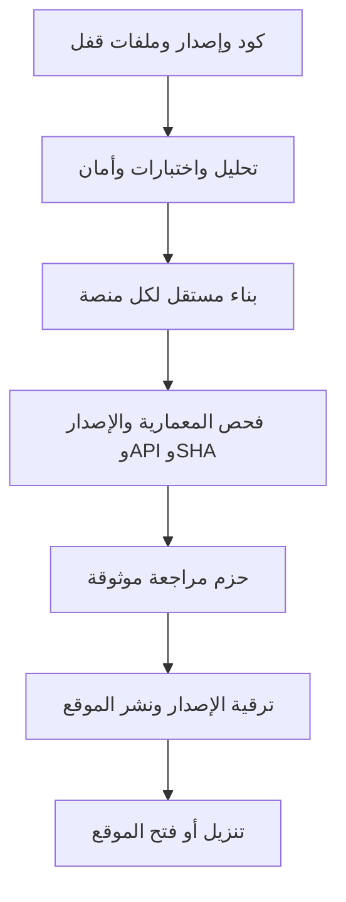
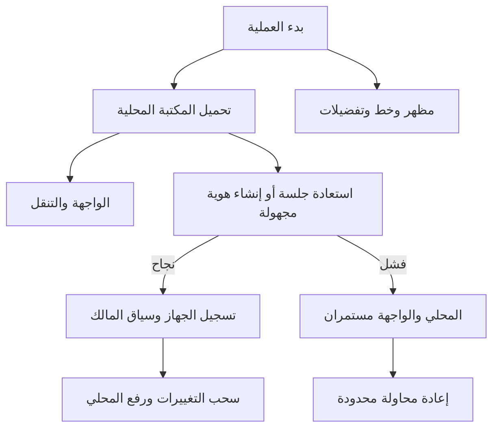
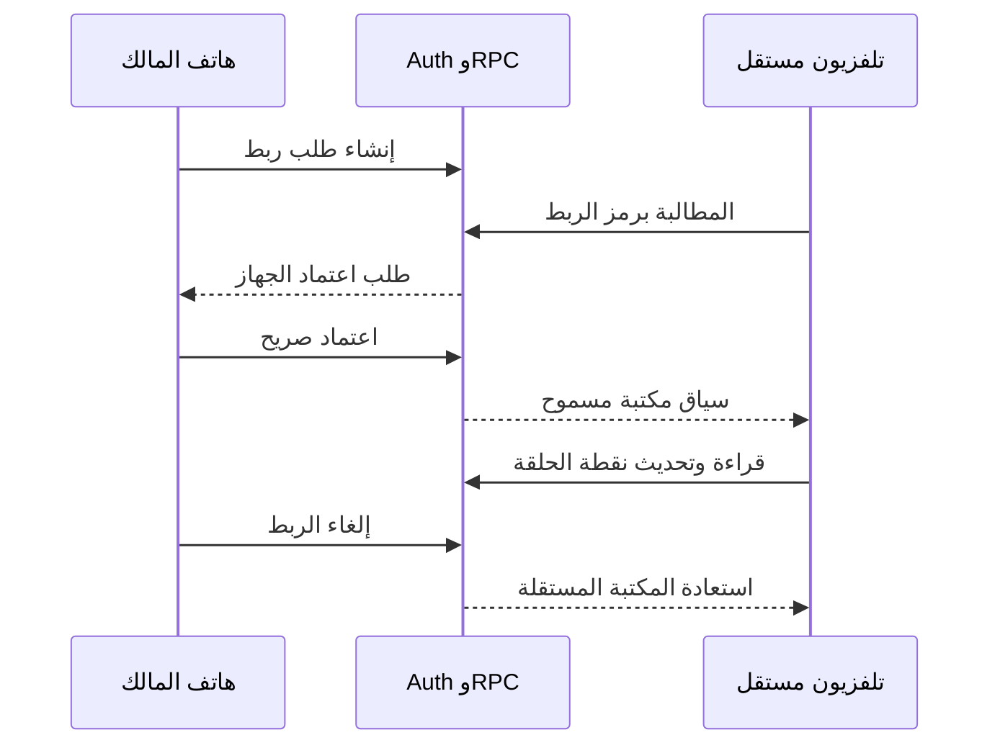
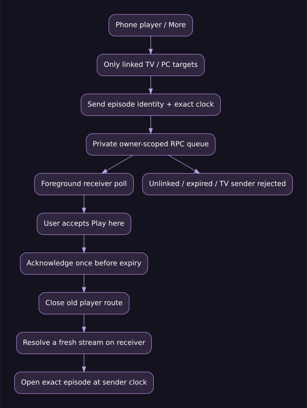
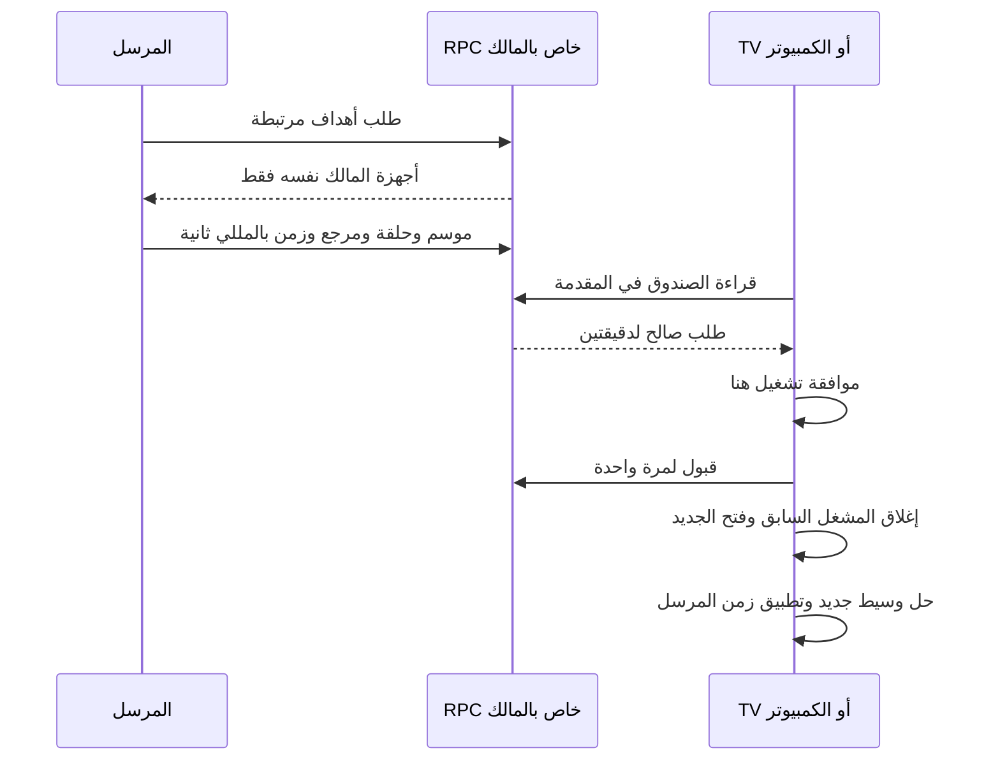
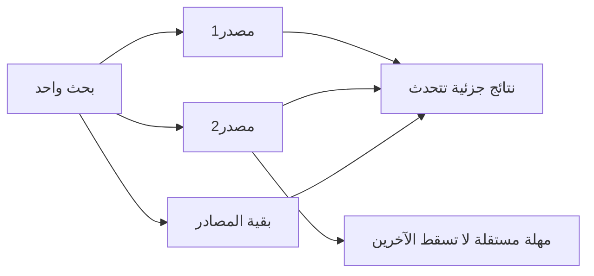
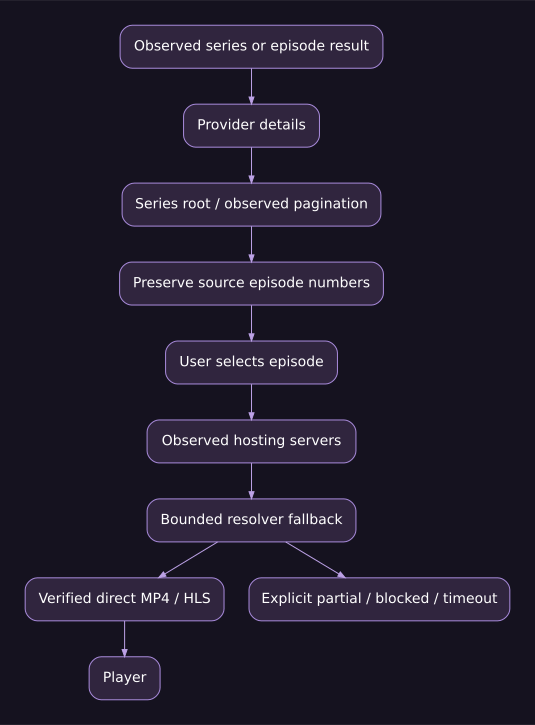
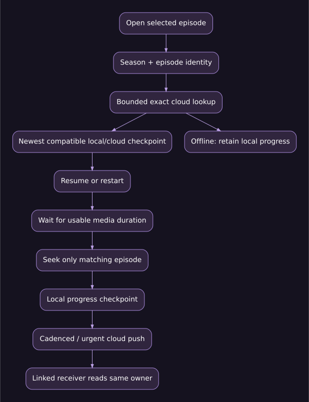
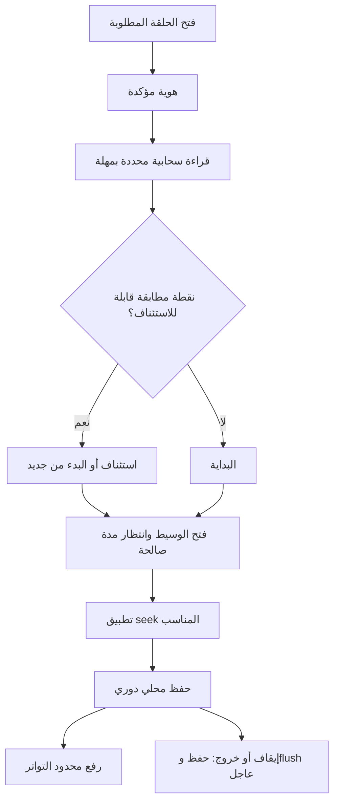
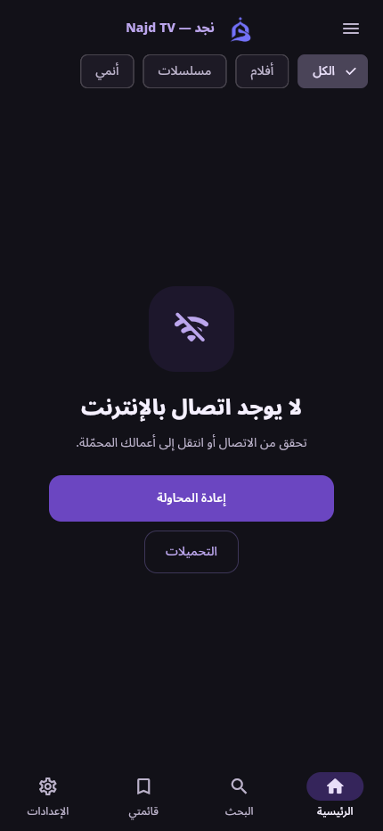

# نجد TV — خريطة التشغيل والمنطق 2.0.4

مرجع تشغيل النسخة 2.0.4+204، يكمل [مرجع البناء والكود](BUILD_AND_CODE_REFERENCE.md). الخرائط صور تقنية مشتقة من المسارات الفعلية، وليست لقطات مزعومة لأجهزة. سجل الدوال الآلي يتيح الوصول إلى موضع التنفيذ، ولا يثبت وحده صحة كل فرع.

## 1. ما يحدث قبل التنزيل

يتضمن العميل عنوان API وإعداد Supabase العام والثيم والأصول المسموحة، ولا يتضمن سر الخدمة أو كلمة الإدارة. تهيأ الدوال والمنح والفهارس على قاعدة البيانات قبل وصول العميل الذي يحتاجها. تغيير اسم العرض لا يبرر تغيير معرف التطبيق التاريخي، لأن ذلك قد ينشئ تثبيتًا منفصلًا عن بيانات المستخدم.

الموقع: https://th-505.github.io/NajdTV/ . الخادم: https://najdtv.onrender.com . Supabase خدمة مستقلة للهوية والمكتبة والفهارس الخاصة بالخادم. عمل الموقع لا يثبت عمل القاشط؛ وعمل الفيديو لا يثبت وصول نقطة التوقف إلى السحابة.

## 2. أول تشغيل

`main()` يشغّل `MitvApp` دون انتظار شبكة. ينشئ المخزن المحلي، ويطلق تحميل المظهر والتفضيلات والخطوط دون حجب. بعد جاهزية المخزن يبدأ `CloudLibrarySync`. يعرض `FutureBuilder` مؤشرًا أثناء تحميل المحلي، ثم ينشئ Shell. فشل Supabase لا يصبح شرطًا يمنع دخول الواجهة.

المقدمة ذات مؤقت وخيار متابعة متأخر؛ ليست نافذة تسجيل دخول. المظهر والخط محفوظان محليًا. فشل التخزين المحلي حالة مختلفة عن انقطاع الشبكة؛ لا ينبغي تسميته «لا إنترنت». بيانات صفحة غير متاحة ليست دليلًا أن المصدر خالٍ من الأعمال.

## 3. الهوية وربط الأجهزة

لكل تثبيت جلسة Supabase مجهولة عند توفر الخدمة، دون نموذج دخول يدوي. auth UID هو هوية التفويض، وليس UUID الجهاز المحلي. غير المرتبط يملك مكتبة مستقلة، بما فيها TV. لا تشترك أجهزة الشبكة نفسها في السجل تلقائيًا.

TV يستقبل الربط ويطالب به ويفصله؛ لا يعرض إنشاءه أو إرساله أو اعتماده. يمنع عقد العميل أيضًا استدعاءات الإنشاء والاعتماد لهدف TV قبل الشبكة. هذا قيد في التطبيق، وليس توثيقًا عتاديًا؛ حماية البيانات تعتمد جلسة المالك والمنحة على الخادم.

المنحة الأسبوعية تختلف عن الدائمة، ومدة المنحة تختلف عن عمر كاش المصدر. إلغاء الربط يعيد عزلة الجهاز. مسح بيانات التطبيق أو إعادة تثبيته قد يفقد الجلسة المجهولة؛ لا تعدها حساب استرداد دائمًا. مسح كاش التصفح لا ينبغي أن يمسح هذه الجلسة.

المكتبة والسجل يزامنان تلقائيًا وفق الدورة. إضافة إليهما، يوجد إرسال تشغيل من «المزيد»: يختار المستخدم التلفزيون أو الكمبيوتر المرتبط، وتصل نافذة طلب تشغيل عند نفس الموسم والحلقة والزمن. يقبل المستقبل «تشغيل هنا» أو يتجاهل. يفتح التطبيق وسيطًا جديدًا على المستقبل دون نقل رابط فيديو مؤقت بين الجهازين.

TV مستقبل فقط، ويمنع الخادم إرساله أيضًا بحسب النوع المسجل. الهاتف لا يتوقف تلقائيًا لمجرد إرسال طلب لم يوافق عليه الطرف الآخر؛ رسالة المرسل تصف الطلب ولا تدعي أنه بدأ التشغيل. لا يوجد بث شاشة أو ريموت مستمر في هذه الميزة. فشل وسيط المصدر على الجهاز المستقبل يظل خطأ تشغيل عاديًا ولا تعالجه إعادة تمرير رابط منتهي.

يفحص المستقبل الصندوق كل8 ثوان في المقدمة، ويتوقف في الخلفية ويؤخر الإعادة30 ثانية بعد الخطأ. الطلب المقبول لا يعاد، والمنتهي لا يفتح، وفصل الربط يبطل الوصول. الجلسة المجهولة تبقى محلية؛ فقدانها بعد مسح بيانات التطبيق أو إعادة التثبيت قد ينشئ هوية جديدة. مسح كاش التصفح وحده لا يمسحها.

## 4. الرئيسية والبحث والتفاصيل

Shell يدير الصفحات. CatalogPage يحمل الأقسام والتحديث والصفحات التالية، وSearchPage يدير الطلب والفلاتر. openDetails ينشئ جلسة browserSession مستقلة عند وجود discoveryScope=beta ويغلق الجلسة المؤقتة بعد العودة.

في نجد، يوفر TMDB بيانات العرض ثم يبدأ البحث عن مصادر التشغيل. لغة الواجهة العربية لا تعني أن عنوان الفيلم الإنجليزي يجب ترجمته دائمًا؛ تبديل لغة بيانات العمل أمر مستقل. صفحة الفنان وأعماله لها بياناتها وحالات فشلها؛ فشل TMDB لا يعني أن الفنان بلا أعمال.

في بيتا، يختار المستخدم المزود، وتأتي الأقسام والبحث والتفاصيل والحلقات من المصدر نفسه. لا يحتاج ترقيم الحلقات إلى تحويل TMDB. هوية المزود والمرجع تحفظ استقلال العمل؛ النسخة المدبلجة ليست نسخة مترجمة تلقائيًا. موسم من20 حلقة في مصدر لا يساوي موسمين10+10 بلا دليل.

## 5. البحث المتوازي والتجميع

البحث في20 مصدرًا بالتزامن ممكن. التوازي هو بدء مهام مستقلة ضمن حدود المسارات والمضيف والطابور، وليس ضمان20 نتيجة ناجحة فورًا. يبدأ وصول نتائج السريع بينما يتأخر غيره. فهرسة صفحات مصدر واستخراج مشغلاته مرحلتان إضافيتان لهما حدود، وليستا20 طلبًا بلا سقف لكل نتيجة.

الصور السابقة أظهرت عشرات بطاقات لحلقات مايسيما نفسها. هذه ليست36 مصدرًا مستقلًا. التجميع يجب أن يحافظ على العمل والنسخة والموسم، ويعرض داخله الحلقات بأرقامها المرصودة. رابطان للحلقة14 بديلان للحلقة نفسها، ولا يجوز تحويلهما إلى حلقتين جديدتين. عند اختلاف النسخ أو اللغة أو الفهرسة تبقى النسخ منفصلة.

حالة «استغرق الفحص وقتًا أطول» لا تثبت انقطاع الإنترنت. السبب قد يكون DNS أو رفض HTTP أو طابورًا أو استخراج مشغل أو مهلة. عدد المصادر الجارية والمنتهية والمتعذرة أوضح من إيقاف كل النتائج بسبب مصدر واحد.

## 6. دخول نتيجة حلقة بدل جذر مسلسل

نتيجة «الحلقة19» قد تكون رابط حلقة فقط. المحلل المتخصص يفحص تفاصيلها والروابط المرصودة لجذر المسلسل وقوائم الحلقات وصفحات التالي والسابق والصفحات المتعددة. عند العثور على المجموعة يعرض المواسم والحلقات. عنوان نتيجة البحث وحده لا يكفي لإعلان اكتمال فهرس المسلسل.

قوائم AJAX المعلنة تستخدم عبر عقد تم التحقق منه، لا عبر تنفيذ شيفرة الصفحة أو تخمين روابط. لا تفترض بنية HTML موحدة لكل المواقع. يحفظ الفهرس المرجع والرقم واللغة والنسخة. إذا انقطع الاستكمال تظهر حالة partial قابلة للمتابعة، ولا تعلن حلقة واحدة باعتبارها كامل العمل.

زر «تحديث الآن» في نسخة مزود يعيد فهرسة تلك النسخة ويتجاوز كاشها فقط. لا يعيد البحث في كل المواقع، ولا يستخرج فيديو جميع الحلقات خلفيًا لمجرد تحديث الفهرس.

## 7. من التشغيل إلى الوسيط

يختار المسار حلقة صحيحة، ويجلب خوادمها المرصودة، ويحل رابط الخادم، ثم يتحقق من النوع والحاوية والصلاحية والترويسات. iframe أو HTML لا يمر على أنه MP4. لا يحتاج المستخدم إلى قائمة طويلة من حالات المحاولة في الواجهة الأساسية؛ تبقى المصادر متاحة عند الحاجة.

المحلل المشترك يحاول حتى32 هدفًا ملاحظًا افتراضيًا بمحاولتين متزامنتين وميزانية40 ثانية للمرحلة. السقوف64 هدفًا و4 محاولات و60 ثانية. هذه ليست مهلة كاملة للعملية؛ جلب قائمة الخوادم وفحص الحاوية لهما حدود مستقلة. إذا انتهت الميزانية قبل استكمال الأهداف يرجع MEDIA_SERVER_SCAN_PARTIAL، ولا يختلق «لا فيديو» نهائية.

Cookie وCSRF والجلسة العامة تمر إلى أصل المصدر فقط. التحويل إلى استضافة أخرى ينزع بيانات الاعتماد، وتحويل جسم POST حساس إلى أصل مختلف مرفوض. التصحيح في CimaNow يعيد استعمال سياق جلسة عامة سبق أن استخرجها المحلل؛ لا يتجاوز دخولًا أو WAF. User-Agent طبيعي لا يضمن قبول الموقع لكل بيئة.

رابط الفيديو الموقع قد ينتهي ولو احتفظنا بالفهرس7 أيام. يعاد حله عند انتهاء الصلاحية؛ لا يرفع مع Cookie أو توكن إلى سجل المستخدم أو تقارير Gemini العامة. نجاح HEAD أو التحقق من الحاوية لا يضمن codec كل جهاز.

## 8. نقطة التوقف والاستئناف

مثال قبول: S1E1 عند02:00، وS1E2 عند04:00، وS2E1 عند06:00. يجب حفظ ثلاث نقاط، حتى إن كان id المصدر فارغًا للثلاثة. هوية الموسم والحلقة تمنع خلطها. مرجع مجهول مختلف يبقى مميزًا دون اختراع رقم.

قبل التشغيل تقرأ حتى ثلاثة مفاتيح محددة للتوافق مع القديم، ولا يسحب كامل السجل قبل كل فيديو. النقطة القديمة الأحدث قد تغلب القياسية الأقدم إذا تطابق السياق. تومبستون أحدث يمنع عودة السجل القديم. القراءة المحددة لا تقدم مؤشر السحب العام فتسقط تغييرات أخرى.

إذا تعطل السحابي، يبقى المحلي صالحًا ولا يستعير زمن حلقة أخرى. إذا كانت الحلقة مكتملة تطبق سياسة الاكتمال بدل استئناف آخر ثانية بلا نهاية. البدء من جديد تحديث مشروع؛ اعتماد أعلى زمن على الإطلاق سيكسر ذلك، لذلك يعتمد الدمج التحديث الأحدث.

أثناء التشغيل ترفع التغييرات بإيقاع5 ثوان وفق شروط المزامنة، ويجري polling أمامي كل30 ثانية. عند الإيقاف أو الخروج يطلب flush عاجلًا بأفضل جهد. قتل النظام للعملية أو انقطاع الشبكة قد يمنع وصول آخر ثوان إلى الجهاز الآخر؛ الحفظ المحلي والطابور ضروريان. لا يرسل التطبيق كلframe إلى قاعدة البيانات.

التبديل اليدوي الصريح بين مزودين يحتفظ بزمن المشاهدة حسب السياسة القائمة. الحلقة التالية تقرأ نقطتها الخاصة. الاحتفاظ بالدقيقة20 عند تبديل نسخة لا يثبت أن حلقة TMDB1 مساوية لحلقة المصدر21.

## 9. التحكم وPiP والتكيف

أزرار الحلقات والصوت والترجمة والمزيد تجمع التحكم؛ السرعة المؤقتة بالضغط المطول قابلة للضبط. ترويسات العرض والنصوص داخل المشغل يجب أن تراعي خلفية الفيديو السوداء في الثيمين. زيادة مساحة لمس زر لا تعني تغطية الفيديو بطبقة معتمة طويلة.

PiP جسر نظام على Android/iOS ومسار متصفح حيث يدعم. وجود الدالة لا يساوي إذن النظام أو دعمه لكل مقطع. يحتاج اختبارًا فعليًا بحسب الجهاز والإصدار وحالة التشغيل. لا ننسب اعتماد PiP لويندوز أو ماك من نجاح البناء وحده.

التكيف يعتمد viewport ونسبة البكسل وsafe insets وtext scale، مع ملف تخطيط محلي مخفي. لا نستنتج شاشة50 بوصة من حجم النافذة. TV يحتاج فحص الريموت والتركيز والرجوع ومقروئية النص، وليس تغيير عرض المتصفح فقط.

## 10. التنزيل والكاش والتخزين

ملف التنزيل محلي، ومزامنة القائمة والسجل لا تنقله إلى TV. DownloadService يسجل المهمة لدى منسق الإلغاء والتنظيف، ويتحقق من الملف ويحافظ على الجزئي عند قابلية الاستكمال؛ إعادة الاتصال محدودة. فتح رابط خارجي ليس تنزيلًا ناجحًا.

التنزيل المرتبط بهوية عمل وحلقة يفتح بسياقه. رابط خام بلا هوية مكتبة قد يعمل بـpersistProgress=false؛ لا يختلق التطبيق له هوية من الاسم. الملف المفقود يختفي من قائمة المكتمل بدل فتح شيء مختلف. إلغاء الجاري غير حذف المكتمل؛ حذف الملف من الجهاز لا يمسح قائمتي أو سجل الحساب.

التشغيل عبر HLS مختلف عن تنزيله دون اتصال؛ offline HLS غير مدعوم في هذه النسخة. أرقام128/3.6/88.6/35.8GB في مرجع التصميم أمثلة، لا قياسات لكل جهاز. شريط التقدم زمني/بايتات من اليسار إلى اليمين داخل RTL.

الكاش يقلل جلب الصور والفهارس. مسح كاش التصفح لا يمسح الجلسة أو المكتبة. صلاحية الفهرس غير صلاحية رابط الفيديو. تعديل الدومين مركزي من لوحة الإدارة، لكن تغير بنية الموقع قد يحتاج تعديل محلل على الخادم، وليس عنوانًا جديدًا فقط. تستفيد النسخ المثبتة دون تحديث إذا بقي عقد API مدعومًا.

## 11. تمييز الأعطال

| المشاهدة | الدليل الممكن | ما يجب تفاديه |
|---|---|---|
| ACCESS_BLOCKED أو403 | رفض من المضيف أو الحماية لهذه البيئة | تسميته محتوى غير موجود أو تجاوز التحدي |
| NETWORK_TIMEOUT | مهلة مرحلة، افحص الاتصال والرد والطابور | الجزم أن القاشط لا يجد الحلقات |
| EMPTY_RESULT | لا نتيجة محللة في هذه العينة | الجزم أن الموقع فارغ |
| DIRECT_MEDIA_NOT_FOUND | لا وسيط متحقق من الأهداف المجربة | إعادة iframe كفيديو |
| MEDIA_SERVER_SCAN_PARTIAL | استكمال المرايا لم ينته | إعلان عدم وجود مصدر نهائيًا |
| فهرس جيد وفيديو فاشل | مرحلة استخراج أو expiry أو codec أو ترويسات | إعادة إنشاء DB دون دليل |
| صورة مفقودة | رابط صورة أو حماية أو تنسيق | استنتاج فشل الفيديو من الصورة وحدها |
| نجاح الحاوية وفشل الجهاز | codec/CORS/نظام محتمل | اعتماد كل الأجهزة من HEAD200 |

## 12. فحص المصادر الحي وحدوده

العينة من بيئة الفحص بمهلة5 ثوان للطلب وأربعة فحوص متزامنة. ليست مصفوفة فيلم ومسلسل لكل مصدر ولا اعتمادًا دائمًا. اختلاف نجاح Ahwak على الإنتاج عن مهلة البيئة المحلية يمنع الخلط بين مشكلة الشبكة ومشكلة المحلل. أعيد الفحص بعد التصحيح: اجتازت6 مصادر العينة في كلا المسارين، وكانت10 جزئية و6 متعذرة. يعرض الجدول النتيجة الأحدث، و[التقرير الآمن](assets/provider-verification-204.json) يحفظ مراحلها؛ لا يعني نجاح العينة اكتمال كل الأعمال.

| المصدر | نجد | بيتا | الدليل المرحلي المختصر |
|---|---|---|---|
| ahwak | passed | passed | اجتازت العينة المحددة |
| brstej | failed | failed | catalog: UNSAFE_URL |
| fosta | passed | passed | اجتازت العينة المحددة |
| mycima | passed | passed | اجتازت العينة المحددة |
| akwam | partial | partial | media: NETWORK_TIMEOUT |
| cimanow | partial | partial | media: DIRECT_MEDIA_NOT_FOUND |
| shahid4u | partial | partial | search: EMPTY_RESULT |
| moviztime | partial | partial | media: DIRECT_MEDIA_NOT_FOUND |
| egydead | failed | failed | catalog: NETWORK_TIMEOUT |
| ipauniverse | partial | partial | media: DIRECT_MEDIA_NOT_FOUND |
| 3cktv | passed | passed | اجتازت العينة المحددة |
| anime4up | partial | partial | search: EMPTY_RESULT؛ media: SERVER_EXTRACTION_FAILED |
| qfilm | partial | partial | media: SERVER_EXTRACTION_FAILED |
| ristoanime | passed | passed | اجتازت العينة المحددة |
| arabseed | failed | failed | catalog: EMPTY_RESULT |
| mewsry | partial | partial | media: DIRECT_MEDIA_NOT_FOUND |
| witanime | failed | failed | catalog: ACCESS_BLOCKED |
| egydead_live | failed | failed | catalog: EMPTY_RESULT |
| yallashoot | partial | partial | media: DIRECT_MEDIA_NOT_FOUND |
| 3isk | partial | partial | media: DIRECT_MEDIA_NOT_FOUND |
| alooy | passed | passed | اجتازت العينة المحددة |
| laroza | failed | failed | catalog: NETWORK_TIMEOUT |

لا تعلن أن22 مصدرًا تعمل من نجاح بعض العينات. عند حجب أو تغير موقع اطلب الرابط الرسمي بعد تحديد المصدر والمرحلة. لا تبدله بآخر خلسة. ضبط الدومين مختلف عن تعديل بنية المحلل، وكلاهما على الخادم ما دام عقد العميل محفوظًا.

## 13. سيناريوهات قبول قابلة للتكرار

1. احفظ النقاط الثلاث في المثال ثم أعد التشغيل وافتح كل حلقة من السجل؛ تعرض نقطتها فقط.
2. افتح الحلقة2 مع WatchEntry قديم من الحلقة1؛ لا يظهر زمن الحلقة1 ولا يطبق seek عليه.
3. اربط TV باعتماد الهاتف، واقرأ نقطة الحلقة ثم حدّثها؛ بعد الإلغاء تعود عزلة المكتبة.
4. اقطع الشبكة بعد حفظ محلي، ثم أعدها؛ تصل التغييرات دون عاصفة إعادة محاولات.
5. اجعل سجلًا قديمًا أحدث من القياسي؛ يؤخذ الأحدث المطابق. ضع حذفًا قياسيًا أحدث؛ لا يعود القديم.
6. شاهد أكثر من80 حلقة؛ لا يحذف ذلك نقاط الأقدم من السحابة آليًا.
7. أفشل أول8 مرايا واجعل التاسعة صالحة؛ يصل إليها المحلل، وتظهر partial عند نفاد الميزانية.
8. حوّل الطلب إلى أصل آخر؛ لا تتسرب بيانات الاعتماد أو POST الحساس.
9. انتقل من بيتا إلى نجد؛ تبقى الهوية والترقيم والطوابير منفصلة.
10. افحص فعليًا الريموت والصوت والترجمة وPiP والخروج المفاجئ، إضافة إلى اختبارات الحزم.

## 14. أين نقرأ الكود عند المشكلة؟

| المشكلة | نقطة البداية ثم المتابعة |
|---|---|
| زمن حلقة خاطئة | watch_identity ثم matchesEpisode ثم resumeEntry ثم PlayerPage._savedEntry |
| المحلي صحيح ولا يصل TV | الجلسة والمنحة، pendingCloudRows، push/pull ثم RPC النقطة |
| فهرس صحيح ووسيط فاشل | scrapeServers ثم resolveStream ثم probe ثم expiry وجسر المشغل |
| تلوث بيتا بمسار نجد | browserSession وscope ومفتاح النسخة والترقيم المرصود |
| CPU مرتفع | العاملان ومعدل claim وbackoff وخطة أكثر استعلام زمنًا |
| الموقع قديم بعد بناء APK | نشر public-web وmanifest وbase-href وsourceSHA والكاش |

## 15. فروق المنصات

| الهدف | الفرق الفعلي | التحقق المطلوب |
|---|---|---|
| AndroidMobile | ARM64 ولمس وجسور وملفات محلية | اختبار أجهزة فعلية بعد فحص APK |
| AndroidTV | ARMv7 وتركيز وريموت وربط مستقبل | اختبار TV ومسافة المشاهدة |
| iPhone/iPad | IPA غير موقعة وجسر iOS | توقيع خارجي وتجربة PiP فعلية |
| Windows | x64 مثبت ومحمول | codec وملفات وصلاحيات النظام |
| macOS | DMG بتوقيع ad-hoc | ليس notarized؛ فحص Gatekeeper |
| Web | CORS ومتصفح وbase-href وتخزين متصفح | ليس مساويًا لملفات التنزيل الأصلية |

الواجهة العربية لا تعني دعم كل لغات الواجهة؛ تبديل بيانات TMDB أمر مختلف. الملفات غير الموقعة توصف بدقة، ولا تعرض IPA كتثبيت مباشر دون توقيع. ليست لدينا حزمة Linux أصلية في هذه المجموعة.

## 16. القرارات والحدود

الاختبارات الآلية ومراجعة المصدر والحزم شرط إطلاق، ولا تكفي لاعتماد كل مواقع الطرف الثالث أو أجهزة السوق. لم ينفذ في هذه الدفعة بث شاشة أو ريموت مستمر أو offline HLS أو اعتماد أجهزة فعلي أو مصفوفة فيلم ومسلسل لكل مصدر. إرسال طلب المشاهدة بالموسم والحلقة والزمن منفذ ومستقل عن ذلك. هذه بنود متابعة صريحة، وليست مزايا مخفية مكتملة.

مرجع الدوال في [الملف الأول](BUILD_AND_CODE_REFERENCE.md) وملفي JSON؛ هذه الخريطة للتسلسل والقرار، والجرد للوصول إلى الكود، والاختبارات للأمثلة القابلة للتكرار. عند تغيير العقد حدث الثلاثة معًا.

## 17. نموذج مرئي من الحزمة الجديدة

لقطة فعلية من حزمة Web المفحوصة 2.0.4 في معاينة Chromium محلية، وليست تصويرًا لآيفون أو دليل نشر الإنتاج. لم يصل طلب الصفحة إلى البيانات في هذه المعاينة فظهرت حالة الشبكة؛ لا تستخدم اللقطة لإثبات أن مزودي الإنتاج محجوبون. توضح اختلاف حالة الواجهة عن تشخيص HTTP المرحلي الموضح أعلاه.

## 18. تحديث فحص CimaNow

في إعادة الفحص التالية نجح جلب50 بطاقة من قسم الأفلام و50 من المسلسلات، مع وجود عنوان في التفاصيل. لم ينتج فحص الوسيط رابطًا متحققًا، وأعاد طلب مستقل لصفحة عينة HTTP403 مع ACCESS_BLOCKED. لذلك لا يوصف المصدر بأنه مصلح حيًا بالكامل. نجاح اختبار جلسة Cookie/CSRF يثبت عقد المحلل في fixture، أما توفر صفحة المضيف فدليل منفصل ومتغير. الفحص السابق ذو المهلة لا يثبت أن الموقع ميت أو خالٍ من المحتوى.

## 19. دليل اختبار الإرسال

نجح اختبار حي لثلاث جلسات Supabase مؤقتة: إخفاء الأهداف غير المرتبطة، ظهور TV المرتبط فقط، وصول S2E3 عند1200456ms، منع قراءة جهاز آخر، منع إرسال TV من الخادم، عدم إعادة المقبول، وإزالة الهدف عند إلغاء الربط. أغلقت جلسات الاختبار وحذفت حساباتها المحددة فقط. يختبر Widget نافذة الموافقة والتشغيل مرة واحدة وتوقف polling في الخلفية، واختبار هدف TV يثبت منع الإرسال قبل الشبكة. هذا لا يحل محل تجربة فعلية بين هاتف وتلفزيون لفحص codec والريموت وPiP.

## 20. اختلاف بيئة الإنتاج عن الفحص المحلي

فحص إضافي عبر API الإنتاج تحقق من TMDB وقاعدة البيانات وخدمة الترجمة. عند انتهاء ميزانية متابعة180 ثانية انتهى46 من47 فحصًا، وبقي فحص3isk في بيتا جاريًا؛ لا نعدّه نجاحًا أو فشلًا نهائيًا. اختلفت بعض النتائج عن البيئة المحلية، ومنها حجب بعض المضيفين من Render. [اللقطة المرحلية الآمنة](assets/production-services-204.json) منفصلة عن جدول عينات البيئة المحلية حتى لا نخلط سلامة المحلل مع توفر المضيف حسب الشبكة. هذا الفحص التشخيصي محدود بأربع مهام متزامنة، بينما البحث عن العمل يستخدم مسارات البحث المتوازية المستقلة؛ ليسا حدًا واحدًا.

## 21. حزمة iPhone المتوافقة

فحص ملف2.0.4 الأصلي أثبت سلامة CRC ومطابقة SHA-256، ووجود24 ملفًا تنفيذيًا لأجهزة iOS الحقيقية بمعمارية arm64، وحد أدنى iOS15. لذلك لم يثبت أن أصل المشكلة تلف الأرشيف. وُجد ملف App.framework/App بصلاحية0644 وبعض الأطر بتوقيع داخلي؛ أضيفت حزمة منفصلة Najd-TV-iPhone-Unsigned-Compatible.ipa لتحسين توافق أدوات التوقيع.

تستخدم scripts/ios_package_compat.py أدوات Apple على macOS لفصل حاوية FAT ذات arm64 إلى ملف رقيق، وإزالة التوقيعات الداخلية، وضبط جميع الملفات التنفيذية إلى0755، وإعادة ZIP مع حفظ صلاحياته. اجتازت الحزمة الجديدة فحص CRC والبصمة وفحص24 ملفًا تنفيذيًا بلا توقيع وبمنصة iPhoneOS. هذه عملية تغليف لا تغيير لكود المشغل، ولا تجعل IPA قابلًا للتثبيت دون توقيع. لا يوجد اعتماد تثبيت على جهاز فعلي حتى ترد رسالة أداة المستخدم وتتم التجربة.

رابط الحزمة والتقرير متاحان في إصدارv2.0.4؛ بقي الملف الأصلي دون استبدال لحفظ الأدلة. تتضمن الحزمة تقريرًا يربط بصمة الإدخال بالإخراج.
